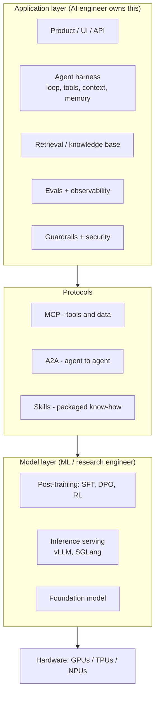
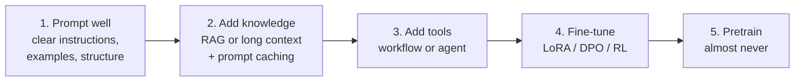

# 1. The landscape: what an AI engineer does in 2026

> **Goal of this chapter.** Build a map before learning the details: which layers exist, which ones an AI engineer owns, and how to decide between prompting, RAG, fine-tuning and agents.

---

## 1.1 From "train a model" to "build a system around a model"

| Era | Main work | Typical skill |
|---|---|---|
| Classical ML (≈2012–2020) | collect data, engineer features, train a model per task | scikit-learn, XGBoost, PyTorch |
| Early LLM apps (2023) | prompt a general model, stuff documents into the prompt | prompt engineering, basic RAG |
| Agents (2024–2025) | give the model tools and let it loop | tool calling, LangGraph, evals |
| **Harness era (2026)** | build long-running, reliable agent systems: context, memory, sandboxes, protocols, evals, security | **context engineering, system design, evaluation** |

The key change: frontier models are good enough that **most failures are system failures**. The model never saw the right document, the tool description was ambiguous, the context filled up with noise, or nobody measured anything. Fixing these is AI engineering.

---

## 1.2 The stack

Most "AI Engineer" job ads focus on the **application layer plus protocols**. "ML Engineer / Research Engineer" ads add the **model layer**. Senior roles expect you to reason across every layer. For example: "this agent is slow because each step re-sends 80k tokens and misses the prefix cache."

---

## 1.3 The decision ladder: what to try first

Always take the cheapest step that works:

| Problem | Right tool | Wrong tool |
|---|---|---|
| Model doesn't know your company's documents | RAG / long context | fine-tuning (bad at adding facts, and they go stale) |
| Model must act (book, query DB, write code) | tools + agent loop | bigger prompt |
| Output format/style inconsistent at huge volume | fine-tune a smaller model | endless prompt tweaks |
| Need 10× lower cost or latency on a narrow task | distill into a small model | using the frontier model forever |
| Need better multi-step reasoning on a verifiable task | RL with verifiable rewards | SFT on a few examples |

**Interview tip:** when asked "how would you build X?", walk down this ladder out loud and say *why* you stop where you stop.

---

## 1.4 What changed in 2026 (one-paragraph summary)

- **Agents run for hours and days on hosted infrastructure.** Anthropic's Managed Agents (April 2026) and Google's Gemini API Managed Agents (I/O, May 2026) run the loop server-side. The architecture separates the model and its loop (brain), the sandboxes (hands) and a durable event log (session) (ch. 4).
- **The protocols matured.** MCP's 2026-07-28 spec made the protocol **stateless**. A2A reached v1.0 (January 2026). Anthropic's SKILL.md format was adopted by OpenAI, Google, Microsoft, Cursor and others. MCP and A2A now sit under the Linux Foundation's **Agentic AI Foundation** (ch. 5).
- **Memory became its own architectural component** with standard benchmarks (LoCoMo, LongMemEval, BEAM) (ch. 3).
- **RAG research moved to "retrieve during reasoning"** and to judging retrieval by *coverage* rather than per-chunk relevance (ch. 2).
- **Evaluation research turned on the judges themselves.** New benchmarks show LLM judges are unreliable on agent traces unless calibrated (ch. 6).
- **Post-training = RL.** GRPO and its successors (DAPO, Dr.GRPO, GSPO) plus agentic multi-turn RL (ch. 7).
- **Inference:** speculative decoding became standard. The drafter now proposes a whole block of tokens in parallel (P-EAGLE, DFlash) (ch. 8).
- **Security thinking matured.** A formal argument that prompt-level defenses can't be complete pushed the field toward architectural isolation (ch. 9).
- **Architectures:** hybrid attention/state-space models, very sparse MoE, and diffusion LMs (ch. 10).

---

## 1.5 The core toolbox (names you should recognise)

| Category | Tools |
|---|---|
| Model APIs | Anthropic (Claude), OpenAI, Google (Gemini), open-weight models via Together/Fireworks/Groq |
| Agent frameworks / SDKs | Claude Agent SDK, OpenAI Agents SDK, Google ADK, LangGraph, PydanticAI, LlamaIndex, DSPy, CrewAI |
| Retrieval | pgvector, Qdrant, Weaviate, Milvus, Elasticsearch/OpenSearch, LanceDB, Vespa; rerankers (Cohere, Voyage, BGE, Qwen3, mxbai) |
| Memory | mem0, Letta, Zep, Supermemory, Anthropic Memory for Managed Agents |
| Evals + tracing | Langfuse, LangSmith, Arize Phoenix, Braintrust, DeepEval, Ragas, Inspect (UK AISI), OpenTelemetry GenAI conventions |
| Fine-tuning | TRL, Unsloth, Axolotl, torchtune, verl / OpenRLHF (RL) |
| Serving | vLLM, SGLang, TensorRT-LLM, llama.cpp, Ollama, NVIDIA Dynamo, llm-d |
| Coding agents | Claude Code, OpenAI Codex, Gemini CLI, Cursor, GitHub Copilot agent |

You don't need all of them. Choose one from each row and learn it well.

---

## 1.6 Check your understanding

1. **Why is fine-tuning usually the wrong way to teach a model your company's documents?**
   Fine-tuning is bad at reliably storing new facts, the facts go stale as documents change, you can't cite sources, and it's expensive to redo. RAG or long context keeps knowledge fresh and citable.
2. **What does "the harness is the product" mean?**
   With strong base models, quality differences come mostly from the system around the model: context selection, tools, retrieval, memory, evals, error recovery.
3. **Give one reason to fine-tune even though RAG works.**
   Cost and latency at scale: distil a narrow task into a small model. Also, consistent format or style, and behaviours that are hard to prompt (for example tool-use policy).
4. **Name the three agent protocols/standards and what each connects.**
   MCP: agent ↔ tools and data. A2A: agent ↔ agent. Skills (SKILL.md): agent ↔ packaged procedural know-how.

---

## Sources
- Anthropic, *Building effective agents* (Dec 2024): https://www.anthropic.com/engineering/building-effective-agents
- Anthropic, *Scaling Managed Agents: decoupling the brain from the hands* (Apr 2026): https://www.anthropic.com/engineering/managed-agents
- Anthropic, *2026 Agentic Coding Trends Report*: https://resources.anthropic.com/hubfs/2026%20Agentic%20Coding%20Trends%20Report.pdf
- MCP blog, *The 2026-07-28 Specification*: https://blog.modelcontextprotocol.io/posts/2026-07-28/
- Chip Huyen, *AI Engineering* (O'Reilly, 2025): the best single book on this layer
