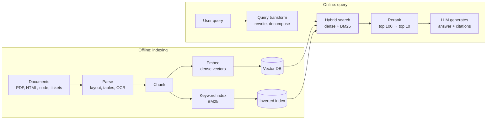
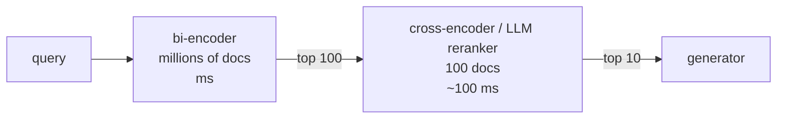
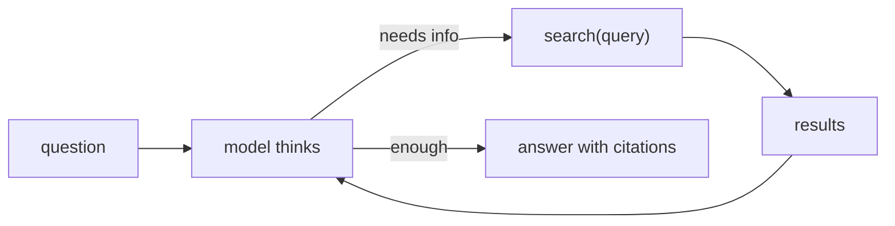

# 2. RAG and knowledge bases

> **Goal of this chapter.** Understand how a production knowledge base works end to end, which techniques give the biggest gains, and where research moved in 2026: retrieval during reasoning, coverage-based metrics, RL-trained retrievers, and RAG security.

> **Implement it:** [implementation/01-rag.md](implementation/01-rag.md) has step-by-step code, tuning parameters, common errors and how to improve.

> **Go deeper:** [techniques/01-chunking.md](techniques/01-chunking.md), [techniques/02-retrieval-and-rag-architectures.md](techniques/02-retrieval-and-rag-architectures.md) cover every alternative technique with pros, cons, evidence and a decision guide.

---

## 2.1 The basic pipeline

RAG = **Retrieval-Augmented Generation**: find relevant text, put it in the prompt, let the model answer from it.

Two numbers matter most:
- **Recall@k:** is the needed information anywhere in the top-k? If not, the model can't answer, whatever the prompt says.
- **Precision / noise:** how much irrelevant text did you add? Noise costs tokens and can mislead the model.

**Rule of thumb:** most RAG failures are **retrieval failures**, not generation failures. Measure retrieval separately (ch. 6).

---

## 2.2 Parsing and chunking

**Parsing** is underrated. A PDF table flattened into word soup can't be retrieved or read correctly. Use layout-aware parsers (Docling, Unstructured, LlamaParse, Azure/Google document AI), or skip text extraction entirely with vision-based retrieval (§2.7).

**Chunking strategies**

| Strategy | How | When |
|---|---|---|
| Fixed-size + overlap | e.g. 512 tokens, 10–20% overlap | baseline; fine for uniform prose |
| Structure-aware | split on headings, sections, functions (code), rows (tables) | documentation, code, contracts |
| Semantic | split where embedding similarity between sentences drops | unstructured long text |
| Parent–child (small-to-big) | retrieve small chunks for precision, return the *parent* section for context | most production systems |
| **Contextual retrieval** (Anthropic, 2024) | an LLM writes 50–100 tokens explaining where each chunk sits in its document; prepend before embedding **and** BM25 | chunks that are ambiguous alone ("revenue grew 3%" — *which company, which quarter?*) |
| **Late chunking** (Jina, 2024) | embed the *whole* document with a long-context embedder, then pool token vectors per chunk, so each chunk vector "knows" its context | similar goal to contextual retrieval, with no LLM calls |

Anthropic reported that contextual embeddings + contextual BM25 cut failed retrievals by **49%**, and by **67% with reranking added** (vendor numbers, on their test sets). With prompt caching the cost is small. This is the single most-copied RAG trick of the last two years.

---

## 2.3 Hybrid search

Dense vectors capture *meaning* ("car" ≈ "automobile") but miss *exact tokens* (error codes, product IDs, names). BM25 is the reverse. Use both, then merge the two lists.

**Reciprocal Rank Fusion (RRF):** for each document, `score = Σ 1 / (k + rank_in_list)`, with k ≈ 60. RRF needs no score calibration between the two systems, which is why it's the default.

Also know:
- **Learned sparse retrieval (SPLADE):** a neural model produces weighted keyword vectors. You get BM25-like exactness plus synonym expansion.
- **Metadata filters:** filter by date, tenant, permission and document type *before* ranking. This matters for multi-tenant access control.

---

## 2.4 Reranking

A **bi-encoder** (embedding model) encodes query and document *separately*: fast, but shallow. A **cross-encoder reranker** reads query and document *together*: slower, but much more accurate. Standard pattern: retrieve ~50–200 candidates cheaply, rerank to the top 5–20.

**Late interaction (ColBERT, and PyLate for training)** sits in between. It keeps one vector *per token* and scores with "MaxSim" (each query token finds its best-matching doc token). It's more accurate than one vector per chunk and cheaper than a cross-encoder, but it uses much more storage.

**2026 model landscape** (check the MTEB leaderboard. The headline score averages many tasks, so read the *Retrieval* column, nDCG@10):
- Embedders: Qwen3-Embedding (4B/8B) near the top of MMTEB; KaLM-Embedding-Gemma3-12B; BGE-M3 for multilingual; API options from Voyage, Cohere, OpenAI, Google.
- Rerankers: Qwen3-Reranker, mxbai-rerank-v2 (Apache 2.0), BGE-reranker, Cohere Rerank, Voyage rerank.
- Multimodal: Qwen3-VL-Embedding / Reranker (Jan 2026).

**Always benchmark on your own data.** Leaderboard rank often doesn't carry over to your domain.

---

## 2.5 Query transformation

| Technique | Idea |
|---|---|
| Rewrite | turn chatty follow-ups ("what about last year?") into standalone queries using the conversation history |
| Decomposition | split multi-hop questions into sub-queries, retrieve for each |
| HyDE | generate a hypothetical answer and embed *that* (answers look more like documents than questions do) |
| Multi-query | generate 3–5 phrasings, retrieve for each, fuse with RRF |
| Routing | choose which index/tool to query (docs vs SQL vs web) |

---

## 2.6 GraphRAG: when chunks aren't enough

Vector search answers *local* questions ("what is our refund window?"). It fails on *global* questions ("what are the main themes across 5,000 customer complaints?") and on multi-hop relationships ("which suppliers of our top customer also supply competitor X?").

**GraphRAG (Microsoft, 2024):** an LLM extracts entities and relationships into a knowledge graph, clusters it into communities, and pre-writes summaries per community. Global questions are answered from community summaries.
- **Costs:** expensive indexing (many LLM calls), harder to update.
- **Lighter variants:** LightRAG, and graph + vector hybrids. Some memory products (ch. 3) now do built-in entity linking instead of maintaining a full graph store.

**When to use:** entity-heavy domains (finance, legal, biomedicine, investigations) and summarisation across a whole corpus. For simple Q&A it's usually over-engineering.

---

## 2.7 Multimodal retrieval

**ColPali-style retrieval (2024 onward):** embed the *image of each page* with a vision-language model, using late interaction over image patches. No OCR and no parsing, and charts, tables and layout are kept. It's a strong choice for slide decks, scanned documents and financial reports. The 2026 Qwen3-VL-Embedding/Reranker family continues this line.

---

## 2.8 Agentic RAG: retrieval becomes a tool

Classic RAG retrieves once, before generation. Agentic RAG gives the model a `search` tool and lets it decide:
- *whether* to search at all
- *what* to search for, refining after reading results
- *when it has enough*
- *which source* (vector index, SQL, web, API)

Earlier milestones: Self-RAG (the model critiques its own retrievals), CRAG (corrective RAG: falls back to web search when retrieval is poor), and **Search-R1 (2025)**, which used RL to train models to interleave reasoning and search calls.

### 2026 research directions

1. **Retrieve *during* reasoning.** *When to Retrieve During Reasoning: Adaptive Retrieval for Large Reasoning Models* (arXiv 2604.26649). Reasoning models think for thousands of tokens. The question is at which point in that thinking a retrieval call pays off, instead of retrieving once up front.
2. **Coverage matters more than relevance.** *Beyond Relevance* (arXiv 2603.08819) studies how retrieval quality relates to the *information coverage* of the final answer. *MIGRASCOPE* (arXiv 2602.21553) proposes information-theoretic metrics for each retriever's redundancy, synergy and marginal contribution. **Takeaway:** ten near-duplicate relevant chunks are worse than five diverse ones. Consider diversity-aware selection (for example MMR, maximal marginal relevance).
3. **RL-optimized retrievers.** *R3* (arXiv 2510.24652, revised Jan 2026) trains the retriever with reinforcement learning *inside the RAG environment*, rewarding what helps the final answer rather than human relevance labels. It reports +5.2% over the original retriever.
4. **RAG security** (arXiv 2604.08304 is a taxonomy). Poisoned documents in the corpus can steer answers and inject instructions (ch. 9).

---

## 2.9 Long context vs RAG

Models with 1M+ token windows plus **prompt caching** make "just put everything in context" viable for small corpora.

| Use long context when | Use RAG when |
|---|---|
| corpus < a few hundred thousand tokens and fairly static | corpus is large or grows |
| questions need a holistic read (whole contract, whole codebase module) | questions are needle-like |
| you can cache the prefix and reuse it many times | per-user access control is required |
| | you need citations and freshness |

Caveat: **context rot.** Accuracy degrades as context grows, even inside the advertised window (Chroma's 2025 study). A 1M window doesn't mean 1M tokens of *useful* attention. Many systems use both: retrieve generously (say 50k tokens) and let the long-context model sort it out.

---

## 2.10 A production checklist

- [ ] Layout-aware parsing; tables kept as tables
- [ ] Structure-aware chunks + contextual retrieval or late chunking
- [ ] Hybrid search (dense + BM25/SPLADE) with RRF
- [ ] Reranker
- [ ] Metadata filtering for permissions *before* ranking
- [ ] Citations in answers; refuse when evidence is missing
- [ ] Retrieval eval set (recall@k, MRR) **separate** from end-to-end answer eval
- [ ] Incremental re-indexing, plus deletion (GDPR and stale documents)
- [ ] Poisoning defenses: treat retrieved text as untrusted data (ch. 9)

---

## 2.11 Check your understanding

1. **Why do we rerank instead of only using a better embedding model?**
   A bi-encoder compresses each document to one vector without seeing the query. A cross-encoder reads both together and can model fine-grained interactions. It's too slow for millions of documents but fine for 100 candidates.
2. **Your RAG system can't find "ERR_4012". What's the likely fix?**
   Add keyword/BM25 (or SPLADE) hybrid search. Dense embeddings are weak at exact rare tokens.
3. **What problem does contextual retrieval solve?**
   Chunks lose their document context ("the company", "this quarter"). Prepending an LLM-written context makes both the embedding and the BM25 entry carry that context.
4. **When is GraphRAG worth its cost?**
   For global or sensemaking questions across a whole corpus and multi-hop entity relationships. Not for simple fact lookup.
5. **What's the 2026 argument about "coverage vs relevance"?**
   Retrieved sets should be judged as a *set*: do they together cover the needed information? Redundant chunks score as relevant but add nothing.
6. **Name two differences between classic RAG and agentic RAG.**
   The model decides *whether/when* to retrieve and can *iterate* (reformulate, pick sources, stop when satisfied). Classic RAG retrieves once, up front, always.

---

## Sources
- Anthropic, *Introducing Contextual Retrieval* (Sep 2024): https://www.anthropic.com/news/contextual-retrieval
- Günther et al., *Late Chunking* (Jina AI, 2024): arXiv 2409.04669
- Edge et al., *From Local to Global: A GraphRAG Approach* (Microsoft, 2024): arXiv 2404.16130
- Faysse et al., *ColPali* (2024): arXiv 2407.01449
- Jin et al., *Search-R1* (2025): arXiv 2503.09516
- *Agentic RAG survey*: arXiv 2501.09136
- *Optimizing Retrieval for RAG via Reinforcement Learning (R3)*: arXiv 2510.24652
- *Revisiting RAG Retrievers: An Information Theoretic Benchmark (MIGRASCOPE)*: arXiv 2602.21553
- *Beyond Relevance: Retrieval and RAG Information Coverage*: arXiv 2603.08819
- *When to Retrieve During Reasoning*: arXiv 2604.26649
- *Securing RAG: A Taxonomy of Attacks and Defenses*: arXiv 2604.08304
- *Qwen3 Embedding*: arXiv 2506.05176 · *Qwen3-VL-Embedding/Reranker*: arXiv 2601.04720 · *PyLate*: arXiv 2508.03555
- Chroma, *Context Rot* (2025): https://research.trychroma.com/context-rot
- MTEB leaderboard: https://huggingface.co/spaces/mteb/leaderboard
