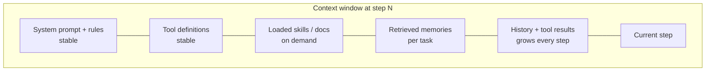
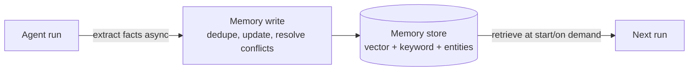

# 3. Context engineering and memory

> **Goal of this chapter.** Learn to treat the context window as a scarce budget, manage it across long agent runs, and design memory that persists across sessions.

> **Implement it:** [implementation/03-context-and-memory.md](implementation/03-context-and-memory.md) has step-by-step code, tuning parameters, common errors and how to improve.

> **Go deeper:** [techniques/03-memory.md](techniques/03-memory.md), [techniques/08-prompt-and-context-engineering.md](techniques/08-prompt-and-context-engineering.md) cover every alternative technique with pros, cons, evidence and a decision guide.

---

## 3.1 From prompt engineering to context engineering

**Prompt engineering** = writing good instructions.
**Context engineering** = deciding *everything* the model sees at each step: instructions, tool definitions, retrieved documents, memory, conversation history, tool results, and deciding what to *leave out*.

For an agent that runs 200 steps, the prompt you wrote is a few percent of the context. The rest accumulates: tool outputs, file contents, errors. If you don't manage it, quality degrades.

**Why it matters:**
1. **Context rot:** accuracy drops as context grows, even well inside the limit.
2. **Cost:** you pay for every input token on *every* step. A 100k-token context × 200 steps = 20M input tokens.
3. **Latency:** time-to-first-token grows with context length (prefill).

---

## 3.2 The core techniques

| Technique | What it does |
|---|---|
| **Keep the prefix stable** | put system prompt, tools and static docs first and never change them mid-run, so **prompt caching** hits (cached tokens cost ~10% and prefill faster) |
| **Just-in-time retrieval** | don't preload everything; give the agent tools (`grep`, `read_file`, `search`) to fetch what it needs. Claude Code works this way instead of indexing the repo into a vector DB |
| **Progressive disclosure** | show only *names + one-line descriptions* of skills/tools/docs; load full content when chosen (the SKILL.md design, ch. 5) |
| **Tool result trimming** | truncate or summarise large tool outputs; return IDs/paths instead of full blobs |
| **Compaction** | when near the limit, summarise the history into a compact state ("goal, decisions so far, open issues, files touched") and continue in a fresh context |
| **Structured note-taking** | the agent writes notes/progress files (e.g. `PROGRESS.md`, a todo list) outside the context and re-reads them, which survives compaction |
| **Sub-agent isolation** | send a noisy subtask (search 50 files) to a sub-agent with its own clean context; only its *summary* returns to the main agent |
| **Clearing old tool results** | drop raw outputs of old tool calls that are no longer needed |

**Cache-aware ordering matters.** Changing one token near the start of the context invalidates the cache for everything after it. So don't put timestamps or per-request data at the top of the system prompt.

---

## 3.3 2026 research on context management

- **TokenPilot: Cache-Efficient Context Management for LLM Agents** (arXiv 2606.17016). Compaction and pruning *break* prompt caching, because they change earlier tokens. TokenPilot designs context edits that preserve as much of the cached prefix as possible. The lesson: **context management and caching must be designed together.**
- **The Missing Memory Hierarchy: Demand Paging for LLM Context Windows** (arXiv 2603.09023). Treats the context window like RAM in an operating system: pages of information are swapped in and out on demand, with the rest in "disk" storage. (MemGPT/Letta proposed the OS analogy in 2023. This paper makes it more systematic.)
- **LOCA-bench** (arXiv 2602.07962). Benchmarks agents under controllable, extreme context growth. It lets you measure how your compaction strategy holds up as runs get longer.

---

## 3.4 Memory: what persists across sessions

Context is working memory for *this* run. **Memory** is what persists *between* runs.

| Memory type | Stores | Example |
|---|---|---|
| **Episodic** | what happened | "on 3 Sep the user asked for a refund; we escalated" |
| **Semantic** | facts and preferences | "user prefers Python; company uses Postgres" |
| **Procedural** | how to do things | "deploys require running `make check` first" (skills, CLAUDE.md/AGENTS.md files are procedural memory) |

### The hard parts
- **What to write:** not everything. You need extraction ("is this a durable fact?") and updating ("user moved from Berlin to Paris" must *replace*, not add).
- **Conflicts and staleness:** old facts that still score as highly relevant are dangerous.
- **Scope:** who can see a memory?
- **Privacy:** consent and deletion.

### 2026 production patterns (from mem0's *State of AI Agent Memory 2026*, a vendor report)
- **Multi-scope memory:** tag every write with `user_id`, `agent_id`, `run_id/session_id`, `app_id/org_id`, and compose scopes at retrieval time.
- **Multi-signal retrieval:** semantic similarity + BM25 + entity matching + recency weighting, rather than vector similarity alone.
- **Actor-aware memory:** record *who* produced a memory (user vs agent vs another agent). Agent-generated "facts" are less trustworthy.
- **Async writes:** extract and store memories after the response, off the latency path.
- **Memory as its own component**, separate from the context window.

### Memory benchmarks you should know
- **LoCoMo:** long multi-session conversations; single-hop, multi-hop, open-domain, temporal questions.
- **LongMemEval:** 500 questions on recall, preference tracking, knowledge updates, temporal reasoning.
- **BEAM:** 1M–10M token scale. Performance reportedly drops ~25% at 10M tokens, and temporal abstraction at scale is still unsolved.

### Products
mem0 (and OpenMemory MCP for local memory across Claude/Cursor/VS Code), Letta (formerly MemGPT), Zep (temporal knowledge graph), Supermemory, and **Anthropic Memory for Managed Agents** (public beta, 23 April 2026).

---

## 3.5 Simplest memory that works

Before adopting a memory product, consider **files**. An agent with `read_file`/`write_file` and a `memory/` directory, plus an index file loaded at start, gets you:
- inspectable, editable memory (a human can fix a wrong memory)
- git versioning
- no embedding infrastructure

This is how Claude Code's memory, CLAUDE.md and AGENTS.md work. Move to a vector/graph memory store when you have many users, need semantic recall over thousands of items, or need access scoping.

---

## 3.6 Check your understanding

1. **Why can compaction hurt cost even though it reduces tokens?**
   It rewrites earlier context and invalidates the prompt cache, so the next call pays full price for prefill. TokenPilot-style methods keep the cached prefix intact.
2. **What is progressive disclosure?**
   Show the model only short descriptions of available skills/tools/docs, and load the full content only when the model selects one. This keeps the base context small.
3. **Why use sub-agents for context reasons (not parallelism)?**
   The sub-agent does noisy exploration in its own context and returns a short summary, so the main agent's context stays clean.
4. **Episodic vs semantic vs procedural memory: examples?**
   Episodic: a past interaction. Semantic: a fact or preference. Procedural: how to do a task (skills, AGENTS.md).
5. **Name two hard problems in memory writing.**
   Deciding what's durable, and updating/resolving conflicts (overwrite stale facts). Also scoping and privacy.

---

## Sources
- Anthropic, *Effective context engineering for AI agents* (2025): https://www.anthropic.com/engineering/effective-context-engineering-for-ai-agents
- Chroma, *Context Rot* (2025): https://research.trychroma.com/context-rot
- *TokenPilot*: arXiv 2606.17016
- *Demand Paging for LLM Context Windows*: arXiv 2603.09023
- *LOCA-bench*: arXiv 2602.07962
- Packer et al., *MemGPT* (2023): arXiv 2310.08560
- mem0, *State of AI Agent Memory 2026* (vendor report): https://mem0.ai/blog/state-of-ai-agent-memory-2026
- mem0, *Context engineering guide*: https://mem0.ai/blog/context-engineering-ai-agents-guide
- Maharana et al., *LoCoMo* (2024): arXiv 2402.17753 · Wu et al., *LongMemEval* (2024): arXiv 2410.10813
