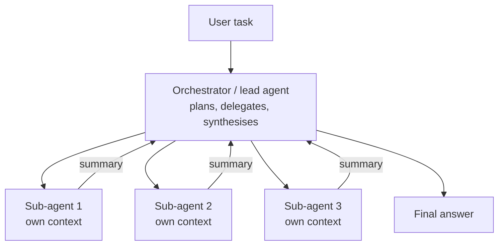
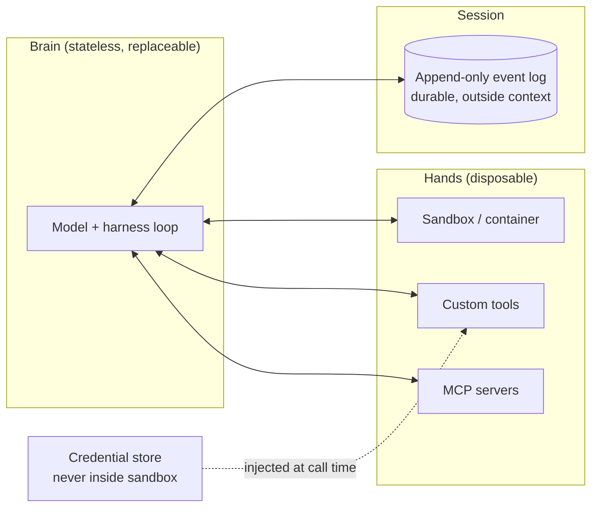

# 4. Agents

> **Goal of this chapter.** Understand the agent loop from first principles, how to design tools, when to use workflows vs autonomous agents vs multi-agent systems, and the 2026 architecture for long-running hosted agents.


> **Implement it:** [implementation/02-agents.md](implementation/02-agents.md) has step-by-step code, tuning parameters, common errors and how to improve.

> **Go deeper:** [techniques/04-agent-architectures.md](techniques/04-agent-architectures.md) cover every alternative technique with pros, cons, evidence and a decision guide.

---

## 4.1 What an agent is

**Agent = an LLM using tools in a loop, deciding its own next step, until the task is done.**

```python
messages = [system_prompt, user_task]
while True:
    response = llm(messages, tools=TOOLS)
    if response.stop_reason != "tool_use":
        break                                  # model decided it's done
    for call in response.tool_calls:
        result = execute(call.name, call.args) # your code runs the tool
        messages.append(tool_result(call.id, result))
```

That's the whole core. Everything else (frameworks, memory, sub-agents) is engineering around this loop. **Write this by hand once** before using any framework.

The pattern goes back to **ReAct (2022)**: reason, act, observe, repeat. Modern models do it natively through tool-calling APIs, with "thinking" between steps.

---

## 4.2 Workflows vs agents

Anthropic's *Building effective agents* (Dec 2024) draws the distinction that most teams now use:
- **Workflow:** *your code* decides the control flow; the LLM fills in steps. Predictable, cheaper, easier to test.
- **Agent:** *the model* decides the control flow. Flexible, but less predictable and costlier.

The five workflow patterns:

| Pattern | Shape | Use when |
|---|---|---|
| Prompt chaining | A → B → C, with checks between | a task splits into fixed steps |
| Routing | classify → specialised handler | distinct input types (refund vs tech support) |
| Parallelisation | run N calls at once, aggregate | independent subtasks, or voting |
| Orchestrator–workers | LLM splits the task dynamically, workers execute | subtasks not known in advance |
| Evaluator–optimizer | generate → critique → revise loop | clear quality criteria (translation, code with tests) |

**Rule:** start with the simplest thing. Only move to an autonomous agent when the task is open-ended and you can't predict the steps. Only go multi-agent when evals show a single agent can't do it.

---

## 4.3 Tool design (where most quality comes from)

Tools are the agent's interface to the world, and the model reads your tool definitions like documentation. From Anthropic's *Writing effective tools for agents* (2025) and wider practice:

- **Fewer, higher-level tools** beat many thin API wrappers. `schedule_meeting(attendees, duration)` beats `list_users` + `list_events` + `create_event`.
- **Clear names and descriptions**, written like docs for a new colleague. State when to use the tool, and when *not* to.
- **Unambiguous parameters:** `user_id` not `user`; enums instead of free strings.
- **Return what's useful, not everything.** Offer a `response_format: "concise" | "detailed"` option, paginate, truncate with a note ("showing 20 of 3,400; refine your query").
- **Actionable errors:** "Date must be YYYY-MM-DD, got '5 Sept'" instead of a stack trace. The agent reads errors and self-corrects.
- **Namespacing** when there are many tools (`github_create_issue`, `jira_create_issue`).
- **Evaluate tools:** run the agent on realistic tasks, read transcripts, and fix tools where the agent gets confused. You can let Claude/another model propose tool-description improvements from failed transcripts.

**Code as action:** instead of dozens of JSON tools, give the agent a sandbox where it writes and runs code (Python/bash). Code composes, loops and filters, and code execution is now built into major agent platforms. It's even used to call MCP tools, which avoids loading every tool definition into context. The trade-off is that it needs a secure sandbox.

---

## 4.4 Multi-agent systems



**When multi-agent helps:** breadth-first, parallelisable work, such as research across many sources, or searching many parts of a codebase. Anthropic's multi-agent research system (June 2025) beat a single agent substantially on research evals, but used roughly **15× the tokens** of a chat. Token usage explained most of the performance difference.

**When it hurts:** tightly coupled tasks (most coding), where agents need shared context and make conflicting decisions. Errors also *cascade*: one agent's wrong output becomes another's input.

**2026 research on multi-agent:**
- *Reinforcement Learning for LLM-based Multi-Agent Systems through Orchestration Traces* (arXiv 2605.02801) splits orchestration into five learnable decisions: **when to spawn, whom to delegate to, how to communicate, how to aggregate, when to stop.** This is a useful checklist for designing orchestrators by hand, too.
- **LCGuard / ExComm** (May 2026) add validation between agents so one agent's corrupted output doesn't spread through the pipeline.

---

## 4.5 The 2026 architecture for long-running agents: brain, hands, session

Agents now run for hours (big refactors, research, operations). Anthropic's *Scaling Managed Agents* (8 April 2026) describes the architecture:



- **Brain** = model + control loop. It's **stateless**: if it crashes, a new one rebuilds its state from the session log. Brains scale horizontally.
- **Hands** = execution environments (containers, tools, MCP servers). They're treated as **disposable ("cattle")**; a sandbox failure doesn't kill the agent.
- **Session** = append-only log of everything that happened, stored **outside** the context window. It enables crash recovery, runs longer than the context window, and lets the brain look back at earlier steps as needed.
- **Credentials live outside the sandbox**, so code running in the sandbox (possibly steered by prompt injection) can't steal them.
- **Design philosophy:** like an OS. Stable interfaces (session, sandbox, tool) outlive specific harness designs as models improve.

Google announced a similar **Managed Agents** feature in the Gemini API at I/O 2026 (server-side loop, state persistence, proactive 24/7 execution). **Takeaway:** the agent loop is moving from your laptop or process to hosted infrastructure, and "durable execution" ideas (Temporal-style event logs, retries) are becoming agent basics.

---

## 4.6 Other 2026 techniques worth knowing

| Technique | Idea | Source |
|---|---|---|
| **Workflow compilation** | record traces of a multi-call agent pipeline and fine-tune a model to produce the same output in *one* pass; reported near-frontier quality at ~100× less cost | *Compiling Agentic Workflows into LLM Weights* (May 2026) |
| **Idle-time speculative planning** | while waiting for a slow tool, the agent predicts the result and pre-plans next actions; if the prediction was right, it continues immediately | *IdleSpec* (May 2026) |
| **Self-evolving agents** | the agent finds weaknesses, rewrites its own code modules, validates with tests, redeploys | *MOSS* (May 2026). Research-stage, with obvious safety questions |
| **Agent Skills** | package procedures as folders the agent loads on demand | ch. 5 |
| **Learning to omit** | RL trains agents to skip unnecessary thinking and tool observations, saving tokens | *Agent-Omit* (2026) |

These come from recent papers and a vendor roundup (Requesty). Treat the performance claims as preliminary.

---

## 4.7 Coding agents: the flagship agent application

Coding agents (Claude Code, Codex, Gemini CLI, Cursor, Copilot agent) are the most mature agents, because **code is verifiable**: tests, compilers and linters give feedback. Anthropic's *2026 Agentic Coding Trends Report* describes engineers moving from *implementer* to *orchestrator*: specifying intent, running several agents in parallel, and reviewing results.

Patterns worth copying into any agent:
- a **project instruction file** (CLAUDE.md / AGENTS.md) as procedural memory
- **plan mode** before acting
- **todo lists** the agent maintains itself
- **permission modes** and hooks for dangerous actions
- **sub-agents** for exploration
- **verification loops:** run the tests and read the output

---

## 4.8 Framework landscape

| Framework | Style | Good for |
|---|---|---|
| Claude Agent SDK | the harness behind Claude Code, as a library: tools, sub-agents, skills, hooks, MCP | general agents, coding/file-based agents |
| OpenAI Agents SDK | lightweight: agents, handoffs, guardrails, tracing | multi-agent handoffs |
| Google ADK | agent development kit, A2A-native | Google Cloud / Gemini |
| LangGraph | explicit state graph with checkpoints, human-in-the-loop | complex workflows needing control and durability |
| PydanticAI | typed, Pythonic, structured outputs | production Python with validation |
| LlamaIndex | data/RAG-centric agents | knowledge-heavy apps |
| DSPy | declare modules + metric, *optimize* the prompts automatically | pipelines you want to tune against an eval |

**Advice:** frameworks change fast, concepts don't. Know the raw loop, then learn one framework in depth.

---

## 4.9 Check your understanding

1. **Write the agent loop in 6 lines.** See §4.1. Call the model with tools; if it requests tools, execute them and append the results; repeat until it stops.
2. **Workflow vs agent: who decides the control flow?** Workflow: your code. Agent: the model.
3. **Three rules of good tool design?** Few high-level tools; clear docs-like descriptions with unambiguous params; concise outputs with pagination and actionable errors.
4. **When does multi-agent pay off, and what does it cost?** Parallel, breadth-first tasks like research. Roughly an order of magnitude more tokens, plus the risk of errors spreading between agents. Bad for tightly coupled tasks.
5. **Explain brain/hands/session.** Brain = stateless model+loop; hands = disposable sandboxes/tools; session = durable event log outside the context. Together they give crash recovery, scaling, runs longer than the context window, and credential isolation.
6. **What is workflow compilation, and why would you do it?** Distil a multi-step agent pipeline's traces into a fine-tuned model that does it in one pass, for large cost and latency savings once the workflow is stable.

---

## Sources
- Yao et al., *ReAct* (2022): arXiv 2210.03629
- Anthropic, *Building effective agents* (Dec 2024): https://www.anthropic.com/engineering/building-effective-agents
- Anthropic, *Writing effective tools for agents* (2025): https://www.anthropic.com/engineering/writing-tools-for-agents
- Anthropic, *How we built our multi-agent research system* (Jun 2025): https://www.anthropic.com/engineering/multi-agent-research-system
- Anthropic, *Scaling Managed Agents* (Apr 2026): https://www.anthropic.com/engineering/managed-agents
- Anthropic, *2026 Agentic Coding Trends Report*: https://resources.anthropic.com/hubfs/2026%20Agentic%20Coding%20Trends%20Report.pdf
- *RL for LLM-based Multi-Agent Systems through Orchestration Traces*: arXiv 2605.02801
- Requesty, *5 AI agent techniques (May 2026)*, covering MOSS, workflow compilation, IdleSpec, LCGuard/ExComm, Gemini Managed Agents (vendor roundup): https://www.requesty.ai/blog/ai-agent-techniques-may-2026-self-evolving-managed-compiled
- Google Cloud, *AI agent trends 2026*: https://cloud.google.com/resources/content/ai-agent-trends-2026
