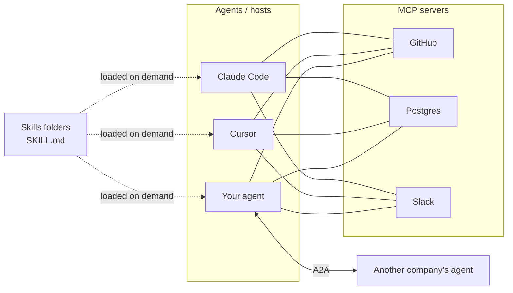

# 5. Protocols: MCP, A2A and Agent Skills

> **Goal of this chapter.** Learn the three open standards that now connect agents to tools (MCP), to other agents (A2A), and to packaged know-how (Skills), including the **2026-07-28 MCP rewrite**, which breaks older tutorials.


> **Implement it:** [implementation/04-mcp-and-skills.md](implementation/04-mcp-and-skills.md) has step-by-step code, tuning parameters, common errors and how to improve.

---

## 5.1 Why protocols

Without standards, every agent × every tool needs a custom integration (N × M). With a standard, each tool is wrapped once and every agent can use it (N + M), just as USB or HTTP did for their fields.



**Governance (Dec 2025):** the Linux Foundation launched the **Agentic AI Foundation (AAIF)** as a neutral home for MCP, A2A and related projects. IBM's competing ACP had already merged into A2A in August 2025. The protocol competition has largely settled.

---

## 5.2 MCP (Model Context Protocol)

Launched by Anthropic in November 2024; now the de-facto standard for connecting models to tools and data.

**The building blocks a server can expose:**
| Primitive | Controlled by | Example |
|---|---|---|
| **Tools** | model decides to call | `create_issue`, `run_query` |
| **Resources** | application attaches | files, DB schemas, documents |
| **Prompts** | user picks | reusable prompt templates / slash commands |

**Transports:** stdio (a local subprocess) and Streamable HTTP (remote). JSON-RPC messages.

### Version history (why tutorials disagree)
| Version | Main changes |
|---|---|
| 2024-11-05 | first release: stdio + HTTP/SSE |
| 2025-03-26 | Streamable HTTP, OAuth 2.1 authorization, tool annotations |
| 2025-06-18 | elicitation (server asks user for input), structured tool output, resource links |
| 2025-11-25 | experimental Tasks (long-running operations), more auth work |
| **2026-07-28** | **stateless core**, a breaking change (below) |

### The 2026-07-28 spec: what changed

**1. Stateless protocol.** The `initialize`/`initialized` handshake and **session IDs are gone**. Each request carries its protocol version and client identity in `_meta`. An optional `server/discover` RPC lets clients ask about capabilities up front.
→ *Why:* stateful sessions forced sticky load-balancing and shared session stores. Now any server instance behind a plain load balancer can answer any request. This matters for serverless and large deployments. (Google's developer blog has a write-up on scaling with it.)

**2. Multi Round-Trip Requests (MRTR).** Previously a server needing user input mid-call (elicitation) had to hold a stream open and send a request *to* the client. Now the server returns `resultType: "input_required"` describing what it needs; the client collects it and **retries the call with `inputResponses`**. Interactive flows now work over stateless HTTP.

**3. Header-based routing.** `Mcp-Method` and `Mcp-Name` HTTP headers, so gateways, WAFs (web application firewalls) and rate limiters can route and meter without parsing JSON bodies.

**4. Cacheable list results.** `tools/list`, `prompts/list` and `resources/list` include `ttlMs` and `cacheScope`, so clients stop re-fetching tool catalogs.

**5. Formal extensions framework.** Optional features live in namespaced extensions:
- `io.modelcontextprotocol/tasks`: long-running operations with polling (moved out of core)
- **MCP Apps**: servers can ship interactive UI to the host
- **Enterprise Managed Authorization (EMA)**

**6. Authorization hardening.** RFC 9207 issuer validation is required; client credentials are bound to their issuer (no reuse across servers). **Dynamic Client Registration is deprecated** in favour of **Client ID Metadata Documents (CIMD)**: the client ID is a URL pointing to a metadata document.

**7. Deprecations:** Roots, Sampling and Logging are deprecated but keep working for at least 12 months.

**Migration checklist for server authors:** drop session-ID logic; make handlers stateless (keep state in your own DB, keyed by user/resource); switch elicitation to MRTR; set TTLs on list results; plan auth around CIMD; upgrade to a Tier-1 SDK version that supports the new spec.

### Design advice for MCP servers
- Apply the tool-design rules from ch. 4 §4.3. An MCP server is a tool set, and thin REST-wrapper servers perform poorly.
- Watch context cost: 30 servers × 20 tools = hundreds of tool definitions loaded every turn. Use tool search / progressive loading, or code execution that calls MCP tools.
- Security: MCP servers are a supply-chain risk (tool poisoning, malicious descriptions, rug-pull updates). See ch. 9.

---

## 5.3 A2A (Agent2Agent protocol)

MCP connects an agent to *tools*. A2A connects an agent to *another agent*, possibly from another vendor and opaque to you. Google created it (April 2025) and donated it to the Linux Foundation.

**Core concepts:**
- **Agent Card:** a JSON document (at a well-known URL) describing an agent: name, skills, endpoint, auth requirements. Used for discovery.
- **Task:** the unit of work, with a lifecycle (submitted → working → input-required → completed/failed), because agent work can take a long time.
- **Messages and Artifacts:** conversation turns and output files/data.
- Streaming (SSE) and push notifications for long tasks.

**Versions:** v0.3.0 (July 2025: streaming-first, capability negotiation) → **v1.0.0 (January 2026: production-ready, signed Agent Cards for cryptographic verification)** → v1.0.1 (May 2026: extension mechanism). By April 2026: 150+ supporting organisations, integrated in Google, Microsoft and AWS platforms (Linux Foundation press release).

**MCP vs A2A in one line:** MCP = "use this capability" (tool, transparent). A2A = "please get this done" (a peer that plans for itself, opaque).

**Honest status:** MCP adoption is far broader. Most "multi-agent" systems today are sub-agents inside one harness, not A2A across companies. A 2026 paper (*Governance Gaps in Agent Interoperability Protocols*, arXiv 2606.31498) argues that MCP, A2A and ACP can't express key governance needs (delegated authority, accountability).

---

## 5.4 Agent Skills (SKILL.md)

A **skill** is a folder that teaches an agent a procedure:

```
pdf-forms/
├── SKILL.md          ← required
├── fill_form.py      ← optional scripts the agent can run
└── reference.md      ← optional extra docs, loaded only if needed
```

```markdown
---
name: pdf-forms
description: Fill and validate PDF forms. Use when the user asks to fill a PDF form or extract form fields.
---
# Filling PDF forms
1. Run `python fill_form.py --list-fields input.pdf` ...
```

**The key idea is progressive disclosure:**
1. At startup the agent sees only each skill's `name` + `description` (a few dozen tokens each).
2. When a task matches, it reads the full SKILL.md.
3. If needed, it reads the extra files or runs the scripts.

So an agent can have hundreds of skills installed at almost no context cost. Compare MCP, where every tool definition sits in context.

**Timeline:** Anthropic introduced Skills in Claude (October 2025) and released the format as an **open standard on 18 December 2025** (agentskills.io). By early March 2026, OpenAI Codex, Microsoft/GitHub Copilot, VS Code, JetBrains, Cursor, Gemini CLI, Block's Goose and ~25 others supported it. Community marketplaces reportedly list hundreds of thousands of skills (vendor/blog figures).

**Skills vs MCP vs AGENTS.md:**
| | Gives the agent | Loaded |
|---|---|---|
| MCP server | *capabilities* (can now call Slack) | tool definitions every turn |
| Skill | *know-how* (how *we* write release notes) + optional scripts | description always, body on demand |
| AGENTS.md / CLAUDE.md | project-wide rules and context | always |

**Security:** a skill can include scripts, so installing a skill = running someone's code. Review skills like dependencies.

---

## 5.5 Check your understanding

1. **What problem does MCP's stateless core solve?** Session IDs and handshakes forced sticky routing and shared session state. Stateless requests can go to any instance behind a normal load balancer.
2. **How does MRTR replace server-initiated elicitation?** The server returns `input_required` with what it needs; the client gathers the input and retries the same request with `inputResponses`. No held-open stream.
3. **What's replacing Dynamic Client Registration?** Client ID Metadata Documents (CIMD): the client ID is a URL to a metadata document.
4. **MCP vs A2A?** MCP: agent → tools/data (transparent capabilities). A2A: agent ↔ agent (opaque peers with task lifecycles, discovered via Agent Cards).
5. **Why do skills scale better than tools?** Progressive disclosure: only the name and description sit in context; the full content loads on demand.
6. **Name two MCP security risks.** Tool poisoning (malicious instructions in tool descriptions or outputs) and "rug pulls" (a trusted server changes behaviour after an update). Also credential exposure.

---

## Sources
- MCP blog, *The 2026-07-28 Specification*: https://blog.modelcontextprotocol.io/posts/2026-07-28/
- MCP specification 2026-07-28: https://modelcontextprotocol.io/specification/2026-07-28
- MCP blog, *The 2026 MCP Roadmap*: https://blog.modelcontextprotocol.io/posts/2026-mcp-roadmap/
- Google Developers Blog, *Scaling AI agent infrastructure with the MCP stateless updates*: https://developers.googleblog.com/scaling-ai-agent-infrastructure-with-the-mcp-stateless-updates/
- The Register, *MCP prepares to break with its stateful past* (Jul 2026): https://www.theregister.com/devops/2026/07/23/model-context-protocol-prepares-to-break-with-its-stateful-past/5276722
- Linux Foundation, *A2A surpasses 150 organizations*: https://www.linuxfoundation.org/press/a2a-protocol-surpasses-150-organizations-lands-in-major-cloud-platforms-and-sees-enterprise-production-use-in-first-year
- HPCwire, *A2A marks one year* (Apr 2026): https://www.hpcwire.com/aiwire/2026/04/09/linux-foundation-a2a-protocol-marks-one-year-with-broad-enterprise-and-cloud-adoption/
- *Governance Gaps in Agent Interoperability Protocols*: arXiv 2606.31498
- Laurent Kempé, *Agent Skills: from Claude to open standard* (Jan 2026): https://laurentkempe.com/2026/01/27/Agent-Skills-From-Claude-to-Open-Standard/
- *A Comprehensive Survey on Agent Skills*: arXiv 2605.07358
- Agentman, *Agent Skills ecosystem report 2026*: https://agentman.ai/blog/agent-skills-ecosystem-report-2026
