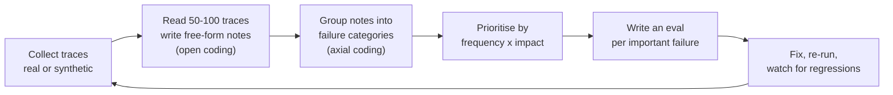

# 6. Evaluation

> **Goal of this chapter.** Learn how to measure LLM systems: building eval sets from real failures, metrics for RAG and agents, using LLM judges without being fooled, and what the 2026 judge benchmarks found.

> **Implement it:** [implementation/05-evals.md](implementation/05-evals.md) has step-by-step code, tuning parameters, common errors and how to improve.

> **Go deeper:** [techniques/05-evaluation-techniques.md](techniques/05-evaluation-techniques.md) cover every alternative technique with pros, cons, evidence and a decision guide.

---

## 6.1 Why evals are the core skill

Without evals, every change is a guess: a new prompt, a new model, a new chunk size. With evals you can make decisions such as "switching to model X raises task success from 71% to 78% and cuts cost 40%". Teams that ship good AI products are almost always teams with good evals.

---

## 6.2 The process: error analysis first

The approach popularised by Hamel Husain and Shreya Shankar:

- **Look at your data.** Generic metrics ("helpfulness 4.2/5") rarely tell you what to fix. Specific failure categories do ("misses date filter on 'last quarter' questions: 14% of traces").
- Prefer **binary pass/fail** per criterion over 1–5 scales. Binary labels are more consistent between people and easier to act on.
- **Code-based checks first** (JSON valid? correct tool called? SQL runs? citation IDs exist?). They're cheap and deterministic. Use LLM judges only for what code can't check.

---

## 6.3 The eval types

| Level | What | Example |
|---|---|---|
| Unit / component | one step in isolation | retrieval recall@10; tool-call argument correctness |
| End-to-end | whole task | final answer correct; ticket resolved |
| Trajectory / trace | the path taken | used the right tools in a sensible order; no loops; no unsafe actions |
| Online / production | real traffic | user thumbs, escalation rate, task completion, cost, latency |
| Regression suite | fixed set run in CI | "these 200 cases must still pass after every change" |

---

## 6.4 RAG metrics

Evaluate **retrieval and generation separately**:

| Metric | Measures | Needs |
|---|---|---|
| Recall@k / hit rate | is a relevant doc in top-k? | labelled relevant docs per query |
| MRR / nDCG | how high the relevant docs rank | labels (graded for nDCG) |
| Context precision | fraction of retrieved chunks that are relevant | LLM judge or labels |
| Context recall / **coverage** | does the retrieved *set* contain all needed facts? (see ch. 2 §2.8) | reference answer |
| Faithfulness / groundedness | is every claim in the answer supported by the context? | LLM judge |
| Answer correctness | does it match the reference? | reference answer + judge |

Libraries: Ragas, DeepEval, TruLens, plus the eval features of Langfuse/Phoenix/Braintrust.

---

## 6.5 Agent evaluation

Agents are harder: long, non-deterministic trajectories, side effects, many valid paths.

- **Task success** checked by the **final environment state** (was the DB row updated? do the tests pass?), not just the text answer. This is how SWE-bench, τ-bench and Terminal-Bench work.
- **pass@k vs pass^k:** pass@k = at least one of k attempts succeeds (good for "can it ever?"). **pass^k** = *all* k attempts succeed (τ-bench). It measures **reliability**, which is what production needs. An agent with 80% single-run success can have pass^8 far below 50%.
- **Trace metrics:** tool-call accuracy, wasted steps, loops, recovery from errors, cost and latency per task.
- **Safety checks:** did it take a forbidden action? Did it ask for confirmation where needed?

**Benchmarks to know:** SWE-bench Verified (coding), Terminal-Bench (terminal tasks), τ-bench / τ²-bench (customer-service tools + simulated users), GAIA (general assistant), OSWorld (computer use), BrowseComp (web research), MCP-Bench (tool use via real MCP servers, arXiv 2508.20453).

---

## 6.6 LLM-as-judge: and who judges the judge?

Using a strong model to grade outputs scales well, but judges have known biases:
- **Position bias:** prefers the first (or second) option in pairwise comparisons
- **Length / verbosity bias:** prefers longer answers
- **Self-preference:** prefers outputs from its own model family
- **Non-determinism**, and cost (a full model call per judgment)

**How to use judges properly:**
1. Write a **specific rubric** per criterion, with pass/fail and examples of each.
2. **Calibrate against human labels.** Label ~100–200 examples yourself, measure judge agreement (precision/recall or Cohen's κ), and iterate on the judge prompt until agreement is high. Hold out a test split.
3. Randomise order in pairwise comparisons; ask for reasoning before the verdict.
4. Re-check agreement whenever you change the judge model.
5. Correct your metrics for the judge's error rate (see *Bias and Uncertainty in LLM-as-a-Judge Estimation*, arXiv 2605.06939).

### 2026: benchmarks for judges

A cluster of 2026 papers measured how reliable judges are on *agentic* tasks. The findings are mostly bad news for uncalibrated judges:

| Benchmark | What it tests |
|---|---|
| **AgentJudgeBench** (arXiv 2608.26623) | judges on agentic tool-calling with dependency-driven workflows, at several difficulty levels |
| **AJ-Bench** (arXiv 2604.18240) | *agent-as-a-judge*: a judge that can itself use tools and inspect the environment to verify outcomes |
| **MobileJudgeBench** (arXiv 2608.11434) | judges on mobile-agent trajectories: 931 human-annotated trajectories, 68 apps |
| **LongJudgeBench** (arXiv 2606.01629) | judges on long-form outputs: factual grounding and coverage at document level |
| **AgentProp-Bench** (arXiv 2604.16706) | judge reliability + how errors *propagate* through tool-using agents, and runtime mitigation |

**Takeaways:**
- Judging a final answer is easier than judging a *trajectory*.
- **Agent-as-a-judge** (the judge can check the environment, run the tests, query the DB) is more reliable than reading text alone.
- Judge reliability must be measured *per task type*. A judge that's good on chat can be poor on tool calls.

---

## 6.7 Observability

You can't do error analysis without traces. Standard setup:
- Log every LLM call, tool call, retrieval and its results as **spans in a trace** (one trace per user request or agent run).
- Use the **OpenTelemetry GenAI semantic conventions** so traces work across tools.
- Platforms: Langfuse (open source), LangSmith, Arize Phoenix (open source), Braintrust, Weights & Biases Weave.
- Build dashboards on **cost per task, latency (p50/p95), task success, and escalation rate**, not just token counts.

---

## 6.8 Check your understanding

1. **Why prefer binary pass/fail over 1–5 scores?** More consistent between raters and judges, easier to calibrate, and it maps directly to a fix.
2. **What's the difference between pass@k and pass^k?** pass@k: any of k succeeds (capability). pass^k: all k succeed (reliability/consistency).
3. **How do you trust an LLM judge?** Calibrate against human labels on a held-out set, measure agreement, fix the rubric, and re-check whenever the judge model changes.
4. **Why grade agents by environment state?** The text can claim success while the actual state is wrong. The state is the ground truth.
5. **What's agent-as-a-judge?** A judge with tools that can inspect the environment (run tests, query state) instead of only reading the transcript.
6. **Your RAG answers are wrong. How do you tell if retrieval or generation is at fault?** Check retrieval recall/coverage separately. If the needed facts weren't retrieved, it's retrieval. If they were retrieved but the answer is wrong or unfaithful, it's generation.

---

## Sources
- Hamel Husain, *Your AI product needs evals* and *LLM evals FAQ*: https://hamel.dev
- Shankar et al., *Who Validates the Validators?* (2024): arXiv 2404.12272
- Yao et al., *τ-bench* (2024): arXiv 2406.12045
- *MCP-Bench*: arXiv 2508.20453
- *AgentJudgeBench*: https://huggingface.co/papers/2608.26623
- *AJ-Bench: Agent-as-a-Judge*: arXiv 2604.18240
- *Benchmarking LLM Judges for Mobile Agent Evaluation*: arXiv 2608.11434
- *LongJudgeBench*: arXiv 2606.01629
- *AgentProp-Bench*: arXiv 2604.16706
- *Bias and Uncertainty in LLM-as-a-Judge Estimation*: arXiv 2605.06939
- Confident AI, *LLM agent evaluation guide 2026*: https://www.confident-ai.com/blog/llm-agent-evaluation-complete-guide
- Ragas: https://docs.ragas.io
