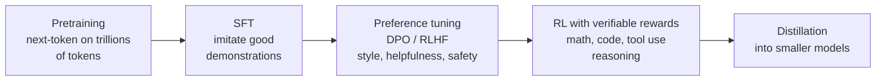
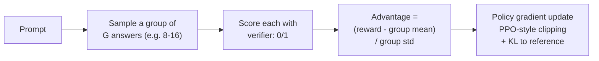

# 7. Post-training and RL

> **Goal of this chapter.** Understand how models are adapted after pretraining (SFT, LoRA, preference optimization, RL with verifiable rewards), the GRPO family of 2025–2026, and how RL is now used to train *agents*.
>
> For the hardware/systems side of RL (rollout long tails, weight sync), see [../hardware/10-llm-inference-and-rl.md](../hardware/10-llm-inference-and-rl.md). For reward hacking in depth, see [../kernels_rl_reward_hacking_literature_review.md](../kernels_rl_reward_hacking_literature_review.md).

> **Implement it:** [implementation/06-fine-tuning-and-rl.md](implementation/06-fine-tuning-and-rl.md) has step-by-step code, tuning parameters, common errors and how to improve.

> **Go deeper:** [techniques/06-post-training-techniques.md](techniques/06-post-training-techniques.md) cover every alternative technique with pros, cons, evidence and a decision guide.

---

## 7.1 The pipeline

As an application engineer you'll mostly do **SFT/LoRA** and sometimes **DPO** or small-scale **RL** on open models. Frontier labs do all stages.

---

## 7.2 SFT and parameter-efficient fine-tuning

**SFT (supervised fine-tuning):** train on (prompt, ideal response) pairs with the normal next-token loss, only on the response tokens.

**LoRA:** freeze the base weights W; learn a low-rank update ΔW = B·A (rank r ≈ 8–64). You train < 1% of the parameters, can swap adapters per task, and serve many adapters on one base model (vLLM multi-LoRA).
**QLoRA:** base model quantized to 4-bit, LoRA adapters in higher precision. This lets you fine-tune a 70B model on one large GPU.
**DoRA and other variants:** small improvements. Plain LoRA is still the default.

**When SFT works:** format, style, narrow task behaviour, tool-calling conventions, distillation from a bigger model.
**When it doesn't:** teaching new facts (use RAG), or improving reasoning beyond the demonstrations (use RL).

Tools: **TRL** (Hugging Face), **Unsloth** (fast, low memory, good for Colab), **Axolotl**, **torchtune**.

---

## 7.3 Preference optimization

**RLHF (classic, 2022):** train a reward model on human preference pairs → optimize the policy with PPO against it. Powerful, but complex: four models in memory (policy, reference, reward, value/critic) and unstable.

**DPO (2023):** the key result is that you can optimize the same preference objective **directly on (chosen, rejected) pairs**, with no reward model and no RL loop. It's a simple classification-style loss. It became the default for open models.

Variants: **SimPO** (no reference model), **KTO** (single thumbs up/down labels instead of pairs), **ORPO** (SFT + preference in one stage), and 2026 variants such as InSPO, TI-DPO and RAPPO.

A 2025 paper, *It Takes Two: Your GRPO Is Secretly DPO* (arXiv 2510.00977), shows GRPO and DPO are more closely related than they look.

---

## 7.4 RL with verifiable rewards (RLVR) and GRPO

The big shift since DeepSeek-R1 (January 2025): for tasks where **a program can check the answer** (math with known answers, code with tests, formatted outputs, tool-use tasks with checkable end states), you don't need a learned reward model. The reward is just `1 if correct else 0` (+ format checks). That's **RLVR**. It's how reasoning models learn long chains of thought.

**GRPO (Group Relative Policy Optimization,** DeepSeekMath 2024):

- **No critic/value network:** the group's mean reward is the baseline. That saves memory (roughly 40% by common estimates) and removes a source of instability.
- If *all* answers in a group are right (or all wrong), the advantages are zero and there's **no learning signal**. Prompt difficulty therefore matters a lot.

### The GRPO family (know these names)

| Method | Fixes | Key idea |
|---|---|---|
| **DAPO** (ByteDance/Tsinghua, 2025) | instability on long chains of thought | *Clip-Higher* (asymmetric clipping keeps exploration), *Dynamic Sampling* (drop all-correct/all-wrong groups), *token-level loss*, *overlong reward shaping* |
| **Dr. GRPO** (2025) | length/difficulty bias | removes length and std normalization, which let wrong answers grow longer |
| **GSPO** (Qwen, 2025) | instability, especially in MoE | importance ratios at **sequence** level instead of per token |
| **REINFORCE++** | simplicity | critic-free REINFORCE with normalized advantages |
| **DHPO** (2026) | token vs sequence trade-off | blends GRPO-style token-level and GSPO-style sequence-level objectives |
| **EP-GRPO / TR-GRPO** (2026) | credit assignment | reweight tokens by entropy progress / contribution to reward |
| **DPPO** (2026) | rollout cost | prune redundant rollouts with unbiased importance-sampling correction |

**Interview framing:** "GRPO removed the critic by using the group mean as the baseline. The follow-ups fix what that exposed: length bias (Dr.GRPO), zero-signal groups and entropy collapse (DAPO), and token-level noise (GSPO)."

---

## 7.5 Agentic RL: training agents, not just reasoners

Single-turn RLVR trains one long answer. **Agentic RL** trains *multi-turn* behaviour: call tools, read results, decide again. The reward usually comes at the end (task solved?).

New challenges:
- **Credit assignment** across many turns and tool calls
- **Environment cost:** rollouts need sandboxes, browsers and real tools, and are slow with long tails
- **Tool outputs are not model tokens:** mask them out of the loss
- **Reward hacking:** agents find shortcuts (editing tests, special-casing checks)

2025–2026 work:
- **Search-R1** (2025): RL to interleave reasoning with search calls.
- **ARPO:** policy optimization specialised for multi-turn tool use.
- **Agent-R1** (arXiv 2511.14460): a modular framework for end-to-end agent RL.
- **Agent-Omit** (2026): RL teaches agents to *skip* unnecessary thinking and tool observations, so they use fewer tokens.
- **RL for orchestration** (arXiv 2605.02801): learn the five multi-agent decisions: spawn, delegate, communicate, aggregate, stop.
- Surveys: *The Landscape of Agentic RL for LLMs* (arXiv 2509.02547); *Rethinking Agentic RL* (arXiv 2604.27859).

**Frameworks:** verl (ByteDance), OpenRLHF, TRL (GRPOTrainer), SkyRL, prime-rl, ART.

### Agents that do post-training
A 2026 twist: benchmarks ask whether **agents can run post-training themselves**.
- **PostTrainBench** (arXiv 2603.08640): can an agent take a base model and improve it via SFT/RL within a budget?
- **Agent² RL-Bench** (arXiv 2604.10547): can an agent design, implement and debug a full RL pipeline, up to online RL with trajectory collection?
- **LLMZero** (arXiv 2606.18388): agents discovering adaptive RL training strategies.

---

## 7.6 Distillation

Train a small "student" on a big "teacher's" outputs (and sometimes its logits). DeepSeek-R1's distilled small models showed that **reasoning distils well**: a small model trained on a big model's reasoning traces beats the same small model trained with RL alone.

Practical use: once a workflow is stable, distil it into a cheap model. *Workflow compilation* (ch. 4 §4.6) is the agentic version of this.

---

## 7.7 Check your understanding

1. **Why does GRPO not need a critic?** The baseline is the mean reward of a group of answers sampled for the same prompt.
2. **What happens if all 16 samples for a prompt are correct?** Every advantage is 0, so there's no gradient signal. DAPO's dynamic sampling filters such prompts.
3. **DPO vs RLHF?** DPO optimizes preferences directly on pairs with a classification-style loss; no reward model, no RL loop.
4. **What's RLVR, and where does it fail?** RL with programmatically verifiable rewards. It fails on tasks that can't be checked automatically (open-ended writing), and it's vulnerable to reward hacking if the verifier is weak.
5. **What's different about agentic RL?** Multi-turn, tool results in context (masked from the loss), sparse end-of-task rewards, expensive environment rollouts, credit assignment across steps.
6. **What does GSPO change?** It computes importance ratios and clipping at the sequence level rather than per token, which is more stable (especially for MoE).

---

## Sources
- Hu et al., *LoRA* (2021): arXiv 2106.09685 · Dettmers et al., *QLoRA* (2023): arXiv 2305.14314
- Rafailov et al., *DPO* (2023): arXiv 2305.18290
- Shao et al., *DeepSeekMath (GRPO)* (2024): arXiv 2402.03300 · DeepSeek-AI, *DeepSeek-R1* (2025): arXiv 2501.12948
- Yu et al., *DAPO* (2025): arXiv 2503.14476 · Liu et al., *Dr. GRPO* (2025): arXiv 2503.20783 · Zheng et al., *GSPO* (2025): arXiv 2507.18071
- *It Takes Two: Your GRPO Is Secretly DPO*: arXiv 2510.00977
- Hugging Face blog, *From GRPO to DAPO and GSPO*: https://huggingface.co/blog/NormalUhr/grpo-to-dapo-and-gspo
- Turing Post, *Reasoning RL in 2026*: https://www.turingpost.com/p/reasoning-rl-in-2026
- *Agent-R1*: arXiv 2511.14460 · *Agentic RL survey*: arXiv 2509.02547 · *Rethinking Agentic RL*: arXiv 2604.27859
- *RL for Multi-Agent Systems through Orchestration Traces*: arXiv 2605.02801
- *PostTrainBench*: arXiv 2603.08640 · *Agent² RL-Bench*: arXiv 2604.10547 · *LLMZero*: arXiv 2606.18388
- Sebastian Raschka, *LLM Research Papers: The 2026 List (Jan–May)*: https://magazine.sebastianraschka.com/p/llm-research-papers-2026-part1
