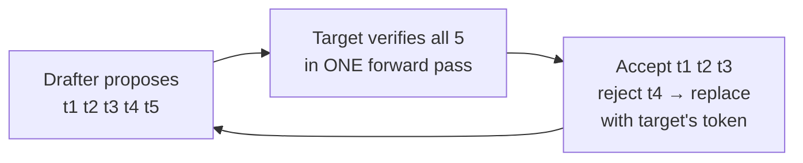

# 8. Inference and serving

> **Goal of this chapter.** Understand the software techniques that make LLM serving fast and cheap: KV cache, batching, prefix caching, quantization, speculative decoding (including 2026's P-EAGLE and DFlash), and disaggregation.
>
> The hardware view (TTFT/TPOT, memory bandwidth, why decode is memory-bound) is in [../hardware/10-llm-inference-and-rl.md](../hardware/10-llm-inference-and-rl.md) and [../hardware/04-ai-chips-and-ascend-core.md](../hardware/04-ai-chips-and-ascend-core.md).

> **Implement it:** [implementation/07-serving.md](implementation/07-serving.md) has step-by-step code, tuning parameters, common errors and how to improve.

> **Go deeper:** [techniques/07-inference-optimization.md](techniques/07-inference-optimization.md) cover every alternative technique with pros, cons, evidence and a decision guide.

---

## 8.1 The two phases

| Phase | What happens | Bottleneck | User-facing metric |
|---|---|---|---|
| **Prefill** | process the whole prompt in parallel, build the KV cache | compute | **TTFT** (time to first token) |
| **Decode** | generate one token at a time, reading all weights + KV cache each step | **memory bandwidth** | **TPOT / ITL** (time per output token) |

Almost every optimization below targets one of these: do less prefill (caching), or do more useful work per decode step (batching, speculation, quantization).

---

## 8.2 KV cache and PagedAttention

Each generated token attends to all previous tokens. Recomputing their keys/values every step would be wasteful, so we **cache K and V**. The cache is big:
`KV bytes ≈ 2 × layers × kv_heads × head_dim × seq_len × bytes_per_value`, and it often exceeds the weights at long context and high batch.

Architectural reductions: **GQA/MQA** (fewer KV heads), **MLA** (DeepSeek: compress KV into a latent vector), sliding-window and hybrid layers (ch. 10).

**PagedAttention (vLLM, 2023):** store the KV cache in fixed-size blocks, like OS virtual-memory pages, instead of one contiguous buffer per request. It almost eliminates fragmentation, so more requests fit in memory and throughput goes up.

---

## 8.3 Batching and scheduling

- **Continuous (in-flight) batching:** new requests join the batch at any decode step, and finished ones leave. This is the main reason vLLM/SGLang beat naive serving.
- **Chunked prefill:** split long prefills into chunks mixed with decode steps, so a 100k-token prompt doesn't stall everyone's decoding.
- **Throughput vs latency:** bigger batches mean more tokens/s per GPU but slower tokens per user. Pick the operating point from your SLO.

---

## 8.4 Prefix caching: the agent-era optimization

Agents and chat re-send the same prefix (system prompt, tools, history) every turn. **Prefix caching** reuses the KV cache for identical prefixes:
- **SGLang RadixAttention:** a radix tree of cached prefixes, shared across requests.
- **vLLM automatic prefix caching:** hash-based block reuse.
- **API prompt caching** (Anthropic, OpenAI, Google): cached input tokens are billed at a steep discount and prefill faster.

Consequence for application design: **keep prefixes stable** (ch. 3 §3.2). Many agent cost problems are really cache-miss problems.

---

## 8.5 Quantization

Store weights (and sometimes activations/KV) in fewer bits. Decode is memory-bound, so fewer bytes = faster.

| Format | Where used |
|---|---|
| BF16/FP16 | baseline |
| **FP8** (W8A8) | standard for production serving on H100/H200/B200; small quality loss |
| INT4 weight-only (AWQ, GPTQ) | memory-limited serving, consumer GPUs |
| **MXFP4 / NVFP4** | 4-bit floating point with block scaling; native on Blackwell. OpenAI's gpt-oss shipped in MXFP4 |
| GGUF (Q4_K_M, etc.) | llama.cpp / Ollama local inference |
| KV-cache quantization (FP8) | longer contexts / more concurrent requests |

Always evaluate quality on *your* task after quantizing. Reasoning and long-context tasks degrade first.

---

## 8.6 Speculative decoding

**Idea:** decode is memory-bound, so checking K tokens in one forward pass costs about the same as generating one. A cheap **drafter** proposes K tokens; the **target** model verifies them all at once and keeps the longest correct prefix. The output distribution is **exactly** the target model's (lossless).

The speedup depends on the **acceptance rate** (how often the drafter guesses right) and the **drafting cost**.

**Evolution:**
| Method | Drafter |
|---|---|
| Classic (2023) | a separate small model from the same family |
| Medusa (2024) | extra decoding heads on the target |
| **EAGLE / EAGLE-2 / EAGLE-3** (2024–25) | a small head reading the target's hidden features; dynamic draft trees |
| **MTP** (DeepSeek-V3, Qwen) | multi-token-prediction heads trained with the model |
| **P-EAGLE** (arXiv 2602.01469, 2026) | EAGLE-3 but drafts **all K tokens in one forward pass** instead of K sequential passes, so deep speculation no longer multiplies drafter cost |
| **DFlash** (arXiv 2602.06036, 2026) | a lightweight **block-diffusion** drafter generates the whole draft block in parallel; **KV injection** feeds target-model context features into the drafter's KV cache |

**Reported results (paper and vendor claims):** DFlash reports over **6× lossless acceleration** and up to 2.5× more speedup than EAGLE-3. On LMSYS's SGLang benchmark (Qwen 3.5 397B, HumanEval), it gave ~4.3× baseline throughput at concurrency 1 and 1.5× native MTP.

**SGLang Spec V2** (June 2026) is a reworked speculative engine with an **overlap scheduler**: CPU-side bookkeeping runs while the GPU computes. LMSYS reports ~33% single-GPU gain (11.4k → 15.3k tok/s) combined with DFlash.

**Caveat:** speculation helps most at **low batch size / latency-sensitive** serving. At high batch the GPU is already busy, so verification is no longer "free" and gains shrink. 2026 papers address this: *FASER* (arXiv 2604.20503, phase management under dynamic load) and *AdaServe* (per-request speculation for different SLOs).

---

## 8.7 Disaggregated serving and routing

**Prefill/decode disaggregation:** prefill (compute-bound) and decode (bandwidth-bound) run on **separate GPU pools** sized independently, and the KV cache is transferred between them. Examples: DistServe, Mooncake (Moonshot/Kimi, KV-cache-centric), **NVIDIA Dynamo**, **llm-d** (Kubernetes-native, Red Hat/Google/IBM), SGLang PD disaggregation. This is now standard at large scale.

**KV-aware routing:** send a request to the replica that already holds its prefix in cache.

**Model routing / cascades:** a cheap classifier or small model handles easy requests and escalates hard ones to a frontier model. This is often the biggest cost lever for applications.

---

## 8.8 Engine choice (2026)

| Engine | Strength |
|---|---|
| **vLLM** | the most widely used; broad model/hardware support; multi-LoRA |
| **SGLang** | RadixAttention prefix caching, strong for agents/structured output; speculative decoding with tree attention; Spec V2 + DFlash |
| TensorRT-LLM | peak NVIDIA performance, more engineering effort |
| llama.cpp / Ollama | local, CPU/Apple Silicon, GGUF |
| Dynamo / llm-d | cluster-level orchestration and disaggregation on top of engines |

**Structured outputs:** constrained decoding (XGrammar, Outlines, llguidance) forces valid JSON or schema output at generation time. It's built into vLLM and SGLang and into the major APIs.

---

## 8.9 Check your understanding

1. **Why is decode memory-bound?** Each step generates one token per sequence but must read all the weights and the KV cache from memory, so there's very little arithmetic per byte.
2. **What does PagedAttention fix?** KV-cache fragmentation and over-reservation. Block-based allocation lets more requests fit.
3. **Why is speculative decoding lossless?** The target verifies every drafted token and only accepts those matching its own distribution (via rejection sampling). The output is identical in distribution to the target alone.
4. **What bottleneck do P-EAGLE and DFlash remove?** Sequential drafting: drafting K tokens needed K drafter passes. Both draft the whole block in one pass.
5. **Why does speculation help less at high batch?** The GPU is already compute-saturated, so verifying extra tokens isn't free.
6. **Why disaggregate prefill and decode?** They have different bottlenecks (compute vs bandwidth) and interfere when mixed. Separate pools can be sized and tuned independently.

---

## Sources
- Kwon et al., *PagedAttention / vLLM* (2023): arXiv 2309.06180
- Zheng et al., *SGLang* (2023): arXiv 2312.07104
- Leviathan et al., *Fast Inference via Speculative Decoding* (2022): arXiv 2211.17192
- Li et al., *EAGLE-3* (2025): arXiv 2503.01840
- *P-EAGLE: Parallel-Drafting EAGLE*: arXiv 2602.01469
- *DFlash: Block Diffusion for Flash Speculative Decoding*: arXiv 2602.06036
- LMSYS, *The next generation of speculative decoding: DFlash and Spec V2* (Jun 2026): https://www.lmsys.org/blog/2026-06-15-next-generation-speculative-decoding-dflash-v2/
- *FASER*: arXiv 2604.20503 · *AdaServe*: arXiv 2501.12162
- Spheron, *Speculative decoding production guide*: https://www.spheron.network/blog/speculative-decoding-production-guide/
- Zhong et al., *DistServe* (2024): arXiv 2401.09670 · Qin et al., *Mooncake* (2024): arXiv 2407.00079
