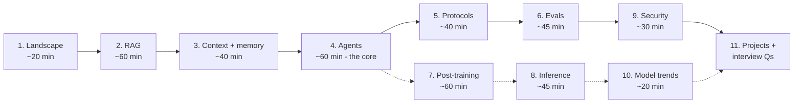

# AI Engineering in 2026: from RAG to production agents

This is a practical course on what AI/ML engineers build now. It covers knowledge bases (RAG), context and memory, agents, protocols (MCP, A2A, Skills), evaluation, post-training, inference, and security. Each chapter goes from the basic idea to the **2026 state of the art**, and each claim links to its source (paper or engineering blog).

Current as of **19 September 2026**.

Diagrams are Mermaid. Open any file and press `⇧⌘V` in VS Code to render them.

Related notes in this repo:
- [../rag_recall_literature_review.md](../rag_recall_literature_review.md): academic depth on retrieval recall (2020–2024)
- [../llm_external_knowledge_lit_review.md](../llm_external_knowledge_lit_review.md): knowledge base construction, latency and scale
- [../kernels_rl_reward_hacking_literature_review.md](../kernels_rl_reward_hacking_literature_review.md): RL and reward hacking in depth
- [../hardware/10-llm-inference-and-rl.md](../hardware/10-llm-inference-and-rl.md): the hardware side of inference and RL

## Chapters

| # | Chapter | You'll learn | New in 2026 |
|---|---|---|---|
| 1 | [The landscape](01-the-landscape.md) | what an AI engineer does, the stack, the decision ladder | the "harness era": the system around the model is the product |
| 2 | [RAG and knowledge bases](02-rag-and-knowledge-bases.md) | chunking, hybrid search, reranking, GraphRAG, agentic RAG | retrieval *during* reasoning, coverage > relevance, RL-trained retrievers |
| 3 | [Context engineering and memory](03-context-engineering-and-memory.md) | context budget, compaction, memory types | memory as a separate component, cache-aware context, demand paging |
| 4 | [Agents](04-agents.md) | the loop, tool design, workflows vs agents, multi-agent | brain/hands/session, managed agents, workflow compilation, idle-time speculation |
| 5 | [Protocols: MCP, A2A, Skills](05-protocols-mcp-a2a-skills.md) | how agents connect to tools, each other, and know-how | **stateless MCP (2026-07-28)**, A2A v1.0, SKILL.md standard |
| 6 | [Evaluation](06-evaluation.md) | error analysis, LLM-as-judge, RAG and agent metrics | judge benchmarks, trace-level evaluation, pass^k |
| 7 | [Post-training and RL](07-post-training-and-rl.md) | SFT, LoRA, DPO, GRPO, RLVR | DAPO / Dr.GRPO / GSPO, agentic RL, agents that do post-training |
| 8 | [Inference and serving](08-inference-and-serving.md) | KV cache, batching, quantization, speculative decoding | P-EAGLE, DFlash, SGLang Spec V2, disaggregated serving |
| 9 | [Security](09-security.md) | prompt injection, lethal trifecta, defenses | defense trilemma, Parallax, architecture over prompts |
| 10 | [Model trends](10-model-trends.md) | reasoning models, MoE, hybrid SSMs, diffusion LMs | what the new architectures mean for engineers |
| 11 | [Projects and interview questions](11-projects-and-interviews.md) | 6 build projects, 30 interview questions with answers | |
| — | [Glossary](12-glossary.md) | every term, one line each | |

## Technique deep dives

[techniques/](techniques/README.md) covers every major technique in each area (chunking, retrieval, memory, agents, evals, post-training, inference, prompting, security), with how it works, pros, cons, cost, published evidence, pitfalls, comparison tables and decision guides.

## Implementation track

For building these techniques yourself, not just understanding them: [implementation/](implementation/README.md) has step-by-step guides with tuning parameters, **common errors (symptom → cause → fix)** and ranked improvements. They're backed by tested reference code in [code/](code/README.md) (`pytest` runs 46 tests with no API key or GPU).

## How to study it

- **Application track (most AI engineer roles):** 1 → 2 → 3 → 4 → 5 → 6 → 9 → 11
- **Model/infra track (ML engineer, research engineer):** add 7, 8, 10
- Each chapter ends with **"check your understanding"** questions. Cover the answers and try them first.
- Reading alone won't teach this. Chapter 11 has six projects; build at least projects 1, 2 and 4.

## The seven ideas that explain everything

1. **The model is a component, and the harness is the product.** Most of the quality difference between AI products comes from context, tools, retrieval and evals, not from the choice of model (ch. 1, 4).
2. **Context is a scarce budget.** Every token you add costs money and latency and can distract the model ("context rot"). Deciding what goes in is the core skill (ch. 3).
3. **Retrieval is a tool the model calls, not a fixed first step.** RAG moved from "retrieve once, then answer" to "the model searches when it needs to, including mid-reasoning" (ch. 2, 4).
4. **Start with simple workflows and only add autonomy when evals show it pays.** Multi-agent systems cost many times more tokens (ch. 4).
5. **Standards won.** MCP (tools), A2A (agent-to-agent) and SKILL.md (know-how) are now cross-vendor. Learn them as you would learn HTTP (ch. 5).
6. **You can't improve what you don't measure.** Evals come from real failures, and LLM judges must themselves be checked against human labels (ch. 6).
7. **Prompt injection can't be solved by prompting.** Security comes from architecture: limit capabilities, separate reasoning from action, keep credentials out of reach (ch. 9).

## A note on sources

Research papers are cited by arXiv ID. Vendor blogs (Anthropic, Google, LMSYS, mem0, etc.) are marked as such, and **their performance numbers are the vendors' own claims**. Some trend articles repeat statistics without a primary source; where a number couldn't be traced, the chapter says so.
