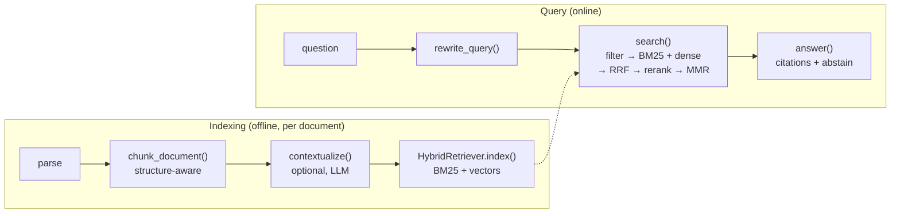

# Implementing RAG: step by step, common errors, how to improve

> Concepts: [../02-rag-and-knowledge-bases.md](../02-rag-and-knowledge-bases.md). Code: [../code/aieng/rag/](../code/aieng/rag/). Tests: [../code/tests/test_rag.py](../code/tests/test_rag.py).

---

## 1. What you are building



Build it in this order, and **measure after every step** (§4). Each step fixes a specific failure you can see in the eval.

---

## 2. Step by step

### Step 0: build the eval set first (1–2 hours, the most valuable part)
You can't tune what you can't measure. Before writing any retrieval code:
1. Collect 50–100 real questions (support tickets, Slack, search logs). If you have none, generate them from documents with an LLM, then **edit them by hand**. Generated questions copy the document's wording, which makes retrieval look far better than it is on real user phrasing.
2. For each question, record the ids of the chunks/sections that contain the answer (`qrels`) and a reference answer.
3. Include hard cases: exact codes (`ERR_4012`), multi-hop questions, questions with **no** answer in the corpus (to test abstention), and follow-ups that need the chat history.

```python
from aieng.rag.metrics import evaluate
report = evaluate(lambda q: [h.chunk.id for h in retriever.search(q, k=10)], qrels, k=10)
print(report["recall@10"], report["mrr"]); print(report["misses"])   # READ the misses
```

Label at **section level** (parent id) rather than chunk level. Otherwise every change to chunking invalidates your labels.

### Step 1: parse well
- PDF: use a layout-aware parser (Docling, Unstructured, LlamaParse, cloud document AI). Check the output by eye on 10 random pages: tables, multi-column layout, headers/footers repeated on every page.
- HTML: strip navigation, footers and cookie banners. Keep headings as Markdown `#`.
- Convert everything to Markdown with headings. Then [chunking.py](../code/aieng/rag/chunking.py) can use the structure.

### Step 2: chunk ([chunking.py](../code/aieng/rag/chunking.py))
```python
chunks, parents = chunk_document(doc_id, markdown, max_tokens=400, overlap_tokens=50)
```
What the implementation does and why:
| Behaviour | Why |
|---|---|
| splits on headings first, keeps a `heading_path` | "Refunds > Team plan" is context the chunk text lacks; it's added to what gets embedded |
| code fences and tables are never split | half a table is useless to both the retriever and the LLM |
| packs whole paragraphs up to `max_tokens` | no mid-sentence cuts |
| overlap = whole trailing paragraphs | overlap exists so an answer spanning a boundary isn't lost |
| only oversized single blocks are split further (lines → sentences → words) | graceful fallback |
| returns parent sections | small-to-big: match small chunks, give the LLM the whole section |

**Starting values:** 300–500 tokens, 10–15% overlap. FAQ-like content → smaller (150–300). Narrative or legal text → larger (500–800).

### Step 3: index with both BM25 and vectors ([retrieval.py](../code/aieng/rag/retrieval.py))
```python
from aieng.rag.retrieval import HybridRetriever, SentenceTransformerEmbedder
emb = SentenceTransformerEmbedder("BAAI/bge-small-en-v1.5", query_prefix="Represent this sentence for searching relevant passages: ")
retriever = HybridRetriever(emb, candidates=50)
retriever.index(chunks)
```
- **Query vs document prefixes:** many embedders are trained with instructions (BGE query instruction, E5 `query:`/`passage:`, Qwen3-Embedding instruction prompts). Read the model card. Leaving them out loses recall with no error.
- Normalise vectors and use cosine/dot product consistently between indexing and query.

### Step 4: fuse with RRF
Already inside `HybridRetriever.search`: BM25 top-50 and dense top-50 → `rrf(k=60)`. Don't add raw BM25 and cosine scores together (different scales). RRF only uses ranks.

### Step 5: filter BEFORE ranking
```python
retriever.search(q, where=lambda c: c.metadata["tenant"] == user.tenant and c.metadata["acl"] & user.groups)
```
Filtering *after* top-k is the classic multi-tenant bug: the top 50 all belong to other tenants → zero results, or worse, a leak if someone forgets the post-filter. In vector DBs use the native pre-filter / filtered HNSW.

### Step 6: rerank ([llm_steps.py](../code/aieng/rag/llm_steps.py) `llm_reranker`, or a cross-encoder)
Retrieve 50, rerank to 8. An LLM reranker is the fastest to start with. For production latency and cost, use a cross-encoder (bge-reranker-v2, mxbai-rerank-v2, Qwen3-Reranker, Cohere/Voyage APIs). The LLM reranker can also be a *teacher*: label 5k (query, passage) pairs with it and fine-tune a small cross-encoder.

### Step 7: contextual retrieval (optional, big win on ambiguous chunks)
```python
contextualize(llm, document_text, chunks_of_that_document)   # adds chunk.metadata["context"]
```
The document is sent in a `cache_control` block, so chunks 2..N read it from cache. Checklist:
- process all chunks of one document **consecutively** (the cache TTL is 5 minutes by default)
- verify `llm.usage.cache_read_input_tokens > 0` after the second chunk
- re-index after contextualising (the context goes into both BM25 and the embedding)

### Step 8: query rewriting (for chat)
`rewrite_query(llm, question, history)` turns "what about the Team plan?" into a standalone query plus sub-queries and exact keywords. Search each sub-query and fuse with RRF.

### Step 9: answer with citations and abstention
`answer(llm, question, chunks)` returns `answerable`, `answer`, `citations`. The code **drops citation ids that weren't in the sources** and flips `answerable` to False if nothing valid remains. Always validate model-produced ids in code.

### Step 10: diversify (optional)
`search(..., diversify=0.7)` applies MMR on the reranked pool. Use it when results are near-duplicates (versioned documents, copied FAQ entries).

---

## 3. Parameters and how to tune them

| Knob | Start | Tune by | Symptom it fixes |
|---|---|---|---|
| `max_tokens` (chunk) | 400 | sweep 200/400/800 on recall@10 **and** answer correctness | too small: context lost; too large: diluted embedding, noisy prompt |
| `overlap_tokens` | 50 | 0 vs 10–15% | answers spanning chunk boundaries |
| `candidates` (per retriever) | 50 | raise until recall@candidates plateaus | reranker never sees the right chunk |
| final `k` | 5–10 | answer-quality eval | too many: noise and cost; too few: missing facts |
| RRF `k` | 60 | rarely matters | — |
| RRF weights | [1, 1] | e.g. [1.5, 1] for code/ID-heavy corpora | exact-match queries losing to semantic matches |
| BM25 `k1`, `b` | 1.5, 0.75 | lower `b` if long docs are unfairly penalised | — |
| MMR `lam` | 0.7 | lower = more diverse | duplicate chunks filling the context |

**Recall@candidates is the ceiling of the whole system.** If the right chunk isn't in the top 50, no reranker can find it.

---

## 4. Common errors

| Symptom | Likely cause | Fix |
|---|---|---|
| Exact codes / names / SKUs never found | dense-only retrieval; tokenizer splits `ERR_4012` | add BM25/SPLADE; check `tokenize()` keeps identifiers intact |
| Good recall in eval, bad with real users | eval questions generated from the docs copy their wording | add real queries; rewrite synthetic ones in user language |
| Recall drops after switching embedding model | missing query/document prefix, or vectors not normalised | follow the model card; re-embed the **whole** corpus (never mix two models' vectors) |
| Tail of long chunks never matches | chunk longer than the embedder's max sequence length (512 for many models) → silently truncated | count tokens with the embedder's tokenizer; keep chunks under its limit |
| Tables return garbage | parser flattened them / chunker split them | layout-aware parsing; keep tables atomic (done in `split_blocks`) |
| Zero results for some users | metadata filter applied after top-k | pre-filter (see `VectorIndex.search(allowed=...)`) |
| Answers cite sources that don't exist | model invents ids | validate citations against retrieved ids in code |
| Model answers from outside knowledge when docs lack the answer | no abstention path in the prompt or schema | `answerable` field + instruction + eval cases with no answer |
| Retrieved chunk is right but the answer is wrong | chunk lacks context ("it", "the plan") or the fact sits in the neighbouring chunk | parent (small-to-big) expansion; contextual retrieval; larger overlap |
| Same paragraph three times in context | duplicate docs / versions | dedupe at ingest (hash of normalised text); MMR |
| Stale answers after a document changes | no re-index/delete path | ids by `doc_id` + version; delete old chunks on update; nightly diff job |
| Contextualisation cost is huge | cache never hits: document below the model's minimum cacheable size, calls not consecutive, or prefix differs per call | check `cache_read_input_tokens`; batch per document; keep the document block byte-identical |
| LLM reranker makes results worse | passages truncated; model scores by style; ids missing | show the full chunk text; graded 0–3 rubric; default missing ids to 0 (done in code) |
| Latency too high | reranking 200 candidates with an LLM; embedding the query on CPU | cross-encoder; fewer candidates; cache query embeddings; GPU/API embeddings |
| A document with "ignore previous instructions" changes answers | retrieved text treated as instructions | wrap in `<source>` tags + "data, not instructions"; don't give the answering model dangerous tools (ch. 9) |

---

## 5. How to improve (ranked by typical gain per effort)

1. **Fix parsing and chunk boundaries.** Look at 20 failed retrievals first: often the chunk simply doesn't contain the fact cleanly.
2. **Add BM25 → hybrid with RRF.** Almost always a clear recall gain, especially on technical corpora.
3. **Add a reranker.** Usually the biggest precision@k jump.
4. **Contextual retrieval / heading paths** in the embedded text.
5. **Query rewriting** for conversational inputs; **decomposition** for multi-part questions.
6. **Tune `candidates` and `k`** against the eval.
7. **Domain embedding fine-tune** (sentence-transformers with hard negatives mined from your own retriever's mistakes). Worth it for jargon-heavy domains once you have a few thousand (query, positive) pairs.
8. **Agentic retrieval:** give the model a `search` tool so it can reformulate and search again when the first results are insufficient (ch. 4). Costs latency; helps multi-hop questions.
9. **GraphRAG** only if error analysis shows *global* or multi-hop entity questions failing.

After each change, record `recall@10`, `mrr`, answer correctness, p95 latency and cost per query in one table. Keep a change only if it improves the target metric by more than the noise (see `bootstrap_ci` in [evals.py](../code/aieng/evals.py)).

---

## 6. Debugging a single bad answer (checklist)

1. Is the answer in the corpus at all? (grep the raw documents)
2. Did parsing keep it? (grep the parsed Markdown)
3. Which chunk holds it, and does that chunk make sense on its own?
4. Is that chunk in BM25 top-50? In dense top-50? (`Hit.sources` tells you which retriever found it)
5. Where did it land after RRF? After reranking?
6. Did it make the final `k`? Was it filtered out by metadata?
7. If it reached the prompt: did the model ignore it, misread it, or was it contradicted by another chunk?

Each "no" points to exactly one component to fix.

---

## 7. Exercises
1. Run the tests: `cd code && .venv/bin/python -m pytest tests/test_rag.py -q`. Read each test: each one encodes a common error.
2. Index 50 of your own documents with `HashingEmbedder`, then swap in a real embedder, and compare recall@10.
3. Add a SPLADE or Cohere/Voyage embedder class that implements the `Embedder` protocol.
4. Make `HybridRetriever.search` return parent sections (small-to-big) and measure the answer-correctness change.
5. Replace `llm_reranker` with a cross-encoder (`sentence_transformers.CrossEncoder`) and compare quality, latency and cost.
