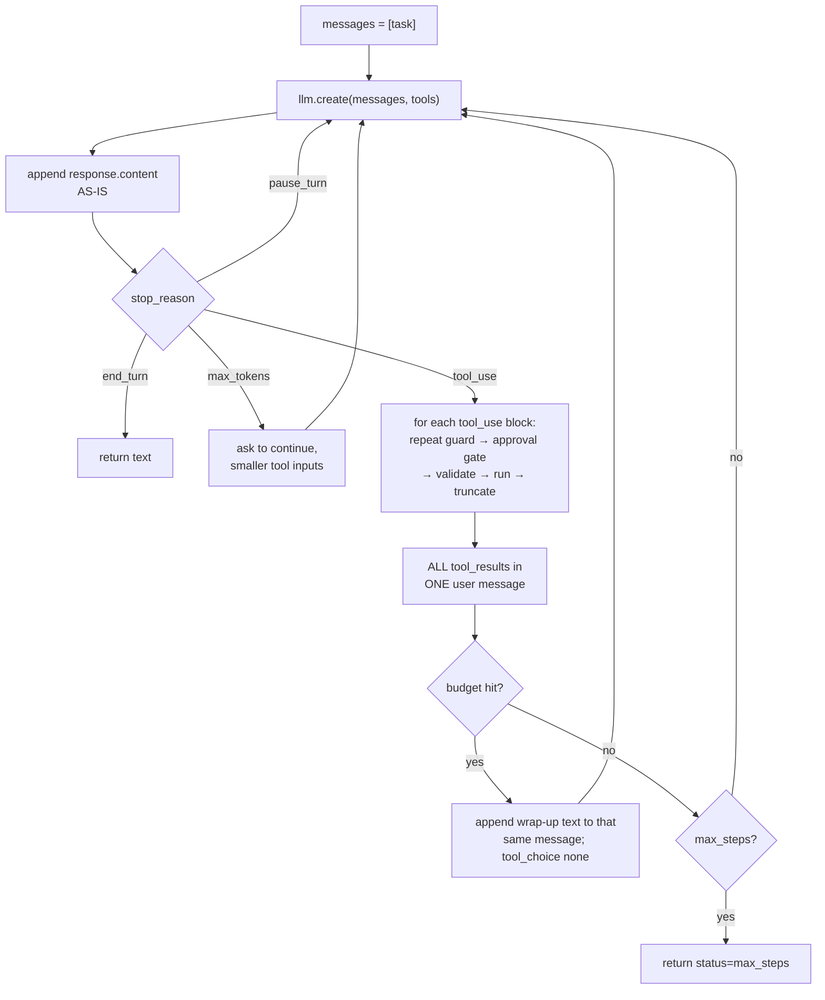

# Implementing agents: the loop, tools, sub-agents, and long runs

> Concepts: [../04-agents.md](../04-agents.md), [../03-context-engineering-and-memory.md](../03-context-engineering-and-memory.md). Code: [../code/aieng/agent/](../code/aieng/agent/). Tests: [../code/tests/test_agent.py](../code/tests/test_agent.py).

---

## 1. The loop, with every guard

[loop.py](../code/aieng/agent/loop.py) `run_agent()` is ~120 lines. Here's what each part protects against:



```python
from aieng.llm import LLM
from aieng.agent.loop import run_agent
from aieng.agent.tools import Tool, ToolRegistry

result = run_agent(LLM(), "Find the refund window for Team plans", ToolRegistry([search_tool]),
                   system=SYSTEM, max_steps=25, token_budget=300_000,
                   approve=lambda name, args: input(f"Allow {name} {args}? [y/N] ") == "y",
                   on_event=print)
print(result.status, result.steps, result.text)
```

### The rules the loop enforces
1. **Append `response.content` unchanged.** It contains `tool_use` blocks (the next request's `tool_result`s must reference their ids) and thinking blocks (on current Claude models these must be passed back unchanged).
2. **Every `tool_use` gets exactly one `tool_result`**, and all results from one assistant turn go in **one** user message. Splitting them across messages breaks parallel tool calling.
3. **Errors are results, not exceptions:** `is_error: True` plus a message saying what to do differently. The model self-corrects surprisingly well when the error is actionable.
4. **Handle every `stop_reason`:** `end_turn`, `tool_use`, `max_tokens` (a truncated tool call must not be executed), `pause_turn` (resend to let a server tool continue), `refusal` (raised by the `LLM` wrapper; `fallbacks: "default"` is enabled for Opus 5 so most declines are retried server-side on another model).
5. **Bound everything:** steps, tokens, identical repeated calls.

---

## 2. Tool design in code ([tools.py](../code/aieng/agent/tools.py))

```python
class SearchArgs(BaseModel):
    model_config = ConfigDict(extra="forbid")
    query: str = Field(description="Keywords, not a question. Include exact error codes verbatim.")
    limit: int = Field(10, ge=1, le=50)
    response_format: Literal["concise", "detailed"] = "concise"

Tool("search_docs",
     "Search internal documentation. Use for product behaviour, policies and error codes. "
     "Not for customer-specific data (use get_account). Returns titles + snippets; call read_doc for full text.",
     SearchArgs, search_docs)
```

| Practice | Implementation |
|---|---|
| schema from a Pydantic model | `args.model_json_schema()`; `extra="forbid"` rejects invented fields |
| validation errors the model can act on | `ToolRegistry.execute` returns `"Invalid arguments for X: limit: must be <= 50. Fix the arguments and call again."` |
| tool crashes don't kill the run | exception → `is_error` result with the type, message and location |
| outputs bounded | `truncate()` keeps head + tail and **says** it truncated |
| deterministic tool order | `schemas()` sorts by name: a changed order changes the prompt prefix and misses the cache |
| side-effect flag | `needs_approval=True` → loop calls `approve(name, args)` with the **exact** arguments |

**Description checklist** (the model reads these like documentation): what it does · when to use it · when *not* to (and what to use instead) · what it returns · format of tricky parameters · an example value.

---

## 3. Sub-agents ([subagent.py](../code/aieng/agent/subagent.py))

```python
lead_tools = ToolRegistry([delegate_tool(LLM(), worker_tools, max_steps=15, token_budget=150_000), *other_tools])
```
The `delegate` tool's schema *forces* a complete brief: `objective`, `context`, `output_format`, `scope_limit`. The sub-agent runs `run_agent` in a fresh context and returns only its final text, plus a note if it stopped early. Several `delegate` calls in one turn run in parallel (the loop uses a thread pool).

When to use: broad reading or searching where only the conclusion matters. When not to: small lookups (the overhead costs more than it saves), or tightly coupled work like editing the same files.

---

## 4. Long runs: context without breaking the rules

On current Claude models the transcript must be **append-only**. Editing or deleting earlier turns invalidates later thinking blocks: it's rejected with a 400 for accounts created on or after 31 Aug 2026, and planned for everyone on future models. It also breaks prompt caching. [context.py](../code/aieng/agent/context.py) gives four append-only-safe tools, in order of preference:

| # | Technique | Code | Notes |
|---|---|---|---|
| 1 | keep tool outputs small at the source | `Tool.max_output_chars`, `response_format`, pagination | the cheapest fix; do this first |
| 2 | server-side tool-result clearing | `create(**server_side_trimming(trigger_tokens=100_000, keep_recent_tool_uses=3, clear_at_least_tokens=20_000))` | the API clears its own copy; set `clear_at_least` so each clearing is worth the cache miss; `exclude_tools` for results you must keep |
| 3 | server-side compaction | `create(**server_side_compaction())` | append `response.content`, not just the text, or the compaction block is lost |
| 4 | client-side summary handoff | `messages = summarize_and_restart(llm, messages, task)` | structured `Handoff` (goal, done, decisions, state, next steps) seeds a **new** conversation; refuses to run mid tool round |

Also keep **notes outside the context**: give the agent a `write_file`/`todo` tool and tell it to maintain `PROGRESS.md`. After compaction it re-reads its own notes.

---

## 5. Parameters

| Knob | Start | Notes |
|---|---|---|
| `max_steps` | 25 (simple), 100+ (coding) | a hard stop; log when it's hit, since that's a failure to analyse |
| `token_budget` | 3–5× the median successful run | triggers wrap-up rather than a hard stop, so the user gets a partial answer |
| `max_repeats` | 2 | identical (name, args) calls beyond this return a guiding error |
| `effort` (`output_config`) | `high` for the lead agent; `low`/`medium` for simple sub-agents | the main quality/cost dial on current Claude models; measure per task |
| tools per agent | < 20 | more tools → more confusion; split into sub-agents or use tool search (`defer_loading`) |
| sub-agent budget | 10–20% of the lead's | stops runaway delegation |

---

## 6. Common errors

| Symptom | Cause | Fix |
|---|---|---|
| `400: tool_use ids found without tool_result` | a tool_use block didn't get a result (exception, skipped call, max_repeats path returned nothing) | every call → exactly one result; errors become `is_error` results |
| `400` about thinking blocks / prefix mismatch | history edited (trimmed, reordered, a message deleted) | append-only history; server-side clearing/compaction; summary handoff into a new conversation |
| Model stops making parallel calls | results for one turn were sent in several user messages | one user message with all results |
| Agent loops calling the same tool | ambiguous or empty results; error message not actionable | repeat guard; results that say what was searched and what to try next |
| Agent "finishes" without doing the task | the task spec is spread over several turns, or the stopping criterion is unclear | full spec up front; define "done" explicitly; verify step (run tests, re-read output) |
| Tool called with invented fields or wrong types | schema too loose | `extra="forbid"`, enums, `strict: true` on tool definitions for guaranteed schema-valid inputs |
| Tool call text appears in the answer instead of a real call | thinking disabled on Claude Opus 5 (known failure mode) | leave adaptive thinking on; lower `effort` instead of disabling thinking |
| Costs explode on long runs | every step re-sends a big context; cache misses | stable prefix (system + sorted tools), check `cache_read_input_tokens`, trim outputs at the source, server-side clearing |
| Cache hit rate ~0% | timestamp or per-request data in the system prompt; tool list order changes; switching models mid-run | freeze system prompt and tools; put volatile data in the latest user message; one model per conversation |
| Truncated/invalid tool JSON | `max_tokens` reached mid tool call | handle `stop_reason == "max_tokens"`; raise `max_tokens` (stream for large values) |
| Sub-agent returns something useless | vague brief; it lacks the lead's context | force brief fields (objective, context, output format, scope limit) |
| Sub-agents duplicate each other's work | lead didn't partition the task | ask the lead to assign disjoint scopes (files, sources, time ranges) |
| Agent takes a destructive action | no approval gate; approval showed a summary rather than the actual args | `needs_approval` + show exact arguments; least-privilege credentials (security guide) |
| Hard to debug what happened | no trace | `on_event` → Langfuse/Phoenix/OpenTelemetry spans; keep `AgentResult.trace` |

---

## 7. How to improve an agent (in this order)

1. **Read 20–50 transcripts** of failed runs and write down, for each, the step where it went wrong. Group them into categories (evals guide).
2. **Fix tools first:** descriptions, parameter design, output size, error messages. Most failures trace back to a tool.
3. **Improve the system prompt:** the goal, what "done" means, and how to verify its own work. Remove over-prescriptive step-by-step rules: current models do better with goals and constraints.
4. **Add a verification step:** run the tests, re-query, check the output against the spec.
5. **Tune `effort` and the model per role:** strong lead model, cheaper and lower-effort workers where evals allow.
6. **Context:** trim outputs at the source → server-side clearing → compaction.
7. **Only then** consider multi-agent, and measure the token multiplier against the quality gain.
8. For a stable, high-volume workflow: record traces and **distil** them into a smaller model (workflow compilation, fine-tuning guide).

---

## 8. Exercises
1. `pytest tests/test_agent.py -v` and read how each guard is tested.
2. Build a research agent: `search_web` + `fetch_page` tools, then add `delegate_tool`. Compare quality and tokens with and without sub-agents on 10 questions.
3. Add `on_event` → write JSONL traces; write a script that prints the step each failed run went wrong on.
4. Run a 200-step task with `server_side_trimming()` and plot `context_tokens(response)` per step with and without it.
5. Swap the hand-written loop for the SDK tool runner (`client.beta.messages.tool_runner`) and list which guards you'd need to re-add as hooks.
