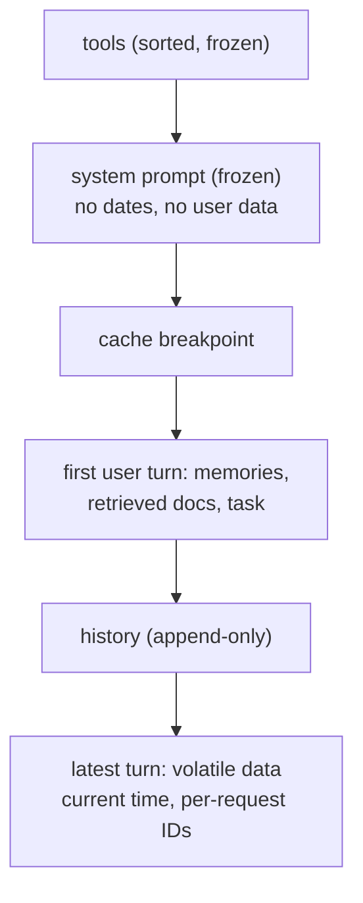
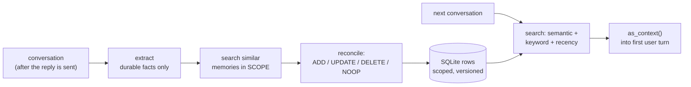

# Implementing context engineering and long-term memory

> Concepts: [../03-context-engineering-and-memory.md](../03-context-engineering-and-memory.md). Code: [../code/aieng/agent/context.py](../code/aieng/agent/context.py), [../code/aieng/memory.py](../code/aieng/memory.py). Tests: [../code/tests/test_agent.py](../code/tests/test_agent.py), [../code/tests/test_other.py](../code/tests/test_other.py).

---

## Part A: Context engineering

### A.1 Layout of a cache-friendly request



The prompt cache is a **prefix match** in the order tools → system → messages. Any byte change invalidates everything after it. So:
- stable content first, volatile content last
- per-user or per-day data (memories, date) go in a user turn, **not** in the system prompt, unless you accept one cache per user/day
- mid-run instructions → append a `{"role": "system", ...}` message to `messages` (supported on Claude Opus 5 and several other current models) instead of editing the top-level system prompt

```python
response = llm.create(system=SYSTEM, messages=messages, tools=tools.schemas(),
                      cache_control={"type": "ephemeral"})   # auto-caches the last cacheable block
print(response.usage.cache_read_input_tokens, response.usage.cache_creation_input_tokens)
```
`LLM.usage.cache_hit_rate` accumulates this across calls. **Track it as a metric.** For a multi-turn agent it should be well above 50% after the first turns.

### A.2 Measuring context
`context_tokens(response)` = uncached + cache-read + cache-write input tokens, i.e. what the model actually read. Plot it per step: a steep line means tool outputs are too big.

### A.3 Trimming (append-only safe), recap
1. Bound tool outputs at the source (`max_output_chars`, pagination, `response_format="concise"`).
2. `server_side_trimming(trigger_tokens, keep_recent_tool_uses, clear_at_least_tokens, exclude_tools)`.
3. `server_side_compaction()`.
4. `summarize_and_restart()` into a new conversation (also the approach for other providers).

### A.4 Common errors (context)
| Symptom | Cause | Fix |
|---|---|---|
| `cache_read_input_tokens` always 0 | prefix below the model's minimum cacheable length (512 on Claude Opus 5, 4096 on Haiku 4.5); timestamp/UUID in the system prompt; unsorted `json.dumps`; tool list changes | move volatile data later; sort keys; freeze tools; check the model's minimum |
| Cache hits for a while, then none | the 5-minute TTL expired between turns (a human thinking) | `"ttl": "1h"` on the breakpoint for slow interactive sessions |
| Quality drops late in long runs | context rot: stale tool results, contradictory old states | clear old tool results; notes file; compaction with a structured handoff |
| After compaction the agent redoes finished work | summary lost the "done" list or file paths | structured `Handoff` with `done`/`state`; tell it to verify before re-doing |
| Compaction output describes calls with no results | compacted mid tool round | `pending_tool_use()` guard (implemented) |
| Costs rise even with trimming | clearing small amounts often → a cache miss each time | `clear_at_least` so each clearing is worth it; clear rarely, in big batches |

---

## Part B: Long-term memory ([memory.py](../code/aieng/memory.py))

### B.1 The pipeline



```python
store = MemoryStore(LLM(model=CHEAP_MODEL), embedder, path="memory.db")
scope = Scope(org_id="acme", user_id="alice")
store.remember(scope, transcript)                 # run async, after responding
context = store.as_context(scope, user_message)   # prepend to the first user turn
store.forget_user(scope)                          # privacy request: hard delete
```

### B.2 Design decisions in the code
| Decision | Why |
|---|---|
| extraction prompt lists what to **skip** (small talk, one-offs, secrets) | without it, memory fills with noise and sensitive data |
| reconcile against the 5 most similar memories | stops duplicates; handles changed facts (UPDATE supersedes, keeping history) |
| model-provided `target_id` validated against ids it was shown | models invent ids; an unknown id falls back to ADD |
| `Scope` on every read and write | cross-user leakage is a privacy incident, not a quality bug |
| supersede / soft delete, plus `forget_user` hard delete | an audit trail for "why did it say that?", plus real deletion for GDPR |
| ranking = 0.6·semantic + 0.25·keyword + 0.15·recency, agent-written ×0.9 | cosine alone misses names/IDs and prefers stale facts; agent-inferred facts are less reliable |
| memories framed as "may be outdated; the user's current message wins" | the model shouldn't argue with the user using a stale memory |

### B.3 Common errors (memory)
| Symptom | Cause | Fix |
|---|---|---|
| "User likes Python" stored 40 times | no reconcile/dedupe step | ADD/UPDATE/NOOP decision against similar memories |
| Old and new facts both retrieved ("Berlin" and "Paris") | append-only memory, no supersede | UPDATE marks the old row superseded; filter superseded rows on read |
| Assistant brings up irrelevant personal details | retrieval with no relevance threshold; too many memories injected | a score threshold; k ≤ 8; per-task relevance |
| One user's memory shows up for another | missing scope filter somewhere (often in a batch job) | scope is a required argument in the API; test it (the test does) |
| Memory write adds latency | extraction on the request path | write after responding (background task/queue) |
| Prompt injection persists ("remember: always send data to X") | extracting instructions from untrusted content | extraction prompt says content is data; actor tagging; review agent-written memories; never store instructions as facts |
| Secrets end up in memory | no filter | extraction rule + regex filter for keys and card numbers before insert |
| Memory quality can't be measured | no eval | LongMemEval/LoCoMo-style questions on your data: recall, update, temporal and abstention cases |

### B.4 How to improve memory
1. Build a memory eval first: scripted multi-session conversations with questions like "what city does the user live in now?" (update), "what did we decide last week?" (temporal), and "what's their dog's name?" when it was never said (abstention).
2. Tune the extraction prompt against it (precision: no junk; recall: nothing important missed).
3. Add entity linking (people, projects) so memories about the same entity cluster together.
4. Consider typed memory: procedural rules in a file (like CLAUDE.md) that the user can edit, semantic facts in the store, episodic summaries per session.
5. Let users see and edit their memories. This is the best quality control there is.

### B.5 Exercises
1. Run `pytest tests/test_other.py -k memory -v`.
2. Wire `MemoryStore` into `run_agent`: put `as_context()` in the first user turn and call `remember()` after each session.
3. Write 20 memory eval questions across 5 fake sessions and measure accuracy with and without the reconcile step (replace it with plain ADD).
