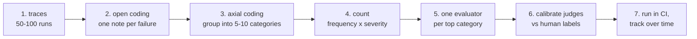

# Implementing evaluation: datasets, judges, statistics, CI

> Concepts: [../06-evaluation.md](../06-evaluation.md). Code: [../code/aieng/evals.py](../code/aieng/evals.py), [../code/aieng/rag/metrics.py](../code/aieng/rag/metrics.py). Tests: [../code/tests/test_other.py](../code/tests/test_other.py).

---

## 1. The workflow in practice



### Step 1: collect traces
Log every run as JSONL: input, retrieved context, tool calls with arguments and results, final output, cost, latency (`run_agent(..., on_event=...)` gives you the events). Or use Langfuse or Phoenix.

### Step 2: open coding (the step people skip)
Read each trace and write one free-text note about the **first** thing that went wrong: "searched with the full question instead of keywords", "cited the 2023 policy". Don't use predefined categories yet.

### Step 3: axial coding
Group the notes into categories. Typical result: `wrong_tool_args 18%`, `stale_doc 12%`, `no_abstain 9%`, `format 4%` …

### Step 4: prioritise
Frequency × severity. A 3% category that sends money to the wrong person outranks a 20% formatting issue.

### Step 5: one evaluator per category, code first
| Failure category | Evaluator |
|---|---|
| invalid JSON / schema | code: `Model.model_validate_json` |
| wrong tool / wrong args | code: compare tool calls to expected on labelled cases |
| cites non-existent sources | code: citation ids ⊆ retrieved ids |
| SQL wrong | code: execute and compare result sets (see `training/rewards.py`) |
| answer not grounded in context | LLM judge: `BinaryJudge(criterion="Every factual claim in the output is supported by the provided context")` |
| didn't abstain when it should | labelled no-answer cases + code check on `answerable` |
| tone / policy | LLM judge with pass and fail examples |

### Step 6: calibrate every LLM judge
```python
judge = BinaryJudge(llm, criterion=GROUNDED, pass_examples=..., fail_examples=...)
dev, test = labeled[:60], labeled[60:]           # tune on dev, report on test
print(judge.calibrate(dev))                       # iterate on the criterion text
a = judge.calibrate(test)
print(a.tpr, a.tnr, a.kappa); print([test[i] for i in a.disagreements])   # read them
```
Targets: TPR and TNR both ≥ 0.85–0.9 for a judge you gate releases on. **Report the corrected rate**, not the raw one:
```python
true_rate = corrected_pass_rate(observed_pass_rate, a.tpr, a.tnr)
```
A lenient judge (low TNR) inflates pass rates. The test in the repo shows a judge with TNR 0.6 turning a true 55% into an observed 70%.

### Step 7: statistics and CI
```python
lo, hi = bootstrap_ci(per_case_scores)   # 95% CI
```
With 50 cases the CI is about ±12 points. Don't ship on a 3-point "improvement". For agents, run each case n=5–10 times and report `pass_at_k(n, c, k)` (capability) **and** `pass_hat_k(n, c, k)` (reliability). An agent that passes 80% of single attempts passes all 5 attempts only about 25–33% of the time. That's what users experience as "flaky".

**CI setup:** a small fast suite (code checks, ~50 cases) on every PR; the full suite with judges nightly; block merges on regressions beyond the CI width.

---

## 2. Datasets

| Source | Pros | Watch out |
|---|---|---|
| production logs | real distribution | privacy (scrub PII); needs labelling |
| failure reports / tickets | high value per case | biased toward known failures |
| synthetic (LLM-generated) | fast coverage of edge cases | copies the phrasing of the source; too easy; **review by hand** |
| adversarial / red team | security and robustness | keep separate from the quality metrics |

Keep **a held-out test set you never tune on**. When you hill-climb prompts against the same 50 cases, you overfit them.

---

## 3. Common errors

| Symptom | Cause | Fix |
|---|---|---|
| Scores go up but users complain | eval set doesn't reflect real traffic; overfit to dev set | refresh from production; held-out test set |
| Judge says 95% pass, humans say 70% | uncalibrated judge; vague criterion; one "quality" judge for everything | one binary criterion per judge; calibrate; corrected rate |
| Judge prefers longer answers | length bias | criterion says length doesn't matter; examples of short passing answers; check pass rate vs length correlation |
| Pairwise results flip when order swaps | position bias | `pairwise_debiased` (ask twice, swapped) |
| Same judge model as the generator inflates scores | self-preference | a different model family for judging, or calibrate specifically for it |
| Flaky CI | non-deterministic generation + too few cases | repeat runs; CIs; thresholds with a margin |
| "72% → 75%, ship it" | noise | bootstrap CI; paired comparison on the same cases |
| Agent eval passes but the environment is wrong | grading the final message text | grade the **final state** (DB row, tests pass, file content) |
| Coding agent "passes" by editing tests | reward hacking | hidden tests; diff check that tests weren't modified |
| Eval costs too much to run often | judges on every case, every run | code checks first; sample for judges; Batch API (50% cheaper) for nightly runs |

---

## 4. How to improve your eval system
1. More **real** cases in the categories that matter, fewer generic ones.
2. Replace LLM judges with code checks wherever possible (cheaper, deterministic).
3. Agent-as-a-judge for agent tasks: the judge gets tools to inspect state (run the tests, query the DB).
4. Track **cost per successful task** and **p95 latency** next to quality: a quality gain that triples cost may not be worth shipping.
5. Online signals: thumbs, escalations, retries, edits of the model's output. Correlate them with offline scores to check the offline eval predicts reality.

## 5. Exercises
1. Take 50 traces from your RAG or agent project; do open and axial coding; write the category table.
2. Write a `BinaryJudge` for "answer is grounded"; label 80 examples; calibrate on 40 and report TPR/TNR/κ on the other 40.
3. Run your agent 8× on 20 tasks; report pass@1, pass@8 and pass^8 with `pass_at_k`/`pass_hat_k`.
