# Chunking techniques: a deep dive

> **Where this fits.** Overview: [../02-rag-and-knowledge-bases.md](../02-rag-and-knowledge-bases.md) §2.2 · Implementation: [../implementation/01-rag.md](../implementation/01-rag.md) · Code: [chunking.py](../code/aieng/rag/chunking.py) (structure-aware), [chunkers.py](../code/aieng/rag/chunkers.py) (sentence-window, semantic, cluster, late-chunking pooling).
>
> **Format of every technique section:** the idea in one sentence → a diagram of how it works → a worked example → step by step → pros and cons → evidence → pitfalls.

---

## 0. The running example

Every technique below is applied to the **same small document**, so you can compare the chunks each one produces.

```text
# ACME Billing Guide

## Refunds
Refunds are issued within 14 days of purchase. The Team plan has a 30-day window.
To request one, contact support with your order ID.

| Plan | Refund window |
|------|---------------|
| Pro  | 14 days       |
| Team | 30 days       |

## Card errors
If you see ERR_4012, the card was declined by the bank. It usually means
insufficient funds. Ask the customer to try another card.
```

And one test question: **"How long do Team customers have to get a refund?"** The answer needs "Team plan … 30-day window", which sits in the Refunds section and in the table.

### Where chunking sits in the pipeline

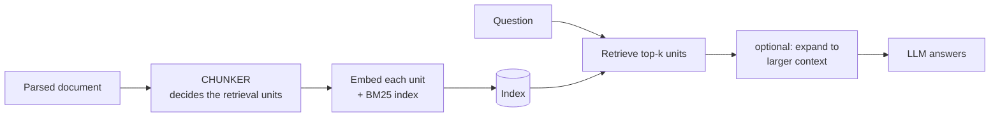

The chunker decides **what one vector represents** and **what text the LLM finally reads**. Many advanced techniques separate those two: they search with small units but give the LLM bigger ones.

### The core trade-off

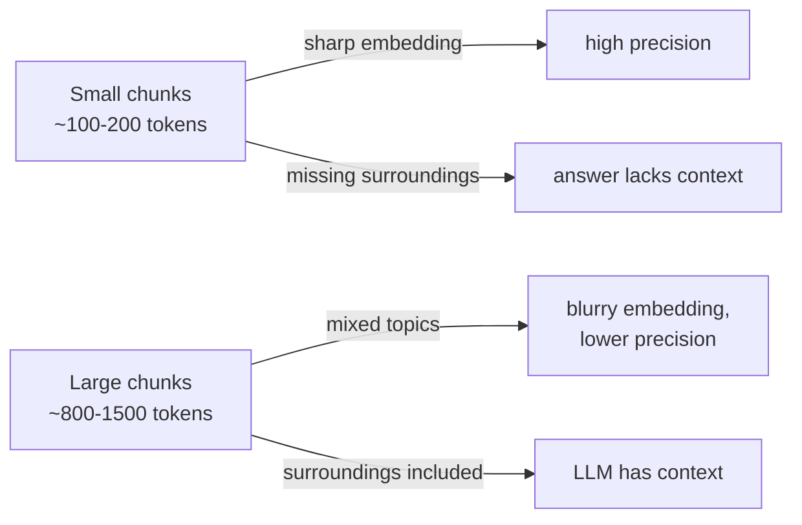

### How to measure a chunker
| Metric | Question it answers |
|---|---|
| recall@k, MRR | is the right chunk in the top k? |
| token-level IoU / precision (Chroma 2024) | how much of the retrieved *text* is actually relevant? (penalises huge chunks) |
| end-to-end answer accuracy | is the final answer right? (the one that matters) |
| indexing cost and time | can you afford to re-chunk the corpus when documents change? |

---

# Part 1: Rule-based techniques

## 1.1 Fixed-size chunking

**Idea.** Cut the text every N tokens, optionally repeating the last M tokens at the start of the next chunk.

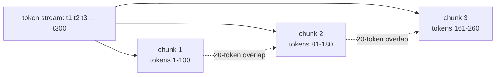

**Worked example** (N = 25 words, no overlap):
```text
chunk 1: "ACME Billing Guide Refunds Refunds are issued within 14 days of purchase. The Team plan has a 30-day window. To request one, contact"
chunk 2: "support with your order ID. | Plan | Refund window | |------|---------------| | Pro | 14 days | | Team |"
chunk 3: "30 days | Card errors If you see ERR_4012, the card was declined by the bank. It usually means insufficient funds..."
```
The table is cut in half: "Team |" ends chunk 2 and "30 days |" starts chunk 3. Neither half says "Team = 30 days".

**Step by step.** 1) Tokenise with the **embedding model's tokenizer**. 2) Slice windows of N tokens with stride N−M. 3) Decode each window back to text.

| Pros | Cons |
|---|---|
| trivial, fast (<1 s for large corpora), deterministic | cuts sentences, tables and code blocks anywhere |
| predictable size, so it always fits the embedder and the prompt budget | one chunk can join the end of one topic with the start of the next |

**Evidence.** In a 2026 comparison of 8 methods on 9 QA datasets, fixed-size scored **87.7% accuracy@5** against 89.4% for the best method, and ran in under a second where LLM-based methods took hours (arXiv 2606.00881). The NAACL 2025 Vectara study found semantic chunking's gains over fixed-size inconsistent (arXiv 2410.13070).
**Pitfall.** Chunks longer than the embedder's maximum input (often 512 tokens) are **silently truncated**, so their tails can never be found.

---

## 1.2 Recursive character splitting

**Idea.** Try to split on the "biggest" natural boundary first. Only if a piece is still too long, split it again on a smaller boundary.

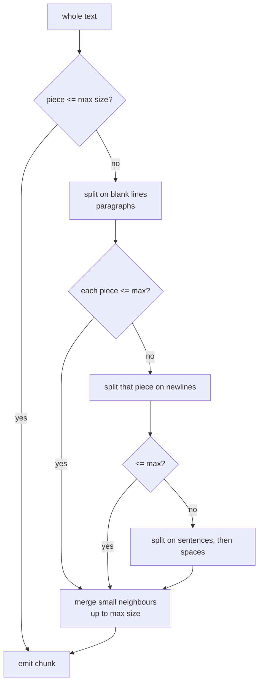

**Worked example** (max ≈ 40 words):
```text
chunk 1: "# ACME Billing Guide\n## Refunds\nRefunds are issued within 14 days of purchase. The Team plan has a 30-day window.\nTo request one, contact support with your order ID."
chunk 2: "| Plan | Refund window |\n|------|---------------|\n| Pro | 14 days |\n| Team | 30 days |"
chunk 3: "## Card errors\nIf you see ERR_4012, the card was declined by the bank. It usually means insufficient funds. Ask the customer to try another card."
```
Paragraph boundaries were respected, so the table stays whole. But chunk 2 (the table) no longer says it's about *refunds*.

| Pros | Cons |
|---|---|
| respects paragraphs and sentences where possible | knows only whitespace and punctuation, not headings or meaning |
| still fast and predictable; works on any text | a split-off table or list loses its heading |

**Evidence.** Chroma (text-embedding-3-large, top-5): recursive at **200 tokens, no overlap** was among the best balanced settings (recall 88.1%, IoU 6.9%). The once-common 800 tokens with 400 overlap had IoU 1.5%.
**Use when.** It's the default starting point for plain text.

---

## 1.3 Sentence-based chunking

**Idea.** Split into sentences with a real sentence splitter, then group sentences up to a size limit.

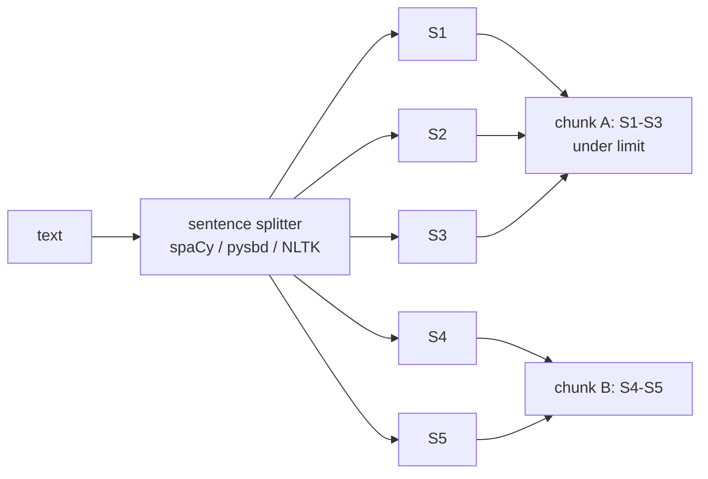

**Worked example.** The splitter must *not* break "e.g. at noon" or "Dr. Smith" into separate sentences. Our [`sentence_split`](../code/aieng/rag/chunkers.py) has an abbreviation list, and a test checks exactly this.

| Pros | Cons |
|---|---|
| never cuts mid-sentence | ignores topics and document structure |
| works well for non-English prose | splitters fail on code, lists, tables and some languages |

**Evidence.** In an Arabic RAG study, sentence-aware chunking scored best (74.8, vs 69.4 fixed-size and 66.9 semantic) (arXiv 2506.06339).

---

## 1.4 Structure-aware chunking (headings, HTML, PDF layout)

**Idea.** Use the author's own structure. Split on headings, keep tables, lists and code blocks whole, and attach the **heading path** to every chunk.

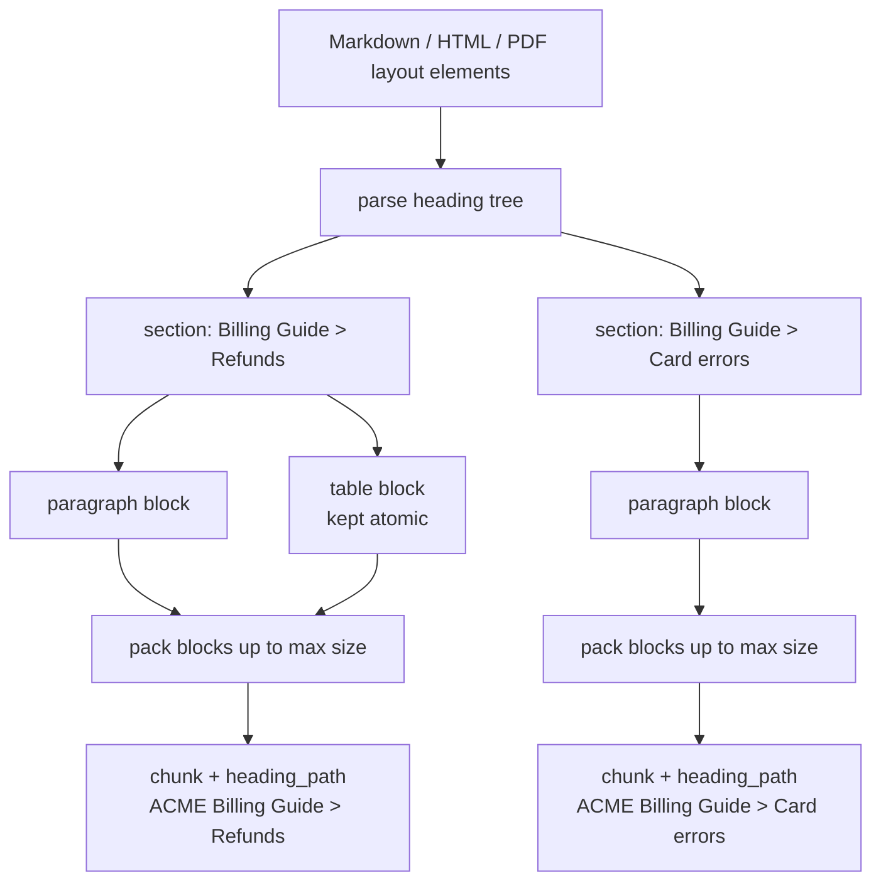

**Worked example** (our [`chunk_document`](../code/aieng/rag/chunking.py)). The **embedded text** includes the heading path:
```text
chunk 1 (embedded as):
  ACME Billing Guide > Refunds
  Refunds are issued within 14 days of purchase. The Team plan has a 30-day window.
  To request one, contact support with your order ID.

  | Plan | Refund window | ... | Team | 30 days |

chunk 2 (embedded as):
  ACME Billing Guide > Card errors
  If you see ERR_4012, the card was declined by the bank. ...
```
The test question now matches chunk 1 on "refund", "Team" *and* the table.

| Pros | Cons |
|---|---|
| chunks = the author's topical units; tables and code intact | only as good as the parser |
| heading paths add context for free | sections can be huge (needs a fallback splitter) or tiny (merge them) |
| citations point to real sections | inconsistent formatting across documents |

**Evidence.** NVIDIA (2024) found **page-level** (a structural unit) chunking had the best average accuracy (0.648) and lowest variance over 5 datasets. HiChunk (arXiv 2509.11552) shows hierarchical, structure-following chunking helps on long structured documents.
**Use when.** Docs, wikis, manuals, contracts, reports. It's usually the best practical default.

---

## 1.5 Page-level chunking

**Idea.** One chunk per page of a PDF or slide deck.

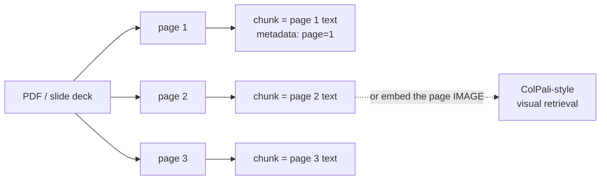

| Pros | Cons |
|---|---|
| keeps a figure, its caption and the text together | sentences broken across page boundaries |
| natural citation unit ("page 12") | pages can be long, so embeddings get diluted |
| robust across messy document types | |

**Evidence.** NVIDIA 2024: best average accuracy across financial reports, earnings and mixed PDFs.

---

## 1.6 Code chunking with the syntax tree (AST)

**Idea.** Parse the code and cut along **functions and classes**, not line counts.

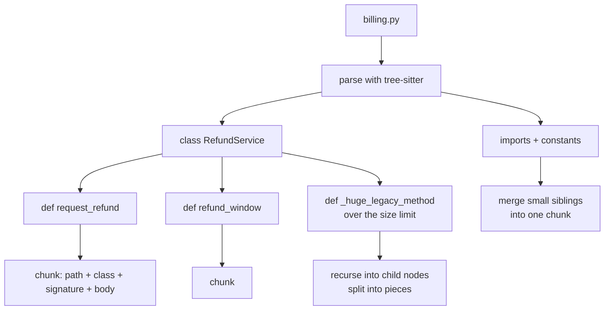

**Worked example.** A fixed 40-line window might cut `refund_window()` in half. AST chunking yields:
```text
chunk: "billing.py > class RefundService > def refund_window(self, plan: str) -> int:
            return 30 if plan == 'team' else 14"
```

| Pros | Cons |
|---|---|
| never cuts a function in half | needs a parser per language |
| language-independent method (tree-sitter) | cross-file context (callers, types) still missing |

**Evidence.** **cAST** (EMNLP Findings 2025, arXiv 2506.15655): **+4.3 Recall@5** on RepoEval and **+2.67 Pass@1** on SWE-bench versus line-based chunking.
**Alternative.** Coding agents often skip chunking entirely and use `grep` and file reads (just-in-time retrieval), which avoids stale indexes.

---

## 1.7 Table chunking

**Idea.** Never flatten a table into prose. Keep small tables whole; split big ones into **row groups that repeat the header**; optionally add a summary chunk.

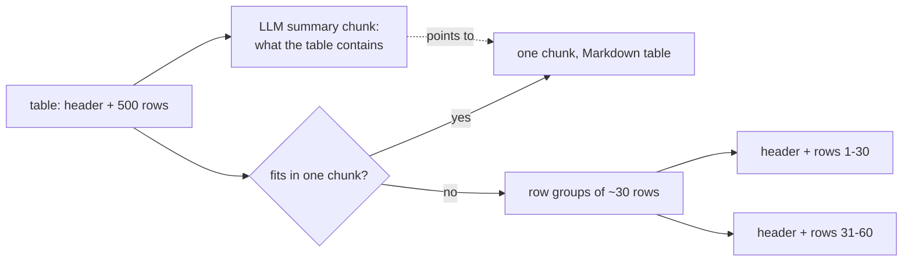

**Worked example.** Bad (flattened by a naive PDF parser): `"Plan Refund window Pro 14 days Team 30 days"`. Good: the Markdown table with its header, so "Team → 30 days" survives.
**When RAG isn't the answer.** "Total revenue across all regions" needs *all* rows. Load the table into SQL or pandas and give the agent a query tool.

---

## 1.8 Conversation chunking

**Idea.** Chunk chat logs by turn, by question-and-answer exchange, or by session, and attach speaker and time.

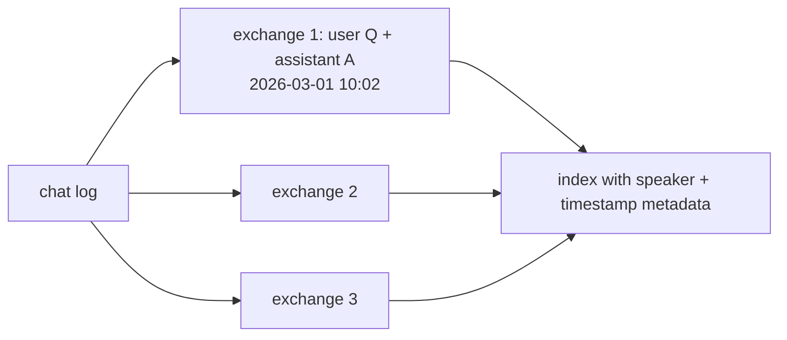

Meaning spans turns ("yes, that one") and time matters, so memory systems usually **extract facts** from conversations instead of chunking them. See [03-memory.md](03-memory.md).

---

# Part 2: Embedding-based techniques

## 2.1 Semantic breakpoint chunking

**Idea.** Embed every sentence; start a new chunk where the meaning changes sharply between two neighbouring sentences.

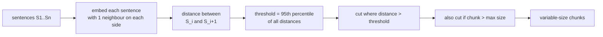

**Worked example.** Distances between consecutive sentences of the running example:
```text
S1 "Refunds are issued within 14 days..."  ─ 0.12 ─  S2 "The Team plan has a 30-day window."
S2                                          ─ 0.18 ─  S3 "To request one, contact support..."
S3                                          ─ 0.71 ─  S4 "If you see ERR_4012, the card..."   ← above threshold: CUT
S4                                          ─ 0.15 ─  S5 "It usually means insufficient funds."
S5                                          ─ 0.20 ─  S6 "Ask the customer to try another card."
Result: [S1 S2 S3] [S4 S5 S6]   (topic-pure chunks)
```

| Pros | Cons |
|---|---|
| boundaries follow topic changes | one embedding per sentence at indexing time |
| needs no document structure | **uncontrolled chunk size** unless you cap it |
| | sensitive to the threshold and the embedding model |
| | topic-pure chunks can lack the context needed to *answer* |

**Evidence.** Chroma: the original Kamradt chunker had *lower* recall (83.6%) than simple recursive splitting (~88%), mostly because its chunks averaged ~660 tokens. The Vectara NAACL 2025 study found the gains inconsistent and not worth the compute.
**Code.** [`semantic_chunks()`](../code/aieng/rag/chunkers.py), with the `max_tokens` cap. The test checks it cuts exactly at the cats→rockets topic change.

---

## 2.2 Cluster semantic chunking (global optimisation)

**Idea.** Instead of cutting at local jumps, choose **all** boundaries together so that sentences inside each chunk are as similar as possible, under a size limit.

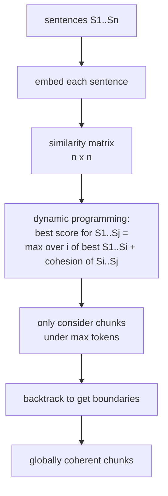

**Worked example.** With 6 sentences where S1–S3 are about refunds and S4–S6 about card errors, the DP compares every legal split, e.g. `[S1..S3][S4..S6]` vs `[S1 S2][S3 S4][S5 S6]`, and keeps the one with the highest total within-chunk similarity: the refunds/errors split.

| Pros | Cons |
|---|---|
| coherent chunks *and* controlled size | O(n × w²) similarity work per document |
| avoids greedy mistakes of breakpoint chunking | more moving parts |

**Evidence.** Chroma: ClusterSemanticChunker at 200 tokens had the **best precision and IoU** of all methods tested (IoU 8.0%). At 400 tokens it had 91.3% recall. In the 2026 comparison, clustering methods took 2–3 hours per dataset.
**Code.** [`cluster_chunks()`](../code/aieng/rag/chunkers.py).

---

## 2.3 Late chunking

**Idea.** Embed the **whole document first**, getting one vector per token that has "seen" the whole document. Only then cut, by averaging the token vectors inside each chunk.

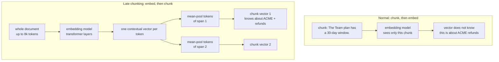

**Worked example.** The chunk "It usually means insufficient funds." embedded alone has no idea what "It" is. With late chunking, the tokens of "It" attended to "ERR_4012" and "card was declined", so the pooled vector sits near queries about *declined card errors*.

**Step by step.** 1) Tokenise the document; keep character→token offsets. 2) One forward pass → token embeddings. 3) Map each chunk's character span to token span. 4) Mean-pool and normalise ([`late_chunk_pool()`](../code/aieng/rag/chunkers.py)).

| Pros | Cons |
|---|---|
| context in every chunk vector, **with no LLM calls** | needs a long-context embedder that returns token vectors (open models; most APIs only return pooled vectors) |
| same index size as normal chunking | documents longer than the model window need macro-chunks |
| | doesn't help BM25 |

**Evidence.** Jina reported gains that grow with document length. A 2026 evaluation found late chunking **helped in-corpus retrieval but hurt in-document retrieval** (finding a needle inside one long document) (arXiv 2602.16974).

---

# Part 3: LLM-based techniques

## 3.1 Contextual retrieval (contextual chunk enrichment)

**Idea.** Keep your chunks, but have an LLM write a short "where this chunk comes from" note for each one, and index the note together with the chunk.

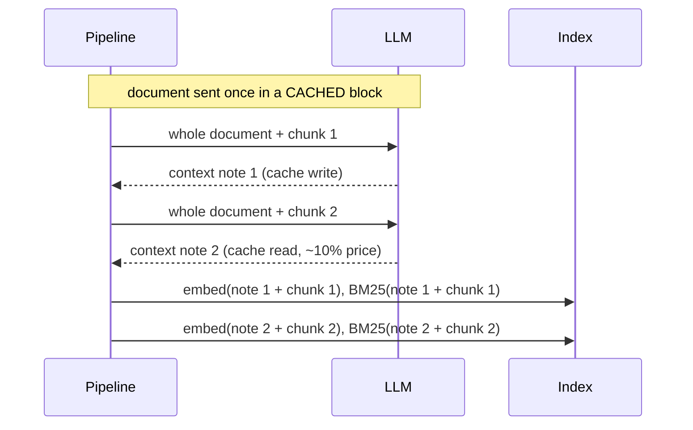

**Worked example.**
```text
original chunk:   "It usually means insufficient funds. Ask the customer to try another card."
context note:     "From ACME's Billing Guide, 'Card errors' section, explaining error ERR_4012 (card declined)."
indexed text:     note + chunk   → now matches "what does ERR_4012 mean?" in BOTH BM25 and vectors
```

| Pros | Cons |
|---|---|
| large, well-documented gains | one LLM call per chunk (cheaper with prompt caching) |
| helps BM25 too (unlike late chunking) | re-run when documents change |
| works with any embedder | a wrong note puts wrong information in the index |

**Evidence.** Anthropic (top-20 retrieval failure rate): **−35%** with contextual embeddings, **−49%** adding contextual BM25, **−67%** adding a reranker.
**Code.** [`contextualize()`](../code/aieng/rag/llm_steps.py): the document goes in a `cache_control` block; check `cache_read_input_tokens > 0`.

---

## 3.2 LLM-decided boundaries (agentic chunking, LumberChunker)

**Idea.** Let an LLM read a window of paragraphs and say where the topic changes.

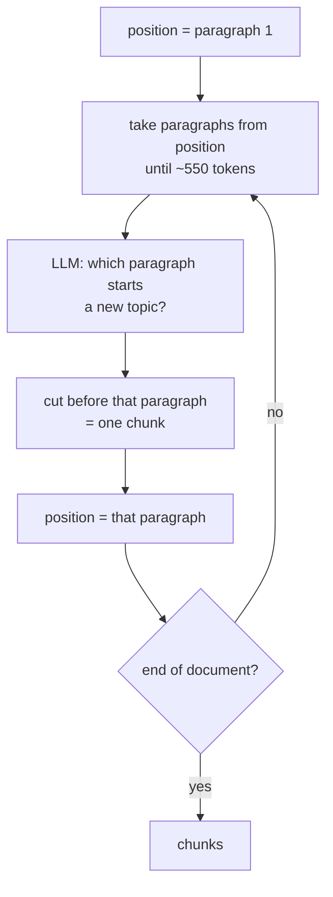

**Worked example.** Given P1 (refund rules), P2 (the table), P3 (card errors), the LLM answers "P3 starts a new topic", so the chunks are [P1 P2] and [P3], the same as a human would choose.

| Pros | Cons |
|---|---|
| human-like boundaries; catches subtle shifts | an LLM call for every window of the whole corpus |
| | slow; non-deterministic; brittle at scale |

**Evidence.** LumberChunker reported ~7% DCG@20 gains on GutenQA (narrative books). But a 2026 benchmark measured **8.4 hours per dataset**, with timeouts and failures, and 85.4% accuracy@5, *below* fixed-size (arXiv 2606.00881). Another 2026 study found it strong for in-document retrieval but beaten by simple methods for in-corpus retrieval (arXiv 2602.16974).

---

## 3.3 Proposition chunking (Dense X Retrieval)

**Idea.** Rewrite the text into **atomic, self-contained facts** and index those.

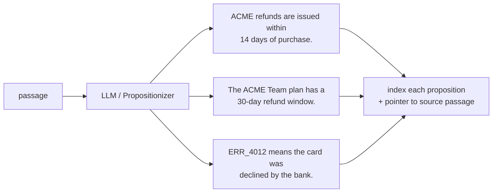

**Worked example.** The test question matches F2 almost word for word: "Team plan … 30-day refund window". Note that the LLM **resolved** "The Team plan" into "The ACME Team plan", which makes the fact self-contained.

| Pros | Cons |
|---|---|
| maximum information per vector; pronouns resolved | very expensive to build |
| excellent for factoid questions | loses nuance, reasoning and structure; can hallucinate facts |
| | the index grows large |

**Evidence.** The original paper found propositions beat passage- and sentence-level retrieval, especially for unsupervised retrievers. The 2026 large-scale comparison measured **~15 hours per dataset**, often failing (arXiv 2606.00881). **Best used as an extra index** that points back to parent passages.

---

## 3.4 Multi-representation indexing (summaries and hypothetical questions)

**Idea.** Index something *derived* from the chunk (a summary, or questions it answers), but return the original chunk.

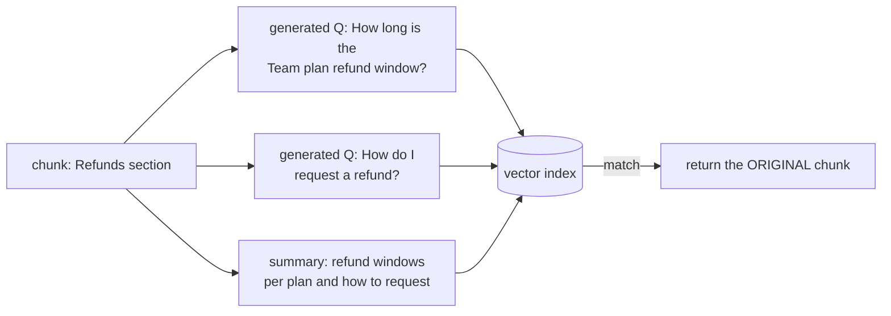

**Worked example.** The user's question "How long do Team customers have to get a refund?" is almost identical to generated question Q1, a much closer match than to the original prose.

| Pros | Cons |
|---|---|
| questions look like user queries | LLM cost per chunk; more vectors |
| summaries capture the gist of long chunks | generated questions may not match how real users ask |

---

## 3.5 Why better retrieval does not always mean better answers

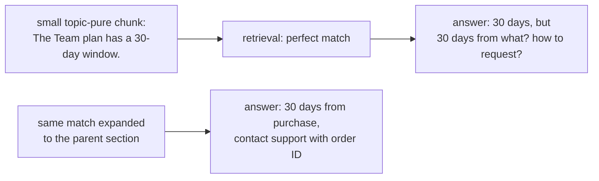

Several studies found small, topic-pure chunks win on recall but lose on end-to-end accuracy. **Measure both**, and pair small retrieval units with **context expansion** (Part 4).

---

# Part 4: Hierarchical and multi-granularity techniques

## 4.1 Sentence-window retrieval

**Idea.** Search over single sentences (precise), but hand the LLM the sentence **plus its neighbours**.

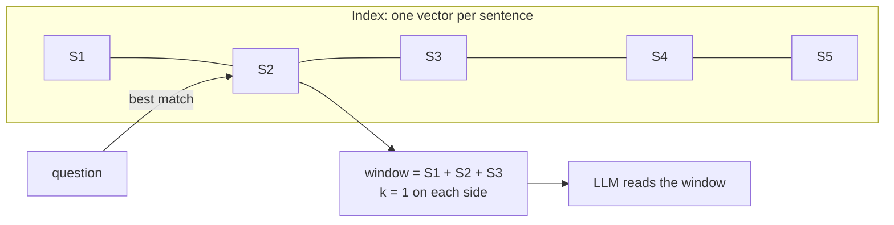

**Worked example** (k = 1): the match is S2 "The Team plan has a 30-day window." and the LLM receives "Refunds are issued within 14 days of purchase. **The Team plan has a 30-day window.** To request one, contact support with your order ID."
**Code.** [`sentence_windows()`](../code/aieng/rag/chunkers.py) stores the window in `metadata["window"]`.

| Pros | Cons |
|---|---|
| precise match + local context; cheap | one vector per sentence (big index) |
| | context further away is still missed; merge overlapping windows |

---

## 4.2 Parent–child (small-to-big) and auto-merging

**Idea.** Index small **child** chunks that point to a large **parent** (a section). Search children, return parents. **Auto-merging**: if many children of one parent match, return the parent instead.

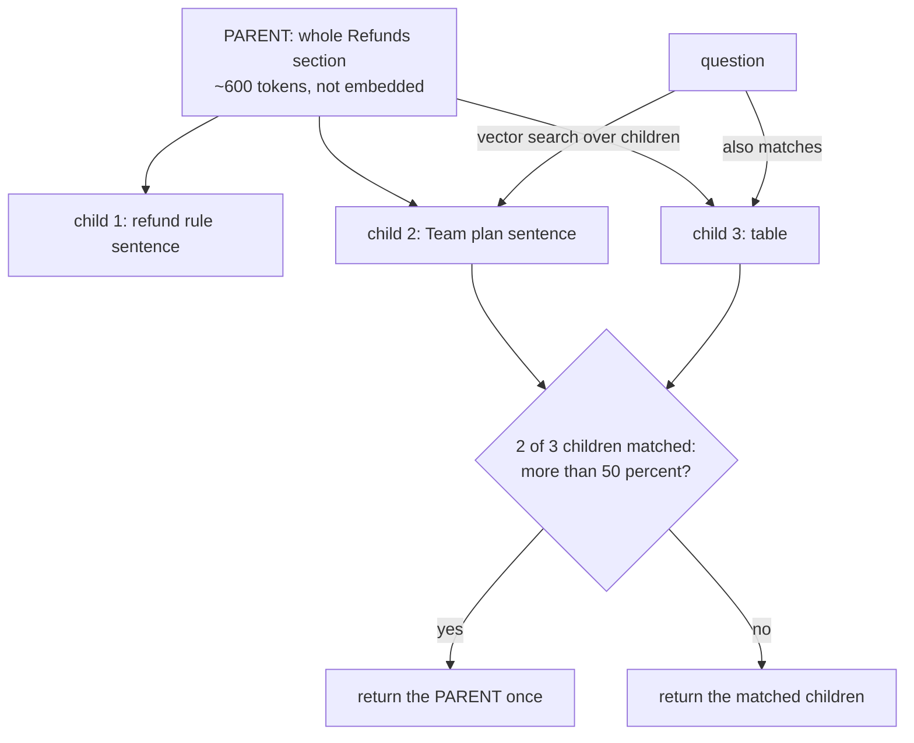

| Pros | Cons |
|---|---|
| the standard fix for the size trade-off | parents can be large (token cost) |
| simple; works with any splitter | dedupe needed when several children share a parent |

**Code.** [`chunk_document`](../code/aieng/rag/chunking.py) returns children + parent sections.

---

## 4.3 RAPTOR (tree of recursive summaries)

**Idea.** Cluster chunks by similarity, summarise each cluster, then cluster and summarise the summaries, building a tree. Search all levels at once.

```mermaid
flowchart BT
    L1["leaf: refund rules"] --> S1["summary A: refund policy<br/>and windows per plan"]
    L2["leaf: refund table"] --> S1
    L3["leaf: how to request"] --> S1
    L4["leaf: ERR_4012"] --> S2["summary B: card errors<br/>and what support should do"]
    L5["leaf: other errors"] --> S2
    S1 --> ROOT["root: ACME billing covers refunds<br/>and payment errors"]
    S2 --> ROOT
```

**How queries use it** ("collapsed tree"): all nodes (leaves, summaries, root) go into one index.
- "What's the Team refund window?" → matches **leaf** L2.
- "Summarise ACME's billing policies" → matches **summary** or **root** nodes, which no single leaf could answer.

**Step by step.** 1) Chunk and embed. 2) Reduce dimensions (UMAP) and soft-cluster (Gaussian mixture). 3) LLM-summarise each cluster → new nodes. 4) Repeat until one cluster is left. 5) Index every node.

| Pros | Cons |
|---|---|
| answers questions that need information spread across a long document | many LLM summarisation calls |
| multiple levels of detail | rebuild needed when documents change |
| | summaries can drop or distort details |

**Evidence.** RAPTOR (arXiv 2401.18059) reported state-of-the-art results on QuALITY, NarrativeQA and QASPER, including a **20-point absolute gain on QuALITY** with GPT-4.

---

## 4.4 Mixed granularity

**Idea.** Index several chunk sizes and pick one per query.

```mermaid
flowchart LR
    Q["question"] --> R{"router: factoid<br/>or analytical?"}
    R -->|factoid| SM["256-token index"]
    R -->|analytical| LG["1024-token / page index"]
    SM & LG --> LLM["LLM"]
```

**Evidence.** NVIDIA 2024: factoid queries were best at 256–512 tokens; analytical queries at 1,024+ or whole pages.

---

# Part 5: Size and overlap, based on evidence

| Knob | What the studies found | What to do |
|---|---|---|
| **Chunk size** | NVIDIA: factoid 256–512, analytical 1,024+. Chroma: 200-token chunks had the best precision at similar recall. A 2026 study: size correlates only weakly with in-corpus quality | start at 256–512; sweep 128/256/512/1024 on **your** eval |
| **Overlap** | Chroma, 400-token chunks: 200 overlap had *lower* recall (88.1%) than no overlap (89.5%), and lower precision | start at 0–10%; use sentence windows or parent expansion instead of big overlaps |
| **Embedder limit** | text past the limit is dropped silently | count tokens with the embedder's tokenizer |
| **Headings/titles in the embedded text** | free context, the same idea as contextual retrieval without an LLM | always include them |
| **Embedder quality** | Vectara: with strong embeddings, the chunking choice mattered less | upgrading the embedder can beat fancy chunking |

---

# Part 6: Comparison and decision guide

| Technique | Boundary quality | Size control | Context in chunk | Indexing cost | Best for |
|---|---|---|---|---|---|
| Fixed-size | low | exact | low | ~0 | baselines, huge corpora |
| Recursive | medium | good | low | ~0 | **default for plain text** |
| Sentence | medium | good | low | low | prose, non-English |
| Structure-aware | high if structured | fallback needed | medium (heading path) | low | **default for docs** |
| Page-level | medium | per page | medium | ~0 | PDFs, slides |
| AST (code) | high | good | medium | low | code |
| Semantic breakpoint | medium–high | poor unless capped | low | embed every sentence | transcripts |
| Cluster semantic | high | good | low | higher | measured boundary problems |
| Late chunking | as base | as base | **high, no LLM** | one long pass | self-hosted embedders |
| Contextual retrieval | as base | as base | **high** | LLM per chunk (cached) | ambiguous chunks |
| LLM boundaries | highest (narrative) | varies | low | **very high** | small narrative corpora |
| Propositions | atomic | tiny | high per unit | **very high** | factoid KBs, as an extra index |
| Multi-representation | as base | as base | high | LLM per chunk | FAQ / support KBs |
| Sentence window | precise | sentence + window | medium | vectors per sentence | dense factual prose |
| Parent–child | as base | two levels | high | low | **almost always** |
| RAPTOR | multi-level | tree | highest for global Qs | many LLM summaries | long docs, thematic Qs |

```mermaid
flowchart TD
    A["What is the content?"] -->|code| CODE["AST chunking,<br/>or grep-style agent tools"]
    A -->|PDF reports / slides| PDF["layout-aware parse, page or<br/>section chunks, tables whole,<br/>maybe ColPali page images"]
    A -->|docs with headings| STRUCT["structure-aware + heading paths"]
    A -->|plain prose / transcripts| PROSE["recursive 256-512 tokens,<br/>sentence-aware for non-English"]
    STRUCT --> B["add parent-child expansion"]
    PDF --> B
    PROSE --> B
    CODE --> B
    B --> C{"eval: chunks ambiguous<br/>out of context?"}
    C -->|yes| D["contextual retrieval,<br/>or late chunking if self-hosted"]
    C -->|no| E{"global / thematic<br/>questions failing?"}
    D --> E
    E -->|yes| F["RAPTOR or GraphRAG"]
    E -->|no| G{"boundary errors<br/>in the misses?"}
    G -->|yes| H["cluster semantic, or LLM<br/>boundaries for small corpora"]
    G -->|no| I["tune size and k, then improve<br/>the embedder and reranker"]
```

**Summary of the 2024–2026 evidence:** simple chunking that respects document structure is hard to beat. The reliable big wins come from **adding context** (heading paths, parent expansion, contextual retrieval) and from **better embedders and rerankers**, not from clever boundary detection.

---

## Check your understanding
1. **Run the test question through fixed-size chunking (§1.1). Why does it fail?** The table row "Team | 30 days" is split across two chunks, so neither says Team = 30 days.
2. **Why can semantic chunking win on recall but lose on answers?** Its topic-pure chunks match well but carry too little surrounding context (§3.5).
3. **What does late chunking change?** It embeds the whole document first and pools token vectors per chunk, so each vector carries document context without LLM calls.
4. **Contextual retrieval vs late chunking?** Contextual: LLM-written notes that help dense *and* BM25, at one LLM call per chunk. Late: no LLM, dense only, needs a token-level long-context embedder.
5. **Why can overlap hurt?** It duplicates text: lower precision, near-duplicate results, more tokens.
6. **When is RAPTOR worth it?** Long, static documents with questions that need a synthesis across the document.

---

## Sources
- Chroma, *Evaluating Chunking Strategies for Retrieval* (2024): https://www.trychroma.com/research/evaluating-chunking
- Qu, Tu & Bao, *Is Semantic Chunking Worth the Computational Cost?* (NAACL Findings 2025): arXiv 2410.13070
- NVIDIA, *Finding the Best Chunking Strategy for Accurate AI Responses* (2024): https://developer.nvidia.com/blog/finding-the-best-chunking-strategy-for-accurate-ai-responses/
- *Chunking Methods on RAG: Effectiveness vs Computational Cost* (2026): arXiv 2606.00881
- *Beyond Chunk-Then-Embed: Taxonomy and Evaluation of Document Chunking Strategies* (2026): arXiv 2602.16974
- *Optimizing RAG Pipelines for Arabic* (2025): arXiv 2506.06339
- Günther et al., *Late Chunking* (Jina AI, 2024): arXiv 2409.04669
- Anthropic, *Introducing Contextual Retrieval* (2024): https://www.anthropic.com/news/contextual-retrieval
- Duarte et al., *LumberChunker* (EMNLP Findings 2024): arXiv 2406.17526
- Chen et al., *Dense X Retrieval* (2023): arXiv 2312.06648
- Sarthi et al., *RAPTOR* (ICLR 2024): arXiv 2401.18059
- *HiChunk* (2025): arXiv 2509.11552
- Zhang et al., *cAST* (EMNLP Findings 2025): arXiv 2506.15655
