# Retrieval and RAG architectures: a deep dive

> **Where this fits.** Overview: [../02-rag-and-knowledge-bases.md](../02-rag-and-knowledge-bases.md) · Implementation: [../implementation/01-rag.md](../implementation/01-rag.md) · Code: [retrieval.py](../code/aieng/rag/retrieval.py) (BM25, vectors, RRF, MMR, hybrid), [llm_steps.py](../code/aieng/rag/llm_steps.py) (rewrite, rerank, cited answers) · Chunking: [01-chunking.md](01-chunking.md).
>
> **Format:** idea → diagram → worked example → pros/cons → evidence.

---

## 0. Running example

A support knowledge base (ACME billing docs, error codes, plan pages, changelogs), and four queries:

| id | Query | What makes it hard |
|---|---|---|
| **Q-exact** | "ERR_4012" | a rare exact token |
| **Q-para** | "my payment keeps getting rejected" | paraphrase: the docs say "card declined" |
| **Q-multi** | "Which plan has a longer refund window than Pro, and how do I request that refund?" | two hops: compare plans, then find the procedure |
| **Q-global** | "What are the most common reasons customers get refused refunds?" | needs a synthesis across hundreds of tickets |

### The retrieval pipeline and where each technique plugs in

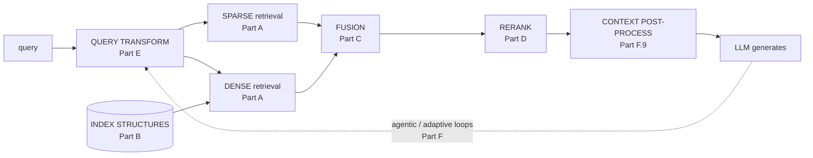

---

# Part A: Representations

## A.1 BM25 (sparse, lexical)

**Idea.** Score documents by how often they contain the query's words, weighted by how rare each word is across the corpus.

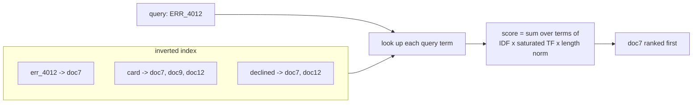

**The formula in words.** For each query term: `IDF(term)` (rare terms count more) × `tf·(k1+1) / (tf + k1·(1 − b + b·doclen/avglen))` (repeats help but saturate; long documents are penalised). k1 ≈ 1.2–2.0, b ≈ 0.75.

**Worked example.** "ERR_4012" appears in 1 of 10,000 docs, so its IDF is very high and doc7 wins easily. For **Q-para**, "rejected" never appears in the docs (they say "declined"), so BM25 fails.

| Pros | Cons |
|---|---|
| exact names, codes, IDs, rare terms | no synonyms or paraphrase |
| no training; fast; explainable | tokenisation-sensitive (keep `ERR_4012` whole; our `tokenize()` does) |
| robust out of domain | |

**Evidence.** On BEIR (2021), BM25 beat many dense retrievers of that time out of domain. That's why hybrid search is standard.

## A.2 Document and query expansion

**Idea.** Add missing vocabulary: to documents at index time (**doc2query**) or to the query at search time (**query2doc**).

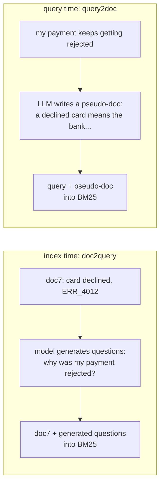
**Worked example.** After expansion, Q-para's "rejected" matches doc7 through the generated question (doc2query), or "declined" appears in the expanded query (query2doc).
**Trade-off.** doc2query costs one generation per chunk at index time; query2doc costs one LLM call per query.

## A.3 SPLADE (learned sparse)

**Idea.** A neural model assigns a weight to **every vocabulary word** for each text, including words the text doesn't contain.

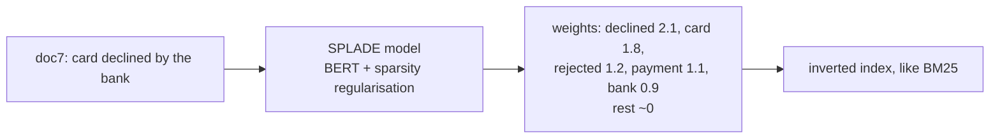
**Worked example.** The model learned that "declined" docs are relevant to "rejected", so it gave doc7 weight on "rejected". Q-para now matches. The exact term "err_4012" also gets a high weight, so Q-exact still works.

| Pros | Cons |
|---|---|
| BM25-like exactness + learned expansion | needs model encoding at index time |
| interpretable; inverted-index serving | mostly English-trained models; bigger postings |

## A.4 Dense embeddings (bi-encoder)

**Idea.** Encode query and document **separately** into one vector each; similar meaning → nearby vectors.

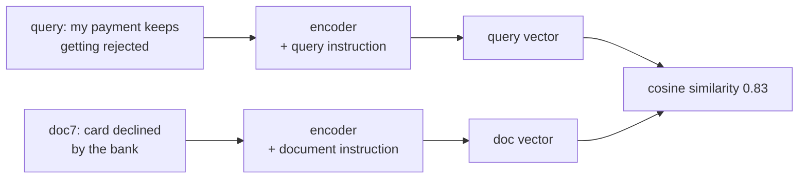
**Worked example.** Q-para ↔ doc7: cosine 0.83 (high), so the paraphrase is solved. Q-exact "ERR_4012" ↔ doc7: the embedding sees a string of characters and digits it barely understands, and a doc about ERR_4013 may score just as high.

**Knobs:**
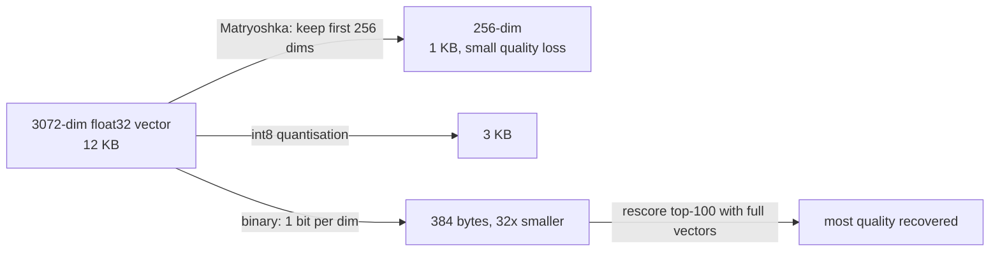
- **Instructions/prefixes** for query vs document matter (E5 `query:`/`passage:`, Qwen3/NV-Embed instructions).
- **Domain fine-tuning** with hard negatives mined from your retriever's own mistakes.

| Pros | Cons |
|---|---|
| paraphrase and meaning | weak on rare exact tokens and negation |
| 1 vector per chunk; scales to billions with ANN | one vector compresses a whole chunk (bottleneck) |
| | re-embed everything to change models; input length limit |

## A.5 Multi-vector late interaction (ColBERT)

**Idea.** Keep **one vector per token**. Each query token finds its best-matching document token (MaxSim), and the scores are summed.

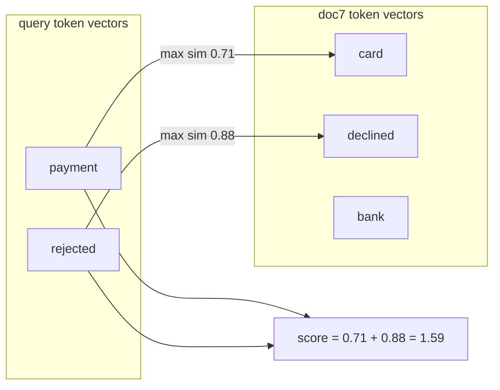
**Why it's better.** Term-level alignment: "rejected" is matched specifically to "declined", not averaged into one vector with everything else in the chunk.

| Pros | Cons |
|---|---|
| much finer matching than one vector; strong out of domain | storage: a vector per token (compressed in ColBERTv2) |
| also usable as a reranker | specialised serving (PLAID, Vespa, Qdrant/Weaviate multi-vector) |

MUVERA (2024) converts multi-vector sets into single fixed-size vectors so ordinary ANN indexes can do the first stage.

## A.6 ColPali / ColQwen (visual page retrieval)

**Idea.** Embed **page images** into patch vectors with a vision-language model. No OCR, no parsing, no chunking.

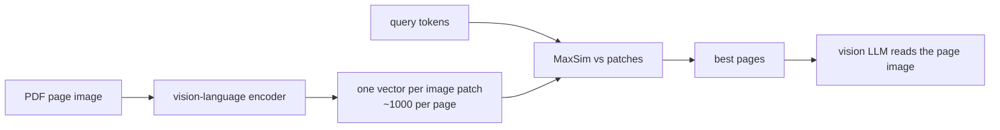
**Worked example.** A pricing page whose refund windows sit in a **chart**: text extraction loses the chart, but ColPali matches the query to the chart's patches.

---

# Part B: Vector index structures

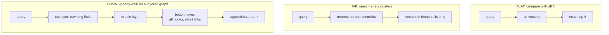

| Index | How | Recall / speed | Memory | Updates | Use when |
|---|---|---|---|---|---|
| **Flat** | brute force | exact; O(N) | vectors only | instant | < ~1M vectors; ground truth |
| **IVF** | k-means cells; probe `nprobe` cells | tune nprobe | + centroids | re-cluster over time | large static sets |
| **IVF-PQ** | IVF + vectors compressed to bytes (product quantisation) | lower; rescore needed | **tiny** | training needed | billions on limited RAM |
| **HNSW** | layered small-world graph, greedy search | **high recall, low latency** | high | inserts OK, deletes awkward | the default in most vector DBs |
| **DiskANN** | SSD-resident graph | high at billion scale | low RAM | slow builds | huge, cost-sensitive |
| **ScaNN** | anisotropic quantisation + tree | very high QPS | small | training | very high throughput |

**HNSW knobs:** `M` (links per node), `ef_construction` (build quality), `ef_search` (the query-time recall/latency dial).
**Filtered search:** the filter must be applied *inside* the index (pre-filter / filter-aware HNSW). Post-filtering loses results ([`VectorIndex.search(allowed=…)`](../code/aieng/rag/retrieval.py) shows the bug and the fix).
**Always measure ANN recall** against flat search on a sample.

---

# Part C: Fusion (hybrid search)

## C.1 Reciprocal Rank Fusion (RRF)

**Idea.** Combine ranked lists using **ranks only**: `score(d) = Σ 1 / (k + rank)`, k = 60.

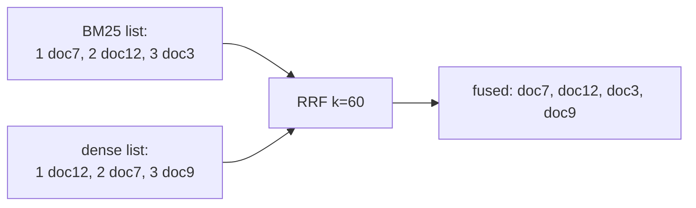
**Worked example:**
```text
doc7 : 1/(60+1) + 1/(60+2) = 0.01639 + 0.01613 = 0.03252
doc12: 1/(60+2) + 1/(60+1) = 0.03252   (tie with doc7)
doc3 : 1/(60+3)            = 0.01587
doc9 : 1/(60+3)            = 0.01587
```
Documents found by **both** retrievers rise to the top, with no score calibration needed.

## C.2 Convex combination
**Idea.** `α·norm(dense) + (1−α)·norm(bm25)` after min-max or z-score normalisation.
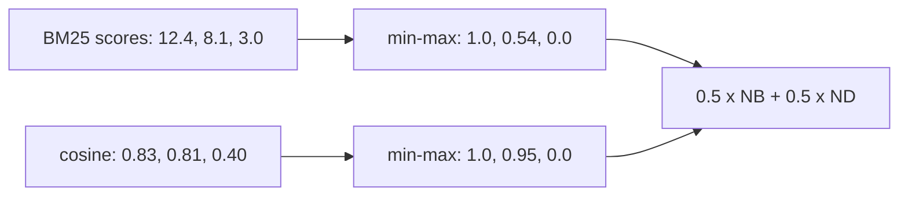
Unlike RRF, it uses **how much** better the top result is. **Evidence:** Bruch et al. (ACM TOIS 2023) found a tuned convex combination beat RRF in and out of domain with only a small labelled set, and that RRF is sensitive to k. **Advice:** start with RRF; switch once you have ~50–100 labelled queries.

---

# Part D: Reranking

**Idea.** Retrieve many candidates cheaply, then rescore the top ones with a model that reads query and passage **together**.

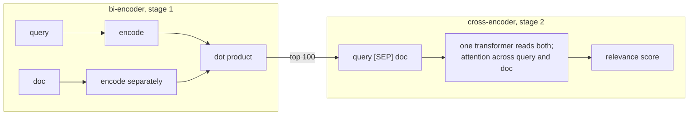
**Worked example.** For Q-multi, the dense stage ranks a *Pro plan* refund page above the Team page (both are "about refunds"). The cross-encoder reads "longer than Pro" together with each passage and puts the Team page (30 days > 14 days) first.

| Reranker | How | Quality | Cost |
|---|---|---|---|
| cross-encoder (bge-reranker, mxbai, Qwen3-Reranker, Cohere, Voyage) | joint encoding → score | high | ~10–50 ms per batch on GPU |
| ColBERT MaxSim | multi-vector over candidates | high | low |
| LLM pointwise (our `llm_reranker`) | grade each passage 0–3 | high | LLM calls (batched) |
| LLM listwise (RankGPT) | the LLM outputs an ordering of ~20 passages, sliding windows for more | very high | expensive; position bias |

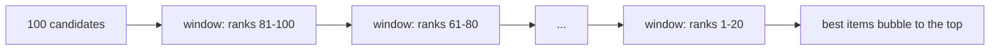
(RankGPT's sliding window goes from the bottom of the list to the top, so strong candidates move upward.)

**Rule.** A reranker can only reorder what stage 1 found: recall@candidates is the ceiling.

---

# Part E: Query transformation

## E.1 Conversational rewrite
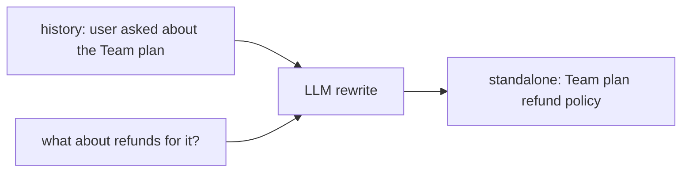

## E.2 HyDE (hypothetical document embeddings)
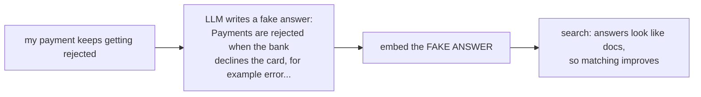
**Risk.** If the fake answer invents wrong specifics, retrieval drifts toward the wrong documents.

## E.3 Multi-query / RAG-Fusion
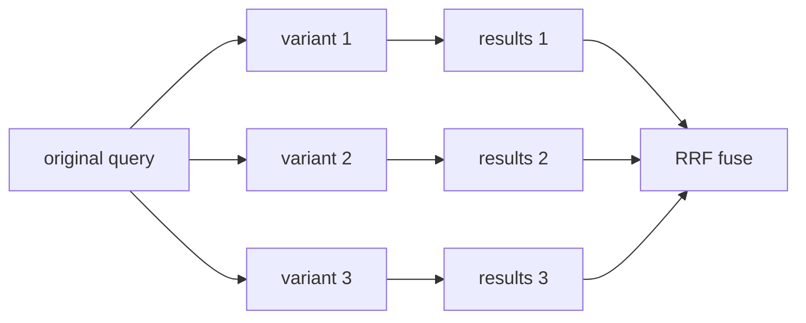

## E.4 Decomposition (for Q-multi)
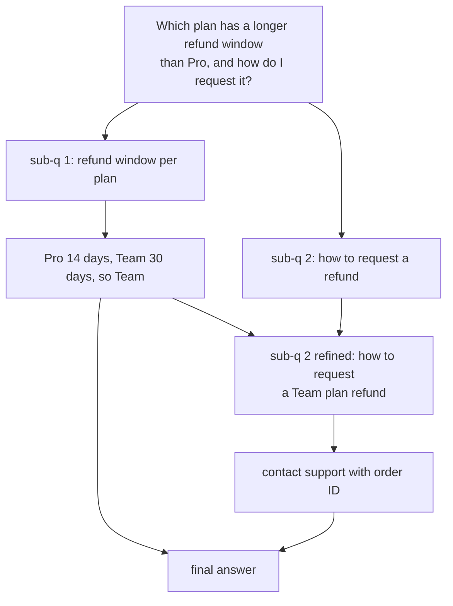

## E.5 Step-back prompting
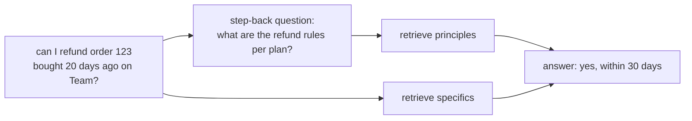

## E.6 Self-query (filter extraction) and routing
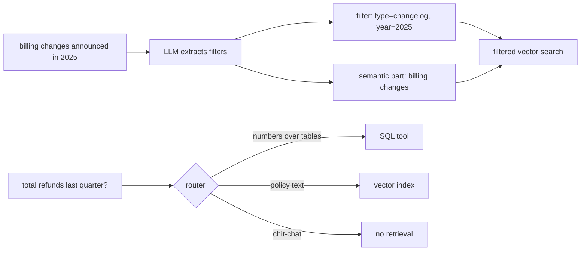

| Technique | Helps | Risk |
|---|---|---|
| rewrite | follow-ups | drifts from intent |
| HyDE | vocabulary gap | hallucinated specifics |
| multi-query | ambiguous queries | N× cost |
| decomposition | multi-part / multi-hop | sequential latency |
| step-back | questions needing principles | extra retrieval |
| self-query | structured filters | wrong filter → zero results (fall back) |
| routing | mixed sources | router errors |

---

# Part F: RAG architectures

## F.1 Naive RAG
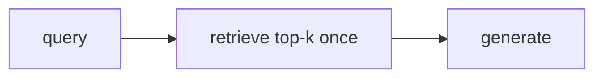
Fast and predictable. Fails Q-multi (one retrieval can't do two hops) and Q-global.

## F.2 Advanced single-pass RAG
```mermaid
flowchart LR
    Q["query"] --> RW["rewrite"] --> HY["hybrid + RRF"] --> RR["rerank"] --> EX["parent expansion"] --> G["generate with citations<br/>+ abstention"]
```
Covers most production needs ([implementation guide](../implementation/01-rag.md)).

## F.3 Iterative retrieval (IRCoT, agentic search)
```mermaid
sequenceDiagram
    participant M as Model
    participant S as Search
    M->>S: refund window per plan
    S-->>M: Pro 14 days, Team 30 days
    Note over M: reasoning step: Team is longer
    M->>S: how to request a Team plan refund
    S-->>M: contact support with order ID
    M->>M: answer with both facts
```
Solves Q-multi. Several round trips (latency, cost); an early mistake propagates.

## F.4 Adaptive and corrective RAG

**FLARE**: retrieve when the model is unsure mid-generation.
```mermaid
flowchart LR
    GEN["generate next sentence"] --> CONF{"any low-confidence tokens?"}
    CONF -->|no| KEEP["keep sentence"] --> GEN
    CONF -->|yes| RET["retrieve with the draft sentence as query"] --> REGEN["regenerate sentence"] --> GEN
```

**Self-RAG**: the model emits reflection tokens.
```mermaid
flowchart LR
    Q["query"] --> R1{"Retrieve? token"}
    R1 -->|no| ANS1["answer directly"]
    R1 -->|yes| P["retrieve passages"] --> REL{"IsRelevant? per passage"}
    REL --> GEN["generate per relevant passage"] --> SUP{"IsSupported? + IsUseful?"}
    SUP --> BEST["pick the best-supported output"]
```

**CRAG** (Corrective RAG): grade retrievals, then correct.
```mermaid
flowchart LR
    Q["query"] --> R["retrieve"] --> EV{"retrieval evaluator"}
    EV -->|correct| REF["refine: keep key strips"]
    EV -->|incorrect| WEB["web search instead"]
    EV -->|ambiguous| BOTH["refine + web search"]
    REF & WEB & BOTH --> G["generate"]
```

**Adaptive-RAG**: route by question complexity.
```mermaid
flowchart LR
    Q["query"] --> CL{"complexity classifier"}
    CL -->|simple| NO["answer without retrieval"]
    CL -->|moderate| ONE["single-step RAG"]
    CL -->|complex| MULTI["multi-step iterative RAG"]
```
**Lesson.** Deciding *whether* and *what* to retrieve matters as much as *how*.

## F.5 RL-trained search agents (Search-R1, R3)
```mermaid
flowchart LR
    P["question"] --> POL["policy model"]
    POL -->|"search: query"| SE["search engine"]
    SE -->|"information: results"| POL
    POL --> ANS["answer"]
    ANS --> REW["reward: exact match with gold"]
    REW -->|RL update, retrieved tokens masked| POL
```
The model *learns* when to search and how to phrase queries. R3 (2025/26) trains the **retriever** inside the RAG loop instead.

## F.6 Graph RAG

### Microsoft GraphRAG
```mermaid
flowchart TB
    subgraph INDEXING["indexing: expensive"]
        DOCS["documents / tickets"] --> EXT["LLM extracts entities + relations"]
        EXT --> KG["knowledge graph"]
        KG --> LEI["Leiden community detection<br/>hierarchical levels"]
        LEI --> SUMS["LLM writes a summary<br/>for every community"]
    end
    subgraph GLOBAL["global search: Q-global"]
        GQ["common reasons refunds are refused?"] --> MAP["MAP: each community summary<br/>-> partial answer + score"]
        MAP --> RED["REDUCE: merge top partial answers"]
    end
    subgraph LOCAL["local search: entity questions"]
        LQ["what is ERR_4012 linked to?"] --> ENT["find entity"] --> NB["neighbours + relations + source text"]
    end
    SUMS --> MAP
    KG --> ENT
```
**Worked example (Q-global).** Communities like "late refund requests", "annual plan non-refundable", "chargeback disputes" each give a partial answer; reduce merges them into "the top reasons are: outside the window, annual plans, …" (illustrative numbers omitted). Vector search can't do this: no single chunk contains the answer.

### Cheaper variants
```mermaid
flowchart LR
    GR["GraphRAG: summarise ALL<br/>communities at index time"] -->|LazyGraphRAG| LAZY["cheap noun-phrase graph;<br/>summarise only relevant parts<br/>at QUERY time"]
    GR -->|LightRAG| LIGHT["graph + vectors,<br/>dual-level keys: entities and themes,<br/>incremental updates"]
    GR -->|HippoRAG| HIPPO["OpenIE graph +<br/>Personalized PageRank"]
```
| Variant | Indexing cost | Strength | Weakness |
|---|---|---|---|
| GraphRAG | very high | global sensemaking | hard incremental updates |
| LazyGraphRAG | ~0.1% of GraphRAG (reported) | comparable global quality | query-time cost |
| LightRAG | moderate | incremental; local + global | less thorough on global questions |
| HippoRAG 2 | moderate (OpenIE) | multi-hop in one step | extraction noise |
| KAG | high | logical reasoning in professional domains | complexity |

## F.7 Long-context alternatives: CAG and LongRAG
```mermaid
flowchart LR
    subgraph CAG["CAG: no retrieval"]
        KB["whole KB under the context limit"] --> PF["prefill once, cache KV"] --> ANY["any query reuses the cache"]
    end
    subgraph LONGRAG["LongRAG: few big units"]
        UNITS["~4k-token retrieval units"] --> FEW["retrieve top 4-8"] --> LR["long-context reader"]
    end
```
Trade-offs: context rot and **lost in the middle** (models use the start and end of the context better than the middle); cost per query; no per-chunk access control.

## F.8 Graph RAG vs vector RAG on the running example
| Query | Naive | Advanced | Iterative | GraphRAG |
|---|---|---|---|---|
| Q-exact | ⚠️ dense-only fails | ✓ hybrid | ✓ | ✓ |
| Q-para | ✓ dense | ✓ | ✓ | ✓ |
| Q-multi | ✗ | ⚠️ decomposition | ✓ | ✓ local search |
| Q-global | ✗ | ✗ | ⚠️ | ✓✓ global search |

## F.9 Context post-processing
```mermaid
flowchart LR
    TOP["top-k chunks"] --> DD["dedupe near-duplicates"] --> GR["grade / filter irrelevant<br/>CRAG-style"] --> CMP["compress<br/>LLMLingua / extract quotes"] --> ORD["order: best first and last,<br/>same-doc chunks in doc order"] --> G["generate"]
```

---

# Part G: Decision guide

```mermaid
flowchart TD
    A["Corpus fits in context<br/>and is stable?"] -->|yes| LC["long context + prompt caching (CAG);<br/>check for context rot"]
    A -->|no| H["hybrid BM25 + dense + RRF,<br/>rerank, citations"]
    H --> Q{"error analysis shows..."}
    Q -->|follow-ups fail| RW["conversational rewrite"]
    Q -->|multi-hop fails| IT["decomposition or<br/>iterative agentic search"]
    Q -->|global questions fail| GR["GraphRAG / LazyGraphRAG / RAPTOR"]
    Q -->|irrelevant chunks hurt answers| CR["CRAG-style grading + abstention"]
    Q -->|domain vocabulary misses| FT["fine-tune embedder, SPLADE,<br/>or expansion"]
    Q -->|layout-heavy PDFs fail| VP["ColPali page retrieval"]
```

---

## Check your understanding
1. **Compute RRF for a doc ranked 1st in BM25 and 5th in dense (k=60).** 1/61 + 1/65 ≈ 0.0164 + 0.0154 = 0.0318.
2. **Why does a cross-encoder beat a bi-encoder at reranking?** It reads query and passage together, so attention can compare them term by term. It's too slow for the whole corpus, so it only reranks candidates.
3. **How does ColBERT's MaxSim differ from one-vector cosine?** Each query token matches its best document token separately, instead of comparing two averaged vectors.
4. **Which technique fixes Q-multi, and which fixes Q-global?** Decomposition or iterative search fixes Q-multi; GraphRAG global search (or RAPTOR) fixes Q-global.
5. **What does CRAG do when retrieval is judged incorrect?** It falls back to web search instead of generating from bad context.
6. **When does HyDE hurt?** When the hypothetical answer invents wrong specifics that pull retrieval toward wrong documents.

---

## Sources
- Robertson & Zaragoza, *BM25 and Beyond* (2009) · Thakur et al., *BEIR* (2021): arXiv 2104.08663
- Nogueira et al., *doc2query* (2019) · Wang et al., *query2doc* (2023): arXiv 2303.07678 · Formal et al., *SPLADE v2* (2021): arXiv 2109.10086
- Kusupati et al., *Matryoshka Representation Learning* (2022): arXiv 2205.13147
- Khattab & Zaharia, *ColBERT* (2020): arXiv 2004.12832 · *ColBERTv2*: arXiv 2112.01488 · *MUVERA* (2024): arXiv 2405.19504 · Faysse et al., *ColPali* (2024): arXiv 2407.01449
- Malkov & Yashunin, *HNSW*: arXiv 1603.09320 · *DiskANN* (NeurIPS 2019) · Jégou et al., *Product Quantization* (2011) · *ScaNN*: arXiv 1908.10396
- Cormack et al., *RRF* (SIGIR 2009) · Bruch et al., *Fusion Functions for Hybrid Retrieval* (TOIS 2023): arXiv 2210.11934
- Sun et al., *RankGPT* (2023): arXiv 2304.09542
- Gao et al., *HyDE*: arXiv 2212.10496 · Zheng et al., *Step-Back*: arXiv 2310.06117
- Trivedi et al., *IRCoT*: arXiv 2212.10509 · Jiang et al., *FLARE*: arXiv 2305.06983 · Asai et al., *Self-RAG*: arXiv 2310.11511 · Yan et al., *CRAG*: arXiv 2401.15884 · Jeong et al., *Adaptive-RAG*: arXiv 2403.14403
- Jin et al., *Search-R1*: arXiv 2503.09516 · *R3*: arXiv 2510.24652
- Edge et al., *GraphRAG*: arXiv 2404.16130 · Microsoft Research, *LazyGraphRAG* (2024 blog) · Guo et al., *LightRAG*: arXiv 2410.05779 · *HippoRAG 2*: arXiv 2502.14802 · *KAG*: arXiv 2409.13731
- Chan et al., *Cache-Augmented Generation*: arXiv 2412.15605 · Jiang et al., *LongRAG*: arXiv 2406.15319
- Liu et al., *Lost in the Middle*: arXiv 2307.03172 · *LLMLingua*: arXiv 2310.05736
