# Memory techniques for LLM agents: a deep dive

> **Where this fits.** Overview: [../03-context-engineering-and-memory.md](../03-context-engineering-and-memory.md) · Implementation: [../implementation/03-context-and-memory.md](../implementation/03-context-and-memory.md) · Code: [memory.py](../code/aieng/memory.py) (extract-and-reconcile), [temporal_memory.py](../code/aieng/temporal_memory.py) (bi-temporal fact graph), [agent/context.py](../code/aieng/agent/context.py) (working memory).
>
> **Format of every technique section:** the idea in one sentence → architecture diagram → the running example through it → pros and cons → evidence → pitfalls.

---

## 0. The running example

Three chat sessions with one user:

```text
Session 1 (2026-01-10)
  user: Hi, I'm Alice. I live in Berlin and I'm vegetarian. I work at Acme as a data engineer.
  assistant: Nice to meet you, Alice! ...

Session 2 (2026-03-05)
  user: I moved to Paris last month, in February.
  user: Recommend a restaurant for Friday.
  assistant: Try "Le Potager du Marais", a vegetarian place in the 3rd arrondissement.

Session 3 (2026-06-20)
  Q1 "Where do I live?"                          → needs the UPDATE (Paris, not Berlin)
  Q2 "Where did I live before Paris?"            → needs HISTORY / time
  Q3 "Any dinner ideas?"                          → needs the PREFERENCE (vegetarian) + current city
  Q4 "What restaurant did you suggest last time?" → needs an EPISODE (what the assistant said)
  Q5 "What's my dog's name?"                      → never mentioned: must ABSTAIN
```

Each architecture is scored on Q1–Q5 at the end of its section.

### 0.1 A map of the field

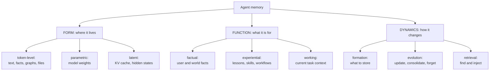
(Taxonomy from the 2025 survey *Memory in the Age of AI Agents*.) The cognitive names map on: **working** = the context window now; **episodic** = what happened and when; **semantic** = facts and preferences; **procedural** = how to do things.

### 0.2 Where memory sits around the agent

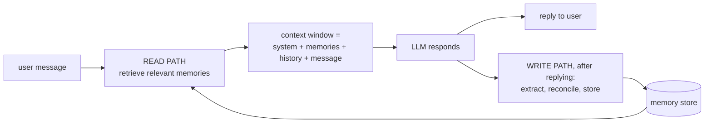

Every technique below is a different design of the **write path** (what and how to store), the **store**, and the **read path** (how to find and inject).

---

# Part A: Working memory (the context window)

## A.1 Full history
Send the whole conversation every turn.
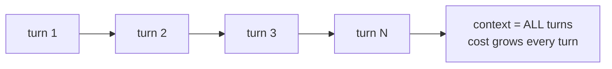
Perfect recall within one session, but cost and latency grow with every turn, quality drops as context gets long (context rot), and it eventually hits the limit. It also forgets everything between sessions. **Alice:** within a session it works; across sessions, Q1–Q4 all fail.

## A.2 Sliding window
Keep only the last N turns.
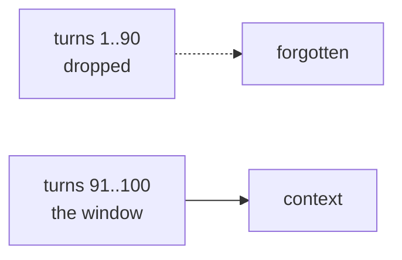
Constant cost, but it forgets old facts, like the user's name from turn 1.

## A.3 Rolling summary (summary buffer)
Recent turns verbatim, older turns replaced by a running summary that an LLM updates.
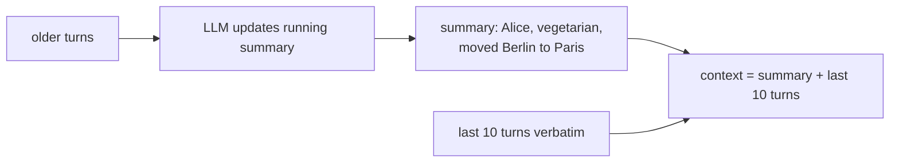
Keeps the gist in bounded space. But details (numbers, IDs, exact names) get lost, the summary **drifts** as it's rewritten again and again, and it costs an extra LLM call.

## A.4 Server-side compaction and tool-result clearing
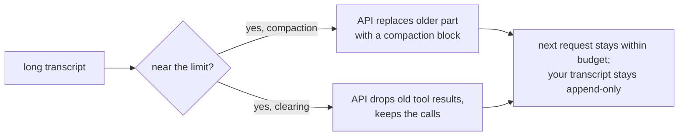
No client logic, and the history stays append-only (which current Claude models require to keep thinking blocks valid). You get less control over what's kept, and a cleared tool result may need to be fetched again. Code: [`server_side_compaction()`, `server_side_trimming()`](../code/aieng/agent/context.py).

## A.5 Structured handoff
At the limit, write a structured state and start a fresh conversation from it.
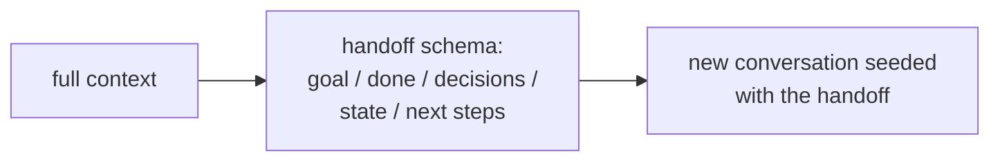
Keeps exactly what matters and is easy to debug. Quality depends on the schema. Code: [`summarize_and_restart()`](../code/aieng/agent/context.py).

## A.6 Notes files and sub-agent isolation
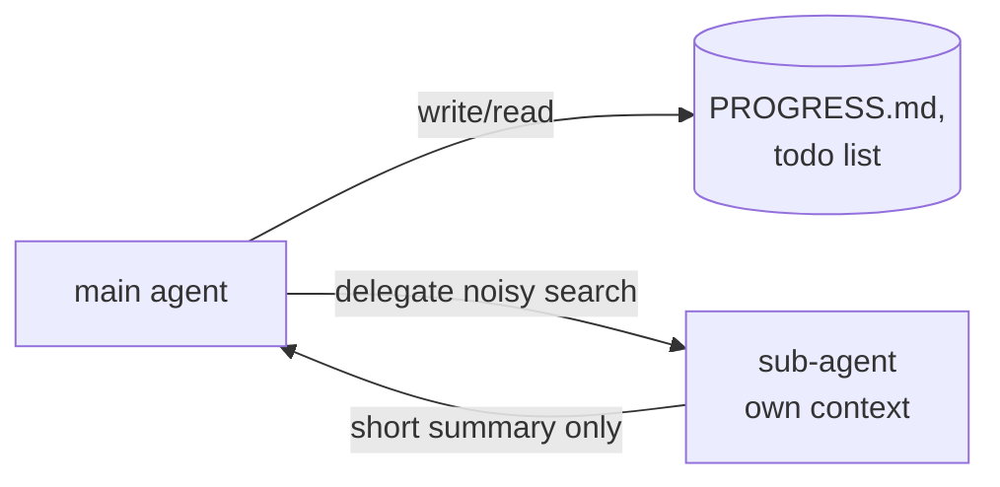
Notes survive compaction and humans can read them. Sub-agents keep noisy exploration out of the main context, at a token cost.

**Evidence for Part A.** Chroma's *Context Rot* (2025) showed accuracy falling as input grows even inside the window. LOCA-bench (2026) tests agents under extreme context growth.

---

# Part B: Long-term memory architectures

## B.1 Conversation RAG (index the raw log)

**Idea.** Store every message with its time, embed it, and retrieve the most similar past messages.

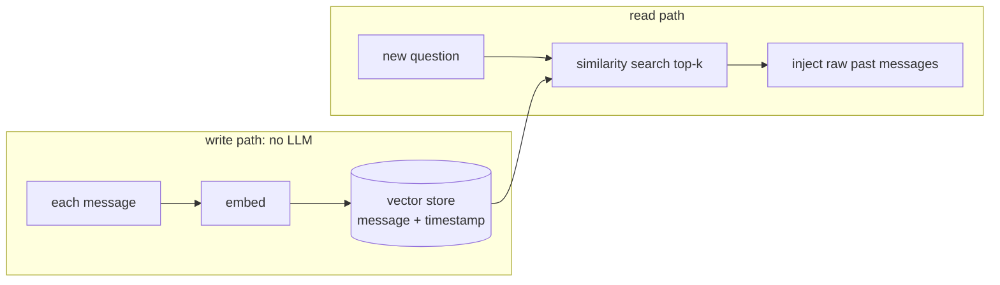

**Running example.** Q1 "Where do I live?" retrieves *both* "I live in Berlin" and "I moved to Paris last month". The LLM must work out which is current from two raw messages. It often manages, but not reliably at scale.

| Q1 update | Q2 history | Q3 preference | Q4 episode | Q5 abstain |
|---|---|---|---|---|
| ⚠️ both retrieved | ⚠️ if both retrieved | ✓ | ✓ (assistant message stored) | ✓ if nothing matches |

| Pros | Cons |
|---|---|
| lossless; no extraction calls | returns messages, not facts; no notion of "current" |
| trivial to build | weak for time questions ("last Tuesday"); grows forever; lots of small talk |

**Use when.** A baseline, "find where we discussed X" features, and as the raw **episode layer** under smarter memories (Zep keeps exactly this).

---

## B.2 Vector memory of extracted facts (append-only)

**Idea.** After each session, an LLM extracts facts; they're appended to a vector store.

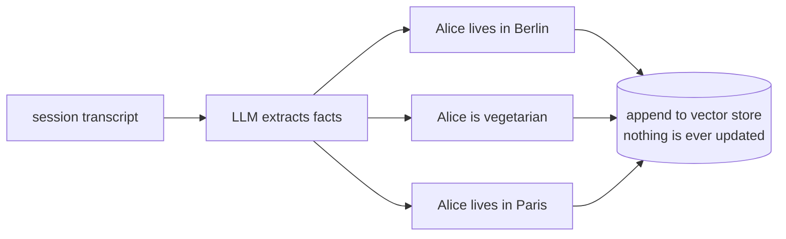

**Running example.** After session 2 the store holds **both** "lives in Berlin" and "lives in Paris" with nothing marking which is current. Q1 gets contradictory facts.

| Pros | Cons |
|---|---|
| dense and useful compared with raw logs | **duplicates and contradictions pile up** |
| simple | extraction errors become permanent; no time awareness |

**Use when.** Prototypes only.

---

## B.3 Extract-and-reconcile (the Mem0 pattern)

**Idea.** Extract candidate facts, then compare each against similar existing memories and let an LLM choose **ADD, UPDATE, DELETE or NOOP**.

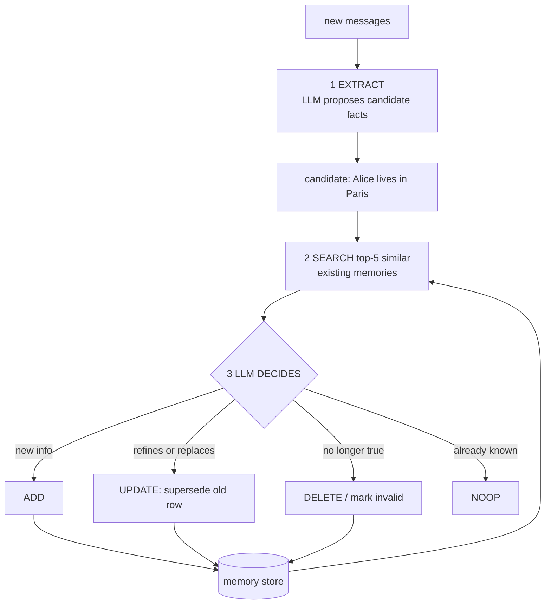

**Running example** (session 2):
```text
candidate: "Alice lives in Paris (moved Feb 2026)"
similar existing: [m1] "Alice lives in Berlin"
LLM decision: UPDATE m1 → "Alice lives in Paris (moved from Berlin in Feb 2026)"
our memory.py: inserts the new row and marks m1 superseded_by=new_id (history kept)
```
At read time only non-superseded rows are searched, ranked by `0.6·semantic + 0.25·keyword + 0.15·recency` (agent-written facts ×0.9).

| Q1 update | Q2 history | Q3 preference | Q4 episode | Q5 abstain |
|---|---|---|---|---|
| ✓ | ⚠️ only if the merged text says "moved from Berlin", or old rows are searchable | ✓ | ✗ unless episodes are also stored | ✓ |

| Pros | Cons |
|---|---|
| compact, deduplicated, current | 2+ LLM calls per write |
| ~90% fewer tokens than full context | a plain UPDATE **overwrites history** (so version rows, as our code does) |
| simple to operate | wrong LLM decisions can delete true facts; relations between facts stay implicit |

**Evidence.** Mem0 paper (ECAI 2025, arXiv 2504.19413), vendor-authored: on LoCoMo, **+26% relative** LLM-judge score vs OpenAI's memory, graph variant about +2 points more, **91% lower p95 latency and >90% token savings** vs full context. Methodology is disputed (Part D).
**Code.** [memory.py](../code/aieng/memory.py) with id validation, supersede-not-overwrite, scoping, `forget_user`.

---

## B.4 Memory stream with reflection (Generative Agents)

**Idea.** Log every observation in a time-stamped stream; retrieve by **recency + importance + relevance**; periodically **reflect** to write higher-level insights back into the stream.

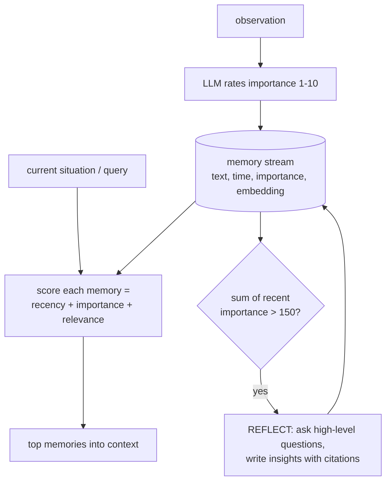

**The retrieval score** (each term min-max normalised, equal weights in the paper):
```text
recency    = 0.995 ^ (hours since last accessed)
importance = LLM rating 1..10 given at write time
relevance  = cosine(query embedding, memory embedding)
score      = recency + importance + relevance
```

**Running example.** "Alice moved to Paris" gets importance 8 (a life event). "Alice said hello" gets 1. After several sessions, reflection might write: *"Alice cares about vegetarian dining and recently relocated, so recommendations should be vegetarian and in Paris."* That insight answers Q3 directly.

| Q1 | Q2 | Q3 | Q4 | Q5 |
|---|---|---|---|---|
| ✓ (recency favours Paris) | ✓ (timestamps kept) | ✓✓ (reflection) | ✓ | ✓ |

| Pros | Cons |
|---|---|
| principled mix of time, significance and topic | an importance-rating call per memory |
| reflection builds understanding across many events | reflection cost grows; three weights to tune |
| explainable (insights cite memories) | designed for simulations; less tested for assistants |

**Evidence.** In the paper's ablations, removing observation, planning or reflection each made agent behaviour less believable to human evaluators (arXiv 2304.03442).

---

## B.5 OS-style tiered memory with self-editing (MemGPT → Letta)

**Idea.** Treat the context window like RAM and external stores like disk. The **agent itself** moves information between them with tool calls.

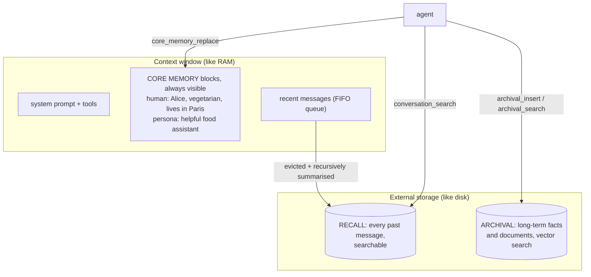

**Running example as tool calls:**

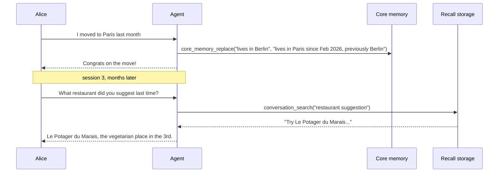

**Sleep-time compute (Letta):** a background agent reorganises core and archival memory between sessions, so the work isn't done while the user waits.

| Q1 | Q2 | Q3 | Q4 | Q5 |
|---|---|---|---|---|
| ✓ (core block edited) | ✓ if the agent wrote "previously Berlin" | ✓ (core block) | ✓ (recall search) | ✓ |

| Pros | Cons |
|---|---|
| unbounded memory; the agent decides what matters | quality depends on the model's judgement (weaker models do this badly) |
| core blocks = a stable, always-present profile | memory tool calls add latency and distract from the task |
| self-editing handles updates naturally | hard to test and reproduce |

**Evidence.** MemGPT (arXiv 2310.08560) beat fixed-context baselines on multi-session consistency and document QA beyond the window. Letta's sleep-time paper (arXiv 2504.13171, vendor research) reports ~5× less test-time compute at equal accuracy, up to ~13–18% accuracy gains, and ~2.5× lower cost per query when amortised over related queries.

---

## B.6 Hierarchical tiers with promotion (MemoryOS)

**Idea.** Three tiers with an explicit consolidation path, like OS memory management: short-term → mid-term → long-term.

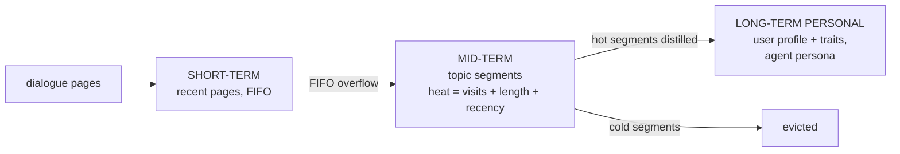

**Running example.** Session 2's messages start in short-term, then move to a mid-term segment "relocation to Paris". Because Alice keeps asking about Paris restaurants (high heat), it's distilled into the long-term profile: "lives in Paris; vegetarian; likes trying restaurants".

| Pros | Cons |
|---|---|
| explicit consolidation (raw → topics → profile); bounded tiers | many hyperparameters (tier sizes, heat weights) |
| cheap heat-based eviction | detail lost at each tier; built for personal assistants |

**Evidence.** Reported strong gains on LoCoMo over its baselines (arXiv 2506.06326).

---

## B.7 Knowledge-graph memory

**Idea.** Extract **entities** and **relations** into a graph, and answer by looking up entities and walking edges.

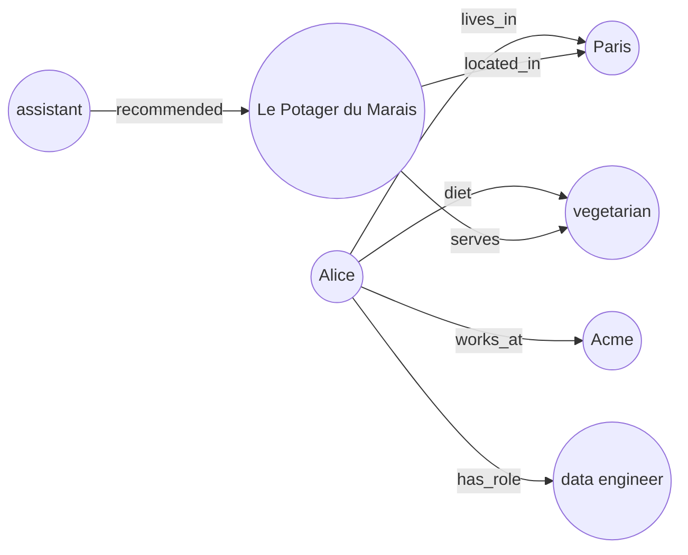

**Running example.** Q3 "Any dinner ideas?": find Alice → follow `diet` and `lives_in` → find restaurants that `serve` vegetarian and are `located_in` Paris. That's a **multi-hop** query that similarity search alone does poorly.

| Pros | Cons |
|---|---|
| explicit relations → multi-hop answers | extraction is expensive and error-prone |
| entity resolution merges "Bob", "Robert" and "my manager" | schema design; graph DB operations |
| inspectable | without timestamps, updates still overwrite (Q2 fails) |

**Examples.** Mem0ᵍ, Cognee, LangMem graph stores.

---

## B.8 Temporal knowledge graph (Zep / Graphiti)

**Idea.** A knowledge graph where **every fact has a validity interval**. New contradicting facts **close** old ones instead of deleting them, and every fact links back to the message it came from.

### Architecture: three tiers
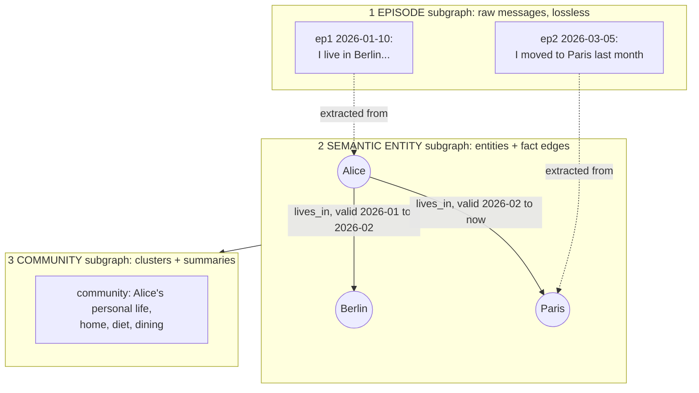

### The bi-temporal model
Each fact edge carries **two timelines**:

| Timeline | Fields | Question it answers |
|---|---|---|
| **valid time** (the world) | `valid_from`, `valid_to` | *When was it true?* |
| **transaction time** (the system) | `recorded_at`, `retracted_at` | *When did we believe it?* |

The running example as intervals:
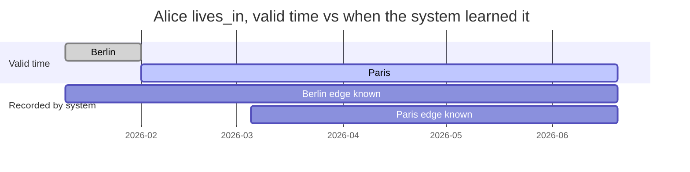
Notice: Alice moved on **2026-02-01** (valid time), but the system only **learned** it on **2026-03-05** (transaction time). "I moved last month" means the event time must be *extracted*; it isn't the message time.

### The write path
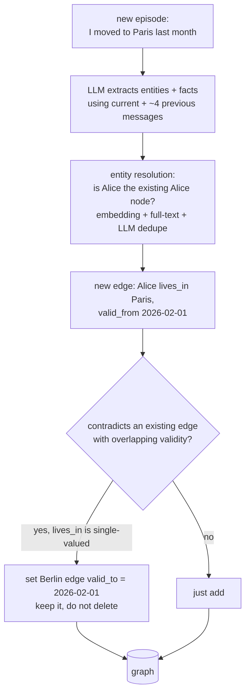

### The read path
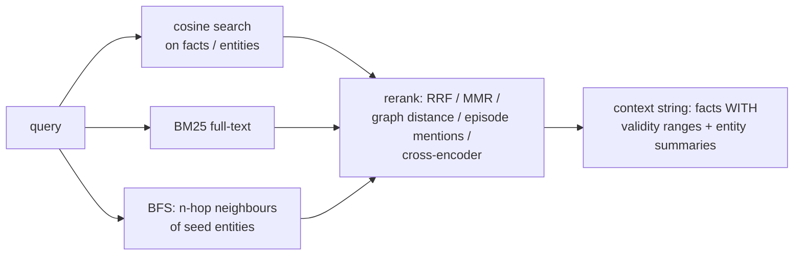
What the LLM sees for Alice:
```text
- alice lives_in berlin (2026-01-10 to 2026-02-01) [past]
- alice lives_in paris (2026-02-01 to present) [CURRENT]
- alice diet vegetarian (2026-01-10 to present) [CURRENT]
```

| Q1 | Q2 | Q3 | Q4 | Q5 |
|---|---|---|---|---|
| ✓✓ | ✓✓ (history kept with dates) | ✓ | ✓ (episodes kept) | ✓ |

| Pros | Cons |
|---|---|
| the best-designed answer to **updates and time questions** | **write-heavy**: several LLM calls per episode |
| provenance: every fact → its source message | needs a graph database; ingestion delay |
| "as of" queries; fast reads without LLM calls | large memory footprint (disputed, Part D); more to tune |

**Evidence.** Zep paper (arXiv 2501.13956), vendor-authored: on LongMemEval (~115k-token histories), **71.2% vs 60.2%** accuracy for full context with gpt-4o and **63.8% vs 55.4%** with gpt-4o-mini, at **~90% lower latency** (2.58 s vs 28.9 s) and ~1.6k vs ~115k context tokens. Biggest gains on preference (+184%), temporal (+38%) and multi-session (+31%) questions, but **−17.7%** on recalling what the *assistant* said.
**Code.** [temporal_memory.py](../code/aieng/temporal_memory.py): functional vs multi-valued predicates, invalidation, late-arriving facts, `query(as_of=…, known_at=…)`, provenance, `as_context()`. The tests replay exactly this Berlin→Paris scenario.
**Pitfalls.** (1) Treating every relation as single-valued ("likes pizza" wiping "likes sushi"): declare **functional** predicates. (2) Using message time as valid time. (3) Late-arriving older facts must be *bounded by* newer facts, not invalidate them. (4) Open-interval bugs (`∞ < ∞` is false); our first version made this mistake and the tests caught it. (5) Entity-resolution errors corrupt everything downstream.

---

## B.9 Associative memory: HippoRAG

**Idea.** Build a knowledge graph from documents; at query time, start from the query's entities and **spread activation** through the graph (Personalized PageRank) to find passages connected to all of them, in one step.

```mermaid
flowchart LR
    Q["query: vegetarian dinner<br/>near Alice"] --> SEEDS["seed nodes:<br/>vegetarian, Alice"]
    SEEDS --> PPR["Personalized PageRank<br/>spreads activation"]
    subgraph KG["knowledge graph built by OpenIE"]
        A(("Alice")) --- P(("Paris"))
        P --- R(("Le Potager"))
        V(("vegetarian")) --- R
    end
    PPR --> KG
    KG --> RANK["passages ranked by activation:<br/>Le Potager scores highest,<br/>linked to BOTH seeds"]
```

| Pros | Cons |
|---|---|
| multi-hop retrieval without iterative LLM calls | OpenIE extraction cost and noise |
| continual integration of new knowledge | better for document collections than per-user chat memory |

**Evidence.** HippoRAG 2 (arXiv 2502.14802): average F1 59.8 vs 57.0 for NV-Embed-v2 and 53.1 for HippoRAG 1, with the biggest gains on multi-hop tasks.

---

## B.10 Self-organising notes (A-MEM, Zettelkasten)

**Idea.** Each memory is a rich note (content, keywords, tags, context). New notes **link** to related ones, and can **rewrite** the attributes of older linked notes.

```mermaid
flowchart TD
    NEW["new note: Alice moved to Paris<br/>keywords: relocation, Paris<br/>tags: home, life-event"] --> FIND["find similar notes"]
    FIND --> N1["old note: Alice lives in Berlin"]
    FIND --> N2["old note: Alice likes trying restaurants"]
    NEW -->|LLM: link| N1
    NEW -->|LLM: link| N2
    NEW -->|EVOLUTION: update context of N2| N2U["N2 context now:<br/>restaurant interest, now in Paris"]
```

| Pros | Cons |
|---|---|
| the network reorganises itself; no fixed schema | LLM calls per insert; evolution can cascade |
| links capture relations that embeddings miss | rewriting old notes can **drift** or corrupt them |

**Evidence.** A-MEM (NeurIPS 2025, arXiv 2502.12110) reported gains over MemGPT/Mem0-style baselines across six foundation models, especially on multi-hop questions.

---

## B.11 Multi-type modular memory (MIRIX, MemOS)

**Idea.** Different kinds of memory get different stores, with a controller routing reads and writes.

```mermaid
flowchart TB
    CTRL["memory controller / router agents"] --> CORE["core:<br/>name, stable profile"]
    CTRL --> EPI["episodic:<br/>session 2 restaurant chat"]
    CTRL --> SEMM["semantic:<br/>vegetarian, lives in Paris"]
    CTRL --> PROC["procedural:<br/>how to book a table"]
    CTRL --> RES["resource:<br/>shared files, docs"]
    CTRL --> VAULT["knowledge vault:<br/>address, card numbers, isolated"]
```
**MemOS** adds a *form* dimension: the same knowledge can move between **plaintext** (retrieval), **activation** (cached KV) and **parametric** (LoRA) memory depending on how often it's used.

| Pros | Cons |
|---|---|
| each type gets the right storage and retrieval | system complexity (many stores and agents) |
| sensitive data isolated | routing errors; hard to evaluate end to end |

---

## B.12 File-based memory (CLAUDE.md, AGENTS.md, the memory tool)

**Idea.** Memory is plain files the agent reads and edits with file tools.

```mermaid
flowchart LR
    START["session start"] --> IDX["load memory/INDEX.md<br/>one line per memory"]
    IDX --> AG["agent"]
    AG -->|open when relevant| F1["memory/user-profile.md"]
    AG -->|create / edit| F2["memory/dining-preferences.md"]
    HUMAN["human"] -->|can read and fix| F1 & F2
    F1 & F2 --> GIT[("git history")]
```

**Running example.** `user-profile.md` says "Lives in Paris since Feb 2026 (previously Berlin). Vegetarian." The agent edited it in session 2. Alice can open the file and correct it herself.

| Pros | Cons |
|---|---|
| transparent and **human-editable**; versioned | doesn't scale to thousands of facts without search |
| zero infrastructure; natural for **procedural** memory | recall depends on the agent opening the right file |

Anthropic's memory tool (`memory_20250818`) standardises this with a client-hosted memory directory. **Try this first**, before a memory service.

---

## B.13 Experiential memory (learning from past tasks)

**Idea.** Remember **how to do things better**, not facts about users.

```mermaid
flowchart LR
    TASK["attempt task"] --> RES{"success signal:<br/>tests, checker, user"}
    RES -->|fail| REFL["Reflexion: write a lesson<br/>I forgot to filter by diet"]
    RES -->|success| SKILL["Voyager / AWM: save the<br/>working code or workflow"]
    REFL --> EXP[("experience store")]
    SKILL --> EXP
    EXP -->|retrieve similar past lessons / skills| TASK
```

| Technique | What it stores | Evidence |
|---|---|---|
| **Reflexion** (2023) | verbal lessons after failures, prepended to retries | large gains on coding (HumanEval) and decision tasks |
| **ExpeL** (2023) | insights extracted from many trajectories + successful examples | beat ReAct on HotpotQA, ALFWorld, WebShop |
| **Voyager** (2023) | successful behaviours as **executable code**, indexed by description | compounding skills in Minecraft |
| **Agent Workflow Memory** (2024) | reusable workflows induced from trajectories | +24.6% / +51.1% relative success on Mind2Web / WebArena (reported) |
| **Skills (SKILL.md)** | procedures as files with progressive disclosure | cross-vendor standard |

**Running example.** After the assistant once suggested a steakhouse and Alice objected, a Reflexion-style lesson "always filter restaurant suggestions by the user's diet" is stored and applied to every future recommendation.

---

## B.14 Parametric memory (in the weights)

**Idea.** Put the knowledge into the model by fine-tuning, per-user LoRA, or knowledge editing (ROME/MEMIT).

```mermaid
flowchart LR
    DATA["Alice's facts as training text"] --> FT["fine-tune / LoRA / ROME edit"]
    FT --> W["weights now 'know' Alice lives in Paris"]
    W --> PROB["problems: no source, cannot cleanly<br/>update or delete, edits leak into<br/>unrelated knowledge"]
```

**Running example.** When Alice moves again, you must retrain or edit, and the old "Berlin" may still come out. If Alice asks to be forgotten, you can't prove it's gone.

| Pros | Cons |
|---|---|
| no retrieval latency; no context tokens | unreliable for precise, changing facts |
| good for stable style and domain behaviour | no provenance; **no clean deletion** (privacy) |

**Use for** style and domain behaviour, **not** user facts.

---

## B.15 Latent memory (the KV cache as memory)

**Idea.** Reuse computed attention state instead of re-reading text: prompt caching, cache-augmented generation (CAG), and research systems storing hidden states.

```mermaid
flowchart LR
    KB["stable knowledge<br/>under ~200k tokens"] --> PRE["prefill once"]
    PRE --> KV[("cached KV prefix")]
    Q1["query 1"] --> KV
    Q2["query 2"] --> KV
    KV --> FAST["fast answers,<br/>no retrieval step"]
```

| Pros | Cons |
|---|---|
| very fast reuse; no retrieval errors if everything fits | bounded by the window; caches expire |
| cheap with API prompt caching | model-specific; not selective |

---

## B.16 Learned memory management (RL-trained)

**Idea.** Instead of prompting an LLM to pick ADD/UPDATE/DELETE, **train** it with RL, rewarded when later answers are correct.

```mermaid
flowchart LR
    DLG["dialogue turn"] --> MM["Memory Manager policy<br/>ADD / UPDATE / DELETE / NOOP"]
    MM --> BANK[("memory bank")]
    QQ["question"] --> AA["Answer Agent:<br/>selects + reasons over memories"]
    BANK --> AA
    AA --> ANS["answer"]
    ANS --> REW["reward: answer correct?"]
    REW -->|PPO / GRPO update| MM
    REW -->|PPO / GRPO update| AA
```

| Pros | Cons |
|---|---|
| memory policy optimised for the actual goal | needs training infrastructure and QA rewards |
| small models become good memory managers | hard to define rewards for open-ended assistants |

**Evidence.** Memory-R1 (arXiv 2508.19828) reports beating strong baselines on LoCoMo, MSC and LongMemEval across 3B–14B models with only **152 training QA pairs**. Follow-ups: Mem-α, MemRL (2026), Memory-R2 (2026).

---

# Part C: Memory operations in detail (for every architecture)

## C.1 Formation: what to store
```mermaid
flowchart LR
    MSG["message"] --> F{"durable fact about the user,<br/>a decision, or a procedure?"}
    F -->|no: small talk, one-off| SKIP["skip"]
    F -->|secret: password, card| BLOCK["never store"]
    F -->|yes| TAG["store with actor tag<br/>user / agent / tool<br/>+ source episode id + time"]
```
Formation policies, compared: store everything (no loss, lots of noise) · LLM extraction with keep/skip rules (dense, can miss implicit facts) · importance scoring (cheap filter, noisy) · agent-decided (context-aware, distracting) · RL-learned (optimal for outcomes, needs training).

## C.2 Timing: when to write
```mermaid
flowchart LR
    TURN["user turn"] --> REPLY["reply"]
    TURN -.->|hot path: slower reply,<br/>memory usable immediately| W1["write"]
    REPLY -->|background queue: DEFAULT| W2["write seconds later"]
    IDLE["idle time / nightly"] -->|sleep-time consolidation| W3["merge, summarise, re-index"]
```

## C.3 Updating: four strategies on "Berlin → Paris"
| Strategy | What the store holds afterwards | Q1 | Q2 |
|---|---|---|---|
| overwrite in place | "lives in Paris" | ✓ | ✗ |
| supersede (our `memory.py`) | "Paris (active)", "Berlin (superseded)" | ✓ | ⚠️ needs a query over superseded rows |
| bi-temporal invalidation (our `temporal_memory.py`, Zep) | Berlin [Jan–Feb], Paris [Feb–now], both with recorded times | ✓ | ✓ |
| keep all, resolve at read time | both raw statements | ⚠️ LLM decides each time | ✓ but slow |

**Functional vs multi-valued relations:** `lives_in` has one value at a time, so a new value invalidates the old one. `likes` has many values, so add without invalidating. Declaring this prevents the most common update bug.

## C.4 Forgetting
```mermaid
flowchart LR
    M["memory"] --> TTL["TTL: delete after N days"]
    M --> DECAY["recency decay:<br/>score x 0.995^hours"]
    M --> EBB["Ebbinghaus strength:<br/>R = e^(-t/S), S grows on each recall"]
    M --> HEAT["heat / LRU eviction<br/>from a bounded tier"]
    M --> CONS["consolidation:<br/>many episodes -> one fact"]
    M --> HARD["hard delete on user request:<br/>ALL stores, summaries, caches"]
```

## C.5 Retrieval: combine several signals
| Signal | Catches | Misses |
|---|---|---|
| semantic similarity | paraphrases | names, IDs, time |
| keyword / BM25 | "Le Potager", "ERR_4012" | paraphrases |
| entity match + graph walk | "everything about Alice", multi-hop | unlinked facts |
| recency | current state | old but important facts |
| importance | life events | noise in the ratings |
| valid-time filter | "last week", "in 2024" | needs temporal metadata |

Fuse with RRF or weighted sums, then rerank. **Rewrite time expressions first** ("last week" → a date range).

## C.6 Injection
```text
<memories>
Things you remember about this user. They may be outdated; the user's current message wins.
- Lives in Paris since 2026-02 (previously Berlin). (said by user, 2026-03-05)
- Vegetarian. (said by user, 2026-01-10)
</memories>
```
Put this in the **first user turn** (not the frozen system prompt, which would break caching). Include dates and sources. Keep it to ≤ 10 relevant items. Watch for **memory-induced sycophancy** (agreeing with stored beliefs over the evidence; MemSyco-Bench, 2026).

---

# Part D: Benchmarks and how to read the numbers

| Benchmark | Tests | Size | Watch out |
|---|---|---|---|
| **DMR** (MemGPT) | single-fact recall across sessions | 500 conversations × ~60 messages | fits in modern context windows, so it barely separates systems |
| **LoCoMo** (2024) | single-hop, multi-hop, temporal, open-domain | ~10 long conversations, ~1.5–2k questions | small; category handling caused disputed scores |
| **LongMemEval** (2024) | extraction, multi-session, **temporal, knowledge updates, abstention** | 500 Qs; ~115k tokens (S) / ~500 sessions (M) | the best coverage of Q1–Q5-style abilities |
| **BEAM** (2026) | 10 abilities incl. contradiction resolution, at 1M and 10M tokens | large | built not to saturate; Mem0 self-reports 64.1% / 48.6% |
| **MemSyco-Bench** (2026) | sycophancy caused by memory | — | a safety angle |

**The Zep–Mem0 dispute.**
```mermaid
flowchart LR
    Z1["Zep claims ~84%<br/>on LoCoMo"] --> M1["Mem0 paper measures<br/>Zep at ~66%, later cites ~58%"]
    M1 --> Z2["Zep: Mem0 misconfigured us,<br/>corrected score 75.1%"]
    Z2 --> LESSON["lesson: different answer models,<br/>judges and categories;<br/>run candidates on YOUR data"]
```
Mem0's paper also claims Zep's memory footprint exceeds 600k tokens per conversation vs ~1.8k for Mem0. Both vendors self-report 90%+ on configurations not fully disclosed. Always ask which answer model, which judge, and which question categories. Include **update, temporal and abstention** questions (like Q1, Q2 and Q5 here), since that's where systems actually differ.

---

# Part E: Risks
```mermaid
flowchart TB
    R["memory risks"] --> P1["POISONING: an injected instruction stored as a fact<br/>fix: actor/source tags, never store instructions<br/>from untrusted content, review agent-written memories"]
    R --> P2["PRIVACY: memories are personal data<br/>fix: scoping, encryption, user-visible memory,<br/>hard delete that reaches summaries, graphs, caches"]
    R --> P3["STALENESS: old facts stated confidently<br/>fix: timestamps, may-be-outdated framing, temporal models"]
    R --> P4["DRIFT: rewritten summaries/notes distort facts<br/>fix: keep raw episodes as ground truth, re-derive"]
    R --> P5["CREEPINESS: irrelevant personal details surfaced<br/>fix: relevance thresholds, user controls"]
```
Governance of self-evolving memory is an active research topic (e.g. SSGM framework, arXiv 2603.11768).

---

# Part F: Scorecard and decision guide

**Running example scorecard** (✓ reliable · ⚠️ sometimes · ✗ fails):

| Architecture | Q1 update | Q2 history | Q3 preference | Q4 episode | Q5 abstain | Write cost |
|---|---|---|---|---|---|---|
| Full history (per session) | ✗ across sessions | ✗ | ✗ | ✗ | ✓ | none |
| Rolling summary | ⚠️ | ⚠️ | ✓ | ⚠️ | ✓ | low |
| Conversation RAG | ⚠️ | ⚠️ | ✓ | ✓ | ✓ | lowest |
| Vector facts, append-only | ✗ contradictory | ⚠️ | ✓ | ✗ | ✓ | low |
| Extract + reconcile (Mem0) | ✓ | ⚠️ | ✓ | ✗ unless episodes kept | ✓ | medium |
| Memory stream + reflection | ✓ | ✓ | ✓✓ | ✓ | ✓ | medium |
| MemGPT / Letta | ✓ | ⚠️ agent-dependent | ✓ | ✓ | ✓ | medium |
| Knowledge graph (no time) | ✓ overwrite | ✗ | ✓ multi-hop | ✗ | ✓ | high |
| **Temporal KG (Zep/Graphiti)** | ✓✓ | ✓✓ | ✓ | ✓ | ✓ | high |
| File-based | ✓ if edited | ⚠️ if written down | ✓ | ✗ | ✓ | lowest |
| Parametric | ⚠️ | ✗ | ✓ | ✗ | ⚠️ may hallucinate | very high |

```mermaid
flowchart TD
    A["What must the agent remember?"] -->|how to do tasks| P["procedural: files/skills<br/>+ experiential (Reflexion, AWM)"]
    A -->|facts about users| B{"Do facts change, and<br/>does history matter?"}
    A -->|large document knowledge| DOC["RAG; HippoRAG / GraphRAG<br/>if multi-hop"]
    B -->|rarely, or only the current state| M0["extract + reconcile<br/>(Mem0-style), supersede rows"]
    B -->|often, need as-of queries + provenance| Z["temporal KG<br/>(Graphiti / Zep-style)"]
    M0 --> C{"long-lived agent with<br/>a persistent identity?"}
    Z --> C
    C -->|yes| L["add core memory blocks (Letta-style)<br/>+ sleep-time consolidation"]
    C -->|no| E["build a memory eval with<br/>update, temporal, abstention Qs"]
    L --> E
```

**Practical recommendation (2026):** start with **file-based procedural memory + extract-and-reconcile fact memory with superseding rows** ([memory.py](../code/aieng/memory.py)), plus an eval shaped like Q1–Q5 on your own data. Move to a **temporal knowledge graph** when the eval shows failures on updates, history or multi-hop questions. Add **experiential memory** when agents repeat task types. Don't use fine-tuning for user facts.

---

## Check your understanding
1. **Walk "I moved to Paris last month" through Mem0 and through Zep. What does each store?** Mem0: UPDATE supersedes "lives in Berlin" with a merged fact. Zep: a new Paris edge with valid_from = February, the Berlin edge closed at February (not deleted), both linked to their source episodes.
2. **What are the two timelines in a bi-temporal model?** Valid time (when it was true) and transaction time (when the system believed it).
3. **Why invalidate instead of delete?** It keeps history for Q2-style questions, audit and provenance, while current-state queries skip invalid edges.
4. **What does reflection add in Generative Agents?** Higher-level insights synthesised from many memories, stored back as memories.
5. **In MemGPT, who decides what to remember?** The agent itself, through memory tool calls (core_memory_replace, archival_insert, conversation_search).
6. **Why is parametric memory bad for user facts?** Unreliable storage of specific facts, no provenance, no clean update or delete.
7. **How should you read a vendor's LoCoMo score?** Skeptically: check the answer model, judge and categories, and re-run on your own data.

---

## Sources
- Liu et al., *Memory in the Age of AI Agents: A Survey* (2025): https://github.com/Shichun-Liu/Agent-Memory-Paper-List
- Park et al., *Generative Agents* (UIST 2023): arXiv 2304.03442
- Packer et al., *MemGPT* (2023): arXiv 2310.08560 · Letta, *Sleep-time Compute* (2025): arXiv 2504.13171
- Chhikara et al., *Mem0* (ECAI 2025): arXiv 2504.19413
- Rasmussen et al., *Zep: A Temporal Knowledge Graph Architecture for Agent Memory* (2025): arXiv 2501.13956 · Graphiti: https://github.com/getzep/graphiti
- Zep rebuttal: https://blog.getzep.com/lies-damn-lies-statistics-is-mem0-really-sota-in-agent-memory/ · https://github.com/getzep/zep-papers/issues/5
- mem0, *AI memory benchmarks in 2026*: https://mem0.ai/blog/ai-memory-benchmarks-in-2026
- Kang et al., *MemoryOS* (2025): arXiv 2506.06326
- Gutiérrez et al., *HippoRAG* (2024): arXiv 2405.14831 · *HippoRAG 2* (2025): arXiv 2502.14802
- Xu et al., *A-MEM* (NeurIPS 2025): arXiv 2502.12110
- Wang & Chen, *MIRIX* (2025): arXiv 2507.07957 · *MemOS* (2025): arXiv 2507.03724
- Yan et al., *Memory-R1* (2025): arXiv 2508.19828
- Zhong et al., *MemoryBank* (2023): arXiv 2305.10250
- Shinn et al., *Reflexion* (2023): arXiv 2303.11366 · Zhao et al., *ExpeL* (2023): arXiv 2308.10144 · Wang et al., *Voyager* (2023): arXiv 2305.16291 · Wang et al., *Agent Workflow Memory* (2024): arXiv 2409.07429
- Meng et al., *ROME* (2022): arXiv 2202.05262 · *MEMIT*: arXiv 2210.07229
- Maharana et al., *LoCoMo* (2024): arXiv 2402.17753 · Wu et al., *LongMemEval* (2024): arXiv 2410.10813
- *MemSyco-Bench* (2026): arXiv 2607.01071 · *SSGM* (2026): arXiv 2603.11768
- Chroma, *Context Rot* (2025): https://research.trychroma.com/context-rot
