# Agent architectures and patterns: a deep dive

> **Where this fits.** Overview: [../04-agents.md](../04-agents.md) · Implementation: [../implementation/02-agents.md](../implementation/02-agents.md) · Code: [agent/](../code/aieng/agent/).
>
> **Format:** idea → diagram of the control flow → the running task executed with that pattern → pros/cons → evidence.
>
> **2026 note:** many of these patterns were invented when models couldn't plan or reflect by themselves. Modern reasoning models do much of it internally, between tool calls. The patterns are still worth knowing: each is a lever for a specific failure you'll see in evals.

---

## 0. Running task

> **"Book Alice a vegetarian dinner in Paris for 2 people, Friday 8 pm, at the best-rated place that has a table."**

Tools available:
| Tool | Does | Side effect? |
|---|---|---|
| `search_restaurants(city, diet)` | returns ~10 candidates | no |
| `get_rating(id)` | rating 1–5 | no |
| `check_availability(id, time, people)` | true/false | no |
| `book(id, time, people)` | makes the booking | **yes: needs approval** |

---

# Part A: Single-agent patterns

## A.1 Chain-of-thought and reasoning models

**Idea.** Think step by step before answering. Now built into reasoning models and controlled with an effort level.
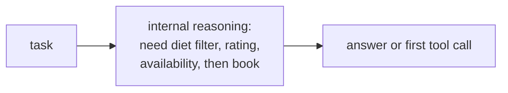
Nearly free to use today (it's a parameter); it costs output tokens and latency. It's the foundation all other patterns build on.

---

## A.2 ReAct (reason + act)

**Idea.** A loop: think → call a tool → read the result → think again, until done.

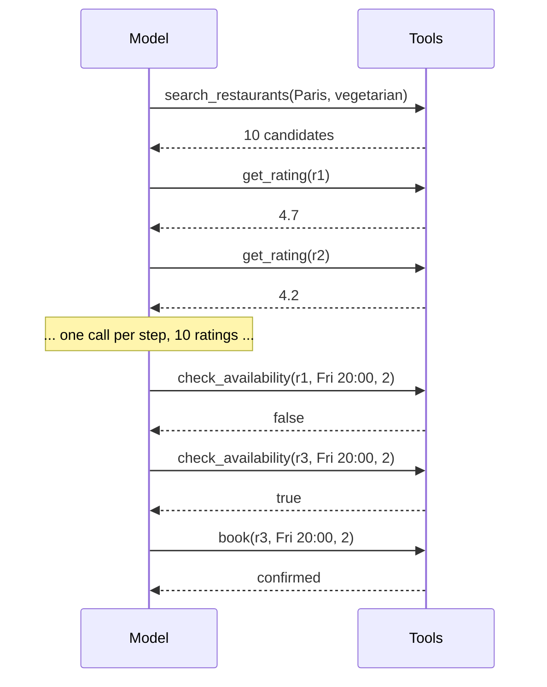

**Worked example.** About 23 sequential model calls. Each call re-sends the growing history. It adapts well ("r1 is full → try the next best"), but it's slow.

| Pros | Cons |
|---|---|
| adapts after every observation | sequential: one round trip per step |
| simple; handles open-ended tasks | history re-sent each step: cost grows fast |
| | can loop or wander without a global plan |

**Evidence.** Beat act-only and reason-only baselines on HotpotQA, FEVER, ALFWorld and WebShop (2022). **This is the default loop** ([loop.py](../code/aieng/agent/loop.py)).

---

## A.3 Plan-and-execute

**Idea.** A planner writes the steps; an executor runs each step; a re-planner revises the plan when reality differs.

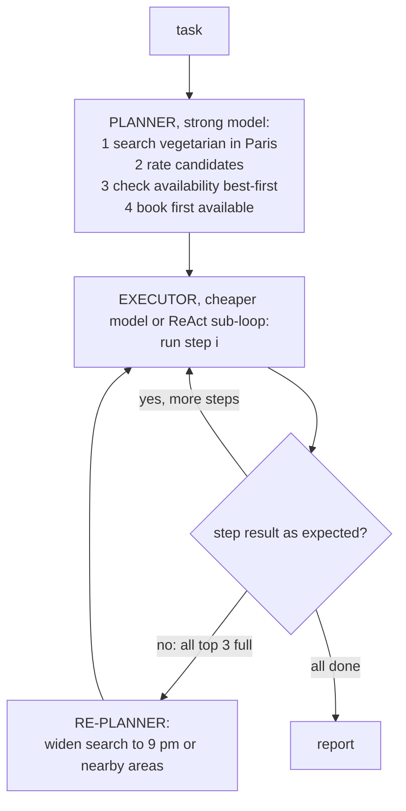

| Pros | Cons |
|---|---|
| a global view; the plan can be shown to and approved by a human | plans go stale when reality differs |
| cheaper executor models; progress tracking | rigid for exploratory tasks |

**Modern form.** The agent keeps its own **todo list** (Claude Code's todos, "plan mode").

---

## A.4 ReWOO (reasoning without observation)

**Idea.** Plan **everything up front with variables**, run all tools without calling the model in between, then write the answer once.

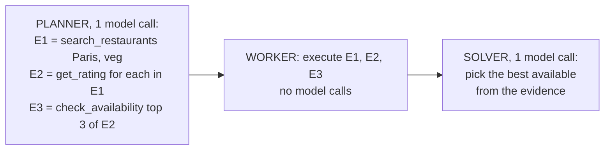

**Worked example.** 2 model calls instead of ~23. But if all top 3 are full, E3 can't adapt, so the solver just reports "none available".

| Pros | Cons |
|---|---|
| far fewer tokens (history not re-sent after each tool) | can't adapt mid-plan |
| predictable | bad when results are surprising |

**Evidence.** The paper reports ~5× token efficiency on HotpotQA with a small accuracy gain (arXiv 2305.18323).

---

## A.5 LLMCompiler (parallel tool DAG)

**Idea.** Plan a **dependency graph** of tool calls and run everything whose inputs are ready **in parallel**.

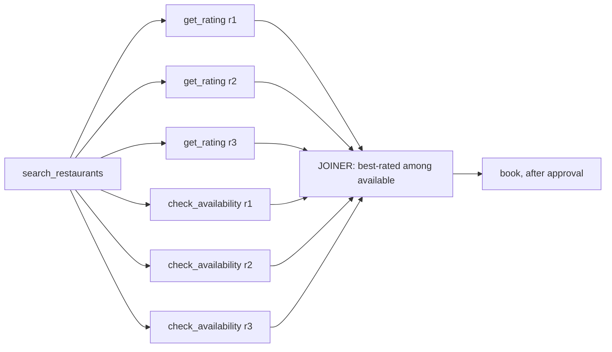

**Worked example.** 6 lookups run at once. Wall time ≈ search + one lookup + book, instead of 8 sequential steps.

| Pros | Cons |
|---|---|
| latency: the paper reports up to 3.7× faster, 6.7× cheaper, ~9% more accurate than ReAct | gains depend on how parallelisable the task is |

**Modern form.** Native **parallel tool calls**: the model emits several `tool_use` blocks in one turn; our loop runs them in a thread pool.

---

## A.6 Reflexion (learn from failure by writing lessons)

**Idea.** After a failed attempt, write a **verbal lesson**, store it, and retry with the lessons in context.

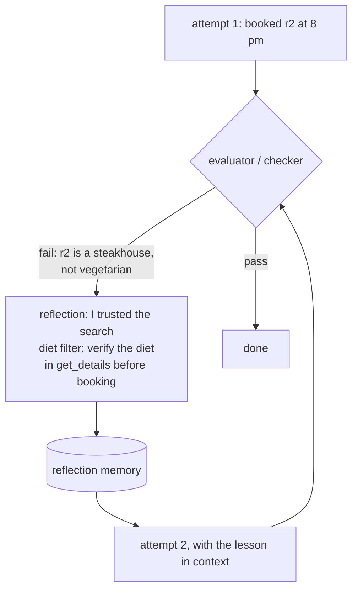

| Pros | Cons |
|---|---|
| improves on retries without training | needs a reliable success signal |
| readable lessons | self-critique without external feedback often confirms its own mistakes |

**Evidence.** 91% pass@1 on HumanEval with GPT-4 (vs 80% baseline at the time) in the paper.

---

## A.7 Self-consistency and best-of-N

**Idea.** Sample several answers and vote, or pick the best with a verifier.
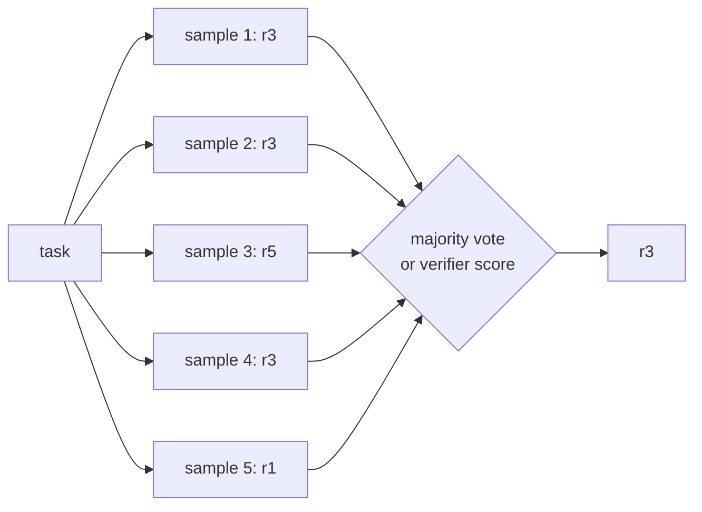
N× cost; parallel; needs comparable answers or a verifier. Great for discrete answers (labels, numbers, choices).

---

## A.8 Tree of Thoughts / LATS (search over branches)

**Idea.** Explore several branches, evaluate them, and expand the promising ones (BFS/DFS in ToT; Monte Carlo tree search in LATS).
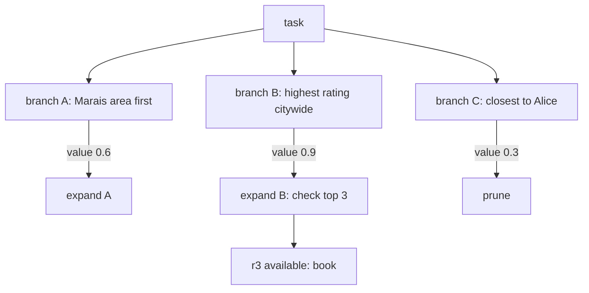
**Evidence.** ToT: Game of 24 success 74% vs 4% for CoT (GPT-4). LATS: 92.7% HumanEval pass@1 (at the time).
**Trade-off.** Very expensive and needs a good state evaluator. Rare in production: reasoning models absorbed much of it.

---

## A.9 CodeAct (code as the action)

**Idea.** The agent writes a **program** that calls the tools, loops and filters, and only the final result comes back into the context.

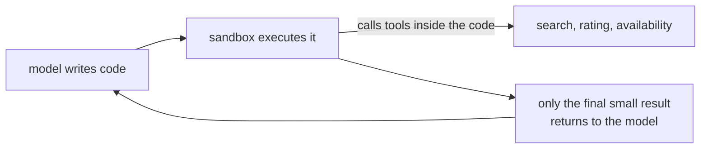

**Worked example.** One model turn:
```python
cands = search_restaurants("Paris", "vegetarian")
ranked = sorted(cands, key=lambda r: get_rating(r.id), reverse=True)
best = next((r for r in ranked if check_availability(r.id, "Fri 20:00", 2)), None)
print(best.id if best else "none available")
```
10 ratings and several availability checks never enter the context. Only `r3` does.

| Pros | Cons |
|---|---|
| far fewer tokens and turns | needs a secure sandbox |
| loops, filtering, composition in one step | per-action approval is harder (keep `book` as a separate approved tool) |

**Evidence.** CodeAct reported up to ~20% higher success than JSON/text actions (arXiv 2402.01030). Now built into platforms (code execution, programmatic tool calling, MCP "code mode").

---

## A.10 Pattern comparison on the running task

| Pattern | Model calls | Adapts when r1 is full? | Latency | Tokens |
|---|---|---|---|---|
| ReAct | ~23 | ✓ | high | high |
| Plan-and-execute | ~6 + re-plans | ✓ via re-plan | medium | medium |
| ReWOO | 2 | ✗ | low | **lowest** |
| LLMCompiler / parallel calls | ~3 | ✓ via the joiner | **lowest** | medium |
| CodeAct | ~2 | ✓ (logic in code) | low | **low** |
| Reflexion | ReAct × attempts | ✓ across attempts | high | high |

---

# Part B: Workflow patterns (code decides the flow)

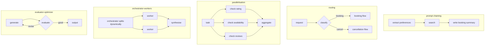
**Rule.** If you can draw the flowchart in advance, build a workflow, not an agent: it's cheaper, faster and testable.

---

# Part C: Multi-agent topologies

## C.1 Orchestrator–worker (supervisor)
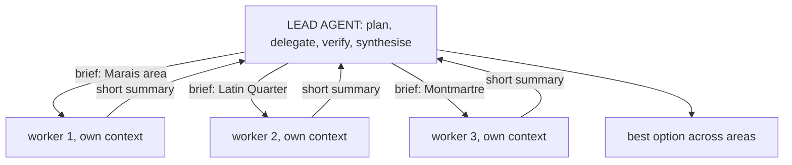
Parallel breadth and clean contexts, but it multiplies tokens and workers lack shared context. It's what our [`delegate_tool`](../code/aieng/agent/subagent.py) does.

## C.2 Hierarchical
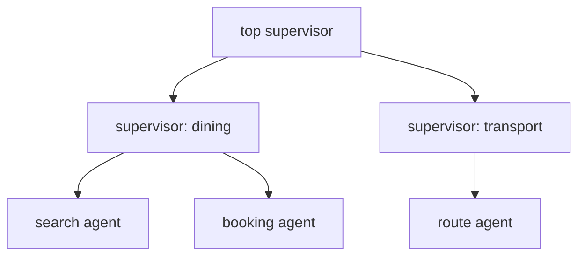
Scales to big tasks, but errors and latency grow with depth.

## C.3 Handoffs (swarm)
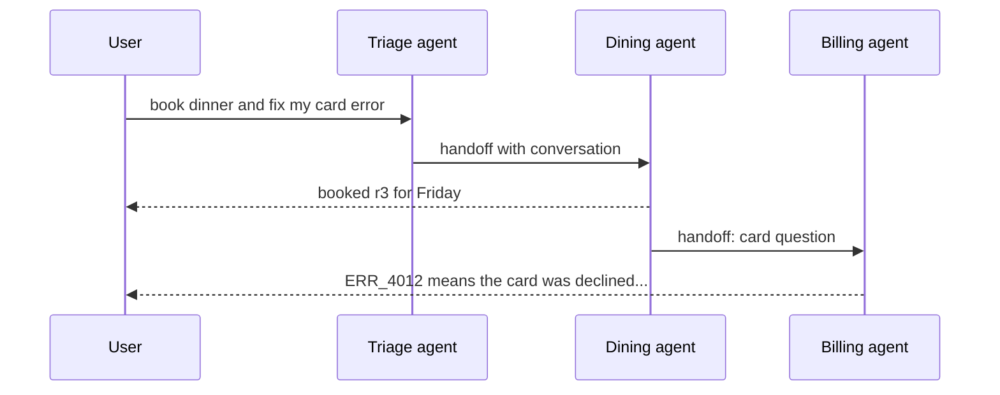
Each specialist has a small prompt and tool set. Risks: context lost at handover, and agents passing the conversation back and forth.

## C.4 Pipeline (fixed roles)
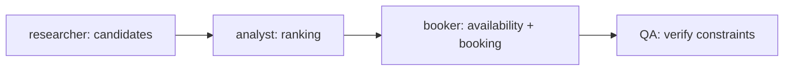
Mirrors a human process with structured handoffs. Rigid, and errors flow downstream (MetaGPT, ChatDev).

## C.5 Group chat
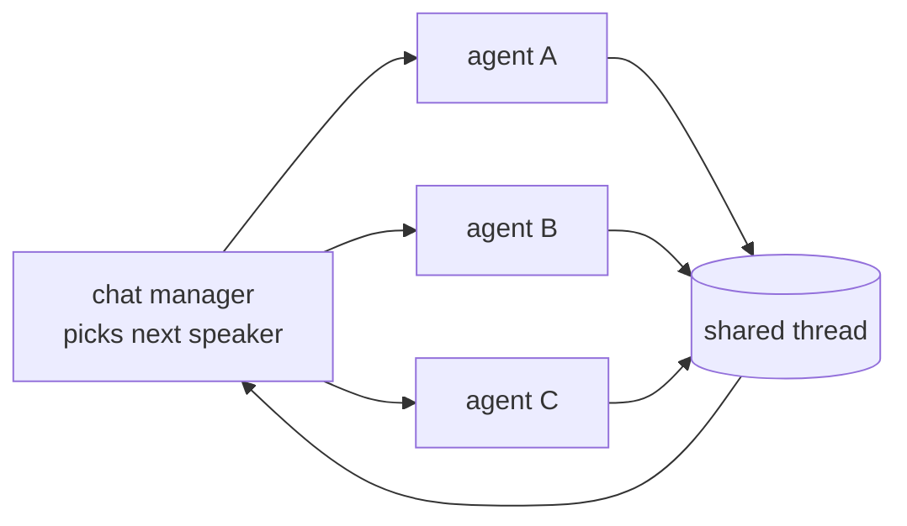
Flexible, but chatty, costly, and hard to terminate (AutoGen).

## C.6 Debate
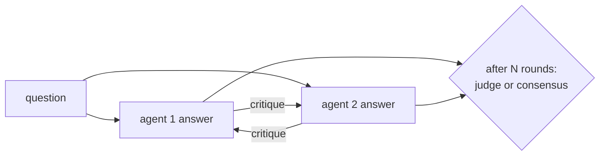
Can improve factuality; costs N×; can converge on a confident wrong answer.

## C.7 Blackboard
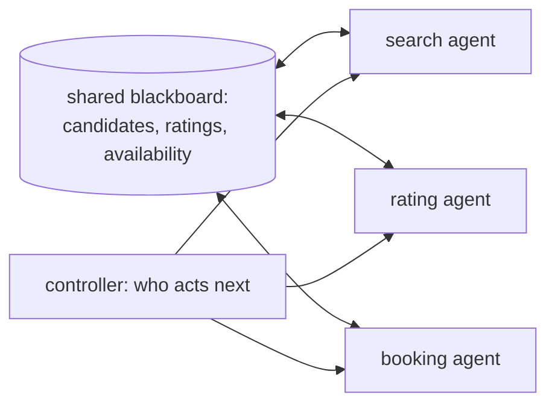
Loose coupling via shared state; needs coordination and conflict rules.

### What the evidence says about multi-agent systems
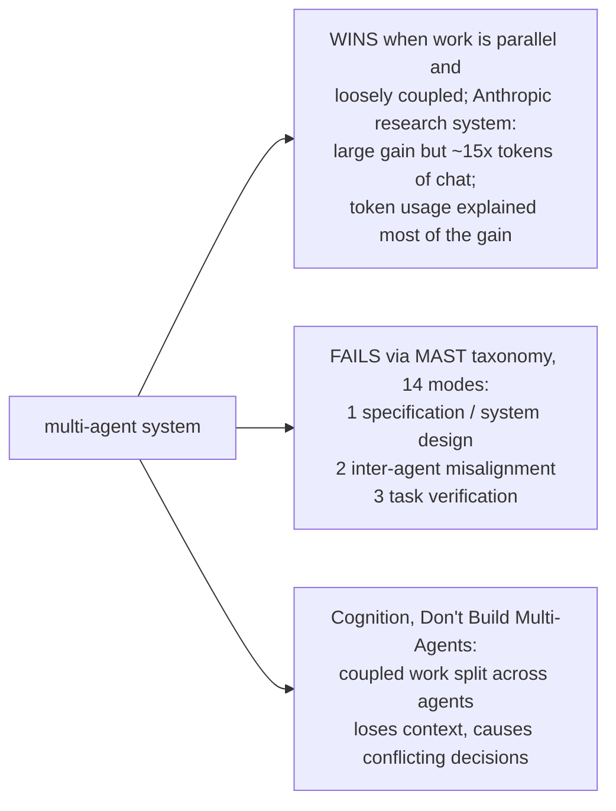
**Design rules:** complete briefs · disjoint scopes · the lead **verifies** worker outputs · budgets on spawning.

---

# Part D: Tool-use patterns

```mermaid
flowchart TB
    subgraph NATIVE["native function calling"]
        N1["tool schemas in context"] --> N2["model emits a structured call"] --> N3["your code runs it"]
    end
    subgraph SEARCHT["tool search / deferred loading"]
        S1["only a search tool loaded"] --> S2["model searches: booking"] --> S3["book tool definition loaded"]
    end
    subgraph PTC["programmatic tool calling"]
        P1["model writes code"] --> P2["code calls your tools in a sandbox"] --> P3["only the final result returns"]
    end
    subgraph MCPB["MCP"]
        M1["agent"] <-->|protocol| M2["external tool servers"]
    end
```

| Pattern | Pros | Cons |
|---|---|---|
| native function calling (+ `strict` schemas) | reliable, typed | every definition costs context |
| parallel calls | latency | all results must return in one message |
| tool search / deferred loading | scales to hundreds of tools | a search step |
| programmatic tool calling / CodeAct | big token savings | sandbox; less per-call control |
| MCP | reuse across agents | supply-chain risk; context bloat |
| skills | near-zero idle context | quality control |
| computer use / browser | any UI | slow, brittle, security-sensitive |

---

# Part E: Control and reliability patterns

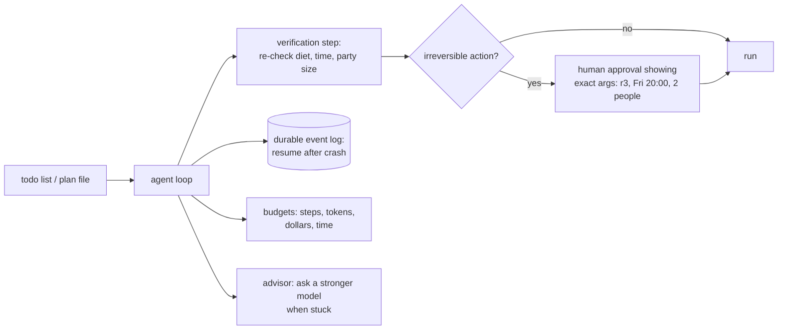

| Pattern | Purpose |
|---|---|
| todo list / plan file | coherence on long tasks; survives compaction |
| verification step | catch errors before "done" |
| durable execution (event log, resumable harness) | crash recovery; runs lasting hours or days (brain/hands/session) |
| human-in-the-loop | approve risky actions with the exact arguments |
| budgets | bound runaway behaviour; graceful wrap-up |
| advisor / escalation | a cheaper model asks a stronger one when stuck |
| idle-time speculation (IdleSpec, 2026) | plan ahead while waiting on slow tools |
| workflow compilation (2026) | distil a stable multi-call workflow into one fine-tuned call |

---

# Part F: Decision guide

```mermaid
flowchart TD
    A["Can you draw the steps in advance?"] -->|yes| W["workflow: chaining, routing,<br/>parallel, evaluator-optimizer"]
    A -->|no| B["single agent: ReAct loop<br/>+ good tools + todo list"]
    B --> C{"evals show..."}
    C -->|slow: many independent lookups| P["parallel calls / LLMCompiler DAG"]
    C -->|token cost from big data| CA["CodeAct / programmatic tool calling"]
    C -->|wrong but checkable answers| RF["verification + Reflexion;<br/>best-of-N with a verifier"]
    C -->|loses track on long tasks| PL["plan-and-execute / todo file,<br/>compaction + notes"]
    C -->|breadth: many sources to read| MA["orchestrator-worker sub-agents,<br/>budgeted, disjoint scopes"]
    C -->|many tools confuse it| TS["tool search, skills,<br/>fewer and better tools"]
```

---

## Check your understanding
1. **How many model calls does ReWOO need for the running task, and what's the catch?** Two (plan + solve). It can't adapt if the top choices are full.
2. **Why is LLMCompiler faster than ReAct?** Independent calls (ratings, availability) run in parallel following the dependency graph.
3. **In CodeAct, why do the 10 ratings never enter the context?** They're processed inside the code; only the final choice is printed back.
4. **What does Reflexion need to work?** A reliable success signal (a checker, tests, a user confirmation).
5. **Name the three MAST failure categories.** Specification/system design, inter-agent misalignment, task verification.
6. **Where must the human approval sit in this task, and what must it show?** Before `book`, showing the exact restaurant, time and party size.

---

## Sources
- Wei et al., *Chain-of-Thought* (2022): arXiv 2201.11903 · Wang et al., *Self-Consistency* (2022): arXiv 2203.11171
- Yao et al., *ReAct* (2022): arXiv 2210.03629 · Xu et al., *ReWOO* (2023): arXiv 2305.18323 · Kim et al., *LLMCompiler* (2023): arXiv 2312.04511 · Wang et al., *Plan-and-Solve* (2023): arXiv 2305.04091
- Shinn et al., *Reflexion* (2023): arXiv 2303.11366 · Madaan et al., *Self-Refine* (2023): arXiv 2303.17651
- Yao et al., *Tree of Thoughts* (2023): arXiv 2305.10601 · Zhou et al., *LATS* (2023): arXiv 2310.04406
- Wang et al., *CodeAct* (2024): arXiv 2402.01030
- Anthropic, *Building effective agents* (2024), *How we built our multi-agent research system* (2025): https://www.anthropic.com/engineering
- Cemri et al., *Why Do Multi-Agent LLM Systems Fail? (MAST)* (2025): arXiv 2503.13657 · Cognition, *Don't Build Multi-Agents* (2025)
- Du et al., *Multiagent Debate* (2023): arXiv 2305.14325 · Hong et al., *MetaGPT*: arXiv 2308.00352 · Wu et al., *AutoGen*: arXiv 2308.08155
- Requesty roundup (IdleSpec, workflow compilation, May 2026): https://www.requesty.ai/blog/ai-agent-techniques-may-2026-self-evolving-managed-compiled
