# Evaluation techniques: a deep dive

> **Where this fits.** Overview: [../06-evaluation.md](../06-evaluation.md) · Implementation: [../implementation/05-evals.md](../implementation/05-evals.md) · Code: [evals.py](../code/aieng/evals.py), [rag/metrics.py](../code/aieng/rag/metrics.py).
>
> **Format:** idea → diagram → worked example on the running case → pros/cons → evidence.

---

## 0. Running example

A RAG support bot:
```text
question:   "How long do Team customers have to get a refund?"
reference:  "30 days from purchase."
retrieved:  [c1] "The Team plan has a 30-day refund window."  [c2] "Refunds are issued within 14 days of purchase."  [c3] "ERR_4012 means the card was declined."
answer A:   "Team customers have 30 days from purchase to request a refund [c1]."
answer B:   "You have 14 days to get a refund [c2]."
answer C:   "Team customers get a full refund within 30 days, and refunds are processed instantly to your bank. Contact our 24/7 hotline." (long, partly invented)
```
A is correct; B is wrong but faithful to a (wrong) chunk; C is correct on the key fact but contains unsupported claims.

### Where each evaluation technique sits

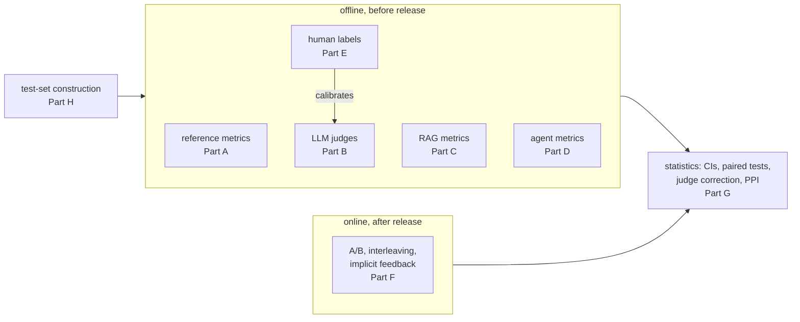

---

# Part A: Reference-based metrics

## A.1 Exact match and token F1
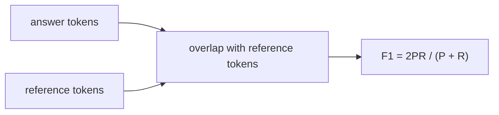
**Worked example.** Reference "30 days from purchase" (4 tokens). Answer A contains all 4 plus 7 others → recall 1.0, precision 4/11 ≈ 0.36, **F1 ≈ 0.53**. Answer B "You have 14 days to get a refund" shares only "days" → F1 ≈ 0.18. EM = 0 for all three, even though A is perfect. **Lesson:** fine for short, canonical answers (IDs, numbers, labels); misleading for sentences.

## A.2 BLEU / ROUGE / BERTScore
n-gram overlap (BLEU/ROUGE) or embedding similarity (BERTScore). Answer C scores *high* (it shares "Team", "refund", "30 days") despite invented claims. They correlate poorly with quality for open-ended LLM output. **Use only for legacy comparisons.**

## A.3 Execution-based checks
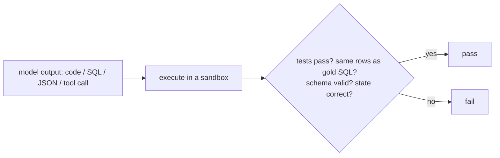
Ground truth, cheap and deterministic. Needs a harness, and the harness must itself be sound (a leaky harness gets gamed; see the SQL reward tests in [training/rewards.py](../code/training/rewards.py)).
**Rule:** if you can check it with code, do.

---

# Part B: LLM-as-judge variants

## B.1 Pointwise scale (1–10)
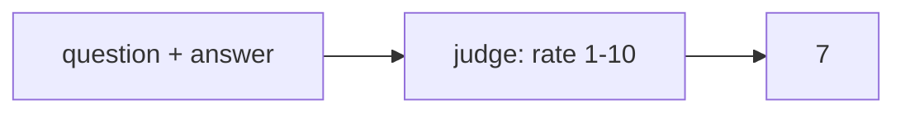
Scores drift, cluster around 7–8, and agree poorly between runs. A, B and C might get 9, 6 and 8.

## B.2 Binary, one criterion per judge (recommended)
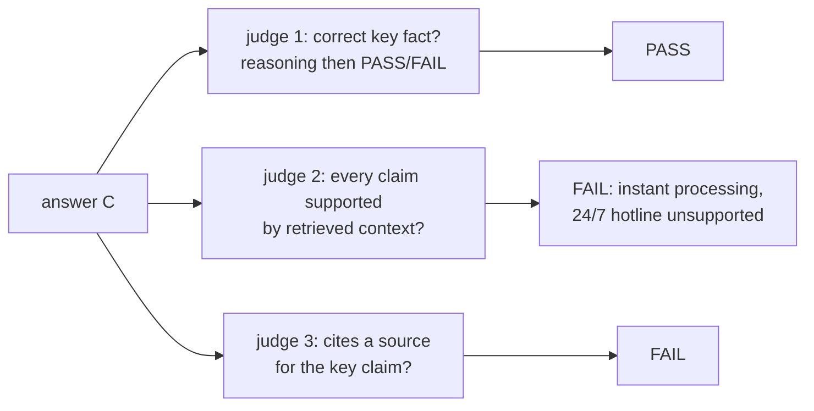
Precise, actionable, and the easiest kind to calibrate. Costs one judge per criterion. Code: [`BinaryJudge`](../code/aieng/evals.py).

## B.3 Rubric / checklist
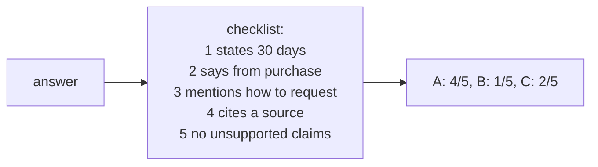
Fine-grained and explainable. Also usable as an **RL reward** (rubrics as rewards, ch. 7).

## B.4 Pairwise comparison with debiasing
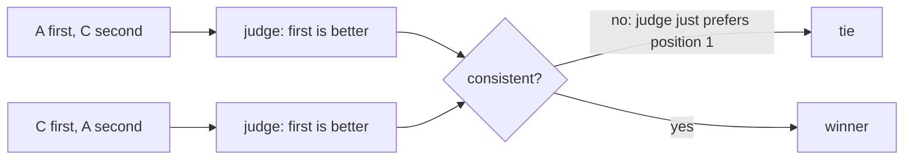
Pairwise is more reliable than absolute scores for comparing two systems, but it has **position bias**, so ask in both orders ([`pairwise_debiased`](../code/aieng/evals.py)).

## B.5 Reference-guided judging
The judge sees the reference answer "30 days from purchase". It catches B immediately (14 ≠ 30), even though B is fluent and cites a source. **Much more accurate on factual tasks** whenever you have references.

## B.6 G-Eval (probability-weighted scores)
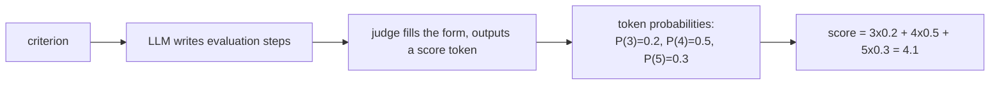
Smoother, better-correlated scores than a single sampled number. Needs token probabilities from the judge model.

## B.7 Fine-tuned judges (Prometheus, Lynx, MiniCheck, HHEM)
Small models trained to judge (general rubrics, or specific tasks like "is this claim supported by this passage?"). Cheap, fast, private, consistent. They can be weaker out of domain.

## B.8 Jury of judges (PoLL)
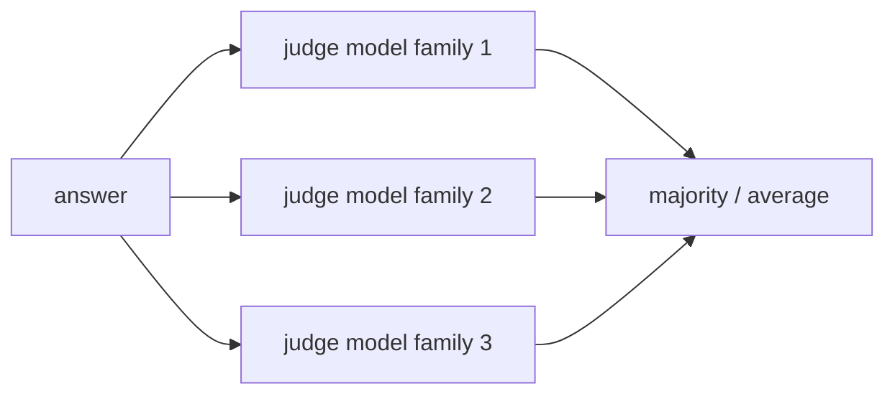
The PoLL paper found a panel of smaller, *different* models had less bias and better agreement with humans than one large judge, at lower cost.

## B.9 Agent-as-a-judge
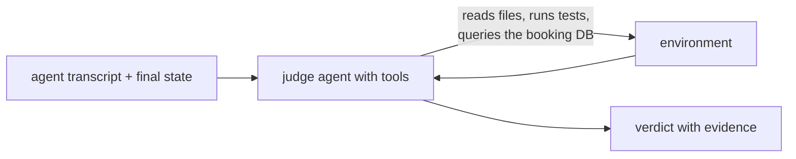
For agents, checking the **environment** beats reading the transcript. The transcript can claim success that never happened. AJ-Bench (2026) benchmarks exactly this.

### Judge biases and fixes
| Bias | On the running example | Fix |
|---|---|---|
| verbosity | C (longest) rated highest | "length is irrelevant"; short passing examples; check pass rate vs length |
| position | whichever answer is shown first wins | ask in both orders |
| self-preference | the judge prefers its own model family's style | a different judge family, or a jury |
| leniency | B passes "helpfulness" | reference-guided judging; measure TNR |

### Calibration (mandatory)
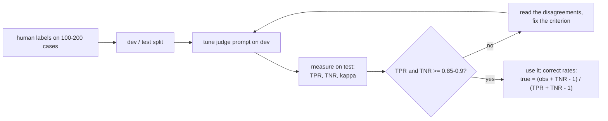

---

# Part C: RAG-specific metrics

## C.1 Faithfulness (groundedness) by claim decomposition
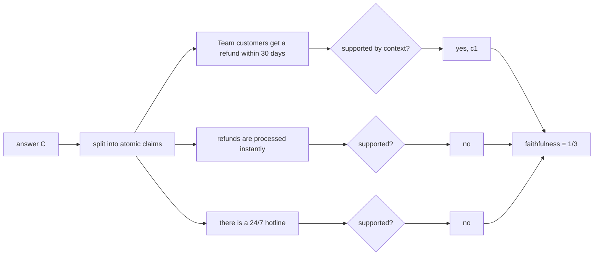
Answer A → 1/1 = 1.0. Answer B → 1/1 = **1.0** (faithful to c2, which is the wrong chunk!). That's why faithfulness ≠ correctness.

## C.2 Context precision and recall / coverage
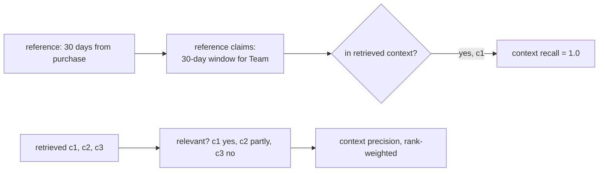
Low context recall → retrieval is the problem. High recall but a wrong answer → generation is the problem.

## C.3 Citation precision and recall (ALCE)
- **Citation precision:** does each cited source support its statement? A: c1 supports it ✓.
- **Citation recall:** does every statement that needs a source have one? C: none ✗.

## C.4 Abstention
Add questions whose answer is **not** in the corpus ("What's the refund window for the Enterprise plan?"). A correct system says it doesn't know; a bad one invents "60 days".

## C.5 Noise robustness
Inject irrelevant or contradicting chunks (like c3, or a stale "Team: 14 days" page) and check that the answer doesn't change.

---

# Part D: Agent evaluation

## D.1 Final-state checking
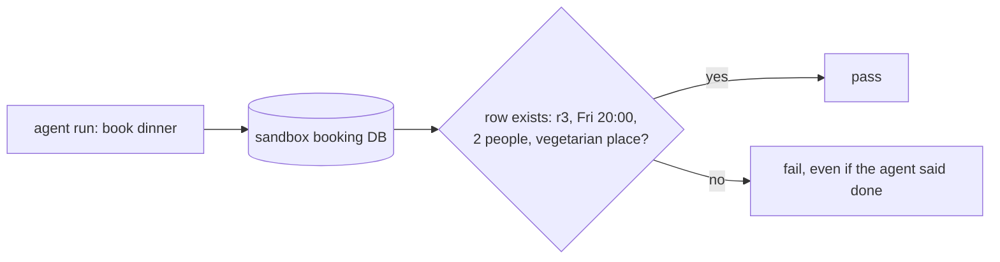

## D.2 Trajectory matching
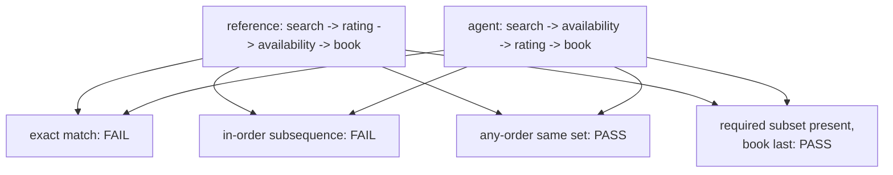
Strict matching penalises valid alternative paths. Use loose matching plus required constraints ("book only after availability").

## D.3 pass@k vs pass^k
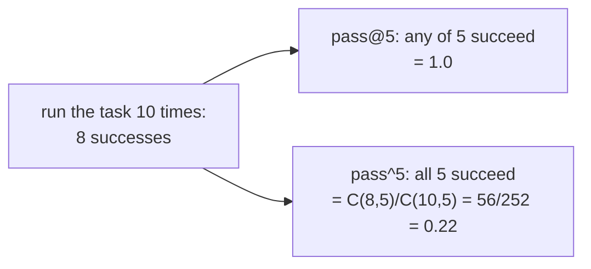
An agent that works 80% of the time works **5 times in a row only 22%** of the time. That gap is what users experience as flakiness. Code: [`pass_at_k`, `pass_hat_k`](../code/aieng/evals.py).

## D.4 Simulated users (τ-bench style)
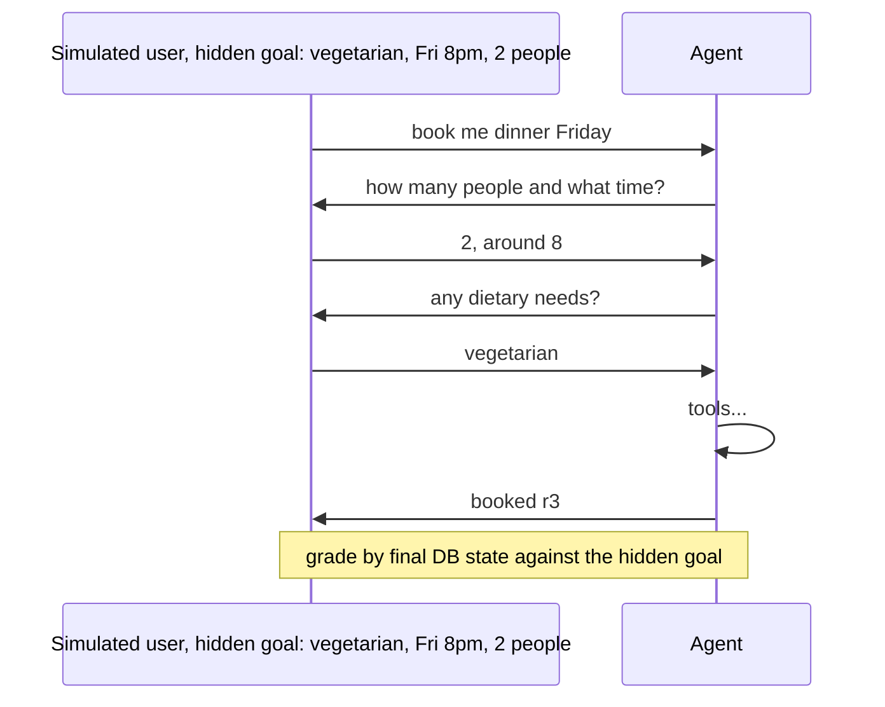

## D.5 Efficiency and safety
Cost, latency and steps **per successful task**; forbidden actions taken; confirmations skipped.

---

# Part E: Human evaluation

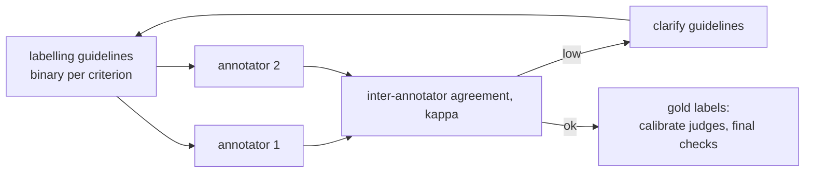
- **Pairwise preference + Elo / Bradley–Terry:** rank many systems (Chatbot Arena style); votes have style biases too (length, formatting).
- **Error analysis (open and axial coding):** the most valuable hour. Read traces, write notes, group them into failure categories.

---

# Part F: Online evaluation

## F.1 A/B test
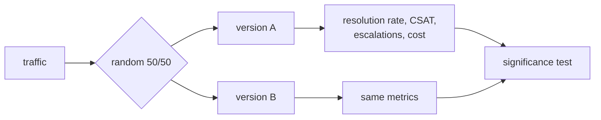

## F.2 Interleaving (for rankers)
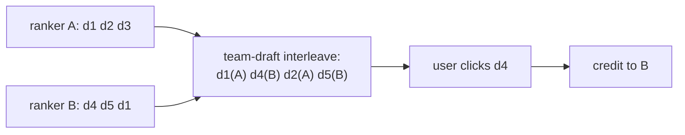
Far more sample-efficient than A/B for comparing rankers.

## F.3 Implicit feedback and guardrail metrics
Thumbs, copies, edits, retries, escalations, abandonment; latency, error rate, cost, refusal rate. Check that offline scores **predict** these.

---

# Part G: Statistics

## G.1 Bootstrap confidence interval
```mermaid
flowchart LR
    S["50 case scores"] --> RS["resample 50 with replacement,<br/>2000 times"]
    RS --> M["2000 means"]
    M --> CI["2.5th and 97.5th percentile<br/>= 95% CI"]
```
With 50 cases and ~72% pass, the CI is about ±12 points: 72% vs 75% is noise.

## G.2 Paired comparison
Compare A and B **on the same cases** (paired bootstrap, McNemar for pass/fail). This has far more power than comparing two separate intervals.

## G.3 Sample size
For a pass rate near 70%, a ±5-point 95% CI needs n ≈ 1.96² × 0.7 × 0.3 / 0.05² ≈ **323 cases**.

## G.4 Correcting for judge error
```text
judge TPR = 0.95, TNR = 0.60, observed pass rate = 0.70
true rate = (0.70 + 0.60 - 1) / (0.95 + 0.60 - 1) = 0.30 / 0.55 = 0.545
```
A lenient judge turned a true 55% into an observed 70%.

## G.5 Prediction-powered inference (PPI)
```mermaid
flowchart LR
    BIG["10,000 cases labelled by the judge"] --> EST["judge-based estimate"]
    SMALL["200 cases labelled by humans AND judge"] --> BIAS["measure the judge's bias:<br/>human minus judge"]
    EST --> PPI["PPI estimate =<br/>judge estimate + bias correction"]
    BIAS --> PPI
    PPI --> OUT["unbiased, with tighter CIs<br/>than 200 human labels alone"]
```

---

# Part H: Building test sets

```mermaid
flowchart TB
    PROD["production samples, stratified"] --> SET[("eval set")]
    FAIL["failure mining: tickets, thumbs-down"] --> SET
    SYN["synthetic: persona x intent x difficulty,<br/>human-filtered"] --> SET
    EVOL["evolve seeds to be harder"] --> SET
    CL["CheckList behavioural tests"] --> SET
    SET --> SPL["dev split: tune on it<br/>test split: never tune on it"]
```

**CheckList test types on the running example:**
| Type | Test | Expectation |
|---|---|---|
| **MFT** (minimum functionality) | "Team refund window?" | says 30 days |
| **INV** (invariance) | "Team refnd windw?" (typos) or "Hi! Team refund window please" | the same answer |
| **DIR** (directional) | change the plan in the question from Team to Pro | the answer changes to 14 days |

**Contamination:** public benchmarks leak into training data. Trust your private, held-out set most, and prefer regularly refreshed benchmarks.

---

# Part I: Decision guide

| Need | Technique |
|---|---|
| checkable output | execution / code checks |
| factual QA with references | reference-guided judge, F1/EM for short answers |
| open-ended quality | calibrated binary judge per criterion |
| comparing two systems | debiased pairwise + paired statistics |
| RAG debugging | retrieval metrics + faithfulness + correctness, separately |
| agents | final-state checks + pass^k + trace review |
| cheap monitoring at scale | fine-tuned small judges or a jury + sampled human audits |
| few human labels, unbiased estimates | PPI |

```mermaid
flowchart LR
    EA["error analysis: read traces"] --> CAT["failure categories"]
    CAT --> CODE{"checkable by code?"}
    CODE -->|yes| CC["code check"]
    CODE -->|no| J["binary judge per category"]
    J --> CAL["calibrate vs human labels"]
    CC & CAL --> STAT["CIs, paired tests, pass^k"]
    STAT --> ON["confirm against online metrics"]
```

---

## Check your understanding
1. **Answer B is faithful but wrong. Which metrics catch it?** Correctness (reference-guided judge, F1 vs reference); context precision shows the wrong chunk was used. Faithfulness does not catch it.
2. **Compute pass^3 for 8 successes in 10 runs.** C(8,3)/C(10,3) = 56/120 ≈ 0.47.
3. **Why ask a pairwise judge twice?** To cancel position bias: inconsistent verdicts become ties.
4. **What does G-Eval use that a normal judge ignores?** The probability of each score token.
5. **What problem does PPI solve?** It gives unbiased estimates from many cheap judge labels corrected by a few human labels.

---

## Sources
- Zheng et al., *MT-Bench / Chatbot Arena* (2023): arXiv 2306.05685 · Liu et al., *G-Eval* (2023): arXiv 2303.16634
- Kim et al., *Prometheus 2* (2024): arXiv 2405.01535 · Tang et al., *MiniCheck* (2024): arXiv 2404.10774 · *Lynx* (2024): arXiv 2407.08488
- Verga et al., *PoLL: Replacing Judges with Juries* (2024): arXiv 2404.18796
- Zhuge et al., *Agent-as-a-Judge* (2024): arXiv 2410.10934 · *AJ-Bench* (2026): arXiv 2604.18240 · *AgentJudgeBench* (2026)
- Es et al., *RAGAS* (2023): arXiv 2309.15217 · Gao et al., *ALCE* (2023): arXiv 2305.14627 · Chen et al., *RGB* (2023): arXiv 2309.01431
- Yao et al., *τ-bench* (2024): arXiv 2406.12045 · Debenedetti et al., *AgentDojo*: arXiv 2406.13352
- Angelopoulos et al., *Prediction-Powered Inference* (2023): arXiv 2301.09633
- Ribeiro et al., *CheckList* (ACL 2020): arXiv 2005.04118 · Chapelle et al., *Interleaved search evaluation* (TOIS 2012)
- Shankar et al., *Who Validates the Validators?* (2024): arXiv 2404.12272 · Hamel Husain: https://hamel.dev
