# Post-training techniques: a deep dive

> **Where this fits.** Overview: [../07-post-training-and-rl.md](../07-post-training-and-rl.md) · Implementation: [../implementation/06-fine-tuning-and-rl.md](../implementation/06-fine-tuning-and-rl.md) · Code: [training/](../code/training/).
>
> **Format:** idea → diagram → worked example → pros/cons → evidence.

---

## 0. Running example

Turn a small open model (e.g. a 1.5B instruct model) into **ACME's text-to-SQL assistant**:
```text
input:  "Schema: orders(id, plan, amount, created_at) | Q: total Team revenue in March 2026"
output: "<sql>SELECT SUM(amount) FROM orders WHERE plan='team' AND created_at >= '2026-03-01' AND created_at < '2026-04-01'</sql>"
```
Verifier available: run the SQL on a test database and compare the result with the gold query's result.

### The post-training pipeline

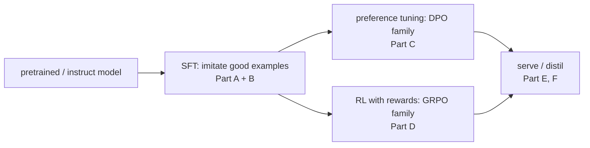

---

# Part A: How the weights are updated (PEFT)

## A.0 Full fine-tuning
Every weight gets a gradient. Maximum capacity, but memory for weights + gradients + Adam states (≈16+ bytes per parameter in mixed precision), a full model copy per task, and more forgetting.

## A.1 LoRA
**Idea.** Freeze the weight matrix W; learn a small **low-rank update** ΔW = B·A added beside it.

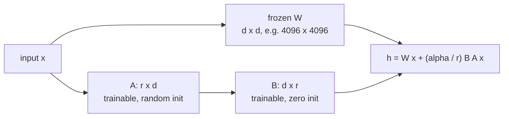

**Worked example.** One 4096×4096 matrix has 16.8M weights. LoRA with r = 16 trains A (16×4096) + B (4096×16) = **131k weights (0.8%)**. B starts at zero, so the model is unchanged at step 0. After training you can **merge** (W' = W + BA, so no extra latency) or keep adapters separate (swap per task; serve many LoRAs on one base).

| Pros | Cons |
|---|---|
| tiny trainable size; cheap; swappable adapters | may underfit large-data / new-knowledge tasks |
| forgets less of the base model | one more hyperparameter set (r, α, target modules) |

**Evidence.** *LoRA Learns Less and Forgets Less* (2024): less target-domain gain than full fine-tuning in continued training, but better preservation of general skills. *LoRA Without Regret* (Thinking Machines, 2025): matched full fine-tuning on small/medium supervised data and on **RL** when applied to **all layers** (especially MLPs) with a ~**10× higher LR**.

## A.2 QLoRA
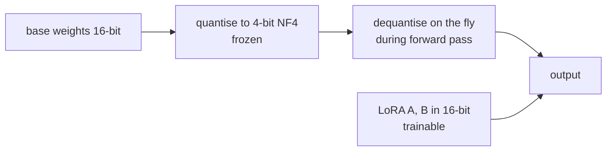
Fine-tune 30–70B models on one GPU (4-bit base + paged optimizers). Steps are slower and there's a small quantisation cost.

## A.3 DoRA
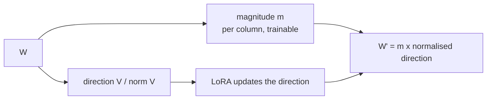
Splitting magnitude from direction often closes part of the gap to full fine-tuning at low rank.

## A.4 Other PEFT variants at a glance
| Method | Change vs LoRA | Why |
|---|---|---|
| LoRA+ | higher LR for B than for A | faster convergence |
| rsLoRA | scale α/√r instead of α/r | stable at high ranks |
| PiSSA | initialise A, B from W's top singular vectors | starts from the "important" directions |
| VeRA / (IA)³ | train only scaling vectors | tiny adapters, lower capacity |
| prompt / prefix tuning | learn virtual tokens instead of weights | no weight changes; usually weaker |
| bottleneck adapters | small MLPs inserted between layers | the original PEFT; extra latency unless merged |

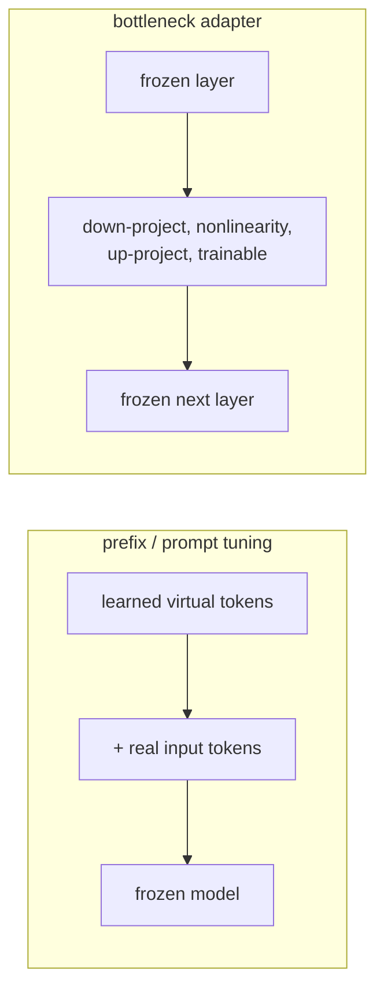

**Defaults:** LoRA r = 16–64, α = 2r, all linear layers, LR 1e-4 to 2e-4 for SFT. QLoRA when memory-bound.

---

# Part B: SFT data techniques

## B.1 Distillation + rejection sampling (the workhorse)
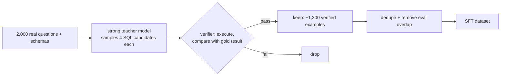
Quality at scale **because of the verifier**. Without one, you train on the teacher's mistakes too.

## B.2 Synthetic instruction generation
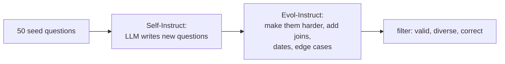
Adds diversity and difficulty, but can drift and become homogeneous.

## B.3 Other data practices
| Practice | Why |
|---|---|
| mix in general instruction data | limits forgetting |
| dedupe + decontaminate against evals | honest evaluation |
| packing short examples (with proper masking) | faster training |
| quality over quantity (LIMA: ~1k curated examples align style well) | format/style needs few examples; new skills need more |

---

# Part C: Preference optimisation

## C.1 RLHF with PPO (classic)
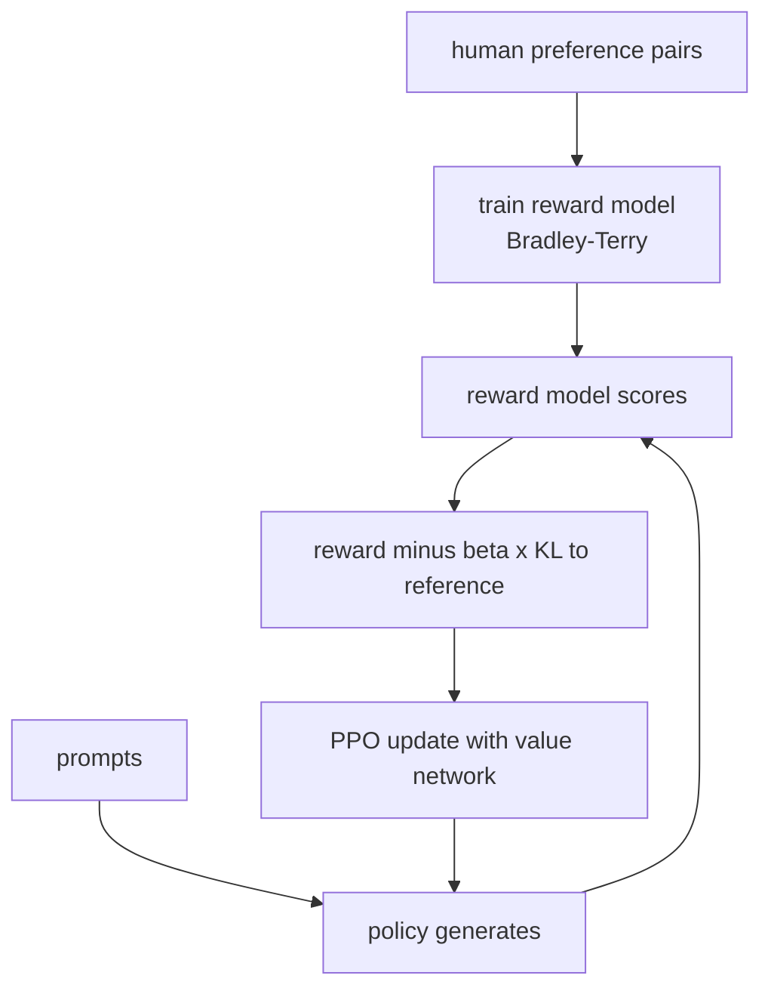
Four models in memory (policy, reference, reward, value). Powerful but unstable, and prone to reward hacking.

## C.2 DPO
**Idea.** Skip the reward model and RL loop: directly increase the probability of the *chosen* answer relative to the *rejected* one, measured against a frozen reference model.

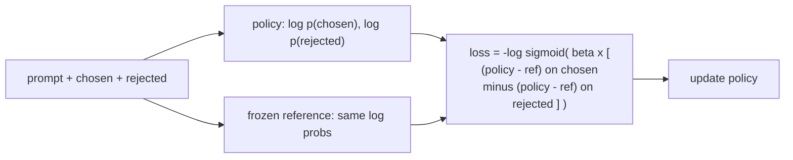

**Worked example.** Chosen: the SQL with the correct `created_at < '2026-04-01'` bound. Rejected: `created_at <= '2026-03-31'`, which misses times on March 31 after midnight. DPO raises the likelihood of the first *relative to* the second.

| Pros | Cons |
|---|---|
| simple, stable, offline | off-policy: learns from fixed pairs (often generated by other models) |
| no reward model | can lower the likelihood of *both* responses; verbosity drift |

## C.3 DPO relatives
| Method | Data | Key change |
|---|---|---|
| IPO | pairs | regularised loss, robust to deterministic/noisy preferences |
| KTO | single 👍/👎 labels | no pairs needed (uses cheap feedback) |
| ORPO | pairs | SFT + odds-ratio preference in **one** stage; no reference model |
| SimPO | pairs | length-normalised reward, no reference model, target margin |
| online / iterative DPO | fresh pairs from the **current** model each round | fixes the off-policy weakness |
| RLAIF / Constitutional AI | AI-labelled preferences guided by principles | scales feedback |

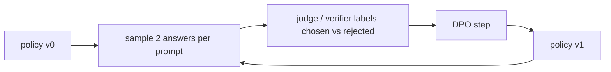
(online DPO)

## C.4 Reward models: outcome vs process
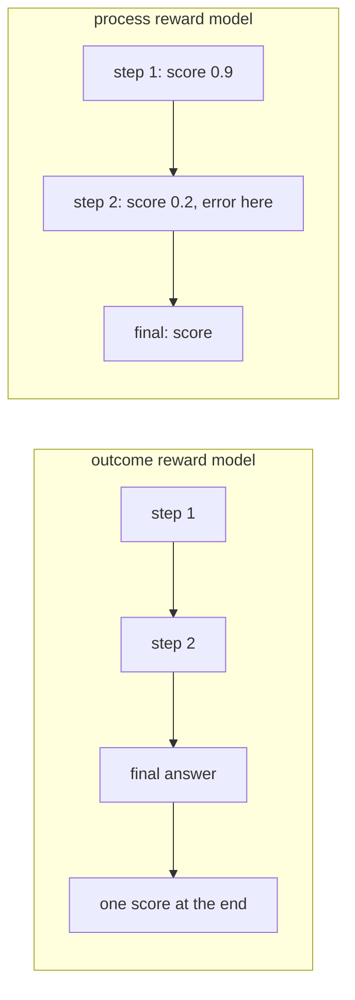
PRMs locate the mistake and gave better supervision for math reasoning (*Let's Verify Step by Step*, 2023), but step labels are expensive. **Rubrics as rewards** (2025) use per-prompt checklists graded by a judge for tasks with no verifier.

---

# Part D: Reinforcement learning methods

## D.1 PPO vs GRPO
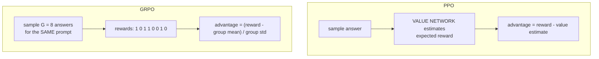

**Worked GRPO example.** 8 SQL samples for one question; the verifier says 4 are correct.
```text
rewards   = [1, 0, 1, 1, 0, 0, 1, 0]      mean = 0.5, std = 0.5
advantage = [+1, -1, +1, +1, -1, -1, +1, -1]
→ push up the tokens of correct queries, push down the tokens of wrong ones (with PPO-style clipping)
```
If all 8 were correct: mean = 1, every advantage = 0 → **no learning signal from this prompt**.

| Pros | Cons |
|---|---|
| no critic: less memory, fewer moving parts | zero-variance groups waste compute |
| natural fit for verifiable rewards | original normalisation biases length |

## D.2 The GRPO family: what each fix targets
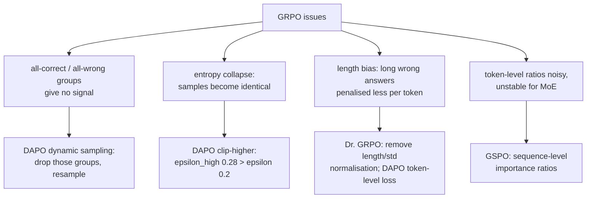
In TRL these are config switches: `loss_type="dapo"` / `"dr_grpo"`, `epsilon_high`, `importance_sampling_level="sequence"` (see [train.py](../code/training/train.py)).

## D.3 Rewards: types and hacking
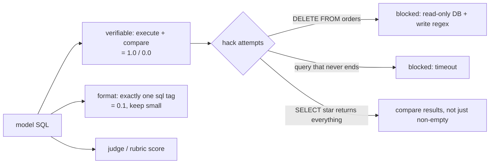
The tests in [test_other.py](../code/tests/test_other.py) cover exactly these hacks.

## D.4 Agentic (multi-turn) RL
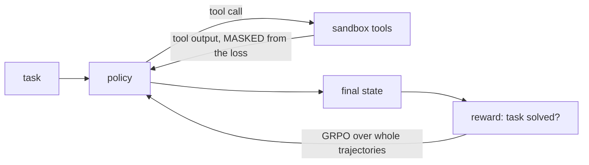
Challenges: credit assignment across turns, slow and variable rollouts (asynchronous RL systems), sandboxes at scale. Frameworks: verl, OpenRLHF, TRL, SkyRL, prime-rl, ART.

---

# Part E: Distillation


| Type | Pros | Cons |
|---|---|---|
| sequence-level | simplest; works with API teachers | exposure bias: never sees its own errors |
| logit KL | rich per-token signal | needs teacher logits, same tokenizer |
| on-policy (GKD; 2025 revival) | dense feedback on the student's own samples; reported near-RL quality at a fraction of the compute | needs online teacher log-probs |
| reasoning-trace | small models gain a lot of reasoning (DeepSeek-R1 distills) | long sequences |
| workflow compilation (2026) | a multi-call agent pipeline becomes one call | brittle if the workflow changes |

---

# Part F: Model merging

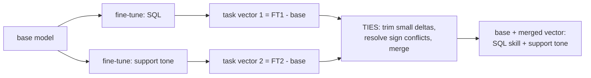
| Method | Idea |
|---|---|
| weight averaging / model soups | average fine-tunes of the same base |
| SLERP | spherical interpolation between two models |
| task arithmetic | add or subtract task vectors |
| TIES | trim, elect signs, merge; reduces interference |
| DARE | randomly drop deltas and rescale before merging |
No training needed, but the results are unpredictable. Always evaluate.

---

# Part G: Decision guide

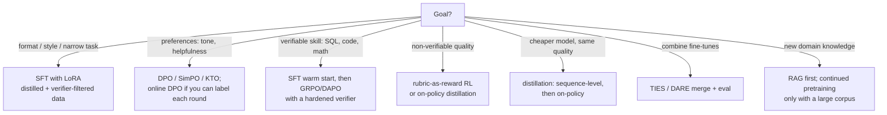

| Technique | Data | Compute | Main risk |
|---|---|---|---|
| SFT (LoRA) | 1k–50k examples | low | forgetting, overfitting |
| DPO family | 5k–100k pairs | low–medium | verbosity drift, off-policy |
| RLHF PPO | pairs + RM + rollouts | high | instability, reward hacking |
| GRPO / RLVR | prompts + verifier | medium–high | verifier hacking, zero-variance prompts |
| on-policy distillation | prompts + teacher | medium | teacher cost |
| merging | existing fine-tunes | ~none | unpredictable interference |

---

## Check your understanding
1. **How many trainable weights does LoRA r = 8 add to a 4096×4096 matrix?** 8×4096 + 4096×8 = 65,536 (0.4%).
2. **Compute GRPO advantages for rewards [1,1,1,0].** Mean 0.75, std ≈ 0.433 → [+0.58, +0.58, +0.58, −1.73].
3. **Why does DPO need a reference model, and which methods drop it?** It measures improvement relative to the reference, which keeps the policy close to it. ORPO and SimPO drop it.
4. **Which GRPO issue does clip-higher address?** Entropy collapse: it allows larger increases for low-probability good tokens, which keeps exploration alive.
5. **Sequence-level vs on-policy distillation?** Sequence-level: the student imitates teacher outputs. On-policy: the teacher grades the student's own samples token by token.

---

## Sources
- Hu et al., *LoRA*: arXiv 2106.09685 · Dettmers et al., *QLoRA*: arXiv 2305.14314 · Liu et al., *DoRA*: arXiv 2402.09353 · Hayou et al., *LoRA+*: arXiv 2402.12354 · Kalajdzievski, *rsLoRA*: arXiv 2312.03732 · Meng et al., *PiSSA*: arXiv 2404.02948
- Biderman et al., *LoRA Learns Less and Forgets Less*: arXiv 2405.09673 · Thinking Machines, *LoRA Without Regret* (2025): https://thinkingmachines.ai/blog/lora/
- Zhou et al., *LIMA*: arXiv 2305.11206 · Wang et al., *Self-Instruct*: arXiv 2212.10560 · Xu et al., *Evol-Instruct/WizardLM*: arXiv 2304.12244
- Ouyang et al., *InstructGPT*: arXiv 2203.02155 · Rafailov et al., *DPO*: arXiv 2305.18290 · Azar et al., *IPO*: arXiv 2310.12036 · Ethayarajh et al., *KTO*: arXiv 2402.01306 · Hong et al., *ORPO*: arXiv 2403.07691 · Meng et al., *SimPO*: arXiv 2405.14734 · Bai et al., *Constitutional AI*: arXiv 2212.08073
- Lightman et al., *Let's Verify Step by Step*: arXiv 2305.20050 · Gunjal et al., *Rubrics as Rewards*: arXiv 2507.17746
- Schulman et al., *PPO*: arXiv 1707.06347 · Ahmadian et al., *RLOO*: arXiv 2402.14740 · Shao et al., *GRPO*: arXiv 2402.03300 · Yu et al., *DAPO*: arXiv 2503.14476 · Liu et al., *Dr. GRPO*: arXiv 2503.20783 · Zheng et al., *GSPO*: arXiv 2507.18071 · Yue et al., *VAPO*: arXiv 2504.05118
- Hinton et al., *Knowledge Distillation* (2015) · Agarwal et al., *GKD*: arXiv 2306.13649 · Thinking Machines, *On-Policy Distillation* (2025)
- Wortsman et al., *Model Soups*: arXiv 2203.05482 · Ilharco et al., *Task Arithmetic*: arXiv 2212.04089 · Yadav et al., *TIES*: arXiv 2306.01708 · Yu et al., *DARE*: arXiv 2311.03099
- TRL GRPO docs: https://huggingface.co/docs/trl/main/en/grpo_trainer
