# Inference optimisation techniques: a deep dive

> **Where this fits.** Overview: [../08-inference-and-serving.md](../08-inference-and-serving.md) · Implementation: [../implementation/07-serving.md](../implementation/07-serving.md) · Code: [serving/bench.py](../code/serving/bench.py) · Hardware view: [../../hardware/10-llm-inference-and-rl.md](../../hardware/10-llm-inference-and-rl.md).
>
> **Format:** idea → diagram → worked numbers on the running example → pros/cons.

---

## 0. Running example

Serve an **8B-parameter chat model** on **one 80 GB GPU**:
```text
layers = 32, query heads = 32, KV heads = 8 (GQA), head_dim = 128, BF16 = 2 bytes
weights         = 8B x 2 bytes           = 16 GB
KV per token    = 2 (K,V) x 32 layers x 8 heads x 128 dims x 2 bytes = 131 KB
free for KV     ≈ 80 x 0.9 - 16          ≈ 56 GB  → ≈ 430,000 tokens in flight
e.g. 50 users x 8k-token conversations
```
Traffic: a chat app with a 2k-token system prompt shared by everyone, plus agent sessions with long tool histories.

### What each technique targets

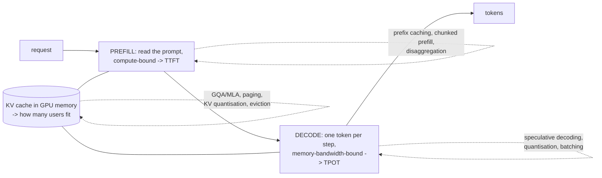

---

# Part A: Attention and KV-cache techniques

## A.1 MHA vs GQA vs MQA
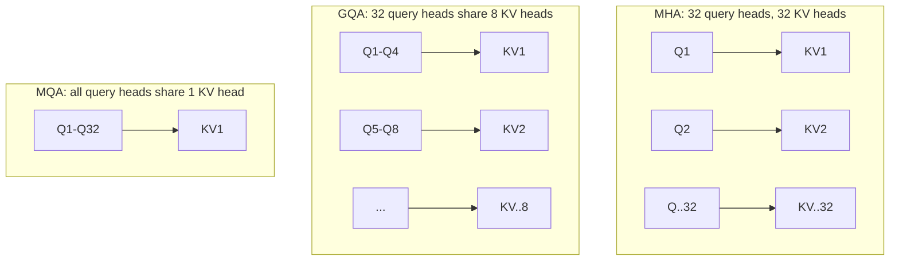
**Numbers.** The same model with MHA would need 524 KB per token (4× more), so only ~107k tokens would fit instead of 430k. GQA is chosen at training time and costs almost no quality.

## A.2 MLA (multi-head latent attention, DeepSeek)
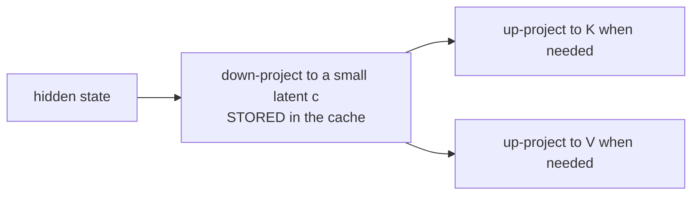
The cache stores one small latent per token instead of full K and V, a large reduction. It costs extra compute and needs special kernels.

## A.3 Sliding-window, sparse and linear attention
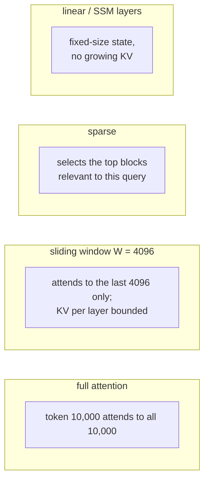
Most modern long-context models are **hybrids**: many cheap local, sparse or linear layers plus a few full-attention layers for exact recall.

## A.4 FlashAttention
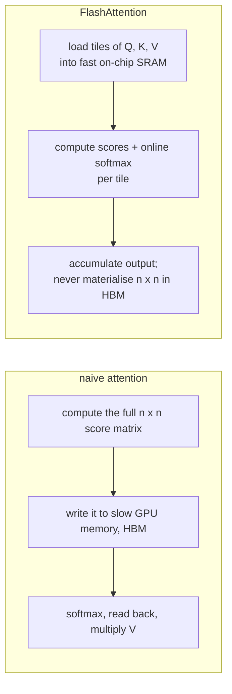
Exact (no approximation), much less memory traffic, faster, and linear memory in sequence length. Versions 2 and 3 add better parallelism and Hopper-specific features (FP8, asynchronous execution).

## A.5 PagedAttention
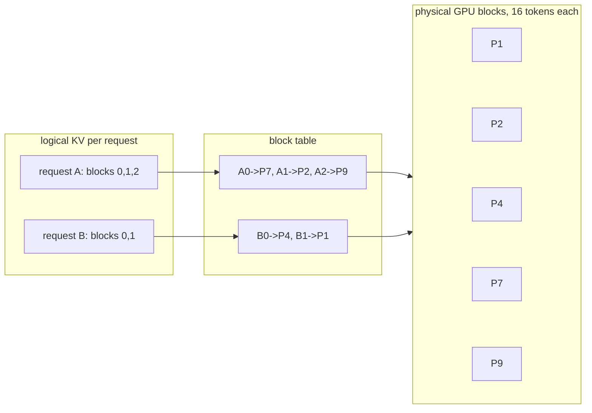
No big contiguous reservation per request (which used to waste 60–80% of KV memory to fragmentation), so many more requests fit. It also enables sharing blocks between requests (prefix caching, parallel sampling).

## A.6 Prefix caching (RadixAttention)
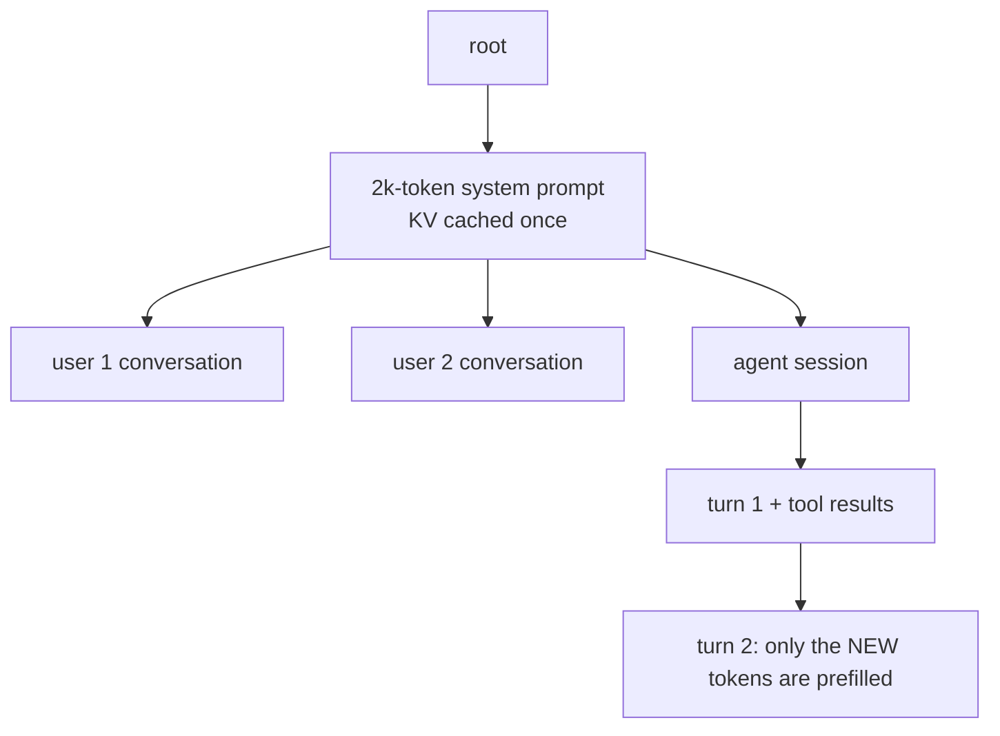
**Numbers.** Without caching, every request prefills the 2k-token system prompt: 100 requests/s × 2k = 200k prefill tokens/s wasted. With a radix-tree cache it's computed once and shared. For agents, each turn re-uses the whole previous conversation's KV.
**Rule.** It only works for **exact** prefixes, so put variable content at the end.

## A.7 KV-cache quantisation
FP8 KV halves 131 KB → 65 KB per token → **~860k tokens** fit instead of 430k. There's a small risk to quality on long-context tasks.

## A.8 KV eviction (StreamingLLM, H2O, SnapKV)
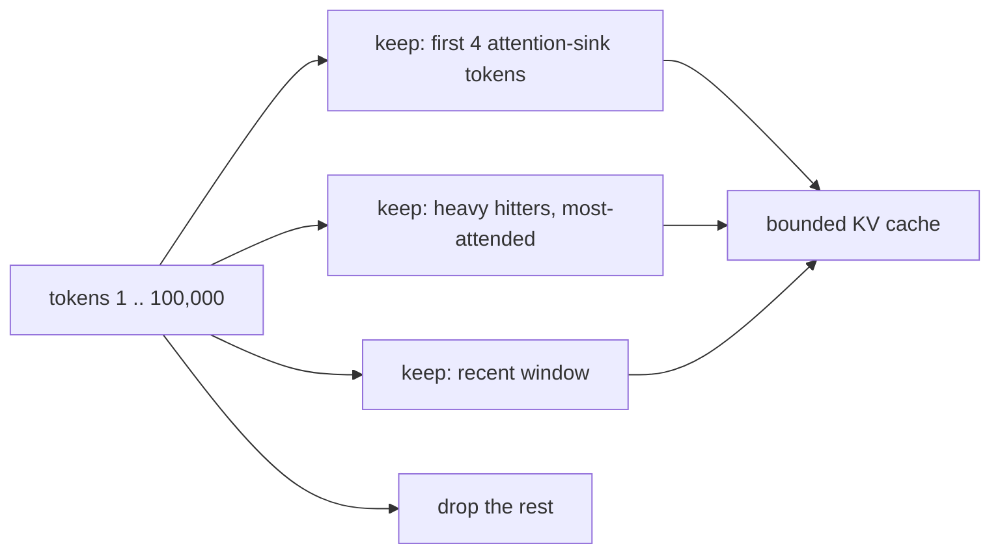
Bounded memory for very long generations, but **lossy**: a dropped token can't be recalled later.

## A.9 KV offloading and sharing (LMCache, Mooncake, CacheBlend)
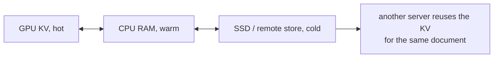
CacheBlend reuses the KV of RAG documents even when they aren't a prefix, recomputing a small part to fix cross-attention. It saves prefill for RAG and multi-turn traffic at scale, at the cost of transfer bandwidth and complexity.

---

# Part B: Batching and scheduling

## B.1 Static vs continuous batching
```mermaid
gantt
    title Static batching: short requests wait for the longest one
    dateFormat X
    axisFormat %s
    section Batch 1
    req A long  :a1, 0, 10
    req B short :b1, 0, 3
    B idle slot :crit, b2, 3, 10
    section Batch 2 waits
    req C       :c1, 10, 14
```
```mermaid
gantt
    title Continuous batching: a new request joins as soon as a slot frees
    dateFormat X
    axisFormat %s
    section Slot 1
    req A long :a1, 0, 10
    section Slot 2
    req B      :b1, 0, 3
    req C      :c1, 3, 7
    req D      :d1, 7, 10
```
Often several times higher throughput. It's the standard in vLLM, SGLang, TGI and TensorRT-LLM.

## B.2 Chunked prefill
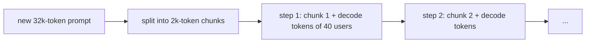
Without it, one 32k-token prompt freezes everyone's token stream while it prefills.

## B.3 Prefill/decode disaggregation
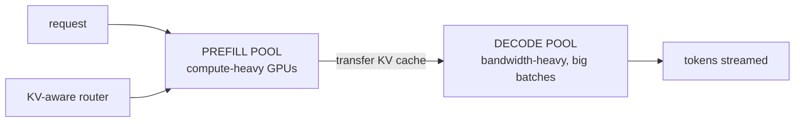
Each phase scales and is tuned separately, with no interference between them. It needs a fast KV-transfer network and is worth it at scale (NVIDIA Dynamo, llm-d, Mooncake, SGLang PD).

---

# Part C: Parallelism

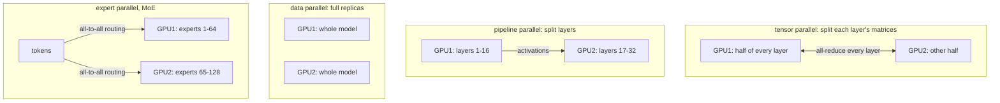
**Running example.** 16 GB of weights fits on one GPU, so use **DP replicas** for more throughput. TP within a node only for lower latency or bigger models; PP/EP across nodes only when needed.

---

# Part D: Quantisation

## D.1 What changes in memory
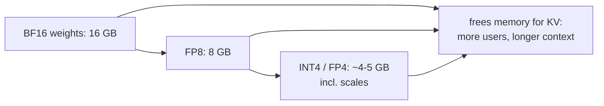
Decode is memory-bandwidth-bound, so fewer bytes per weight also means **faster tokens**.

## D.2 The methods
```mermaid
flowchart TB
    subgraph GPTQ["GPTQ: weight-only INT4"]
        GQ1["quantise one column at a time"] --> GQ2["adjust remaining columns to compensate<br/>using second-order info from calibration data"]
    end
    subgraph AWQ["AWQ: weight-only INT4"]
        AW1["find salient channels<br/>from activation magnitudes"] --> AW2["scale them up before quantising<br/>so they lose less precision"]
    end
    subgraph SQ["SmoothQuant: W8A8"]
        SQ1["activations have outlier channels"] --> SQ2["divide activations by s, multiply weights by s<br/>moves the difficulty into the weights"] --> SQ3["INT8 x INT8 matmuls"]
    end
    subgraph MX["MXFP4 / NVFP4: block floating point"]
        MX1["blocks of 32 or 16 values"] --> MX2["each block shares one scale"] --> MX3["values stored as 4-bit floats;<br/>native on Blackwell"]
    end
```

| Method | Quantises | Quality | Speedup needs |
|---|---|---|---|
| FP8 (W8A8) | weights + activations | ≈ BF16 | Hopper/Blackwell FP8 cores |
| SmoothQuant INT8 | weights + activations | very good | INT8 kernels |
| AWQ / GPTQ INT4 | weights only | good (task-dependent) | 4-bit weight kernels |
| MXFP4 / NVFP4 | weights (+activations) | good with a good recipe | Blackwell |
| GGUF k-quants | weights, mixed 2–8 bit | varies | llama.cpp (CPU, Apple Silicon) |
| QAT | trained with quantisation simulated | best at low bits | training cost |

**Quality ladder:** BF16 ≈ FP8 > INT8 > 4-bit > 3-bit. **Reasoning, code and long-context tasks degrade first.** Always run your eval.

---

# Part E: Speculative decoding family

## E.1 The core mechanism
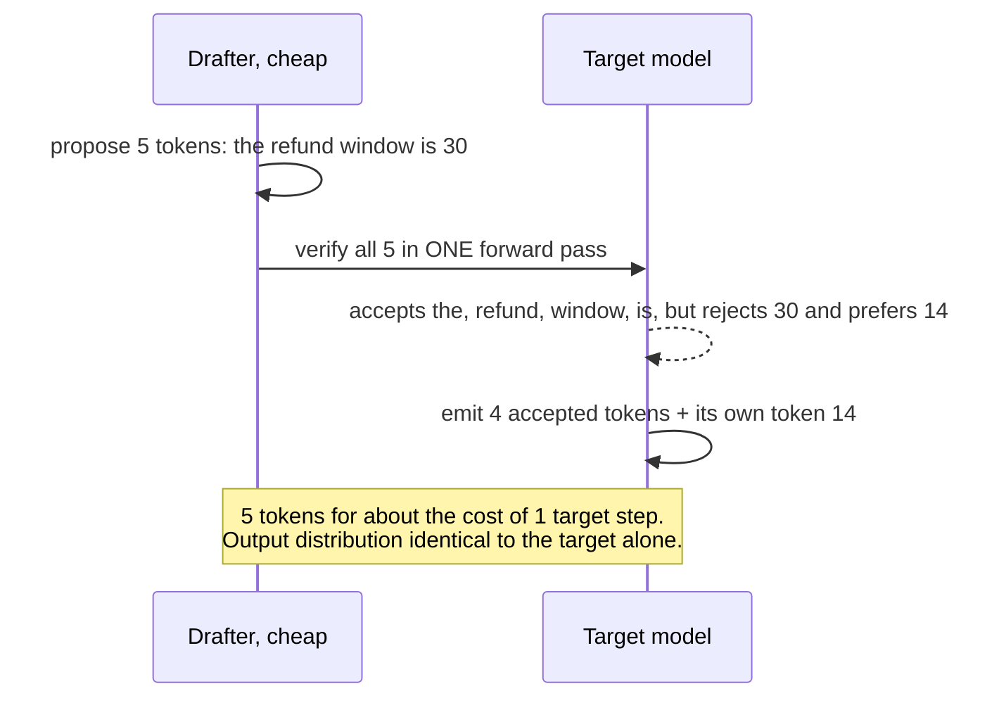
**Numbers.** With an average of 3 accepted tokens per verification and a drafter costing ~10% of a target step, you get ≈ 3–4 tokens per ~1.2 target-step-equivalents ≈ **2.5–3× faster** at low concurrency.

## E.2 Drafter variants
```mermaid
flowchart TB
    subgraph DM["draft model"]
        SMALL["small model of the same family"] --> PROP1["proposals"]
    end
    subgraph NG["n-gram / prompt lookup"]
        CTX["copy spans from the prompt or<br/>earlier output"] --> PROP2["proposals, no model at all"]
    end
    subgraph MED["Medusa"]
        TGT1["target last hidden state"] --> H1["head 1: token +1"] & H2["head 2: token +2"] & H3["head 3: token +3"]
    end
    subgraph EAG["EAGLE-1/2/3"]
        FEAT["target FEATURES from several layers"] --> LIGHT["light autoregressive head"] --> TREE["dynamic draft TREE"]
    end
    subgraph MTP["MTP"]
        TRAINED["prediction modules trained<br/>with the model itself"] --> PROP3["proposals"]
    end
    subgraph PAR["P-EAGLE / DFlash, 2026"]
        ONE["ONE drafter pass"] --> BLOCK["whole block of K tokens at once;<br/>DFlash: block diffusion + target KV injection"]
    end
```

| Drafter | Training | Best for |
|---|---|---|
| draft model | none if a family model exists | general use |
| n-gram / prompt lookup | none | **copy-heavy output**: code edits, RAG quoting, summaries |
| suffix decoding | none | repetitive agent workloads |
| Medusa | extra heads | no separate model |
| EAGLE-3 | a per-model head | high acceptance; widely supported |
| MTP | built into the model | models that ship MTP heads |
| P-EAGLE / DFlash | per-model drafter | deep speculation without sequential drafting cost; DFlash reports >6× lossless |

## E.3 Why speculation helps less under heavy load
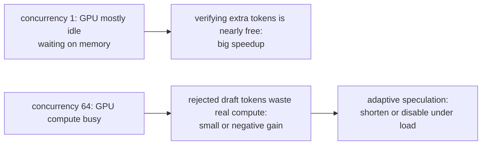

## E.4 Structured (constrained) decoding
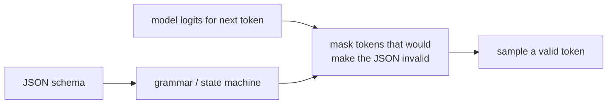
Guarantees parseable output with no retries; XGrammar-style engines keep the overhead near zero.

---

# Part F: Compression beyond quantisation

```mermaid
flowchart LR
    DENSE["dense 8B"] --> PR1["unstructured pruning: zero 50% of weights<br/>SparseGPT, Wanda; little real speedup"]
    DENSE --> PR2["2:4 sparsity: 2 of every 4 zero<br/>hardware-accelerated on NVIDIA"]
    DENSE --> PR3["structured pruning: remove layers/heads,<br/>then distil (Minitron): real speedup"]
    DENSE --> DIS["distil into a 3B student:<br/>the biggest real speedup"]
```

---

# Part G: System-level techniques

```mermaid
flowchart LR
    Q["request"] --> EXACT{"exact cache hit?"}
    EXACT -->|yes| RET["return cached"]
    EXACT -->|no| SEM{"semantic cache:<br/>similar question seen?"}
    SEM -->|"yes, risky"| RET
    SEM -->|no| ROUTE{"router: easy or hard?"}
    ROUTE -->|easy| SMALLM["small model"]
    ROUTE -->|hard| BIGM["large model"]
    SMALLM -->|low confidence| BIGM
```
| Technique | Win | Risk |
|---|---|---|
| model routing / cascades (FrugalGPT, RouteLLM) | large cost cuts | router errors; evaluate per route |
| exact cache | free | low hit rate |
| semantic cache | saves calls on FAQ traffic | **"cancel my order" ≈ "don't cancel my order"**; cross-user leakage |
| provider prompt caching | ~90% cheaper cached input | exact prefix; TTL |
| batch APIs | ~50% off | hours of latency |
| CUDA graphs / torch.compile | lower decode overhead | warm-up time |

---

# Part H: Decision guide

```mermaid
flowchart TD
    A["main problem?"] -->|OOM / few users fit| M["FP8 weights, FP8 KV,<br/>right-size max context,<br/>prefer GQA/MLA models"]
    A -->|high TTFT| T["prefix caching + stable prompts,<br/>chunked prefill,<br/>disaggregation at scale"]
    A -->|high TPOT at low load| S["speculative decoding:<br/>EAGLE-3 / MTP / DFlash;<br/>n-gram for copy-heavy output"]
    A -->|low throughput under load| B["continuous batching (vLLM/SGLang),<br/>quantisation, DP replicas"]
    A -->|cost| C["routing, distillation,<br/>prompt caching, batch API"]
    A -->|model does not fit| P["quantise FP8 then 4-bit,<br/>TP in node, PP/EP across nodes"]
```

---

## Check your understanding
1. **Compute KV per token for 40 layers, 8 KV heads, head_dim 128, FP8.** 2 × 40 × 8 × 128 × 1 = 81,920 bytes ≈ 82 KB.
2. **FlashAttention vs PagedAttention?** FlashAttention is a faster exact attention *kernel* (less memory traffic within a step). PagedAttention is KV *memory management* across requests (more requests fit).
3. **Why must variable content go at the end of prompts?** Prefix caching matches exact prefixes; a change early in the prompt invalidates everything after it.
4. **Why is speculative decoding lossless?** The target verifies every drafted token and resamples on rejection, so the output distribution equals the target's.
5. **When is n-gram speculation especially good?** When the output copies the input (code edits, quoting RAG sources, summaries).
6. **Why is semantic caching dangerous?** Similar-looking requests can need opposite answers, and cached answers can leak across users.

---

## Sources
- Shazeer, *MQA*: arXiv 1911.02150 · Ainslie et al., *GQA*: arXiv 2305.13245 · DeepSeek-AI, *DeepSeek-V2 (MLA)*: arXiv 2405.04434
- Dao et al., *FlashAttention 1/2/3*: arXiv 2205.14135, 2307.08691, 2407.08608
- Kwon et al., *PagedAttention*: arXiv 2309.06180 · Zheng et al., *SGLang / RadixAttention*: arXiv 2312.07104
- Xiao et al., *StreamingLLM*: arXiv 2309.17453 · Zhang et al., *H2O*: arXiv 2306.14048 · Li et al., *SnapKV*: arXiv 2404.14469 · Yao et al., *CacheBlend*: arXiv 2405.16444
- Yu et al., *Orca* (OSDI 2022) · Agrawal et al., *Sarathi-Serve*: arXiv 2403.02310 · Zhong et al., *DistServe*: arXiv 2401.09670 · Patel et al., *Splitwise*: arXiv 2311.18677 · Qin et al., *Mooncake*: arXiv 2407.00079
- Frantar et al., *GPTQ*: arXiv 2210.17323 · Lin et al., *AWQ*: arXiv 2306.00978 · Xiao et al., *SmoothQuant*: arXiv 2211.10438 · OCP *Microscaling formats* (2023)
- Leviathan et al., *Speculative Decoding*: arXiv 2211.17192 · Cai et al., *Medusa*: arXiv 2401.10774 · Li et al., *EAGLE*: arXiv 2401.15077 · *EAGLE-3*: arXiv 2503.01840 · *P-EAGLE*: arXiv 2602.01469 · *DFlash*: arXiv 2602.06036 · LMSYS DFlash/Spec V2 (2026)
- Frantar & Alistarh, *SparseGPT*: arXiv 2301.00774 · Sun et al., *Wanda*: arXiv 2306.11695 · Muralidharan et al., *Minitron*: arXiv 2407.14679
- Chen et al., *FrugalGPT*: arXiv 2305.05176 · Ong et al., *RouteLLM*: arXiv 2406.18665 · Dong et al., *XGrammar*: arXiv 2411.15100
