# Prompt and context engineering techniques: a deep dive

> **Where this fits.** Overview: [../03-context-engineering-and-memory.md](../03-context-engineering-and-memory.md). Working-memory techniques (compaction, clearing, notes, sub-agents) are in [03-memory.md](03-memory.md) Part A. This doc covers **what goes into one request** and **how to optimise prompts systematically**.
>
> **Format:** idea → diagram → worked example → pros/cons.

---

## 0. Running example

Build the prompt for ACME's support bot, which answers from retrieved documents.

**Version 0 (typical first draft):**
```text
You are a SUPER helpful and friendly support assistant!!! ALWAYS be accurate. NEVER make things up.
Answer the question. Here are some docs: <paste of 8 chunks> Question: How long do Team customers have for refunds?
Today is 2026-09-19 14:03:22. User id: u_8812.
```
Problems: shouting, no structure, no output format, no abstention path, the question buried before nothing, and the timestamp and user ID at the top, which break prompt caching on every request.

---

# Part A: Prompt structure

## A.1 The anatomy of a good request

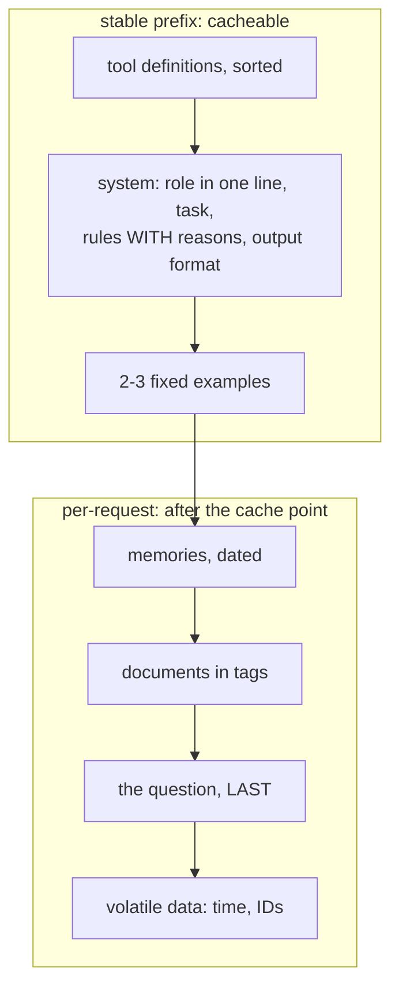

**Version 1 (restructured):**
```text
[system]
You answer ACME billing questions for support agents, using only the provided documents.
- Cite the id of every document you use, e.g. [c1]; agents click through to verify.
- If the documents don't contain the answer, say so and name what's missing. Agents escalate those cases, so a guess costs more than "I don't know".
- Answer in 1-3 sentences; agents read answers aloud to customers.

[user]
<documents>
<doc id="c1">The Team plan has a 30-day refund window.</doc>
<doc id="c2">Refunds are issued within 14 days of purchase.</doc>
</documents>
<question>How long do Team customers have for refunds?</question>
(current date: 2026-09-19)
```

| Technique | Why it helps |
|---|---|
| clear task + criteria | current models follow instructions literally |
| rules with **reasons** | models generalise from the reason ("read aloud" → no Markdown tables) |
| XML tags | unambiguous boundaries between data and instructions |
| **documents first, question last** | long-context guidance reports up to ~30% better answers on complex multi-document inputs |
| explicit abstention | fewer confident hallucinations |
| volatile data at the end | the prefix stays byte-identical, so it stays cached |

## A.2 Structured outputs instead of "please return JSON"
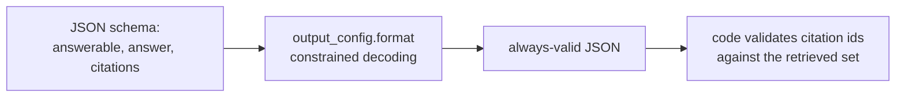
Replaces fragile parsing and retries. Assistant **prefill** (starting the reply with `{`) returns an error on current Claude models; use structured outputs. Code: [`LLM.parse`](../code/aieng/llm.py), [`answer()`](../code/aieng/rag/llm_steps.py).

## A.3 Grounding with quotes (long documents)


## A.4 Reasoning control
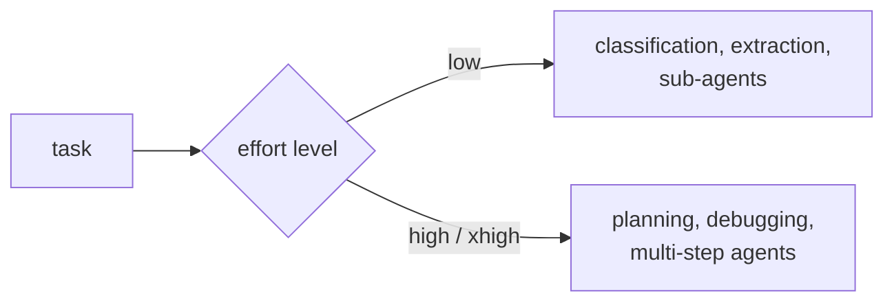
With adaptive thinking, don't also demand "think step by step" in the visible output. It duplicates the work and bloats answers.

---

# Part B: Examples (few-shot)

## B.1 Static vs dynamic examples
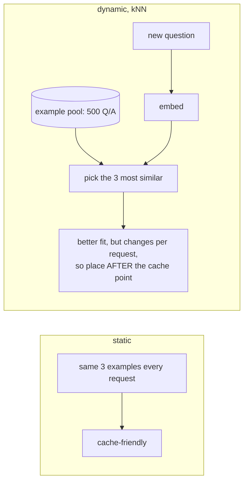
**Evidence.** Semantically similar demonstrations beat random ones (Liu et al., 2021). Example **order** also changes results (Lu et al., 2021): shuffle during evals, and put the most representative example last.

## B.2 Contrastive examples
```text
<example quality="good">Team customers have 30 days to request a refund [c1].</example>
<example quality="bad" reason="uses the general 14-day rule instead of the Team-specific one">You have 14 days [c2].</example>
```
Contrastive pairs make the boundary between acceptable and unacceptable clear. They're especially useful for judges.

## B.3 Many-shot in-context learning
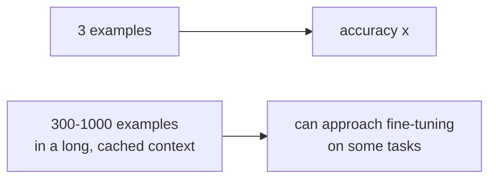
Agarwal et al. (2024). Costs tokens (reduced by prompt caching); no training needed.

---

# Part C: Automatic prompt optimisation

## C.1 The shared loop
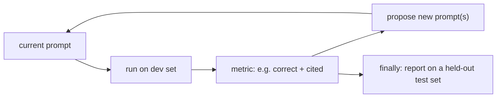
Every method below is a different way to do **"propose new prompts"**.

## C.2 APE


## C.3 OPRO (LLM as optimiser)
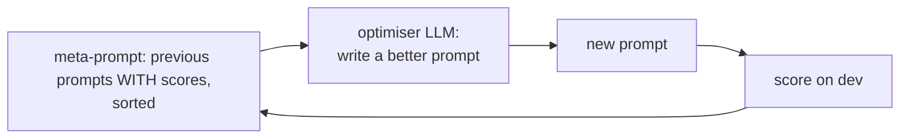

## C.4 DSPy (prompts as learnable parameters)
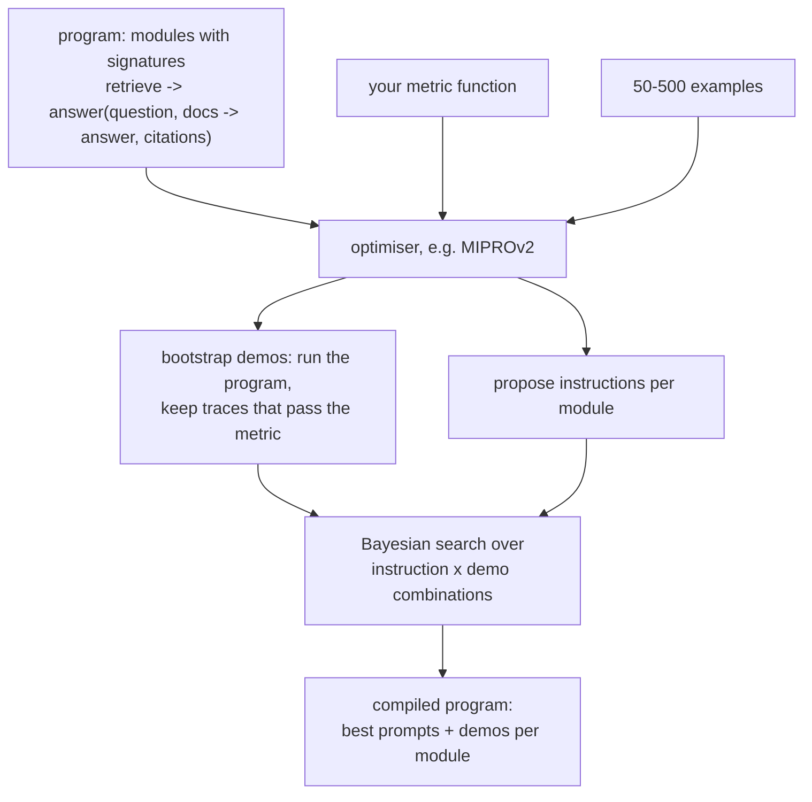
Works across models (recompile when you switch) and treats prompts like weights. Needs a metric and examples; there's a learning curve.

## C.5 TextGrad ("gradients" in text)
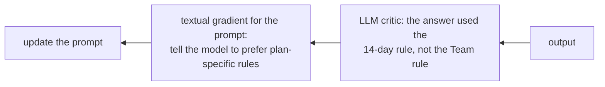
Feedback flows backward through a multi-step system, like backpropagation.

## C.6 GEPA (reflective prompt evolution)
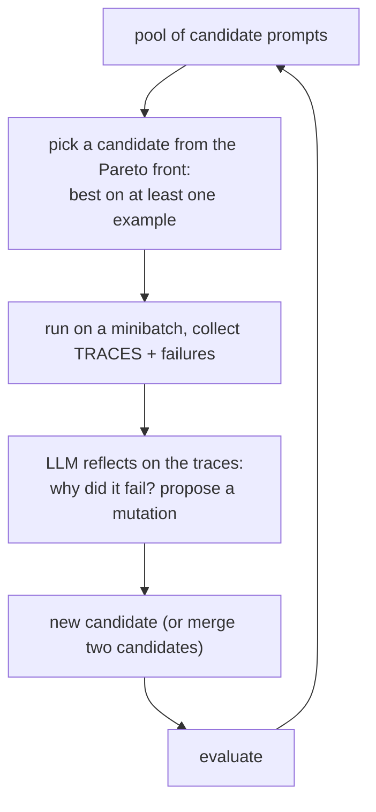
**Evidence.** The paper reports beating GRPO-based RL by ~10% on average (up to ~20%) with up to ~35× fewer rollouts, and beating MIPROv2 (arXiv 2507.19457).

| Method | Optimises | Needs | Notes |
|---|---|---|---|
| manual + evals | anything | a metric | the baseline; watch for dev-set overfitting |
| APE | instructions | examples + metric | simple search |
| OPRO | instructions | metric | the LLM sees the score history |
| DSPy MIPROv2 | instructions + demos per module | metric + 50–500 examples | the most practical framework |
| TextGrad | prompts / variables in compound systems | critic feedback | noisy, costly |
| GEPA | prompts via reflection on traces | metric + traces | sample-efficient |

---

# Part D: Context assembly per request

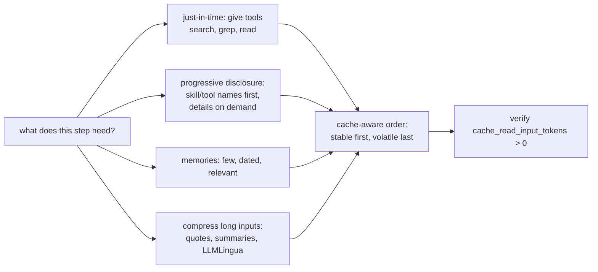

| Technique | Purpose |
|---|---|
| cache-aware ordering | any byte change invalidates everything after it |
| mid-conversation system messages | add instructions without editing the frozen system prompt (keeps the cache; history stays append-only) |
| just-in-time retrieval | smaller contexts; the model fetches what it needs |
| progressive disclosure | scales to many skills and tools |
| tool-definition hygiene | fewer, clearer tools in a fixed order |

---

# Part E: Prompt habits that hurt modern models

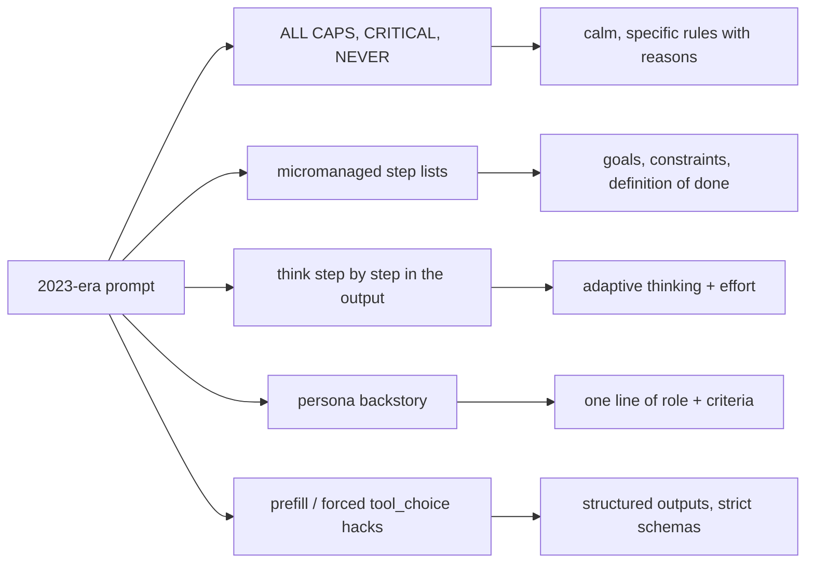
Current models follow instructions **literally**: an emphasised rule gets over-applied, and a micromanaged procedure constrains better native reasoning.

---

# Part F: Decision guide

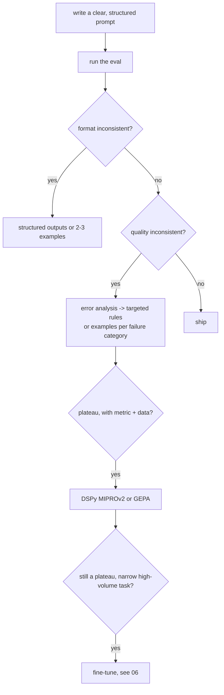

---

## Check your understanding
1. **Name three problems with Version 0 of the running prompt.** Shouting and no reasons; no output format or abstention; volatile data at the top breaking the cache (also no structure; question placement).
2. **Where do dynamic few-shot examples go, and why?** After the cache breakpoint, because they change per request.
3. **What does DSPy's optimiser search over?** Instructions and bootstrapped demonstrations for each module, scored by your metric.
4. **What makes GEPA sample-efficient?** It reflects on full execution traces to propose targeted prompt mutations, and keeps a Pareto front of candidates.

---

## Sources
- Anthropic, *Prompt engineering* docs (incl. long-context tips): https://platform.claude.com/docs/en/build-with-claude/prompt-engineering/overview
- Anthropic, *Effective context engineering for AI agents* (2025)
- Liu et al., *What Makes Good In-Context Examples for GPT-3?*: arXiv 2101.06804 · Lu et al., *Fantastically Ordered Prompts*: arXiv 2104.08786 · Agarwal et al., *Many-Shot ICL*: arXiv 2404.11018
- Zhou et al., *APE*: arXiv 2211.01910 · Yang et al., *OPRO*: arXiv 2309.03409
- Khattab et al., *DSPy*: arXiv 2310.03714 · Opsahl-Ong et al., *MIPROv2*: arXiv 2406.11695
- Yuksekgonul et al., *TextGrad*: arXiv 2406.07496 · Agrawal et al., *GEPA*: arXiv 2507.19457
- Liu et al., *Lost in the Middle*: arXiv 2307.03172 · Jiang et al., *LLMLingua*: arXiv 2310.05736
