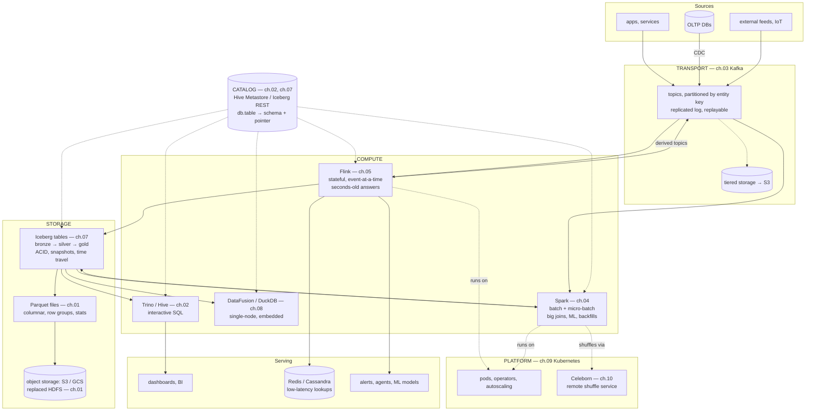
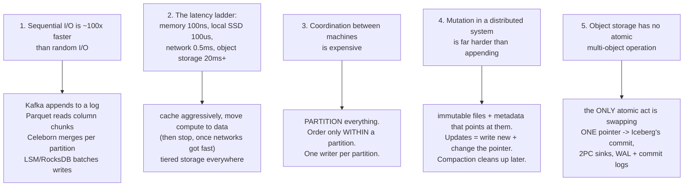
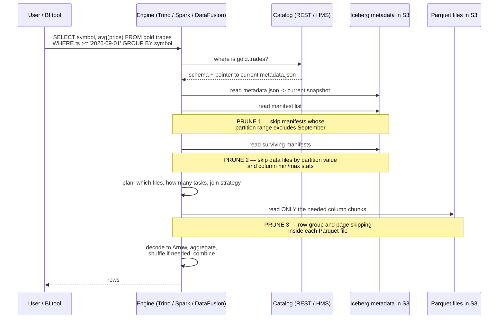
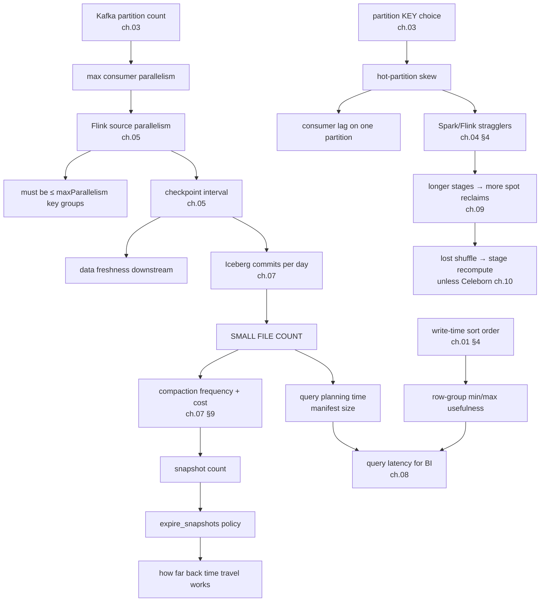
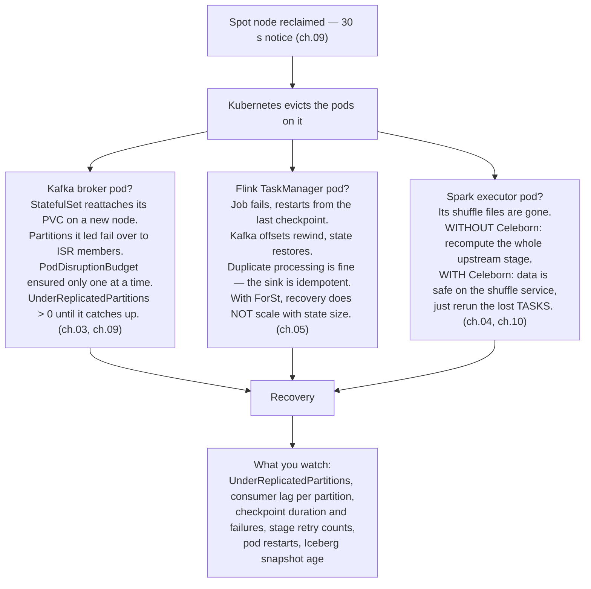
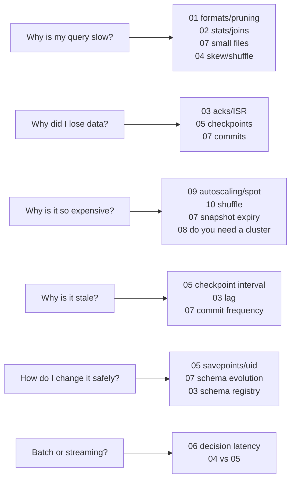

# The Big Picture — how the whole system fits together

> **How to use this.** Read it **first** as a map, then **again at the end** as synthesis. It doesn't re-explain any system — it shows how they connect, what each one hands to the next, and why changing one thing ripples through the rest. Every section links to the chapter that goes deep.
>
> Chapter [06](06-comparison-and-qa.md) compares the systems and drills interview answers. **This document instead follows the data.**

---

## 1. The one-sentence version

> **Events land in a durable log (Kafka), are processed by engines (Flink for low latency, Spark for scale) that run on a resource manager (Kubernetes), reading and writing files (Parquet) that are grouped into transactional tables (Iceberg) in object storage, described by a catalog (Metastore / REST), and queried by whichever engine suits the question (Spark, Trino, DataFusion).**

Everything in this track is a detail of that sentence.

---

## 2. Six layers, and the contract at each boundary

The stack works because each layer exposes a **narrow, stable interface**. That's what lets you swap Spark for Trino, or HDFS for S3, without rewriting everything.

| # | Layer | The unit it deals in | The contract it offers upward | Chapter |
|---|---|---|---|---|
| 6 | **Query / serving** | a question | SQL | [02](02-hive.md), [04](04-spark.md), [08](08-datafusion.md) |
| 5 | **Catalog** | a table name | `db.table` → schema + where the metadata lives | [02](02-hive.md), [07](07-iceberg.md) |
| 4 | **Table format** | a table | atomic commits, snapshots, schema/partition evolution | [07](07-iceberg.md) |
| 3 | **File format** | a file | columnar bytes + statistics for pruning | [01](01-hadoop.md) |
| 2 | **Object storage** | an object | durable bytes, `GET`/`PUT`, **no atomic rename** | [01](01-hadoop.md) |
| 1 | **Resource manager** | a container | "run this process with these resources" | [01](01-hadoop.md) YARN, [09](09-kubernetes.md) K8s |

Plus two **cross-cutting** systems that don't fit the stack cleanly:

| System | What it really is | Chapter |
|---|---|---|
| **Kafka** | the **durable buffer between layers** — a table that you read forward in time | [03](03-kafka.md) |
| **Celeborn** | the **shuffle layer**, extracted from the engines into a service of its own | [10](10-celeborn.md) |

> **The insight worth carrying**: the industry's last fifteen years have been *turning each of these boundaries into a standard*. Storage became S3's API. The table became Iceberg. The catalog became the REST spec. Memory became Arrow. Shuffle became Celeborn. Each unbundling let the layer above compete on merit instead of lock-in — the arc [08](08-datafusion.md) §7 calls the composable data stack.

---

## 3. First principles — five facts that generate the whole design

Almost every design decision in this track is downstream of five physical realities. If you can derive the systems from these, you understand the stack rather than memorizing it.

Worked examples of the derivation:

| Design decision | Which fact forces it |
|---|---|
| Kafka orders records per-partition, never per-topic | #3 — global ordering needs global coordination |
| Parquet stores 128 MB row groups with min/max stats | #1 + #2 — read big sequential chunks, skip what you can |
| Iceberg commits by compare-and-swapping one pointer | #5 |
| Spark recomputes lost partitions from lineage rather than replicating | #2 — replication over the network costs more than recompute |
| Flink checkpoints state instead of replaying from the beginning | #3 — re-coordinating the whole job is expensive |
| Merge-on-read writes delete files instead of editing rows | #4 |
| Celeborn merges all pushes for one partition into one file | #1 — turn M random reads into one sequential read |
| Everyone converges on "detect the hot key, treat it specially" | #3 — a skewed partition is a coordination bottleneck you can't schedule away |

---

## 4. The life of one event — the write path

Follow a single trade event from an exchange feed to a BI dashboard. **This trace is the spine of the whole track.**

```mermaid
flowchart TB
    S1["1. PRODUCE<br/>app serializes with Avro, gets a schema id,<br/>partitioner picks partition = hash(account_id) % N,<br/>batched with linger.ms, compressed"] --> S2
    S2["2. DURABLE IN KAFKA<br/>leader appends to the log, followers fetch,<br/>acks=all + min.insync.replicas=2,<br/>visible to consumers once it passes the high watermark"] --> S3
    S3["3. FLINK CONSUMES<br/>source assigns event time from the exchange timestamp,<br/>watermark = max seen − out-of-orderness,<br/>keyBy(account) routes to a key group"] --> S4
    S4["4. STATEFUL PROCESSING<br/>KeyedProcessFunction updates RocksDB/ForSt state,<br/>timers fire, alerts emitted to a side topic,<br/>late events to a side output"] --> S5
    S5["5. CHECKPOINT<br/>barrier flows through, state snapshot to DFS,<br/>Iceberg sink PRE-COMMITS its written files"] --> S6
    S6["6. COMMIT<br/>on checkpoint-complete, the sink commits:<br/>Iceberg writes a new metadata.json and<br/>compare-and-swaps the catalog pointer.<br/>ONE snapshot per checkpoint."] --> S7
    S7["7. VISIBLE<br/>the row is now in the bronze table for every engine.<br/>Freshness = checkpoint interval."] --> S8
    S8["8. MAINTENANCE (hours later)<br/>rewrite_data_files compacts small files,<br/>expire_snapshots frees old ones"] --> S9
    S9["9. BATCH TRANSFORM (nightly)<br/>Spark reads bronze, dedupes and conforms to silver,<br/>aggregates to gold. Shuffle goes to Celeborn.<br/>Runs on K8s with spot executors."] --> S10
    S10["10. QUERY<br/>Trino/Spark/DataFusion asks the catalog,<br/>reads manifests, prunes, scans Parquet,<br/>returns the dashboard number"]
```

The same trace as a table — **what changes at each hop is the unit, the guarantee, and the failure mode**:

| Hop | Unit of data | Guarantee at this boundary | If it fails | Deep dive |
|---|---|---|---|---|
| App → Kafka | record in a batch | idempotent producer: no duplicates from retries | `send()` throws after `delivery.timeout.ms`; buffer fills and backpressures the app | [03](03-kafka.md) §5 |
| Inside Kafka | offset in a partition | ordered, replicated, replayable; readable only up to the high watermark | leader failover; `acks=all`+ISR prevents loss | [03](03-kafka.md) §3 |
| Kafka → Flink | event with a timestamp | at-least-once read; offsets stored **in the checkpoint**, not committed to Kafka | job restarts from last checkpoint and re-reads | [05](05-flink.md) §4 |
| Inside Flink | keyed state per key group | exactly-once **effect on state** | state restored from checkpoint; `uid()`s must be stable | [05](05-flink.md) §3–4 |
| Flink → Iceberg | a set of data files per checkpoint | 2PC: files written then committed atomically | pre-committed but uncommitted files become orphans, cleaned later | [07](07-iceberg.md) §3 |
| Inside Iceberg | a snapshot | serializable/snapshot isolation via compare-and-swap | losing writer retries against the new base | [07](07-iceberg.md) §3 |
| Iceberg → Spark | a table scan of Parquet files | consistent read of one snapshot | task retry; executor loss loses shuffle unless Celeborn | [04](04-spark.md), [10](10-celeborn.md) |
| Spark shuffle | partition of rows | replicated in Celeborn; recomputed otherwise | stage recompute, or a Celeborn worker failover | [10](10-celeborn.md) §4 |
| Gold → query | rows | reads one immutable snapshot; concurrent writes don't affect it | query retries | [07](07-iceberg.md) §7 |

**The single most important line in the table**: *exactly-once means exactly-once effect on state, and it only reaches the outside world through an idempotent or transactional sink.* It's true at every hop, in every engine.

---

## 5. The life of one query — the read path

**Four filters apply before a single byte of trade data is read**: partition pruning at the manifest-list level, file pruning at the manifest level, row-group pruning inside the file, and column pruning. Layout decisions you made *at write time* (partition transform, sort order, file size) determine how much each one saves. **This is why "layout beats tuning" is the recurring advice** — see [01](01-hadoop.md) §4, [02](02-hive.md) §3, [07](07-iceberg.md) §11.

---

## 6. Who owns what — the five nouns

A clean way to hold the whole stack in your head: there are only five kinds of thing, and each has exactly one owner.

| Noun | Owner | Nobody else may… |
|---|---|---|
| **Bytes** | object storage (was HDFS) | worry about durability |
| **Files** | the file format (Parquet/ORC/Avro) | interpret the bytes |
| **Tables** | the table format (Iceberg/Delta) | decide which files are *in* the table |
| **Records in flight** | Kafka | decide what order things happened in |
| **State** | the stream engine (Flink/Spark) | remember anything between events |

Failure modes are almost always **a layer reaching past its boundary**:
- A Spark job listing an S3 prefix to find its own files = doing the table format's job → race conditions. Use Iceberg.
- A consumer keeping progress in a side database instead of offsets/checkpoints = doing Kafka's job → duplicates or loss on restart.
- A pipeline storing per-key aggregates in Redis instead of engine state = doing Flink's job → no exactly-once, no replay determinism.
- Hive ACID keeping transaction state in the Metastore RDBMS = the catalog doing the table format's job → only one engine can write ([02](02-hive.md) §5).

---

## 7. Same problem, different answers

Nine problems every distributed data system must solve. Reading **across** a row shows how universal the problem is; reading **down** a column shows a system's personality.

| Problem | Kafka | Spark | Flink | Iceberg | Kubernetes |
|---|---|---|---|---|---|
| **Parallelism unit** | partition | task/partition | key group / slot | data file | pod |
| **Ordering** | per partition | none (by design) | per key, by event time | per snapshot | none |
| **Fault tolerance** | replication + ISR | **lineage** (recompute) | **checkpoints** (restore) | immutable snapshots | restart the pod |
| **Elasticity limit** | partition count | shuffle + executor lifetime | `maxParallelism` key groups | file/manifest count | node pool + scheduler |
| **Metadata home** | KRaft metadata log | driver + catalog | JobManager + checkpoint | metadata tree + catalog | etcd |
| **Bounding growth** | retention / compaction | spill + `checkpoint()` | state TTL + watermarks | expire snapshots | resource quotas |
| **Skew handling** | custom partitioner | AQE skew join, salting | two-phase aggregation | bucket + sort on write | — |
| **Hot/cold tiering** | tiered storage → S3 | cache → disk → recompute | ForSt: local cache → DFS | (storage classes) | node classes |
| **"Commit"** | transaction markers | job commit protocol | 2PC on checkpoint | CAS on catalog pointer | resource version |

Three patterns run all the way across, and naming them is what [06](06-comparison-and-qa.md) §8 calls systems thinking:

1. **Partition, then only coordinate within a partition.** Every system's parallelism story.
2. **Separate compute from storage, then cache locally.** Kafka tiered storage, Flink ForSt, Spark on S3, Celeborn — all the same move, a decade apart.
3. **Never mutate; append and re-point.** Kafka's log, Iceberg's snapshots, Hive's deltas, RocksDB's LSM, MoR delete files.

---

## 8. The causality map — change one thing, six things move

This is the part that turns ten chapters into one system. **Nothing here is tunable in isolation.**

Read a few chains out loud — they're the most interview-ready thing in this document:

- **"Shorten the Flink checkpoint interval"** → fresher data *and* more Iceberg commits → more small files → slower query planning and more compaction cost. Freshness is paid for in maintenance.
- **"Pick `account_id` as the Kafka key"** → per-account ordering *and* a hot partition for the biggest account → lag on one partition → a Spark straggler → a longer stage → more chance a spot node is reclaimed mid-stage → a lost shuffle → a recomputed stage. **One key choice, six chapters.**
- **"Move to Kubernetes with spot instances"** → cheap compute → executors die routinely → shuffle tracking pins idle executors → no scale-down → you need Celeborn to get the savings you moved for.
- **"Don't bother sorting on write"** → Parquet row-group min/max spans the whole range → pruning does nothing → every query scans everything → the cluster looks too small.

---

## 9. A day in the life of the platform

Different clocks run at different speeds. Knowing which job runs on which clock is most of operating a platform.

```mermaid
gantt
    title What runs when
    dateFormat HH:mm
    axisFormat %H:%M
    section Continuous
    Kafka brokers - always on             :00:00, 1440m
    Flink jobs - checkpoint 10-60s        :00:00, 1440m
    section Hourly
    Iceberg compaction on streaming tables :01:00, 60m
    Iceberg compaction                     :05:00, 60m
    Iceberg compaction                     :09:00, 60m
    section Nightly
    Spark bronze to silver to gold         :02:00, 150m
    expire_snapshots + remove_orphan_files :04:30, 45m
    section Ad hoc
    Trino BI queries - business hours      :09:00, 480m
    Backfills and reprocessing             :22:00, 110m
```

| Clock | Work | Failure means |
|---|---|---|
| **milliseconds–seconds** | Flink event processing, alerts | user-visible latency |
| **10–60 s** | checkpoints, Iceberg commits | data freshness slips |
| **1–4 h** | compaction of streaming tables | queries slowly get worse |
| **nightly** | batch transforms, snapshot expiry, orphan cleanup | storage bill grows; tables bloat |
| **on demand** | backfills, replay after a bug | correctness recovery |

**The non-obvious point**: the slow clocks are the ones that get neglected, and they are exactly where platforms rot — uncompacted tables, unexpired snapshots, orphan files, and Hive column stats nobody refreshed ([02](02-hive.md) §4).

---

## 10. One failure, traced through every layer

> *A node is reclaimed mid-morning. Follow it up the stack.*

The lesson that generalizes: **each layer absorbs failure differently — replication (Kafka), recomputation (Spark), restoration (Flink), immutability (Iceberg).** Knowing which mechanism applies tells you immediately whether a failure costs milliseconds, minutes, or a whole stage.

---

## 11. Which chapter answers which question

---

## 12. Twelve sentences that hold the whole track

1. **Coordination is the scarce resource**; everything is partitioned so that coordination stays local.
2. **Ordering exists only inside a partition** — in Kafka, in a Flink key group, in a Parquet file.
3. **Immutability everywhere**: you append data and re-point metadata; you never edit in place.
4. **The only atomic operation available on object storage is swapping one pointer** — which is the entire design of Iceberg, and of every 2PC sink.
5. **Exactly-once means exactly-once effect on state**, and it reaches the outside world only through an idempotent or transactional sink.
6. **Watermarks, retention, and TTL are the same idea**: a declared bound on how far back you'll care, which is what keeps state finite.
7. **Small files are the universal disease** — of the NameNode, of the Metastore, of Iceberg manifests, of query planning — and compaction is the universal cure.
8. **Layout at write time (partitioning, sort order, file size) determines read cost** far more than any runtime tuning flag.
9. **Skew is the default, not the exception**; every engine's answer is "detect the hot key and treat it differently."
10. **Compute and storage separated**, so elasticity became possible and data locality became irrelevant — and shuffle, which assumed local disks, had to be rebuilt (Celeborn).
11. **Each boundary became a standard** — S3 API, Parquet, Iceberg, REST catalog, Arrow — which is why you can mix engines over one copy of the data.
12. **Freshness, cost, and correctness are one budget**; tightening any one of them spends the other two.

---

## 13. Self-test — questions that need two or more chapters

Answer these out loud. Each one deliberately spans chapters; if you can connect them, you have the big picture.

1. A Flink job writes to Iceberg with 10-second checkpoints. Six months later, BI queries have become slow. Explain the full causal chain and name three fixes. *(05 → 07 → 01/08)*
2. You move Spark from YARN to Kubernetes to use spot instances, and costs go **up**. Why, and what do you add? *(01 → 09 → 10)*
3. The team wants per-customer ordering, so they key the Kafka topic by `customer_id`. What are the four downstream consequences? *(03 → 05 → 04 → 09)*
4. A regulator asks what a report looked like when it was produced in 2027. What must have been true about your platform at write time? *(07 snapshots/tags → 03 retention → 05 event time)*
5. Trace exactly-once from an exchange feed to a Postgres serving table. Where can it break, and what do you do at that point? *(03 → 05 → 07 → sink)*
6. Why can't Spark release idle executors on Kubernetes, and what two different eras solved the same problem? *(01 external shuffle service → 09 shuffle tracking → 10 Celeborn)*
7. The same aggregation gives different results in the streaming job and the nightly batch job. List five possible causes across the stack. *(05 watermarks/late data → 03 duplicates → 07 snapshot read → 04 float non-determinism → 02 stale stats)*
8. You have 400 GB of Parquet on S3 and a nightly aggregation on a 50-node Spark cluster. Argue for deleting the cluster. *(08 → 01 → 09)*

---

## 14. Where to go next

| If you want… | Read |
|---|---|
| The comparison tables and interview drills | [06-comparison-and-qa.md](06-comparison-and-qa.md) |
| A fully worked system-design answer | [06](06-comparison-and-qa.md) §5 |
| The deep dive on any single system | chapters [01](01-hadoop.md)–[10](10-celeborn.md) |
| The short list of must-know facts | [README.md](README.md) |
