# Hadoop — HDFS, YARN, MapReduce

> **Why this still matters in 2026.** Nobody starts a new project on MapReduce, and most storage has moved to S3-style object stores. But Hadoop is where the field's vocabulary comes from: blocks, replication, data locality, shuffle, containers, speculative execution, the NameNode's single-point-of-failure problem. Spark's scheduler is a direct descendant of YARN's; Iceberg/Delta exist because Hive tables on HDFS had specific failure modes; S3's consistency model is defined by contrast with HDFS. Interviewers ask about Hadoop to check whether you understand *why* the modern stack is shaped the way it is.

---

## 0. The stack at a glance

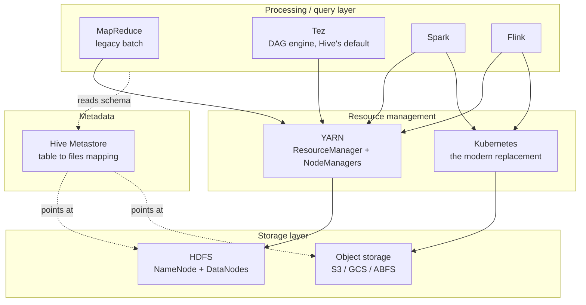

Three independent concerns, and Hadoop's real contribution was separating them:

| Layer | Hadoop's answer | What replaced it |
|---|---|---|
| Storage | **HDFS** | S3 / GCS / ADLS + open table formats |
| Resource management | **YARN** | Kubernetes |
| Compute | **MapReduce** | Spark, Flink, Trino, Tez |
| Metadata | **Hive Metastore** | still HMS, plus Iceberg REST catalogs, Unity, Glue, Polaris |

Note the metadata row: it's the one Hadoop-era component that **survived essentially unchanged**. Almost every engine still asks a Hive Metastore "where are the files for `db.table`, and what's the schema?"

---

## 1. HDFS

### 1.1 Design premises

HDFS was built for one workload and is bad at everything else. State the premises and the design follows:

1. **Files are huge** (GBs–TBs) and few, relative to a POSIX filesystem. → metadata fits in one machine's RAM.
2. **Write once, read many.** Append-only; no random writes. → no distributed write locking.
3. **Hardware fails constantly.** → replication, not RAID; failure is the normal case.
4. **Streaming reads dominate**; high throughput beats low latency. → large blocks, no seek optimization.
5. **Moving computation is cheaper than moving data.** → the block locations are exposed so schedulers can co-locate tasks. This is *data locality*, and it's the single idea that made Hadoop work on 2006 hardware.

Anti-premises (the things HDFS is genuinely bad at, worth saying out loud): millions of small files, low-latency random reads, multiple concurrent writers, and frequent mutation.

### 1.2 Architecture

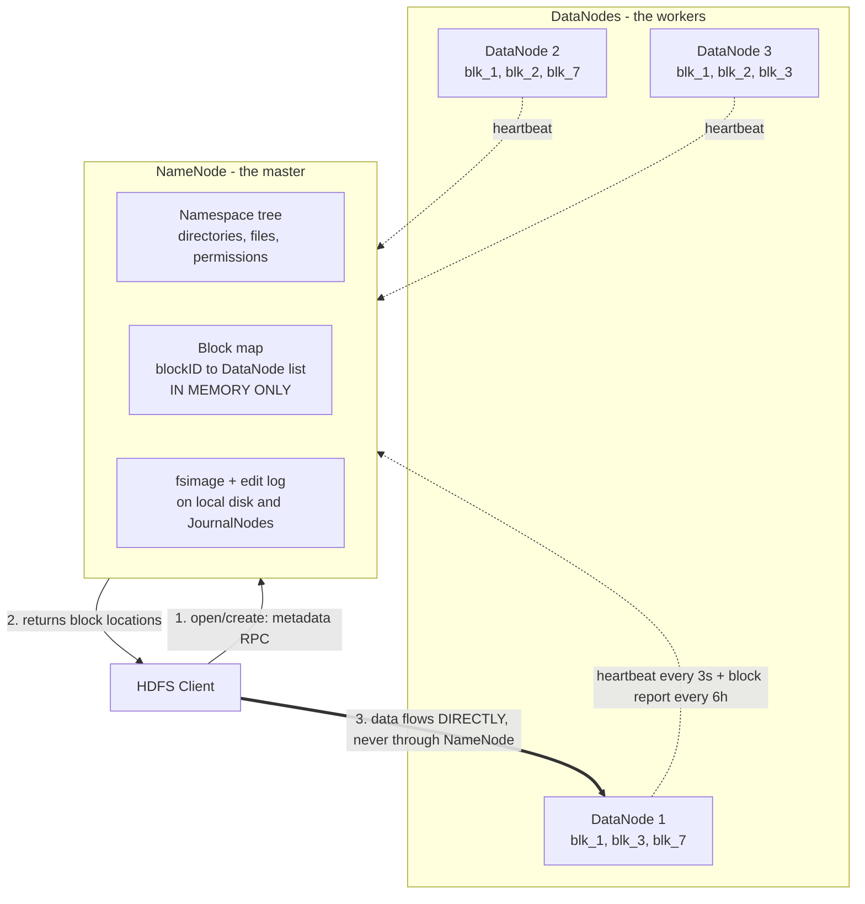

**The critical structural fact**: the NameNode handles *metadata only*. Data never passes through it. This is what lets one master serve a 10,000-node cluster — and also why the NameNode is a memory-bound bottleneck rather than a bandwidth one.

**NameNode memory math** (a favorite interview calculation): each file, directory, and block is an object of roughly **150 bytes** in NameNode heap.

```
10 million files, 1 block each  ≈ 20M objects × 150 B ≈ 3 GB heap
10 million files × 3 blocks     ≈ 40M objects × 150 B ≈ 6 GB heap
```

Now the **small files problem**: 1 TB stored as 10,000 × 100 MB files costs ~10k block objects. The same 1 TB as 10 million × 100 KB files costs ~10M block objects — a thousand times the metadata, for the same bytes, plus 10 million map tasks instead of 8,000. *This is why the small-files problem shows up everywhere downstream (Hive, Spark streaming sinks, Iceberg compaction): it started as an HDFS metadata constraint and became a general lesson about file-per-record pipelines.*

### 1.3 Blocks and replication

Default block size **128 MB** (256 MB is common on modern clusters). Why so large?

- Amortizes the seek: if seek is 10 ms and transfer is 100 MB/s, a 128 MB block spends ~1.3 s transferring vs 10 ms seeking — ~1 % overhead.
- Fewer blocks → less NameNode metadata.
- A file's last block is partial; HDFS does not pad, so a 1 KB file occupies 1 KB of disk (but a full block object of metadata).

**Default replication factor 3**, placed by a rack-aware policy:

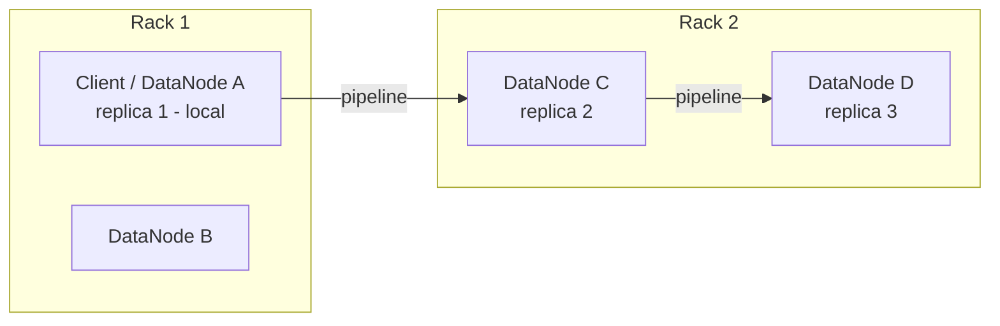

- **Replica 1**: the writing node itself (or a random node if the client is outside the cluster) — zero network cost.
- **Replica 2**: a node on a *different* rack — survives a whole-rack failure (top-of-rack switch dies, power strip trips).
- **Replica 3**: a *different node on the same rack as replica 2* — cheap, because inter-rack bandwidth is the scarce resource and the second cross-rack hop buys little extra safety.

That's the whole tradeoff in one sentence: **one cross-rack hop buys rack-failure tolerance; a second one would cost bandwidth without buying much.**

### 1.4 The write path

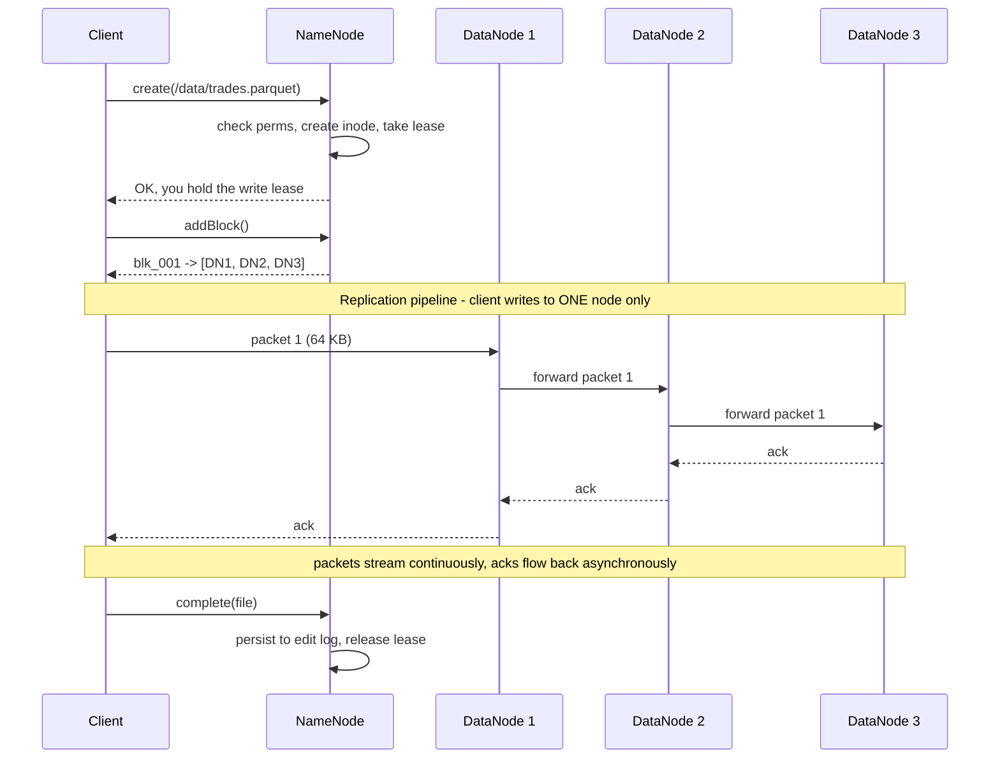

Points worth making:
- The client sends each 64 KB packet **once**; the DataNodes chain it. Client uplink isn't multiplied by the replication factor.
- Writes are acknowledged when the pipeline acks, and the block is *visible* once `min.replication` (default 1) DataNodes have it.
- **Pipeline recovery**: if DN2 dies mid-block, the pipeline is rebuilt from the remaining nodes and the block is re-replicated later by the NameNode. The write does not fail.
- **Lease**: exactly one client may write a file at a time. Leases expire (soft 60 s, hard 1 h) so a dead client's file can be recovered.

### 1.5 The read path

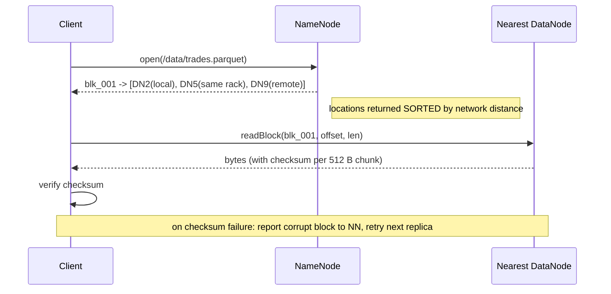

**Short-circuit local reads**: when the client and the data are on the same machine, HDFS hands over a file descriptor and the client reads the local disk directly, bypassing the DataNode process and the TCP stack. This is a large win and the payoff for data locality.

**Locality levels**, in the order a scheduler prefers them: `NODE_LOCAL` → `RACK_LOCAL` → `ANY`. Spark's `spark.locality.wait` (3 s default) is literally "how long to wait for a node-local slot before giving up and running rack-local" — a direct Hadoop inheritance.

### 1.6 High availability

The NameNode was Hadoop 1's single point of failure. HA fixes it:

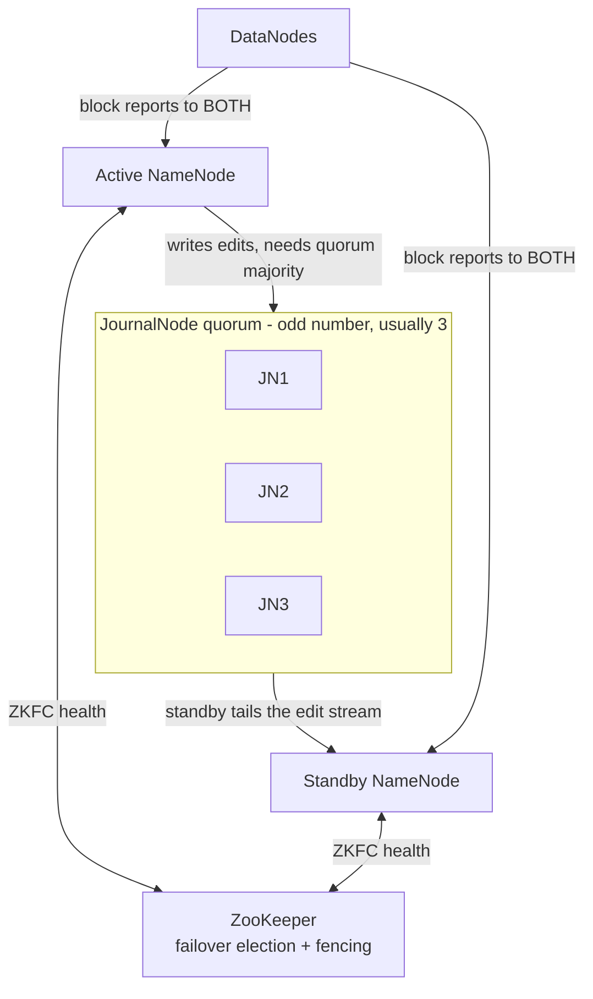

- The active NameNode writes edits to a **JournalNode quorum**; the standby replays them, so it has a hot namespace.
- DataNodes heartbeat to **both**, so the standby also has a live block map — this is what makes failover fast (otherwise it'd need to wait for a full block report, which takes minutes).
- **Fencing** prevents split-brain: before promoting the standby, ZKFC ensures the old active really is dead (SSH-kill or a shared-storage fence). "Two NameNodes both think they're active" is the failure mode this exists to prevent — and a good answer when asked about distributed-system safety.

**Don't confuse the Standby NameNode with the old "Secondary NameNode."** The Secondary NameNode is not a backup and provides no HA: it periodically merges `fsimage` + `edits` into a new checkpoint so the edit log doesn't grow forever. It's a housekeeping process with a catastrophically misleading name — and a classic trick question.

**HDFS Federation** goes further: multiple independent NameNodes each owning a namespace volume, sharing the same DataNode pool. Scales metadata past one heap. Router-Based Federation (RBF) puts a routing layer in front so clients see one namespace.

### 1.7 Erasure coding

Replication ×3 means **200 % storage overhead**. Erasure coding (HDFS-EC, GA since 3.0, still current through 3.4/3.5) trades CPU for space.

```
Replication (3x):   [D][D][D]                    → 200% overhead, 1 TB of data costs 3 TB
RS(6,3):            [D][D][D][D][D][D][P][P][P]  → 50% overhead, tolerates any 3 losses
```

Reed–Solomon `RS(k, m)`: `k` data cells, `m` parity cells; any `k` of the `k+m` reconstruct the file.

Tradeoffs to name:
- **Storage**: RS(6,3) is 1.5× vs 3× — a ~50 % cost reduction on cold data.
- **Locality is gone.** An EC file is *striped* across 9 nodes, so no single node holds a whole block. Every read is a network read, and there's no short-circuit read. This is why EC is for cold/archival data, not the hot path.
- **Reconstruction is expensive**: rebuilding one lost cell reads `k` cells across the network and does Galois-field math. Intel ISA-L acceleration is close to mandatory in production.
- **Small files get worse**, not better — striping a 1 MB file across 9 nodes is pure overhead.

Policy: hot data on replication, warm/cold on EC, set per directory. This is exactly the same tiering logic as Kafka's tiered storage and S3 Glacier — the shape of the answer generalizes.

### 1.8 HDFS vs object storage (the modern comparison)

| | HDFS | S3 / GCS / ABFS |
|---|---|---|
| Consistency | strong, POSIX-ish | strong read-after-write (S3 since Dec 2020); **no atomic multi-object ops** |
| Rename | O(1) metadata op | **O(n) copy + delete** — the root of most "why is my Spark job slow on S3" questions |
| Listing | fast tree walk | paginated, slow on wide prefixes |
| Locality | yes, exploited by schedulers | none — compute and storage are separate by design |
| Cost | you buy and run the disks | pennies per GB-month, infinite capacity |
| Durability | replication/EC you manage | 11 nines, someone else's problem |
| Small files | metadata pressure on NameNode | fine for storage, terrible for query performance |

**Why the industry moved**: elastic compute. With HDFS your storage and compute scale together — you add nodes for space you don't need, or CPU you don't need. Separating them lets you spin a cluster up for an hour and kill it.

**What broke in the move**: the rename problem. Hadoop's commit protocol writes to a temp directory and renames it into place as the "atomic" commit. On S3, rename is a copy, so committing a large job can take longer than computing it, and it isn't atomic — partial failure leaves garbage. Fixes: the S3A committers (magic/staging), and ultimately **table formats (Iceberg, Delta, Hudi) that commit by atomically swapping a metadata pointer** instead of renaming data files. That lineage — HDFS rename → S3 no-rename → Iceberg metadata commit — is a great thing to be able to trace.

---

## 2. YARN

**Y**et **A**nother **R**esource **N**egotiator. Hadoop 1 had a single JobTracker doing both resource management and job scheduling for MapReduce only; it capped out around 4,000 nodes and could run nothing but MapReduce. YARN split those roles, which is what turned Hadoop from "a MapReduce system" into "a cluster OS" — and made Spark on the same cluster possible.

### 2.1 Architecture and the application lifecycle

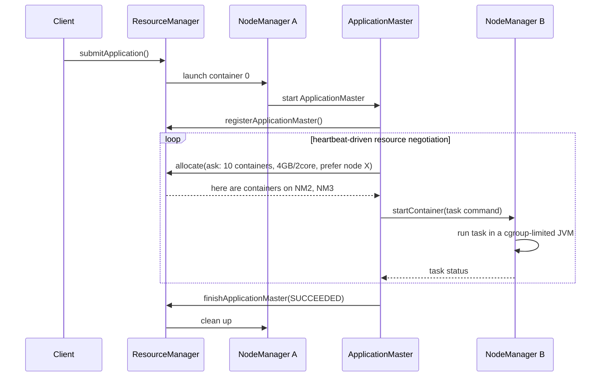

| Component | Role | Fails how |
|---|---|---|
| **ResourceManager** | global scheduler; arbitrates resources between apps. Does **not** track individual tasks. | HA via a standby RM + ZooKeeper; running apps survive via state store |
| **NodeManager** | per-machine agent; launches/monitors containers, enforces cgroup limits, reports health | its containers die; RM reschedules |
| **ApplicationMaster** | **one per application**; negotiates containers and drives that app's task scheduling | RM restarts it (up to `max-attempts`); this is Spark's driver on YARN |
| **Container** | a lease on `<memory, vcores>` on a specific node | killed on OOM or preemption |

**The key design idea**: per-application scheduling logic lives in the ApplicationMaster, not the ResourceManager. So Spark brings its own AM with its own DAG scheduler; MapReduce brings a different one; Flink brings another. The RM only has to decide *who gets how much where*, which is a much smaller problem and is why YARN scaled ~10× past the JobTracker.

### 2.2 Schedulers

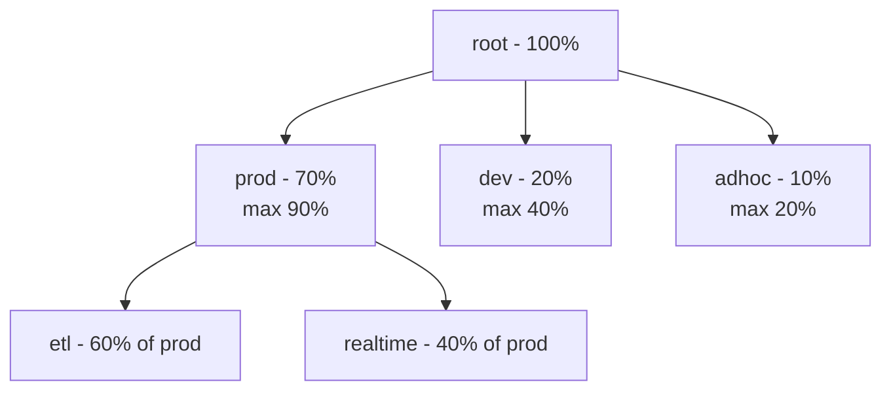

- **Capacity Scheduler** (the default): hierarchical queues with guaranteed capacities and elastic maxima. A queue can burst above its share into idle capacity, and gets preempted back down when the owner returns. Built for multi-tenant clusters where teams need guarantees.
- **Fair Scheduler**: everyone converges to an equal share over time; good for interactive/ad-hoc mixes. Supports DRF.
- **Dominant Resource Fairness (DRF)**: with multiple resource types, fairness is computed on each user's *dominant* resource — the one they use the largest fraction of. A memory-hungry job and a CPU-hungry job can both be "fairly" served.

**Why this matters now**: Kubernetes had no equivalent of hierarchical queues for years, which is exactly why YARN persisted in big enterprises long past its sell-by date. Projects like YuniKorn and Volcano exist to port these semantics to K8s. If asked "why would anyone still run YARN?", that's the answer: multi-tenant queue guarantees plus data locality.

### 2.3 Failure handling

| Failure | Response |
|---|---|
| Task/container | AM re-requests a container and retries (`mapreduce.map.maxattempts`, default 4) |
| NodeManager | RM marks it lost after missed heartbeats; its containers are rescheduled; node may be blacklisted |
| ApplicationMaster | RM restarts it; with `work-preserving recovery` the new AM re-attaches to still-running containers instead of killing everything |
| ResourceManager | active/standby with ZooKeeper election; recovers app state from the state store |

**Speculative execution**: if a task is running much slower than its siblings, YARN launches a duplicate and takes whichever finishes first, killing the loser. Fixes *stragglers* (a dying disk, a noisy neighbour) — but it's harmful for non-idempotent tasks and for tasks writing to external systems, and it wastes cluster capacity when the slowness is data skew rather than a bad node. **Speculation fixes bad machines, not bad data distribution** — a sharp distinction worth making, and it applies identically to Spark's `spark.speculation`.

---

## 3. MapReduce

You will not write it. You must be able to explain it, because **the shuffle is the same shuffle Spark has**, and "why is Spark faster than MapReduce" is one of the most common warm-up questions in existence.

### 3.1 The dataflow

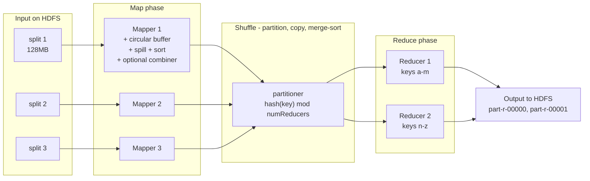

Word count, the canonical example:

```
input split:   "the cat sat on the mat"
map output:    (the,1) (cat,1) (sat,1) (on,1) (the,1) (mat,1)
combiner:      (the,2) (cat,1) (sat,1) (on,1) (mat,1)     <- local pre-aggregation
partition:     hash("the") % 2 = 0  -> reducer 0
shuffle+sort:  reducer 0 receives (cat,[1,3]) (mat,[1]) (the,[2,5,1])
reduce:        (cat,4) (mat,1) (the,8)
```

### 3.2 The shuffle in detail (this is the part that matters)

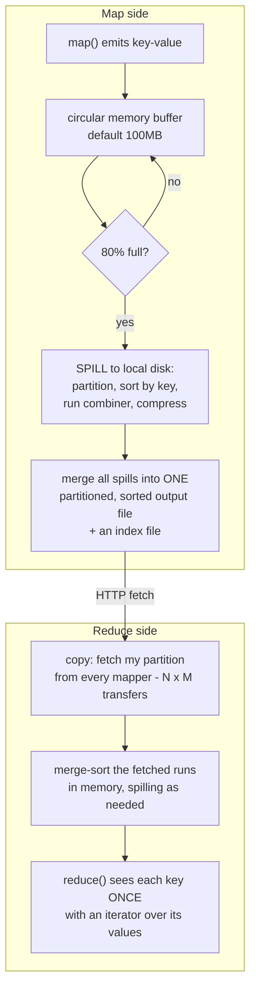

Things to be able to say:

- **Every mapper produces a piece of every reducer's input.** With M mappers and R reducers there are M×R transfers. This all-to-all pattern is *the* scalability wall of every batch engine, Spark included.
- **The sort is mandatory in MapReduce.** Reduce requires keys grouped, and grouping is implemented by sorting. Spark's `sort-based shuffle` does the same, but Spark can *skip* it for operations that don't need ordering (hash aggregation) — one concrete reason Spark is faster.
- **The combiner is a map-side reducer** and only valid when the reduce function is commutative and associative. Sum: yes. Average: no (which is why you carry `(sum, count)` pairs instead — a genuinely common interview question).
- **Data locality applies to mappers only.** The reduce phase is inherently network-bound; nothing can be local about an all-to-all exchange.

### 3.3 Why Spark replaced it

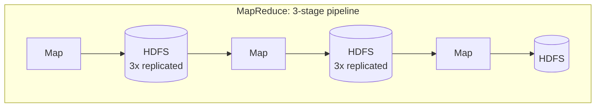
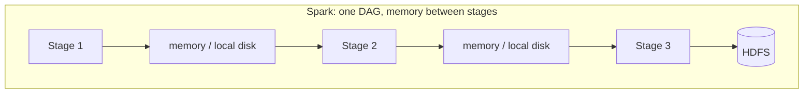

| | MapReduce | Spark |
|---|---|---|
| Between stages | write to HDFS with 3× replication, read back | keep in memory, spill to *local* disk, no replication |
| Job shape | rigid map→reduce; a multi-step algorithm = a chain of jobs | arbitrary DAG in one job |
| JVM reuse | a new JVM per task (Hadoop 1) | long-lived executors, many tasks each |
| Iteration | re-reads input from HDFS every pass — brutal for ML | cache the dataset once, iterate in memory |
| API | Java Mapper/Reducer classes | DataFrame/SQL with an optimizer |
| Fault tolerance | re-run a task; inputs are on durable HDFS | **lineage** — recompute the lost partition from its parents |

The headline "Spark is 100× faster" comes from iterative workloads where MapReduce re-reads and re-replicates between every pass. For a single-pass ETL over cold data the gap is more like 2–5×. Saying that nuance out loud is worth more than the 100× number.

**Fault tolerance is the deep difference.** MapReduce is durable because *every intermediate result is replicated to HDFS*. Spark is durable because it remembers *how each partition was computed* (lineage) and can recompute it. Spark trades durability for speed and pays the price only when a node dies — and that's why long lineages need `checkpoint()`, which truncates the chain by writing to reliable storage.

---

## 4. File formats — the part that actually still matters daily

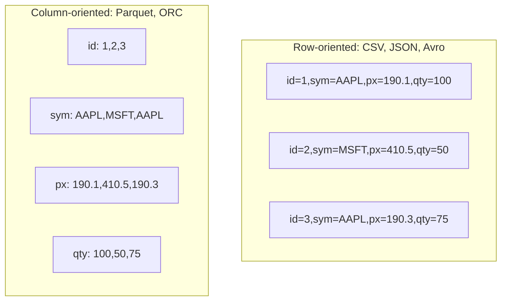

`SELECT avg(px) FROM trades WHERE sym='AAPL'` reads **two columns** out of four in Parquet and **every byte** in CSV. On a 200-column table that's a 100× I/O reduction before any other optimization.

| Format | Layout | Splittable | Schema evolution | Compression | Use for |
|---|---|---|---|---|---|
| CSV | row, untyped | yes | none | poor | interchange only |
| JSON | row, self-describing | line-delimited only | flexible, no enforcement | poor | landing raw events |
| **Avro** | row, schema in header | yes | **excellent** (reader/writer schema resolution) | good | **Kafka messages, write-heavy, full-row reads** |
| **Parquet** | **columnar** | yes | good (add/drop columns) | excellent | **the analytics default** |
| ORC | columnar | yes | good | excellent, built-in indexes + ACID support | Hive-centric stacks |

### Parquet internals (worth knowing precisely)

```
File
├── Row Group 1  (~128 MB — matches an HDFS block on purpose)
│   ├── Column chunk: id     → [Page][Page][Page]  + min/max/null_count
│   ├── Column chunk: symbol → [Page][Page]        + min/max + dictionary
│   └── Column chunk: price  → [Page][Page][Page]  + min/max
├── Row Group 2
└── Footer  ← schema + row-group metadata + column statistics  (read FIRST)
```

Three pruning mechanisms, in order of how much they save:

1. **Partition pruning** — directory layout (`/date=2026-09-16/`) means whole directories are never opened. Biggest win, and it's a *layout* decision, not a format one.
2. **Row-group / predicate pushdown** — the footer holds min/max per column per row group. `WHERE price > 500` skips any row group whose max price is 400. **This only works if the data is sorted or clustered on that column** — random ordering makes every row group's min/max span the full range and pruning does nothing. That's why `ORDER BY`/`CLUSTER BY` on write is a real performance lever.
3. **Column pruning** — read only the column chunks you project.

Plus encodings: dictionary (low-cardinality strings — a symbol column compresses enormously), run-length, delta, bit-packing. Then a codec on top: **Snappy** (fast, default), **ZSTD** (better ratio, now usually the right choice), **GZIP** (slow), **LZ4**.

**Compression and splittability**: a GZIP'd CSV is **not splittable** — one 10 GB file becomes one task, and your 200-node cluster runs at the speed of one core. Parquet compresses *per page inside a splittable container*, so it's always splittable. This is one of the most common real-world Hadoop/Spark bugs and a great war-story answer.

---

## 5. Interview answers to have ready

**"Walk me through what happens when you write a 1 GB file to HDFS."**
Client asks the NameNode to create the inode and gets a lease. The file is cut into 8 × 128 MB blocks. For each block the client asks the NameNode for a placement, gets 3 DataNodes chosen rack-aware (local, remote rack, remote rack same node-group), and streams 64 KB packets into a pipeline where DN1 forwards to DN2 forwards to DN3, with acks flowing back. Checksums are computed per 512 B chunk and stored alongside. On completion the NameNode persists the block map to the edit log. Data never touches the NameNode.

**"Why is the NameNode the bottleneck, and how do you fix it?"**
It holds the entire namespace and block map in RAM (~150 B/object) and serves every metadata RPC. Fixes, in order: stop creating small files (compaction, larger blocks); increase heap; HDFS Federation or Router-Based Federation to split the namespace across NameNodes; ultimately move to object storage where metadata is the provider's problem.

**"What's the small-files problem?"**
Two distinct costs, and good answers name both. (1) *Metadata*: every file/block is ~150 B of NameNode heap, so millions of tiny files exhaust the master. (2) *Compute*: one task per split means millions of short tasks, where JVM startup and scheduling dominate actual work. Fixes: compaction jobs, `CombineFileInputFormat`, sizing streaming triggers larger, Hive's merge-on-write settings, Iceberg/Delta `OPTIMIZE`.

**"HDFS vs S3 for a new platform?"**
S3, essentially always, for the elasticity and cost. Accept that you lose data locality (mitigated by the fact that network is no longer 1 Gb), and handle the rename problem by using a table format (Iceberg/Delta) whose commit is an atomic metadata pointer swap rather than a directory rename. HDFS still wins when you need very low latency on a fixed-size on-prem cluster, or when regulation pins data to your own hardware.

**"Why is Spark faster than MapReduce?"**
In-memory pipelining between stages instead of replicated HDFS round-trips; one DAG per job instead of a chain of jobs; long-lived executors instead of per-task JVMs; an optimizer (Catalyst) that rewrites the query; optional shuffle sort instead of mandatory. Caveat: the 100× figure is for iterative workloads; single-pass ETL over cold data is closer to 2–5×.

**"What is speculative execution and when does it hurt?"**
Duplicate a straggler task and keep the first to finish. Helps with bad hardware. Hurts when the straggler is slow due to *data skew* (the duplicate is equally slow, and you've burned double the resources), and it's dangerous for tasks with side effects — two copies writing to an external system without idempotence.

---

## 6. Sources

- [HDFS Architecture](https://hadoop.apache.org/docs/stable/hadoop-project-dist/hadoop-hdfs/HdfsDesign.html)
- [HDFS Erasure Coding (Hadoop 3.5.0)](https://hadoop.apache.org/docs/current3/hadoop-project-dist/hadoop-hdfs/HDFSErasureCoding.html)
- [Hadoop 3.4.3 release notes](https://hadoop.apache.org/docs/r3.4.3/hadoop-project-dist/hadoop-common/release/3.3.4/RELEASENOTES.3.3.4.html)
