# Apache Hive — and the road to the lakehouse

> **The one-sentence thesis.** Hive's real invention wasn't SQL-on-Hadoop; it was the **Metastore** — a durable mapping from `database.table` to a set of files plus a schema. That idea outlived everything else in Hive and is still the backbone of Spark SQL, Trino, Flink SQL, Presto, Impala and every lakehouse catalog. Most of this document is really about *table metadata*, which is where the interesting questions live.

---

## 1. Architecture

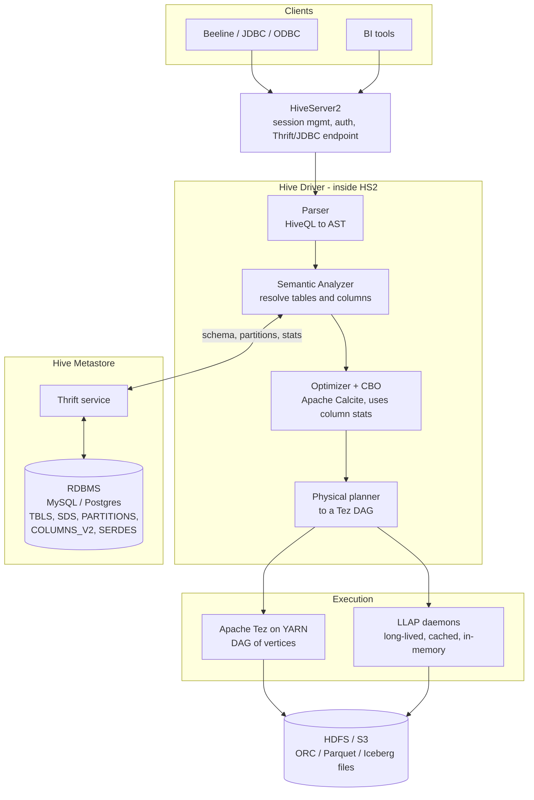

| Component | What it does | Why you care |
|---|---|---|
| **HiveServer2** | Thrift/JDBC front door, sessions, auth (Kerberos/LDAP), concurrency | the thing that falls over under many concurrent users |
| **Driver** | compiles HiveQL → execution plan | where CBO and stats matter |
| **Metastore (HMS)** | table → schema, location, partitions, stats, in an RDBMS | **the piece everyone still uses**; also a scaling bottleneck |
| **Execution engine** | Tez (default), LLAP, formerly MapReduce | MapReduce backend is removed in Hive 4 |
| **Storage** | ORC/Parquet/Avro/text on HDFS or S3 | Hive doesn't own the data — that's the point |

**Hive is not a database.** It has no storage engine of its own, no buffer pool, no indexes in the RDBMS sense. It is a **compiler plus a catalog**: HiveQL in, a DAG of distributed tasks out, reading files that any other engine can read too. This "table format is open, engine is pluggable" property is the whole reason the lakehouse exists.

### Schema-on-read

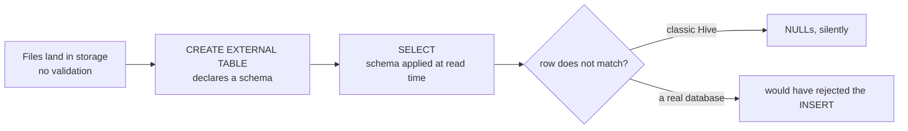

Schema-on-read is why Hive could sit on top of whatever landed in HDFS — and also why data quality on Hadoop was historically terrible. Modern table formats claw back schema enforcement.

---

## 2. Execution: from MapReduce to Tez to LLAP

### Why Tez

Hive on MapReduce compiled a multi-join query into a **chain of MapReduce jobs**, materializing to HDFS between each:

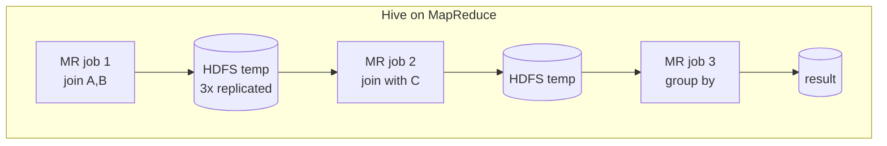
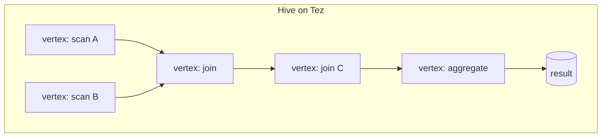

Tez gives Hive: one DAG instead of N jobs, no HDFS round-trip between stages, **container reuse** (pre-warmed JVMs, so a small query starts in ~1 s instead of ~30 s), and **dynamic runtime re-planning**. If that list sounds like Spark, it should — Tez and Spark solved the same MapReduce problems at the same time, and Hive-on-Tez vs Spark SQL is largely a question of which community you're in.

### LLAP — Live Long And Process

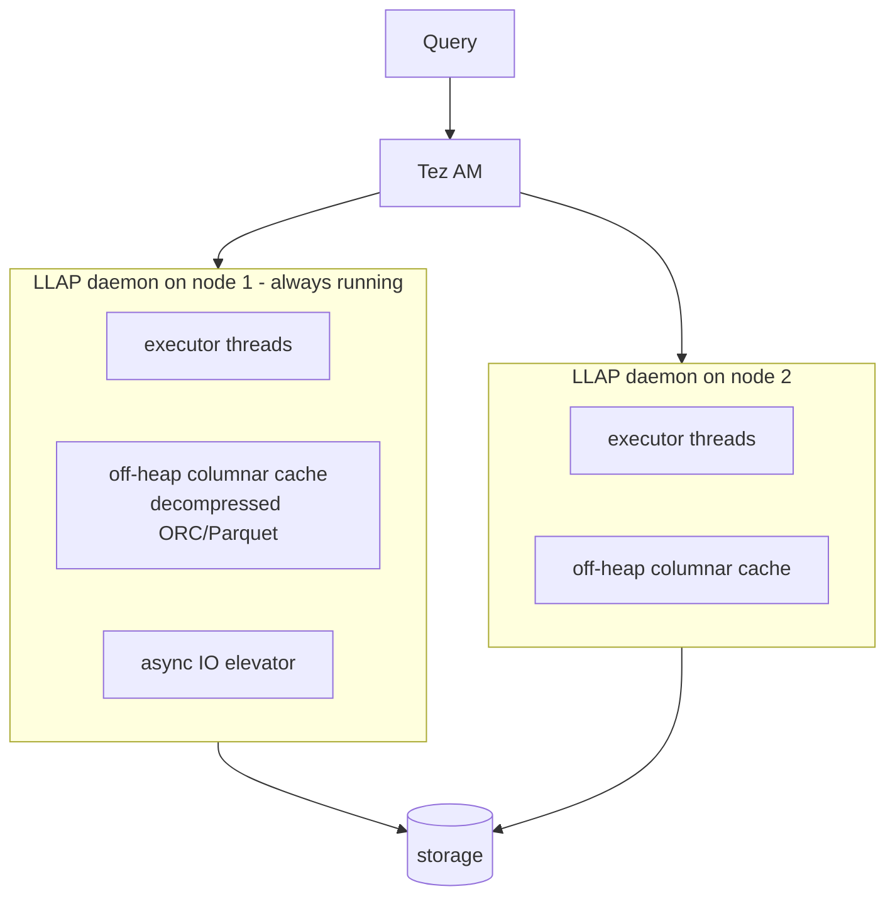

LLAP is a set of **persistent daemons** with a shared, off-heap, *decompressed columnar cache*. Benefits: no container startup, data cached across queries and across users, vectorized execution, and fine-grained security (the daemon reads the file, so column/row-level masking can be enforced centrally rather than trusting the client). The result is interactive (sub-second to seconds) BI latency on Hive — the answer to Impala and Presto.

Cost: daemons hold resources permanently, and the cache is a shared thing you have to size and manage.

### Vectorization

Classic Hive processed one row at a time through a tree of `ExprNodeEvaluator` objects — a virtual call per column per row. Vectorized execution processes **batches of 1024 rows in column-major arrays**, so the inner loop is a tight primitive-array loop the JIT can unroll and SIMD. Typically 3–5×. Requires ORC/Parquet and supported types; `set hive.vectorized.execution.enabled=true`. Spark's whole-stage codegen and Tungsten solve the same problem a different way.

---

## 3. Tables, partitions, buckets

### The physical layout

```
/warehouse/trades/
├── dt=2026-09-15/
│   ├── exchange=NYSE/
│   │   ├── 000000_0     ← bucket 0
│   │   └── 000001_0     ← bucket 1
│   └── exchange=NASDAQ/
└── dt=2026-09-16/
```

**Partitions are directories.** `WHERE dt='2026-09-16'` becomes "open one directory," which is the single biggest performance lever in the whole system. The Metastore stores one row per partition, which is how the planner knows which directories exist without listing storage.

**Partitioning rules** (get these wrong and nothing else helps):
- Partition on **columns you filter by**, with **low-to-moderate cardinality**, usually date.
- **Never partition on a high-cardinality column.** `PARTITIONED BY (user_id)` with 10 M users = 10 M directories, 10 M Metastore rows, and a catalog that takes minutes to plan a query. This is the most common Hive design mistake there is.
- Target partition sizes in the hundreds of MB to a few GB. Too small and you've recreated the small-files problem one level up.
- `strict` mode (`hive.mapred.mode=strict`) rejects a query on a partitioned table with no partition filter — a guardrail against accidental full scans.

**Dynamic partition inserts** are how partitions are usually created:
```sql
SET hive.exec.dynamic.partition.mode=nonstrict;
INSERT OVERWRITE TABLE trades PARTITION (dt)
SELECT ..., to_date(ts) AS dt FROM staging;
```
Dangerous without care: an unexpected value in the partition column creates thousands of tiny partitions. `hive.exec.max.dynamic.partitions` exists precisely to stop that.

### Bucketing

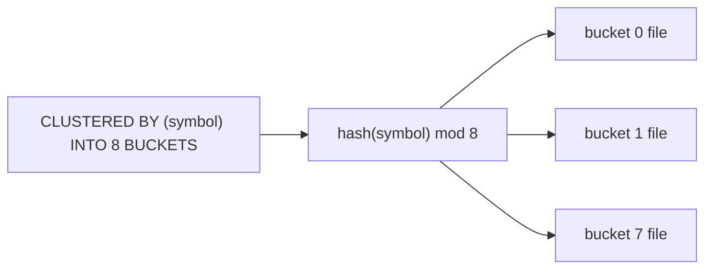

Bucketing hashes a column into a **fixed number of files** within each partition. Three payoffs:

1. **Bucket map join / sort-merge bucket join.** If two tables are bucketed on the join key with the same bucket count, bucket *i* of A only joins bucket *i* of B — **the shuffle disappears**. On huge fact-to-fact joins this is the difference between minutes and hours.
2. **Sampling**: `TABLESAMPLE(BUCKET 1 OUT OF 8)` reads exactly one file.
3. **Bounded file counts** — an antidote to high-cardinality partitioning: partition by date, bucket by `user_id`.

Caveats: the bucket count is baked in at write time (changing it means rewriting), and skew still bites — a hot key lands entirely in one bucket. Spark's bucketing is compatible in concept but historically incompatible in hash implementation, which trips people up.

### Managed vs external tables

| | Managed (internal) | External |
|---|---|---|
| `DROP TABLE` | **deletes the data** | drops metadata only, data survives |
| Location | the Hive warehouse dir | anywhere you point it |
| ACID / transactions | supported (ORC) | not, historically |
| Use when | Hive owns the lifecycle | data is shared with Spark/Flink/others, or is a landing zone |

**The classic incident**: someone runs `DROP TABLE` on what they assume is external, and deletes a production dataset. In Hive 3+, `CREATE TABLE` defaults to **managed + ACID** — a change that has surprised many teams migrating from Hive 2. Say `EXTERNAL` explicitly when you mean it.

---

## 4. How Hive executes joins

### Shuffle join (the default, "common join" / reduce-side join)

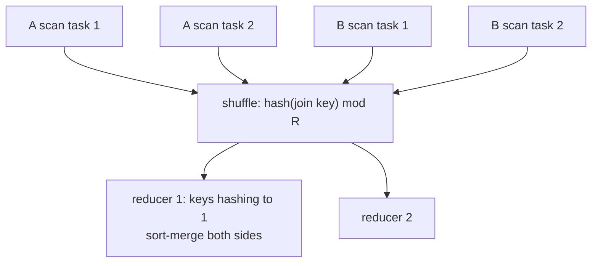
Both sides move across the network. Correct always, slow always.

### Map join (broadcast)

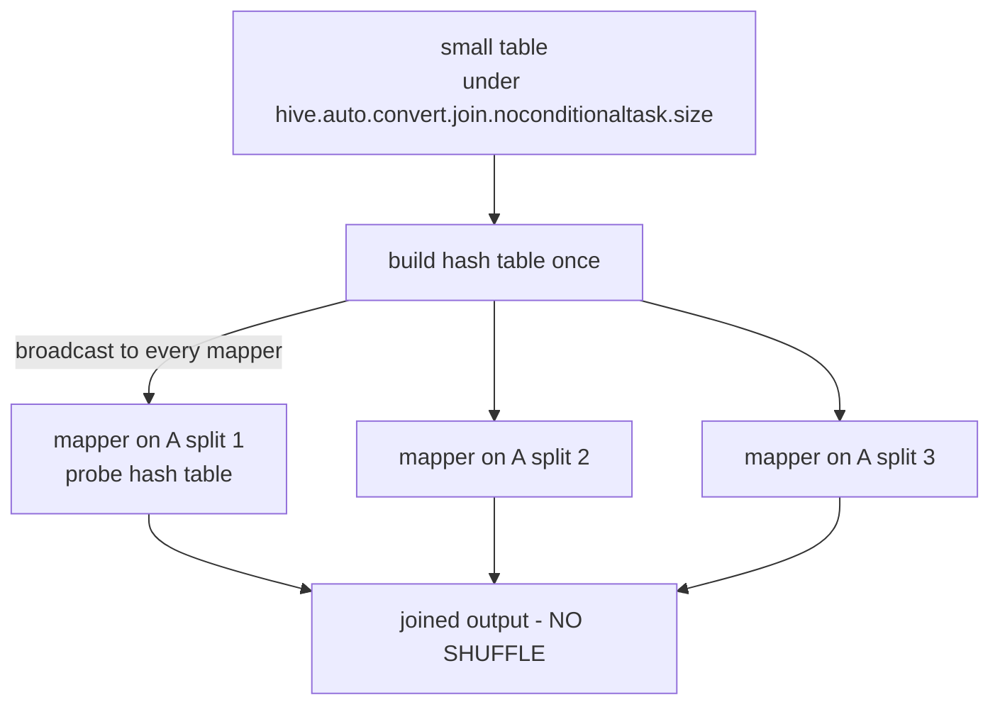
`hive.auto.convert.join=true` does this automatically based on stats. **This is the same broadcast join Spark does**; the threshold config is the knob in both.

### Sort-merge bucket (SMB) join
Both tables bucketed *and sorted* on the join key with matching bucket counts → a streaming merge of corresponding buckets, no shuffle, constant memory. The fastest big-to-big join available, at the cost of a rigid physical layout.

### Skew join
`hive.optimize.skewjoin=true`: keys exceeding a threshold are split into a separate job and handled with a map join, while the rest go through the normal path. Same idea as Spark's AQE skew handling and manual salting — **notice that all three systems converge on "detect the hot key, treat it differently."**

### Cost-based optimization
Hive's CBO (Apache Calcite) does join reordering, bushy joins, and predicate selection using **statistics** — table row counts, column NDV (number of distinct values), histograms, min/max. Stats come from `ANALYZE TABLE t COMPUTE STATISTICS FOR COLUMNS`. **Stale or missing stats are the #1 cause of catastrophic Hive plans**: with no NDV, the optimizer guesses, picks a shuffle join where a map join would do, and a 30-second query becomes an hour. When a Hive query suddenly gets slow, check stats before anything else.

---

## 5. ACID in Hive — and why Iceberg exists

### The original problem

HDFS gives you append-only files and no atomic multi-file operations. So the original Hive had no `UPDATE`, no `DELETE`, no isolation. "Updating" a table meant `INSERT OVERWRITE` of the whole partition — and while that ran, readers saw a half-written directory.

### Hive ACID v2 (ORC-based)

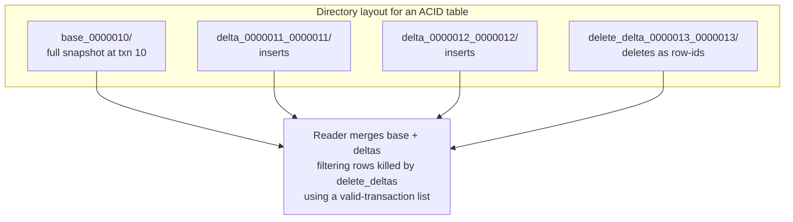

- Writes go to new **delta directories**; nothing is edited in place.
- Each row carries `(originalTransactionId, bucketId, rowId)` so deletes can name a specific row.
- The Metastore hands each reader a **valid write-id list**, giving **snapshot isolation** — readers never see uncommitted or in-flight data.
- **Compaction** is essential: *minor* compaction merges deltas into fewer deltas; *major* compaction merges everything into a new base. Without it, read amplification climbs until queries crawl. Hive 4 ships an improved, automatable compaction service for both ACID and Iceberg tables.

This works, but it's Hive-specific: the transaction state lives in the Metastore RDBMS, so **only Hive can safely write these tables.** Spark or Flink writing concurrently would corrupt them. That coupling is precisely what the open table formats broke.

### Iceberg — the successor, and what Hive 4 integrates

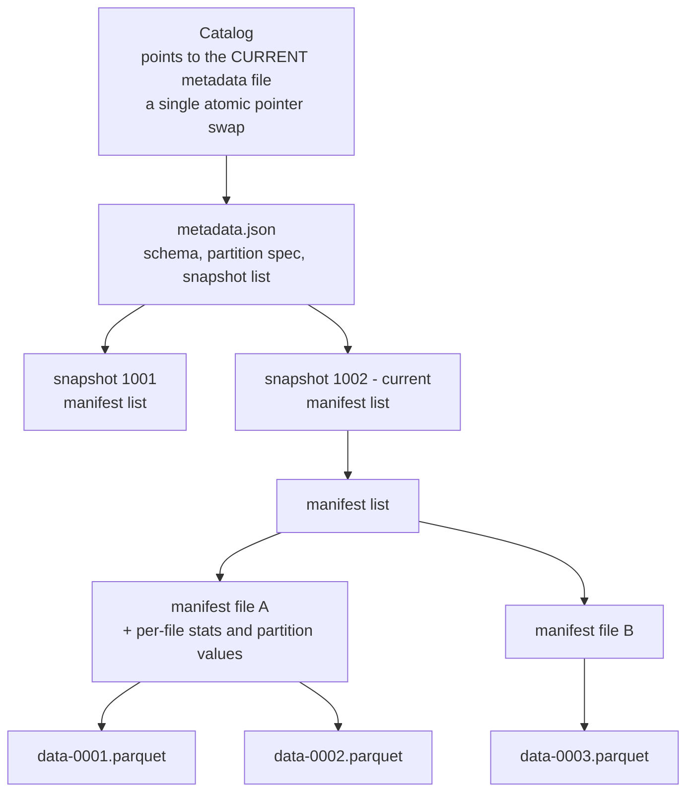

What changes versus a Hive table:

| | Hive table | Iceberg table |
|---|---|---|
| "What files are in this table?" | **list the directory** — slow on S3, racy | read a **manifest** — a file list with statistics |
| Partitioning | physical directories; the *user* must filter on the partition column | **hidden partitioning** — the table knows `dt` derives from `ts`, so `WHERE ts > ...` prunes automatically |
| Change partitioning | rewrite the whole table | **partition evolution** — new spec applies to new data |
| Schema change | positional/name games, can corrupt | **column IDs** — rename/reorder/drop are safe |
| Commit | directory rename (not atomic on S3) | **atomic swap of one metadata pointer** |
| Concurrency | Hive-only, via the Metastore | optimistic concurrency, any engine |
| Time travel | no | `FOR SYSTEM_VERSION AS OF`, snapshot rollback |

Hive 4.0 ships with Iceberg built in (1.4.3; 4.1/4.2 carry 1.9.1), and Hive 4.1 adds storage-partitioned joins, partition-level column stats, and table compaction for Iceberg. The practical upshot: **Hive is now one engine among several writing the same Iceberg tables**, alongside Spark, Flink and Trino, rather than the owner of its own private format.

> **The narrative to have ready**: Hive tables = directories + a metastore, where the *directory listing is the table definition*. That is slow on object storage, unsafe under concurrency, and forces users to know the physical layout. Iceberg/Delta/Hudi replace "the table is a directory" with "the table is a metadata tree with an atomic root pointer," which restores ACID, enables time travel, makes partitioning an internal detail, and lets many engines write safely. Every lakehouse conversation is some version of this.

**→ [07-iceberg.md](07-iceberg.md) picks up exactly here** — the metadata tree, the commit protocol, hidden partitioning, delete files, v3, catalogs, and the maintenance work that teams actually get wrong. Read it next.

---

## 6. What's new in Hive 4.x

- **Iceberg integration** as a first-class storage handler (create, read, write, compact, branch/tag).
- **MapReduce execution engine removed** — Tez only.
- **Compaction for both ACID and Iceberg tables**, with scheduling.
- **Compiler work**: anti-join support, branch pruning, **column histograms** for better CBO, many new Calcite rules.
- **Materialized views** with automatic query rewriting and incremental maintenance — the planner silently answers a query from a pre-aggregated MV.
- **Scheduled queries** (`CREATE SCHEDULED QUERY`) — cron inside Hive, useful for compaction and MV refresh.
- **HPL/SQL** — procedural SQL, easing Teradata/Oracle migrations.
- **Standalone Metastore** distributed separately (binary + Docker), plus official Hive Docker images. JDK 17 support in 4.1.

That "standalone Metastore" point is telling: the Metastore is now shipped as a product in its own right, because half the world uses it without using Hive.

---

## 7. Hive vs the alternatives

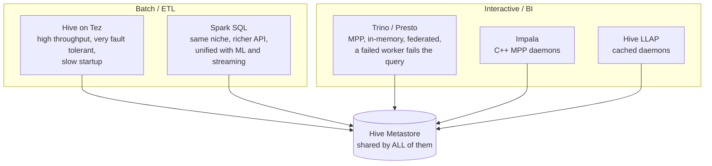

| | Hive (Tez) | Spark SQL | Trino |
|---|---|---|---|
| Model | DAG on YARN, materializes between stages | DAG with in-memory pipelining | MPP, streams between operators, no materialization |
| Latency | seconds–minutes (LLAP: sub-second) | seconds–minutes | **sub-second–seconds** |
| Long queries | **most fault-tolerant** — retries a vertex | retries a stage | a worker dies → the whole query dies |
| Federation | limited | connectors | **excellent** — join Postgres to S3 to Kafka |
| Best at | huge, long, reliability-critical ETL | ETL + ML + streaming in one engine | interactive analytics and ad-hoc BI |

**When a 12-hour ETL job is the workload, Hive's materialize-between-stages design is a feature, not a bug** — it can lose a node at hour 11 and retry one vertex, where Trino would start over. That's the non-obvious point that makes a good answer here.

**Does anyone start new projects on Hive?** Rarely. But enormous amounts of production ETL still run on it, the Metastore is everywhere, and HiveQL is close enough to Spark SQL that the skills transfer. Interviewers ask about it partly for legacy reasons and partly because the concepts (partitioning, bucketing, join strategies, stats, compaction) are universal.

---

## 8. Practical tuning checklist

```sql
-- stats first: bad plans are usually missing stats
ANALYZE TABLE trades PARTITION(dt) COMPUTE STATISTICS FOR COLUMNS;

-- engine and vectorization
SET hive.execution.engine=tez;
SET hive.vectorized.execution.enabled=true;
SET hive.vectorized.execution.reduce.enabled=true;

-- joins
SET hive.auto.convert.join=true;
SET hive.auto.convert.join.noconditionaltask.size=512000000;  -- broadcast threshold
SET hive.optimize.skewjoin=true;

-- the small files problem, at both ends
SET hive.merge.tezfiles=true;
SET hive.merge.smallfiles.avgsize=134217728;
SET hive.merge.size.per.task=268435456;
SET hive.input.format=org.apache.hadoop.hive.ql.io.CombineHiveInputFormat;

-- guardrails
SET hive.mapred.mode=strict;                       -- no unpartitioned full scans
SET hive.exec.max.dynamic.partitions=1000;

-- cost-based optimizer
SET hive.cbo.enable=true;
SET hive.compute.query.using.stats=true;           -- answer count(*) from stats alone
```

**Debugging order when a Hive query is slow**
1. `EXPLAIN` / `EXPLAIN FORMATTED` — is it a map join or a shuffle join? Are partitions pruned (`filterExpr` on the TableScan)?
2. Are **column stats** present and fresh? (Most common root cause.)
3. Is **partition pruning** happening? A function on the partition column (`WHERE year(dt)=2026`) can defeat it — compare against a literal instead.
4. How many **files and partitions** is it touching? Tens of thousands of tiny files → compaction.
5. Tez UI: is one **vertex/task** far slower than its siblings → skew.
6. Is an ACID table **uncompacted**, with hundreds of delta directories?

---

## 9. Interview answers to have ready

**"What is the Hive Metastore and why does it still matter?"**
A relational database plus a Thrift service holding table schemas, storage locations, partition lists, SerDe info and statistics. It matters because it decoupled *what a table is* from *which engine reads it* — Spark, Trino, Flink, Impala and Hive all point at the same HMS and see the same tables. It's also a scaling bottleneck: a table with a million partitions makes planning slow, which is one of the motivations for Iceberg's manifest-based metadata.

**"Partitioning vs bucketing?"**
Partitioning splits data into directories by a low-cardinality column and enables pruning — skipping data entirely. Bucketing hashes a column into a fixed number of files inside each partition and enables shuffle-free joins and sampling. Partition by date; bucket by a high-cardinality join key. Partitioning on high cardinality is the classic mistake because it explodes Metastore rows and file counts.

**"Managed vs external table?"**
`DROP TABLE` on a managed table deletes the data; on external it only removes metadata. Use external whenever the data is shared with other engines or is a landing zone. Note Hive 3+ defaults `CREATE TABLE` to managed *and* transactional, which surprises people migrating.

**"How does Hive do an UPDATE on an append-only filesystem?"**
It doesn't edit files. ACID v2 writes delta and delete-delta directories containing row-ids; readers merge base + deltas against a valid-write-id list, giving snapshot isolation; a compaction service periodically folds deltas back into a new base. The transaction state lives in the Metastore, which is why only Hive can safely write those tables — and why Iceberg, which keeps the state in the table's own metadata tree, superseded the design.

**"Why is Iceberg better than a Hive table?"**
The table's file list is explicit metadata instead of a directory listing, so planning is fast on object storage and immune to listing races. Commits are an atomic pointer swap rather than a rename, so they're safe on S3 and safe under multi-engine concurrency. It adds hidden partitioning, partition and schema evolution without rewrites, per-file statistics for pruning, and time travel with rollback.

**"When would you still choose Hive over Spark or Trino?"**
Very long batch ETL where fault tolerance dominates — Hive on Tez materializes between stages and can retry a single vertex rather than a whole query. Also: an existing Hive-based platform where the migration cost exceeds the benefit, and workloads where LLAP's shared cache and centralized column-level security already meet the need.

---

## 10. Sources

- [Hive 4.0 — overview of major changes](https://hive.apache.org/docs/latest/overview-of-major-changes/)
- [ASF announces Apache Hive 4.0](https://news.apache.org/foundation/entry/apache-software-foundation-announces-apache-hive-4-0)
- [Apache Hive downloads / version notes](https://hive.apache.org/downloads.html)
- [Iceberg — Hive integration](https://iceberg.apache.org/docs/latest/hive/)
- [Hive 4.0+ and Iceberg integration](https://olake.io/iceberg/query-engine/hive/)
