# Apache Kafka — Deep Dive

> **Mental model.** Kafka is a **distributed, replicated, append-only commit log** with a client protocol bolted on. Almost every Kafka question reduces to "what does the log do here?" Unlike a message queue, the broker does not track per-message delivery state — consumers track their own position — and that single decision explains Kafka's throughput, its replay capability, and most of its sharp edges.

---

## 1. The big picture

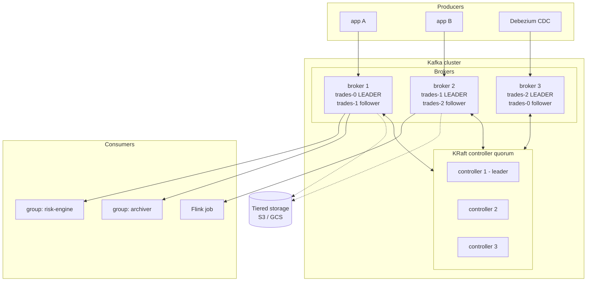

Two independent planes:
- **Data plane** — brokers storing partition logs, serving produce/fetch.
- **Metadata plane** — the KRaft controller quorum, which owns "who leads which partition, what topics exist, what the configs are."

Note that **consumer groups are independent**: the `archiver` reading the same data does not slow down `risk-engine`, because reads are just file offsets into the page cache. This is the fan-out property that makes Kafka a *hub* rather than a pipe.

---

## 2. The storage model — this is the whole thing

### Topic → partition → segment

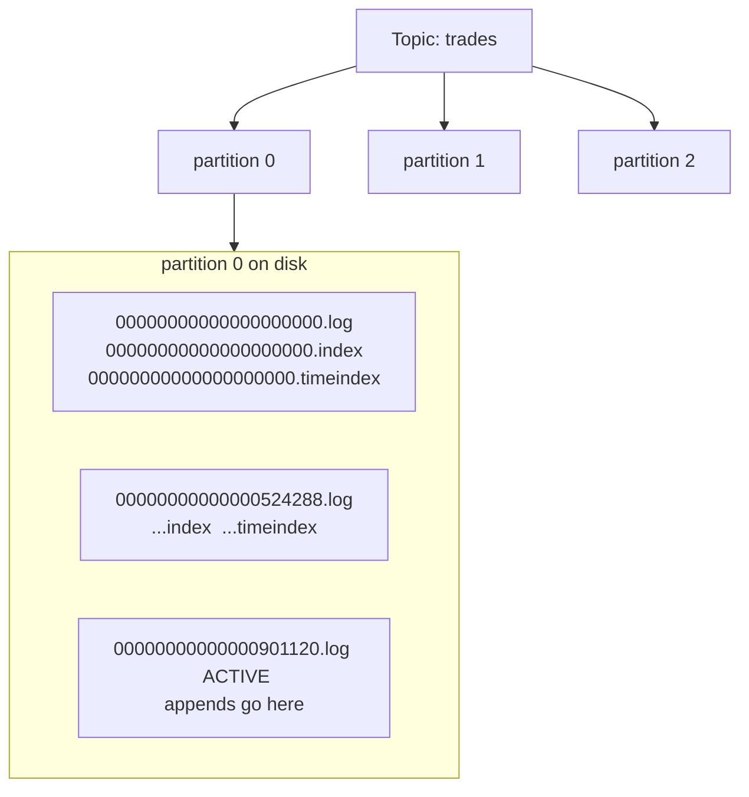

Inside a segment, the log is literally a sequence of length-prefixed record batches:

```
offset:  1000        1001        1002        1003
        ┌──────────┬──────────┬──────────┬──────────┐
        │ batch    │ batch    │ batch    │ batch    │  ← append only, never modified
        └──────────┴──────────┴──────────┴──────────┘
                                              ▲
                                          log end offset (LEO)
```

The **`.index`** file is a *sparse* map of offset → byte position (an entry every `index.interval.bytes`, 4 KB by default): binary-search the index to get close, then scan forward. The **`.timeindex`** does the same for timestamps, which is what `offsetsForTimes()` and "replay from 09:30 yesterday" use.

### Non-negotiable facts

| Fact | Consequence |
|---|---|
| **Ordering is per-partition, never per-topic** | if you need per-entity ordering, partition by that entity's key |
| Offsets are per-partition monotonic longs | not timestamps, not global, never reused |
| Records are immutable once written | "deleting" = retention expiry or compaction, never in-place edit |
| Consumers pull and track their own offset | broker doesn't know who has read what; reads are nearly free |
| A partition lives entirely on one disk on one broker | one partition cannot exceed one disk; partition count is your parallelism |

### Why Kafka is fast — three mechanisms, name all three

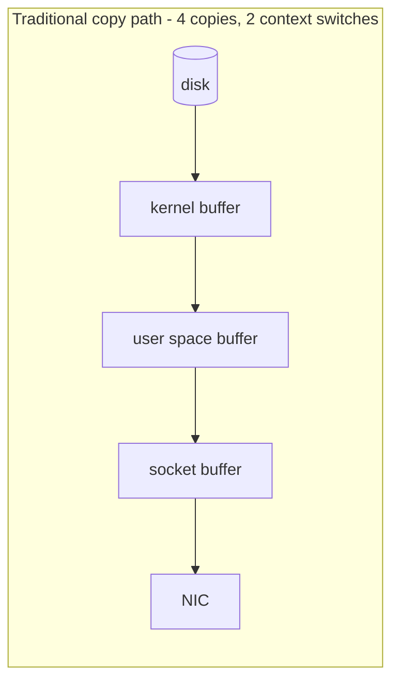
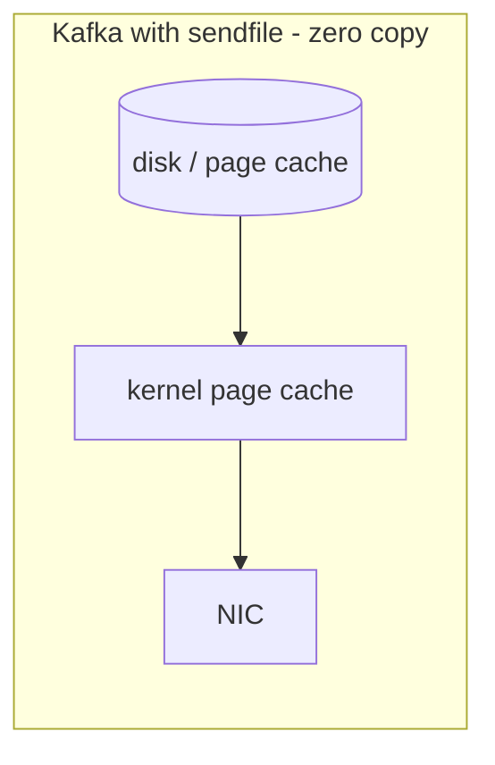

1. **Sequential I/O.** Appends go to the tail of a file; reads are usually near the tail. Sequential disk throughput is within an order of magnitude of RAM, and hundreds of times faster than random.
2. **Page cache, not JVM heap.** Kafka deliberately holds almost no data in heap. Recent writes are in the OS page cache, so recent reads never touch disk. **Give the broker a small heap (6–8 GB) and leave the rest of RAM to the page cache.** Suggesting a 64 GB heap is a classic interview trap — it would just create GC pauses that cause ISR flapping.
3. **Zero copy (`sendfile`).** Bytes go page cache → socket without entering user space. This is *broken* if the broker must re-encode — mismatched message format versions between producer and consumer, or a broker-side recompression — and the resulting throughput collapse after an upgrade is a real production story.

Plus: **batching and compression happen on the producer, per partition**, so the broker stores and forwards already-compressed batches, and compression ratio improves with batch size.

### Retention vs compaction

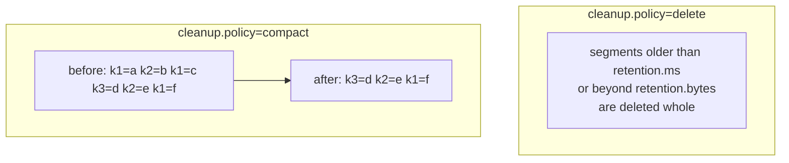

| | `delete` | `compact` |
|---|---|---|
| Deletes by | age (`retention.ms`) or size (`retention.bytes`) | superseded keys |
| Guarantees | a recent window of *all* events | the latest value per key, forever |
| Use for | event streams, logs, metrics | changelogs, CDC snapshots, config/state topics |
| Delete a key | n/a | **tombstone**: `key → null`, removed after `delete.retention.ms` |

Two details people miss: `compact,delete` is legal (bounded changelogs), and **compaction never touches the active segment**, so the head of a compacted topic always still contains duplicates. `min.cleanable.dirty.ratio` controls how aggressively the cleaner runs.

---

## 3. Replication, ISR and the durability dial

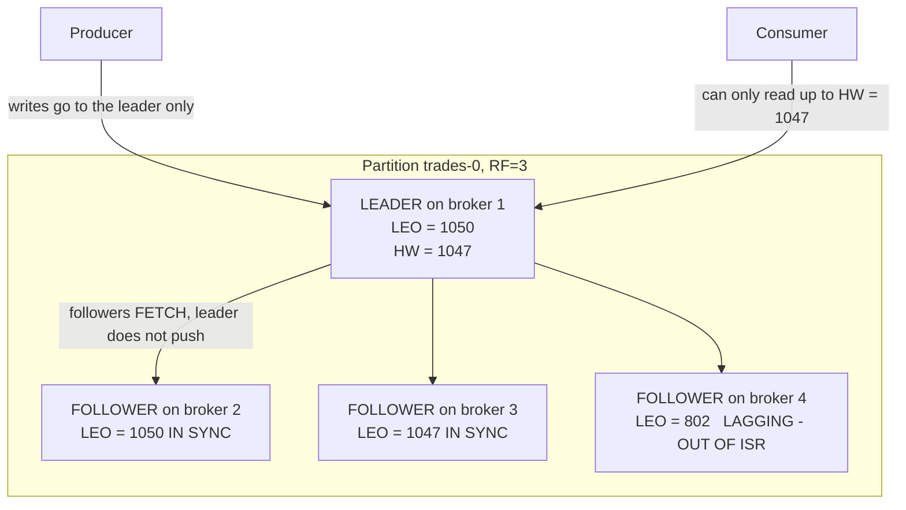

- **ISR (in-sync replicas)**: replicas that have fetched within `replica.lag.time.max.ms` (30 s) of the leader.
- **LEO (log end offset)**: the leader's tail.
- **High watermark (HW)**: the highest offset replicated to *every* ISR member. **Consumers can only read up to the HW.** This is deliberate: it prevents exposing a record that could vanish on failover, so consumers never see data that "un-happens."
- Replication is **pull-based**: followers issue fetch requests exactly like consumers. One code path, less to go wrong.

### The durability dial

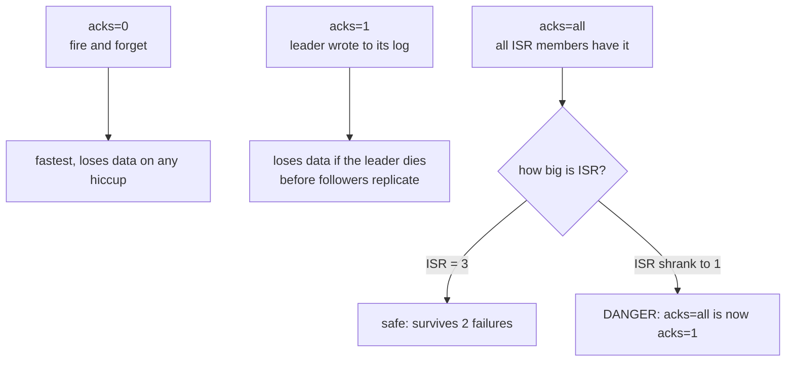

**The trap, and the answer that separates candidates:** `acks=all` does *not* by itself guarantee durability. If two followers fall out of ISR, ISR = {leader}, and `acks=all` silently degrades to `acks=1`. The fix is a topic-level `min.insync.replicas=2`, which makes such a write **fail loudly** with `NotEnoughReplicasException` instead of succeeding unsafely.

> **Canonical safe configuration**: `replication.factor=3`, `min.insync.replicas=2`, `acks=all`. Tolerates one broker down with writes still available and zero data loss. Two brokers down = writes rejected (correctly — you chose consistency over availability).

`unclean.leader.election.enable=false` (default since 3.0): never promote an out-of-sync replica. Setting it `true` is an explicit choice to lose data in exchange for availability.

### Eligible Leader Replicas (KIP-966)

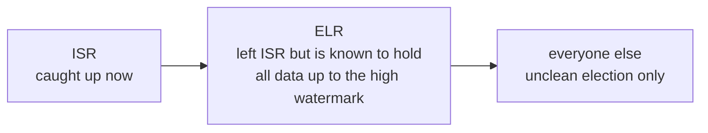
ELR (preview in 4.0) tracks replicas that are still *safe to elect* even after dropping out of ISR. Effect: far fewer situations where the only options are downtime or an unclean election with data loss.

---

## 4. KRaft — the post-ZooKeeper world

**As of Kafka 4.0, ZooKeeper is gone entirely.** KRaft is the only metadata mode.

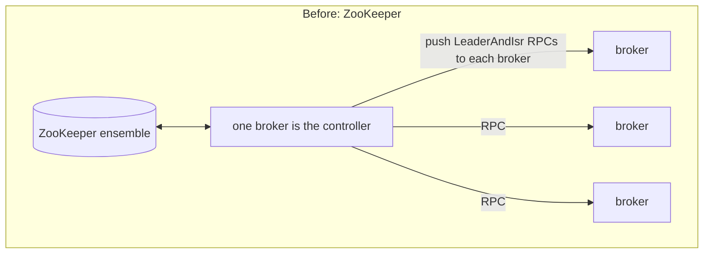
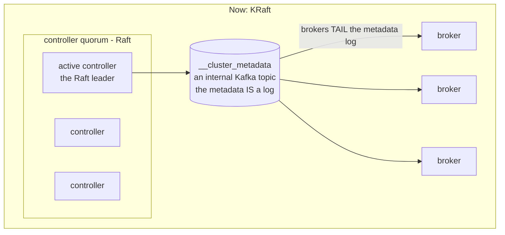

Why it's better, concretely:
- **Metadata is a log**, replayed by brokers, instead of a pile of RPCs pushed by a controller. Brokers converge by replaying; no "did that RPC land?" ambiguity.
- **Controller failover is near-instant** — the new leader already has the metadata log in memory. Under ZooKeeper, a new controller had to read the entire state out of ZK, which took tens of seconds on a large cluster.
- **Scales to millions of partitions**, since metadata propagation is incremental deltas.
- **One system to operate**, not two.
- **KIP-996 Pre-Vote**: a node checks whether it *could* win before forcing an election, so a transient network blip no longer triggers leadership churn.

Deployment: `process.roles=broker`, `controller`, or `broker,controller` (combined — acceptable in dev, discouraged in production because a busy broker can starve the controller).

---

## 5. Producer internals

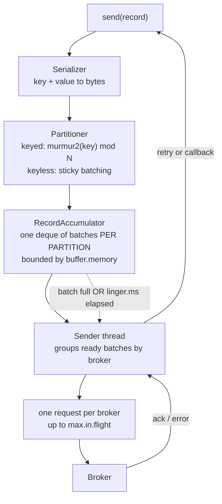

| Config | Effect | Guidance |
|---|---|---|
| `batch.size` (16 KB) | max bytes per partition batch | raise to 64–256 KB for throughput |
| `linger.ms` (0) | how long to wait to fill a batch | **the single best throughput lever**; 5–50 ms typical |
| `compression.type` | `lz4` / `zstd` / `snappy` / `gzip` | compresses the *batch*, so batching multiplies the benefit; `zstd` usually best ratio/CPU today |
| `max.in.flight.requests.per.connection` (5) | pipelining depth | >1 can reorder on retry **unless idempotence is on** |
| `buffer.memory` (32 MB) | client-side backpressure | when full, `send()` blocks for `max.block.ms`, then throws |
| `delivery.timeout.ms` (2 min) | total time budget including retries | the one that actually bounds a send |

**Sticky partitioning**: with no key, modern clients fill *one* partition's batch before moving on, instead of round-robining per record. Same distribution over time, much better batching.

> **Consequence to remember**: adding partitions to a keyed topic changes `hash(key) % N`, so an existing key can move to a different partition. Per-key ordering breaks across the resize, and stateful consumers see keys migrate. **Over-provision partitions up front; don't plan to resize.**

### Idempotent producer

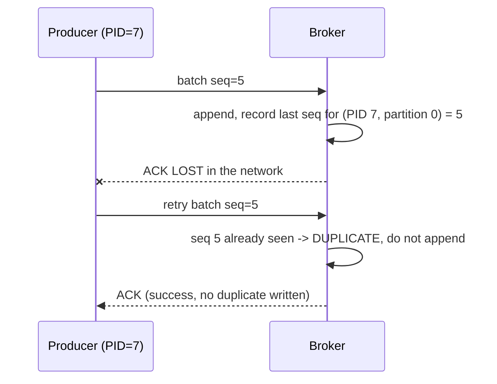

`enable.idempotence=true` (default since 3.0). Each producer gets a PID; each `(PID, partition)` carries a monotonic sequence number, so the broker rejects duplicates and out-of-order sequences. This gives **exactly-once per partition, per producer session** — it eliminates *retry-induced* duplicates and nothing more. Implies `acks=all`, `retries>0`, `max.in.flight<=5`.

---

## 6. Consumer internals

### Groups and assignment

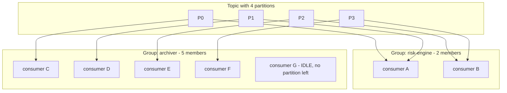

Each partition goes to exactly **one** member of a group, which is what preserves per-partition ordering. **More consumers than partitions ⇒ idle consumers.** Partition count is the hard ceiling on consumer parallelism.

### Rebalancing: old vs new

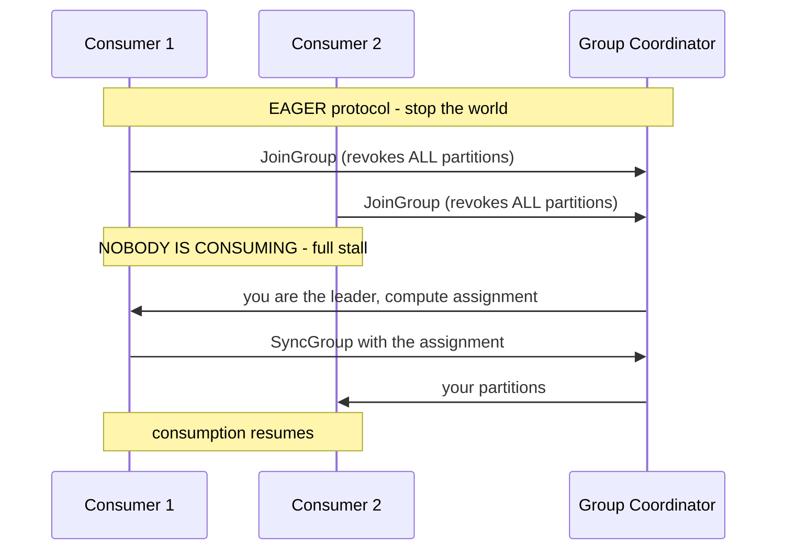
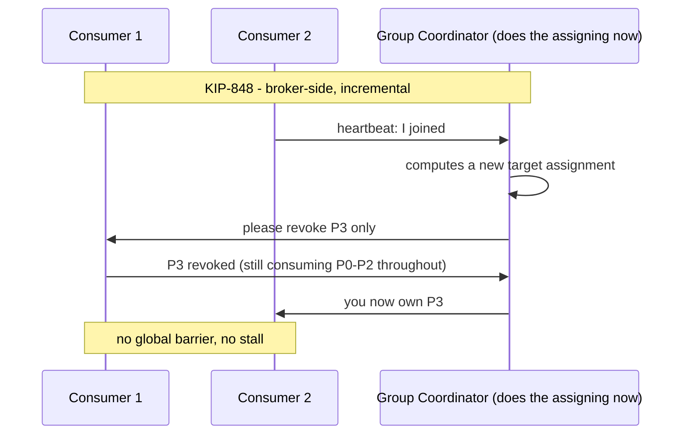

**KIP-848** (default in 4.x) moves assignment computation to the **group coordinator on the broker** and makes revocation incremental. This removes the stop-the-world pause that made large groups fragile. If asked "what's changed in Kafka consumption recently," this is the headline.

Assignors worth naming: `RangeAssignor` (legacy, skews when partition counts differ), `RoundRobinAssignor`, `StickyAssignor`, `CooperativeStickyAssignor` (incremental, minimizes movement).

**Static membership** (`group.instance.id`): a restarting consumer reclaims its previous partitions without triggering a rebalance, provided it returns within `session.timeout.ms`. Essential for rolling restarts of stateful consumers.

### The three timeouts — a very common question

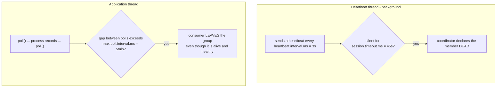

| Config | Guards against | Default |
|---|---|---|
| `session.timeout.ms` | process death (heartbeat thread stopped) | 45 s |
| `heartbeat.interval.ms` | — (cadence; ~1/3 of session timeout) | 3 s |
| `max.poll.interval.ms` | **slow processing** — alive but not polling | 5 min |

**The classic failure — a rebalance storm:**

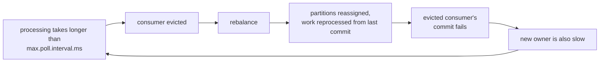

Fixes: lower `max.poll.records`, raise `max.poll.interval.ms`, make processing faster, or move work to a separate thread pool — and if you do that, you must `pause()`/`resume()` partitions to preserve backpressure, otherwise you've just moved the unbounded queue into your heap.

### Offsets and delivery semantics

Offsets live in the internal **compacted** topic `__consumer_offsets` (50 partitions by default), keyed by `(group, topic, partition)`. The partition of that key determines which broker is the **group coordinator**.

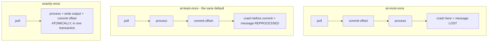

**At-least-once is correct for ~90 % of systems.** Pair it with an idempotent sink — upsert by primary key, dedupe on an event id — and you get effectively-once without the cost and complexity of transactions.

---

## 7. Exactly-once semantics

Kafka transactions provide **atomic read-process-write within Kafka**.

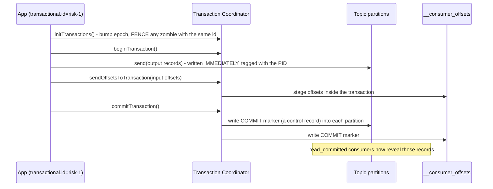

Mechanics that matter:
- Records are written to partitions **immediately**, tagged with the transaction's PID; a **control record (transaction marker)** later declares commit or abort.
- `isolation.level=read_committed` consumers filter aborted records and **will not read past the LSO (last stable offset)** — the offset of the earliest still-open transaction. Therefore **a hung transaction stalls all read_committed consumers on that partition**, until `transaction.timeout.ms` forces an abort. This is a real and nasty incident class.
- **Fencing**: a new producer with the same `transactional.id` bumps the epoch; the old (zombie) instance's writes are rejected. This is how EOS survives a process that was only "mostly" dead.

**The crucial caveat, and the answer that scores:** EOS holds **only inside Kafka**. Kafka → PostgreSQL is not covered. End-to-end exactly-once requires an idempotent sink, a transactional sink (2PC), or storing the offsets in the *same* transaction as the data in the destination store. Costs: latency from markers and coordinator round trips, and throughput that degrades badly with very small transactions.

---

## 8. Share groups — "queues for Kafka" (KIP-932)

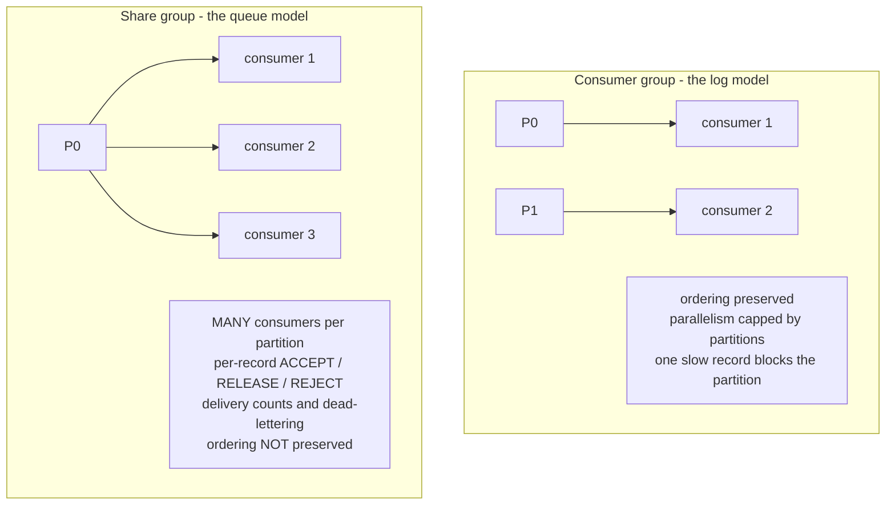

GA in Kafka 4.2. Multiple consumers in a **share group** read the *same* partition concurrently with per-record acknowledgement. Solves two long-standing complaints: "one poison-pill or slow record blocks the whole partition," and "I want 200 workers on a 12-partition topic." Adds a `RENEW` acknowledgement for long processing, plus lag metrics. Gives up per-partition ordering.

Framing for an interview: Kafka now covers **both** the *log* use case (ordered, replayable, fan-out) and the *queue* use case (work distribution, competing consumers) — moving into RabbitMQ/SQS territory for the latter.

---

## 9. Tiered storage (KIP-405)

```mermaid
flowchart LR
    subgraph BROKER["Broker local disk - hot"]
        S3seg["recent segments<br/>local.retention.ms"]
    end
    subgraph REMOTE["Object storage - cold"]
        R1["older segments<br/>retention.ms = months or years"]
    end
    PROD2["producer"] --> S3seg
    S3seg -->|"offload"| R1
    C_HOT["consumer near the tail"] --> S3seg
    C_COLD["consumer replaying history"] --> R1
```

Recent segments stay on broker disk; older ones are offloaded to S3/GCS/ABFS (`remote.storage.enable=true`). Retention becomes effectively unbounded and cheap. The subtle operational win: **broker local disks stay small, so rebalancing and recovery get dramatically faster** — you're not shipping terabytes to a replacement broker. Cold reads hit object storage with higher latency, which is fine for backfills and replay.

---

## 10. The ecosystem

```mermaid
flowchart LR
    SRC[("Postgres / MySQL")] -->|"Debezium CDC"| CON1["Kafka Connect<br/>source"]
    CON1 --> K[("Kafka")]
    K --> KS["Kafka Streams<br/>a LIBRARY in your app"]
    K --> FL["Flink"]
    K --> SP["Spark"]
    KS --> K
    K --> CON2["Kafka Connect<br/>sink"] --> DEST[("Elasticsearch / S3 / Snowflake")]
    SR["Schema Registry<br/>Avro / Protobuf<br/>compatibility rules"] -.-> K
```

- **Kafka Connect** — a cluster of workers running declarative source/sink connectors, with offset management, scaling, and dead-letter queues handled for you. Reach for it before writing a bespoke consumer to load a database.
- **Kafka Streams** — a JVM *library* (no cluster) for stateful processing. State in RocksDB, backed by compacted changelog topics; scale by running more instances of your app. The key concept is **stream–table duality**: a `KStream` is a changelog, a `KTable` is the materialized snapshot, and each converts to the other.
- **Schema Registry** — the answer to schema evolution. `BACKWARD` compatibility (a new schema can read old data) is the usual default; producers register schemas, messages carry a 5-byte schema id instead of the schema itself.

---

## 11. Sizing and operations

**Partition count** ≈ `max(target_throughput / per_partition_throughput, desired_consumer_parallelism)`. Treat ~10 MB/s per partition as a planning number. Costs of too many: more file handles, longer recovery, more producer memory, slower metadata propagation, more `__consumer_offsets` churn. Thousands per broker is fine under KRaft; hundreds of thousands is not.

**Metrics that matter**

| Metric | Meaning | Threshold |
|---|---|---|
| `UnderReplicatedPartitions` | replication falling behind | **must be 0** |
| `OfflinePartitionsCount` | data unavailable | **must be 0 — page someone** |
| consumer group lag, **per partition** | are consumers keeping up | rising = trouble; per-partition reveals skew that totals hide |
| `RequestHandlerAvgIdlePercent` | broker saturation | low = saturated |
| ISR shrink/expand rate | flapping | non-zero sustained = GC pauses, disk stalls, or network trouble |
| `NetworkProcessorAvgIdlePercent` | network thread saturation | low = add threads or brokers |

**Incident → cause table**

| Symptom | Usual cause |
|---|---|
| Rebalance storm | processing exceeds `max.poll.interval.ms` |
| Lag on exactly one partition | hot key / skewed partitioning |
| `read_committed` consumers frozen | a hung transaction pinning the LSO |
| Throughput collapse after an upgrade | broker re-encoding, losing zero-copy |
| Disk fills unexpectedly | compaction not keeping up, or retention by time during a burst |
| ISR flapping | broker GC pause (heap too large) or slow disk |
| Producer `TimeoutException` | `buffer.memory` exhausted from downstream slowness, or `min.insync.replicas` unmet |

---

## 12. Quant / finance angle

- **Market data ingest**: partition by instrument so per-symbol ordering holds — then expect extreme skew (SPY vs an illiquid name). Mitigate with a composite key, a custom partitioner that spreads hot symbols, or a two-tier topic layout.
- **Replay for backtesting**: retention + tiered storage lets you re-run a strategy over the exact production byte stream. Seek by time using the `.timeindex` via `offsetsForTimes()`.
- **Timestamps**: `message.timestamp.type` is `CreateTime` or `LogAppendTime`. For market data, use producer `CreateTime` and *also* carry the exchange timestamp inside the payload — broker time is useless for event-time analytics and worse than useless for latency measurement.
- **Latency path**: `linger.ms=0`, `acks=1`, `compression=none` for the hot path; the durability/latency tradeoff is a business decision, and saying so explicitly scores well.
- **Audit and regulation**: compacted topics for reference data (the "as known at time T" problem), tiered storage for multi-year retention, and a dead-letter topic rather than silent drops — in finance you reconcile, you don't discard.

---

## 13. Rapid-fire answers

**Why can't you have more consumers than partitions?** Each partition is assigned to exactly one consumer in a group, to preserve per-partition ordering; extras idle. Share groups (4.2+) relax exactly this, at the cost of ordering.

**What breaks when you add partitions?** `hash(key) % N` changes, so keys move. Ordering guarantees break across the change and stateful consumers see keys migrate. Over-provision instead.

**Is `acks=all` enough for no data loss?** No — not without `min.insync.replicas ≥ 2`. If ISR shrinks to the leader alone, `acks=all` is effectively `acks=1`.

**What's the high watermark for?** It's the highest offset present on all ISR members, and consumers can't read past it — so they never observe a record that could disappear in a failover.

**How do you handle a poison pill?** Catch the deserialization/processing error, route the raw bytes plus error metadata to a dead-letter topic, commit the offset, continue. Never skip silently.

**Why is Kafka fast?** Sequential I/O, OS page cache rather than heap, zero-copy `sendfile`, and producer-side batching + compression that amortizes per-record cost.

**What changed in Kafka 4.0?** ZooKeeper removed (KRaft only), KIP-848 rebalance protocol as default, share groups introduced, older protocol versions and clients dropped (upgrades must pass through a bridge release).

**Kafka vs RabbitMQ?** Kafka is a durable, replayable, partitioned log optimized for high-throughput fan-out with consumer-tracked offsets. RabbitMQ is a broker-tracked message queue with rich routing, per-message ack, and easy competing-consumer semantics. Kafka's share groups are narrowing the gap from one side.

---

## 14. Sources

- [Apache Kafka 4.0 release (Confluent)](https://www.confluent.io/blog/latest-apache-kafka-release/)
- [Apache Kafka 4.2.0 release announcement](https://kafka.apache.org/blog/2026/02/17/apache-kafka-4.2.0-release-announcement/)
- [Kafka queue semantics GA with the Share Consumer API](https://www.confluent.io/blog/kafka-queue-semantics-share-consumer-ga/)
- [Apache Kafka 4.3.0 — a guide for platform engineers](https://factorhouse.io/articles/apache-kafka-4-3-0/)
