# Apache Spark — Deep Dive

> **Mental model.** Spark is **a distributed query optimizer plus a fault-tolerant execution engine over immutable, partitioned collections.** Correctness surprises come from *lazy evaluation*; performance problems come from *shuffle* and *skew*. Almost every Spark question lands in one of those three buckets.

---

## 1. Architecture

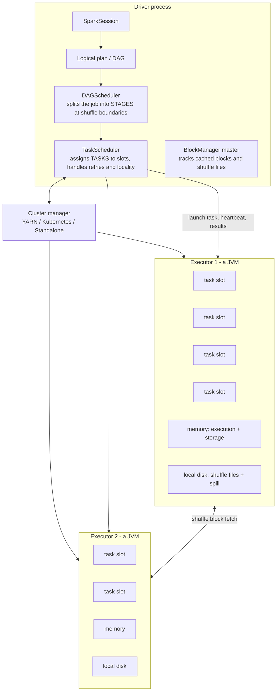

| Concept | Definition | Gotcha |
|---|---|---|
| **Driver** | builds the plan, schedules, collects results | single point of failure; `collect()` on a big dataset OOMs it |
| **Executor** | JVM with N cores (= N concurrent tasks) and a memory pool | dies → its cached blocks and shuffle files are lost |
| **Job** | everything triggered by one *action* | two `count()` calls = two jobs = the pipeline runs twice |
| **Stage** | tasks with no shuffle between them | **stages are cut at shuffle boundaries** |
| **Task** | one partition's work | `#tasks in a stage == #partitions` |

### Spark Connect (the 4.x architecture)

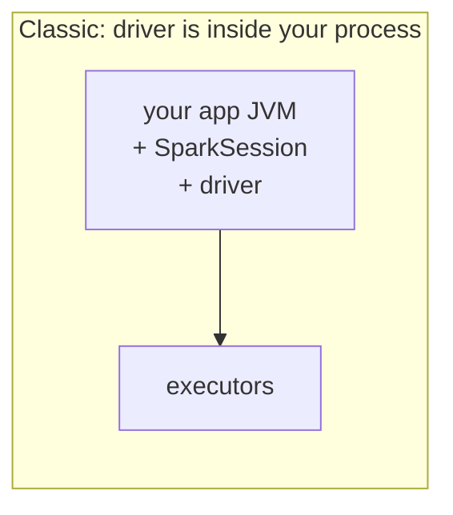
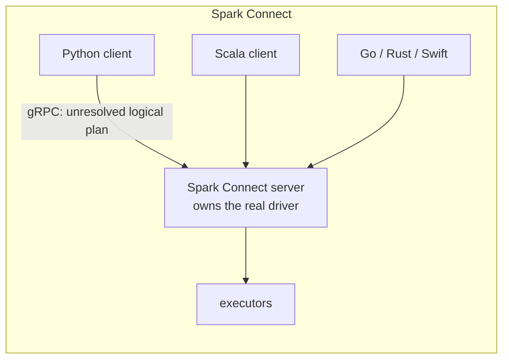

The client sends an **unresolved logical plan** over gRPC instead of embedding a driver. Consequences: thin clients, no JVM-version coupling, multiple independent clients per cluster, easy embedding in notebooks and web apps, and non-JVM languages. Spark 4.0 reached near-parity with classic mode; `spark.api.mode` toggles it. This is why Databricks Connect and serverless Spark work the way they do.

---

## 2. Lazy evaluation and the DAG

```python
df2 = df.filter(...)        # nothing runs
df3 = df2.groupBy(...)      # nothing runs
df3.count()                 # <- the ENTIRE plan executes now
```

Implications to state:
- Calling an action twice re-runs the whole pipeline unless you cache.
- The optimizer can push filters down and prune columns **precisely because** it sees the whole plan before executing.
- Errors surface at the action, not the transformation — which is why stack traces point at the wrong line.

### Narrow vs wide

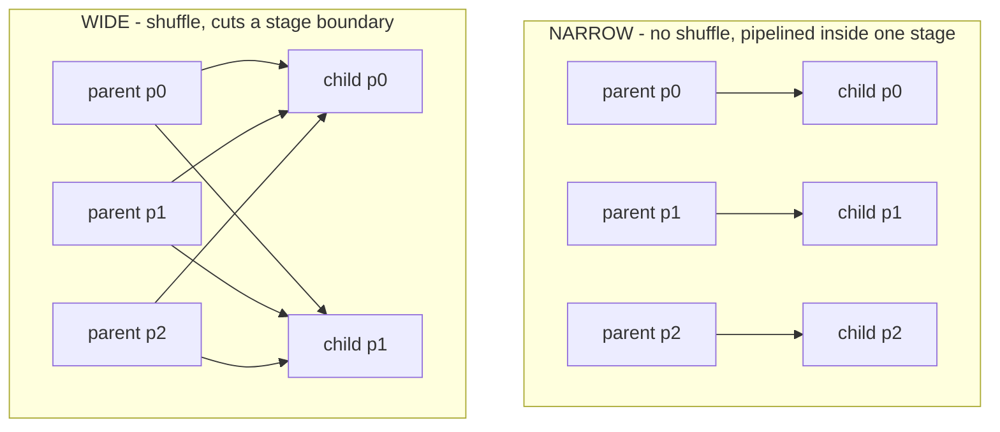

| Narrow | Wide |
|---|---|
| `map`, `filter`, `select`, `withColumn`, `union`, `mapPartitions`, `coalesce` | `groupBy`, `join`, `distinct`, `repartition`, `sortBy`, window functions, `reduceByKey` |
| 1 input partition → 1 output partition | many-to-many; data crosses the network |
| cheap, fused into one task | writes to local disk, fetched over the network — **the expensive thing** |

**Every Spark performance conversation is about minimizing, balancing, or avoiding shuffle.**

### How a job decomposes

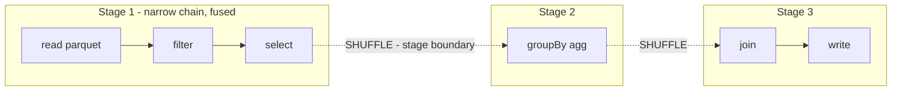

### The shuffle mechanism

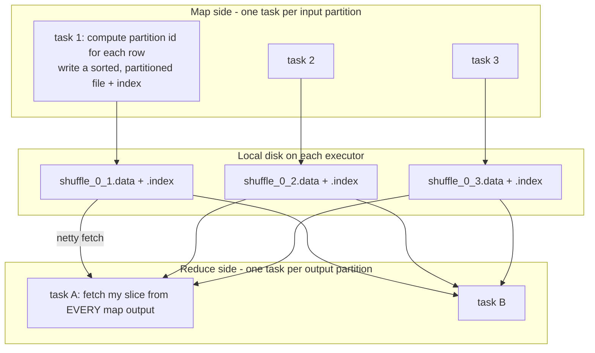

- With M map tasks and R reduce tasks there are **M×R fetches**. This all-to-all is the scalability wall — same as MapReduce's shuffle, but Spark writes to *local* disk without replication, and can skip the sort when the operation doesn't need ordering (hash aggregation), which MapReduce could not.
- **Shuffle files outlive the task** and are served by the executor (or an external shuffle service). Losing an executor loses its shuffle files → recompute the upstream stage. That's why dynamic allocation needs the external shuffle service.
- `spark.sql.shuffle.partitions` (200 default) sets R for SQL operations. With AQE on, this is the *initial* value that gets coalesced down at runtime.

---

## 3. Catalyst and Tungsten

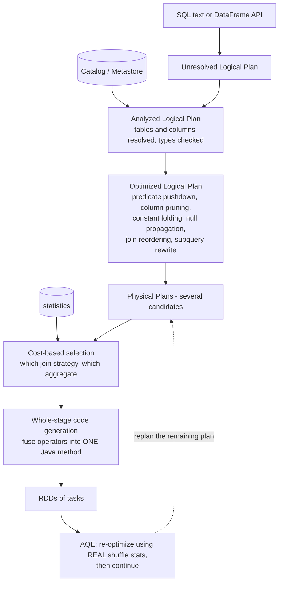

**Tungsten** is the execution layer underneath: off-heap binary row format (no Java object header per row, no per-row GC), cache-friendly layout, and **whole-stage codegen** that collapses a chain of operators into a single tight loop with no virtual calls.

> **Why DataFrames beat RDDs**: an RDD holds opaque lambdas, so Catalyst cannot see inside — no pushdown, no codegen, no reordering. DataFrames are declarative, so they can be rewritten. **Python UDFs break the same property**: rows are serialized out to a Python process, killing codegen and pipelining. Order of preference: **built-in functions > Arrow/pandas UDFs > Python UDFs > RDD ops.**

### Adaptive Query Execution (on by default since 3.2)

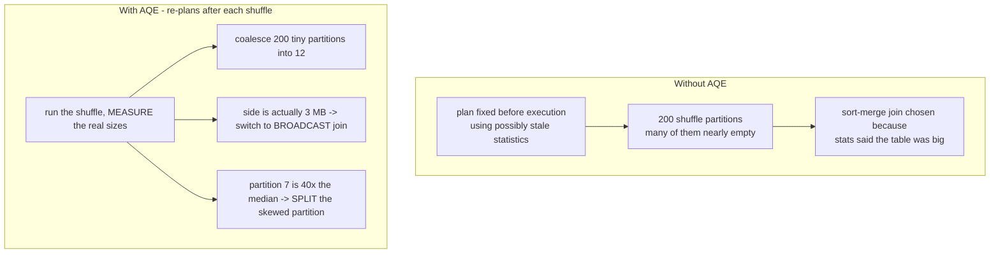

Three tricks, and they cover most of what people used to tune by hand:
1. **Coalesce shuffle partitions** — collapse the default 200 into what the data actually warrants.
2. **Switch join strategy at runtime** — sort-merge → broadcast when a side turns out small.
3. **Skew join handling** — detect oversized partitions and split them, replicating the matching side.

So the modern answer to "how do you tune `spark.sql.shuffle.partitions`?" begins: *"Confirm AQE is on and let it coalesce; set the initial value generously; only override when I can show AQE is choosing badly."*

---

## 4. Joins — know all five and when each fires

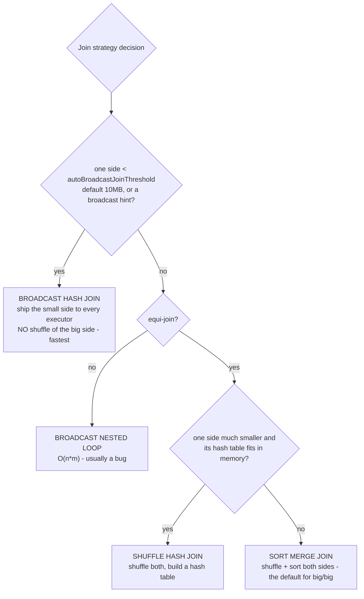

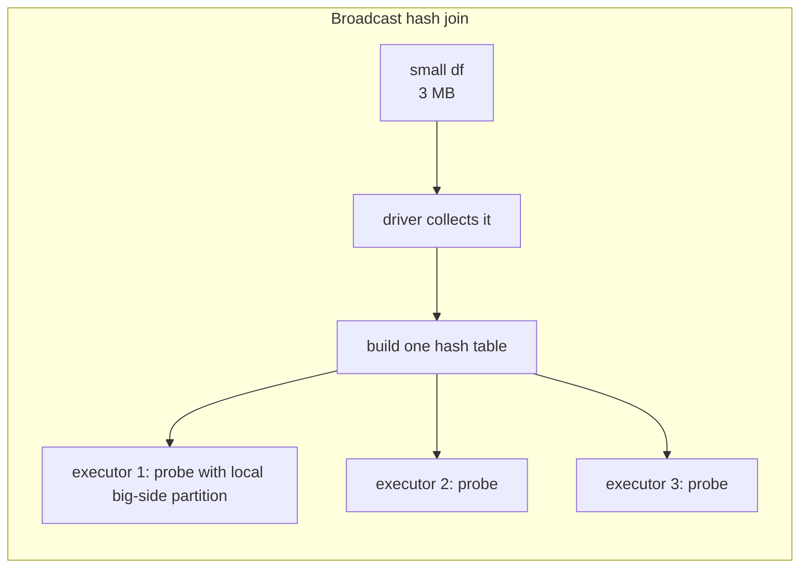

Tuning moves: raise `spark.sql.autoBroadcastJoinThreshold`, add an explicit `broadcast(df)` hint, or fix stale statistics (`ANALYZE TABLE`). AQE will often do it for you. Beware broadcasting something large — it materializes in the driver *and* in every executor.

### Data skew — the most common real Spark problem

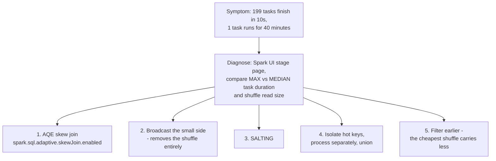

**Salting**, concretely:

```python
N = 32
big_salted = big.withColumn("salt", (rand() * N).cast("int"))
small_exploded = (small
    .withColumn("salt", explode(array([lit(i) for i in range(N)]))))
joined = (big_salted.join(small_exploded, ["key", "salt"])
                    .drop("salt"))
```
The hot key is spread across N reducers; the small side is replicated N-fold to match. You trade N× duplication of the small side for an even distribution — worth it whenever one key dominates.

---

## 5. Memory model

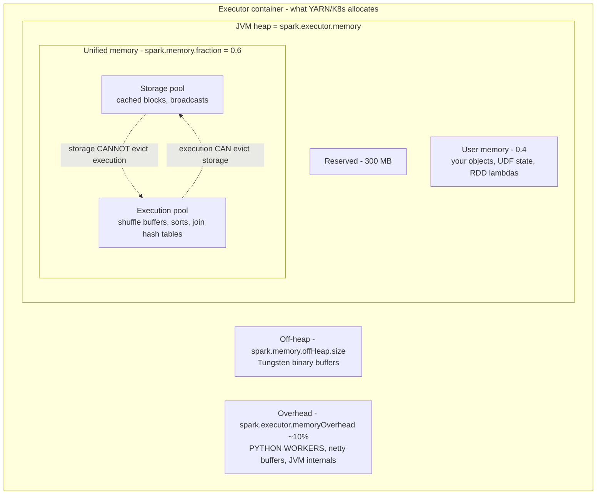

**Execution can evict storage, but not the reverse.** A cache may silently be dropped so a shuffle can complete, and the data is then recomputed — which is why cached DataFrames sometimes "lose" their cache under pressure.

**PySpark OOMs are usually `memoryOverhead`, not heap**, because the Python worker lives *outside* the JVM. This is one of the highest-value practical facts in the whole document.

**Sizing heuristic**: prefer several medium executors (4–5 cores, 20–30 GB) over one fat executor or many tiny ones.
- Too many cores per executor: HDFS/S3 client throughput plateaus above ~5 concurrent tasks, and huge heaps have ugly GC.
- Too few: broadcast variables are copied per executor, and overhead is paid per executor.

### Caching and checkpointing

| | `cache()` / `persist()` | `checkpoint()` |
|---|---|---|
| Where | executor memory / local disk | reliable storage (HDFS/S3) |
| Lineage | **preserved** — can recompute on loss | **truncated** — the DAG is cut |
| Survives executor loss | no (recompute) | yes |
| Use for | reusing a DataFrame several times | long iterative loops where the plan itself grows unboundedly |

Storage levels: `MEMORY_ONLY` (recompute on miss), `MEMORY_AND_DISK` (= `cache()` for DataFrames), `*_SER` (serialized: smaller, more CPU), `DISK_ONLY`, `*_2` (replicated). **Only cache what is used more than once**, and `unpersist()` when done — stale caches steal execution memory.

---

## 6. Structured Streaming

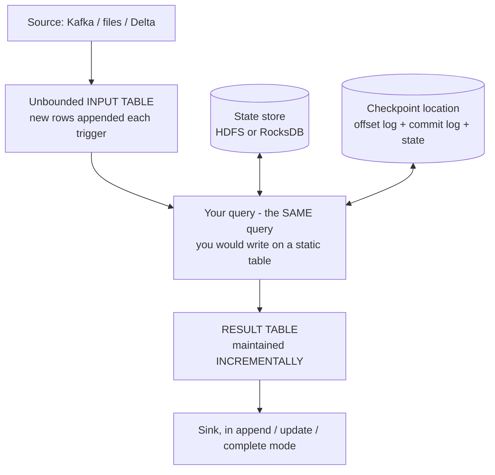

The core idea: **a stream is an unbounded table**, and your streaming query is the same query you'd write on a static one. Spark maintains the result incrementally.

### Execution modes

| Mode | Latency | Notes |
|---|---|---|
| Micro-batch (default) | ~100 ms – seconds | the workhorse; each trigger is a small batch job |
| `Trigger.AvailableNow` | batch | process everything available, then stop (replaces `once`) — great for cheap scheduled incremental loads |
| Continuous processing | ~1 ms | long-experimental, very limited operator support |
| **Real-Time Mode (RTM)**, Spark 4.1 | sub-second; single-digit ms for stateless | long-running tasks processing records continuously |

**RTM is the serious answer to "Spark can't do low latency."** Mention it *with* the caveat that operator coverage is narrower than micro-batch.

### Event time and watermarks

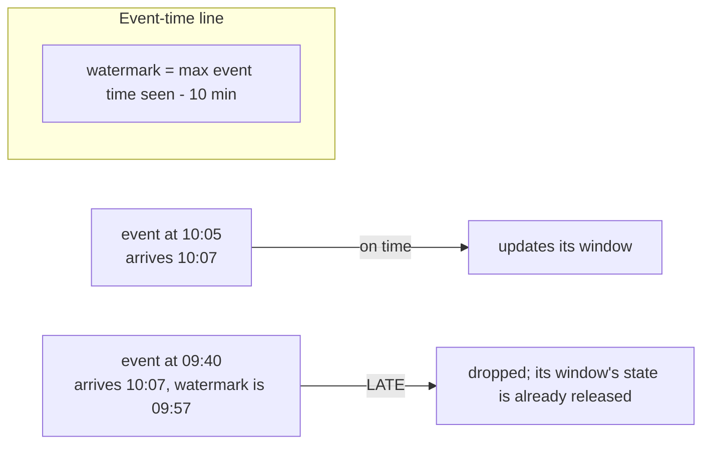

```python
(df.withWatermark("event_time", "10 minutes")
   .groupBy(window("event_time", "5 minutes"), "symbol")
   .agg(avg("price")))
```

A watermark is a promise: *"I will not accept events older than (max observed event time − threshold)."* Its job is to **bound state** — once a window falls behind the watermark, its state is dropped. The dial is **latency vs completeness**: short threshold = fast results, more dropped late data.

Output modes:

| Mode | Emits | Requires |
|---|---|---|
| **Append** | only finalized rows | a watermark for aggregations; the only mode most file sinks support |
| **Update** | rows that changed this trigger | — |
| **Complete** | the whole result table every trigger | state grows forever; only for small aggregations |

Stateful operators: aggregations, `dropDuplicates`, stream–stream joins (both sides need watermarks *and* a time constraint, or state grows without bound), and arbitrary state via `flatMapGroupsWithState` / **`transformWithState`** (the newer 4.x API with composable state variables, TTL, and timers).

### Fault tolerance

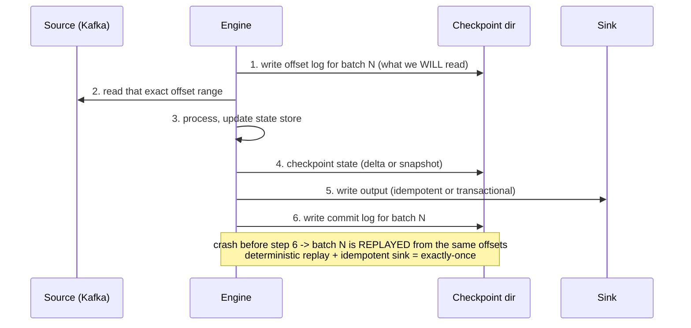

The guarantee is **exactly-once end-to-end**, *provided* the source is replayable (Kafka, files) and the sink is idempotent or transactional (Delta, or `foreachBatch` with an upsert). Same caveat as Kafka: **the sink is where the guarantee is won or lost.**

State store: HDFS-backed by default; **use the RocksDB state store for anything non-trivial** — it keeps state off the JVM heap and avoids the GC cliff. Changelog checkpointing makes RocksDB checkpoints incremental rather than full snapshots.

---

## 7. What's new in Spark 4.x

**Spark 4.0**
- **ANSI SQL mode is the default** (`spark.sql.ansi.enabled=true`). Divide-by-zero, numeric overflow, and invalid casts now **raise errors instead of returning NULL**. This is the biggest 3.x→4.x migration hazard: pipelines that "worked" by silently producing nulls now fail. Say this when asked about upgrading.
- **VARIANT type** for semi-structured data — an open binary encoding of JSON that keeps types and allows efficient nested-field access, ~8× faster than parsing JSON strings. GA in 4.1.
- **Spark Connect at parity**, plus Go/Rust/Swift clients.
- **Collations** (case/accent-insensitive comparison as a type property), SQL `PIPE` syntax, SQL UDFs, session variables, structured error classes.
- **Python data source API** — write a custom source or sink in pure Python.

**Spark 4.1 (Dec 2025)**
- **Spark Declarative Pipelines (SDP)** — declare datasets and the queries that produce them; Spark derives the dependency graph, ordering, parallelism, checkpointing, and retries. Python and SQL authoring (Scala later). Essentially open-source DLT, and a strong "where is Spark going" answer.
- **Real-Time Mode** for Structured Streaming.
- **SQL scripting** (control flow inside SQL), VARIANT GA, continued heavy Python investment.

---

## 8. PySpark specifics

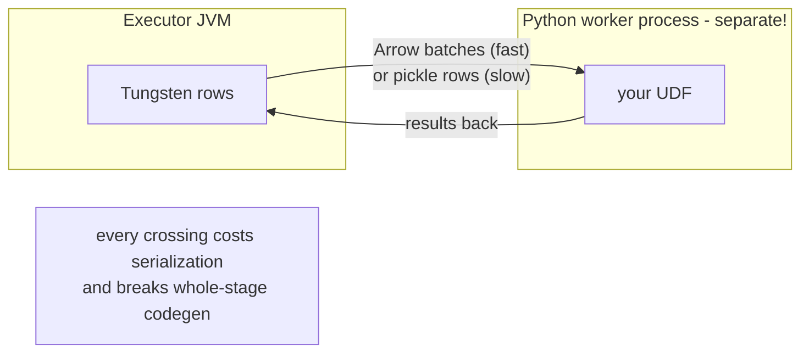

- Preference order: **built-in SQL functions > pandas/Arrow UDFs (vectorized, batch-at-a-time) > Python UDFs (row-at-a-time) > RDD `map`**.
- `spark.sql.execution.arrow.pyspark.enabled=true` for `toPandas()` and pandas UDFs.
- **Pandas API on Spark** (`import pyspark.pandas as ps`) — pandas syntax, Spark execution. Good for migrating pandas code; watch out for operations requiring a global order, which force everything into one partition.

---

## 9. Debugging checklist

1. **Spark UI → Stages**: which stage is slow? Look at the task duration **distribution** (min / 25th / median / 75th / max). Max ≫ median ⇒ skew.
2. **Shuffle read/write bytes** — the cost centre. Can you filter earlier, broadcast, or pre-partition?
3. **Spill (memory / disk)** — non-zero spill means execution memory is too small for the partition size. More partitions, or more memory.
4. **GC time** per task — >10 % of task time means heap pressure; try serialized caching, smaller executors, or off-heap.
5. **`df.explain("formatted")`** — confirm the join strategy, look for `PushedFilters:` and `PartitionFilters:`.
6. **Input size per task** — target ~100–200 MB. Thousands of tiny tasks = scheduler overhead; a handful of giant ones = no parallelism.
7. **Number of output files** — a common downstream complaint; `repartition`/`coalesce` before write, or let AQE do it.

---

## 10. Quant / finance angle

- **As-of / time-series joins** (match each trade to the most recent quote) have no native operator. The patterns: a window function with `last(..., ignoreNulls=True)` over the union of both streams ordered by time, or a range join with an explicit `BETWEEN` plus a range-join hint. **Very likely question given your track** — be able to write both.
- **Layout for market data**: partition by date (and maybe exchange), *not* by symbol — symbol partitioning makes thousands of tiny files. Then **sort by symbol within the file** so Parquet row-group min/max statistics can prune. Layout beats tuning.
- **Small files**: streaming ingest produces one file per partition per trigger. Compact regularly (Delta `OPTIMIZE`, Iceberg rewrite, or a periodic job).
- **Window functions** over `partitionBy("symbol").orderBy("ts")` are the bread and butter — rolling volatility, VWAP, returns. Note each partition key lands in one task, so a hot symbol is a skew source.
- **Determinism and money**: ANSI mode plus explicit `DECIMAL` types matter. Floating-point sums are non-deterministic under repartitioning, which makes results irreproducible run to run — a genuine correctness issue in finance, not a nitpick.

---

## 11. Rapid-fire answers

**Narrow vs wide transformation?** Narrow: each output partition depends on one input partition; pipelined within a stage. Wide: requires a shuffle, cuts a stage boundary, writes to local disk and moves data across the network.

**Why is my job slow when average task time looks fine?** Skew. Compare max vs median task duration. Fix with AQE skew join, broadcast, or salting.

**`repartition` vs `coalesce`?** `repartition(n)` does a full shuffle, can increase or decrease, and balances data. `coalesce(n)` merges partitions with no full shuffle — cheap, decrease only — but it **pushes the lower partition count up into the previous stage**, reducing upstream parallelism. When that matters, use `repartition`.

**When does `cache()` hurt?** When the data is used once (pure overhead), when it evicts execution memory and causes spill, or when the cached plan hides a cheaper re-read with better pushdown.

**Why are Python UDFs slow, and what's the fix?** They serialize rows to a separate Python process and break whole-stage codegen. Use built-ins, or Arrow-based pandas UDFs that work on batches.

**Executor OOM in PySpark but the heap looks fine?** The Python worker lives outside the JVM heap — raise `spark.executor.memoryOverhead`.

**Biggest hazard upgrading 3.x → 4.0?** ANSI mode on by default: overflow, invalid casts and divide-by-zero now raise instead of yielding NULL.

**How does Spark achieve fault tolerance?** Lineage: it records how each partition was derived and recomputes lost partitions from their parents, rather than replicating intermediate results the way MapReduce did. Long lineages should be `checkpoint()`ed.

**RDD vs DataFrame vs Dataset?** RDD: opaque lambdas, no optimizer, full control. DataFrame: `Dataset[Row]`, declarative, Catalyst + Tungsten apply — the default. Dataset: typed JVM objects with compile-time safety, but encoders add cost and it's Scala/Java only.

---

## 12. Sources

- [Introducing Apache Spark 4.0 (Databricks)](https://www.databricks.com/blog/introducing-apache-spark-40)
- [Spark Release 4.1.0](https://spark.apache.org/releases/spark-release-4.1.0.html)
- [Spark Declarative Pipelines in Apache Spark 4.1](https://dataverses.io/resources/blog/spark-declarative-pipeline)
