# Apache Flink — Deep Dive

> **Mental model.** Flink is a **stateful dataflow engine**: records flow through a graph of operators, each holding local, checkpointed state. Batch is just a bounded stream. Everything distinctive — millisecond latency, exactly-once, event-time correctness, huge stateful joins — follows from one decision: **state is a first-class, fault-tolerant thing that the engine owns.**

---

## 1. Architecture

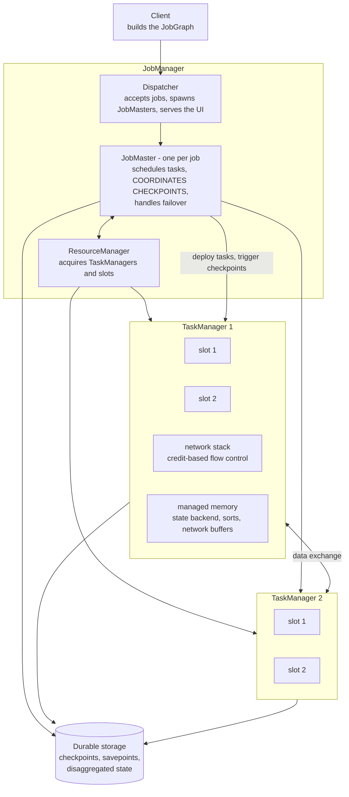

### Slots, chaining, and parallelism

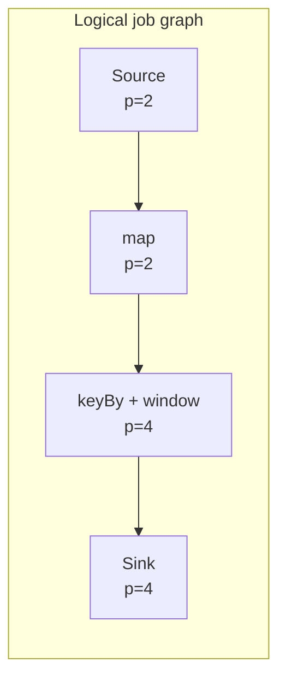
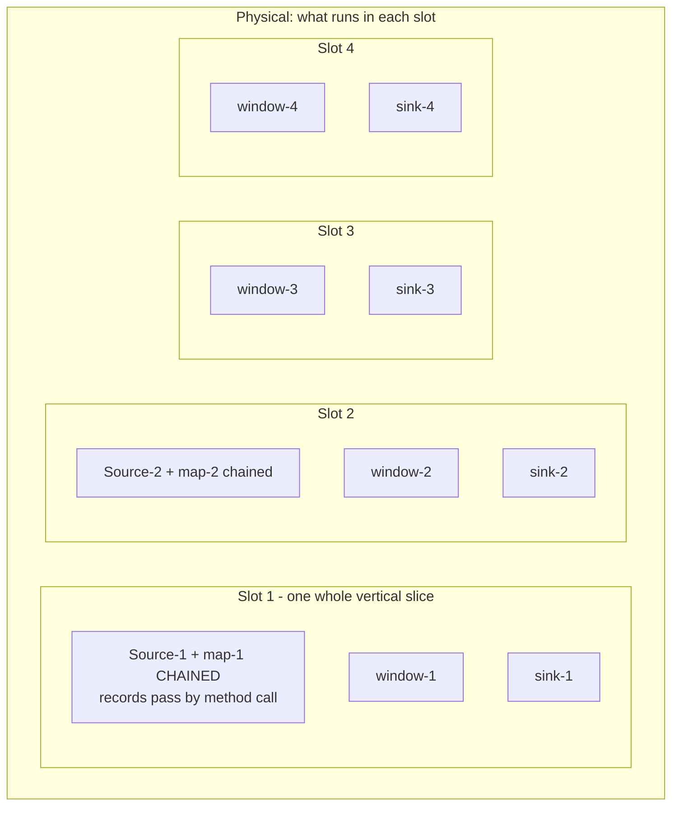

- **The task slot, not the core, is the unit of scheduling.** `#TaskManagers × #slots` = max parallelism.
- **Slot sharing** (default): one slot runs one subtask *of each operator* in the pipeline, so a slot holds a vertical slice of the whole job. This keeps resource usage even and makes "parallelism = number of slots" work.
- **Operator chaining**: adjacent operators with the same parallelism and a forward connection are fused into one task, so records move by method call rather than serialization. A large win; `disableChaining()` when you need per-operator metrics for profiling.

**Deployment modes**: *Application mode* (one cluster per job, your `main()` runs on the JobManager — the production default), *Session mode* (shared cluster, many jobs, cheaper for small jobs but one bad job can hurt neighbours), per-job mode (deprecated).

---

## 2. Time semantics — Flink's signature strength

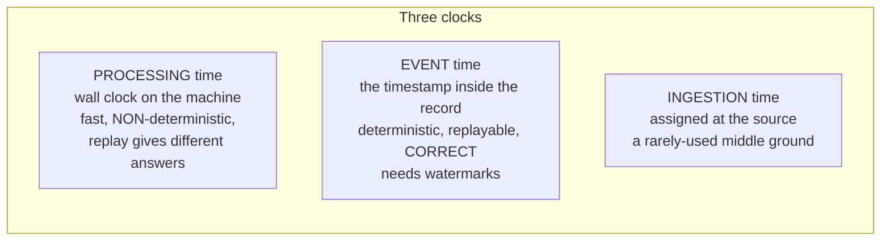

**Event time is the default choice** because it makes a replay of the same input produce the same output — which is the basis of backtest/production parity, reprocessing after a bug, and any regulatory reproducibility claim.

### Watermarks

A watermark `W(t)` flowing through the stream asserts: *no more events with timestamp ≤ t are expected.* It is a **heuristic**, not a guarantee.

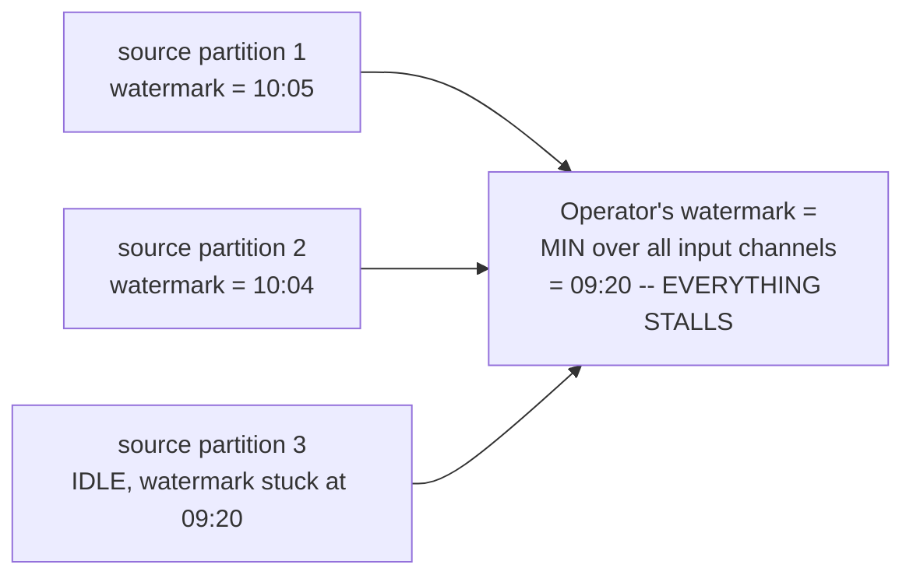

**This diagram is the single most valuable thing in the document.** An operator's watermark is the **minimum across its inputs**, so one idle or lagging partition freezes the entire job's event-time clock, and windows never fire. It is *the* most common "my Flink job produces no output" cause.

```java
WatermarkStrategy
  .<Trade>forBoundedOutOfOrderness(Duration.ofSeconds(5))
  .withTimestampAssigner((e, ts) -> e.getExchangeTimestamp())
  .withIdleness(Duration.ofMinutes(1))             // exclude quiet partitions
  .withWatermarkAlignment("group", Duration.ofSeconds(30));  // throttle sources that race ahead
```

| Mechanism | Fixes |
|---|---|
| `withIdleness` | a quiet partition holding back the global watermark |
| `withWatermarkAlignment` | one partition racing far ahead during a backfill, blowing up state |
| `allowedLateness` | keep window state a bit longer and re-fire on late arrivals |
| side output for late data | **route late events somewhere instead of dropping them** — mandatory in finance |

**The tradeoff to articulate**: watermark lag is a **latency vs completeness dial**. Short lag = fast results, more late data. Long lag = correct results, more state, more delay.

---

## 3. State

### Types

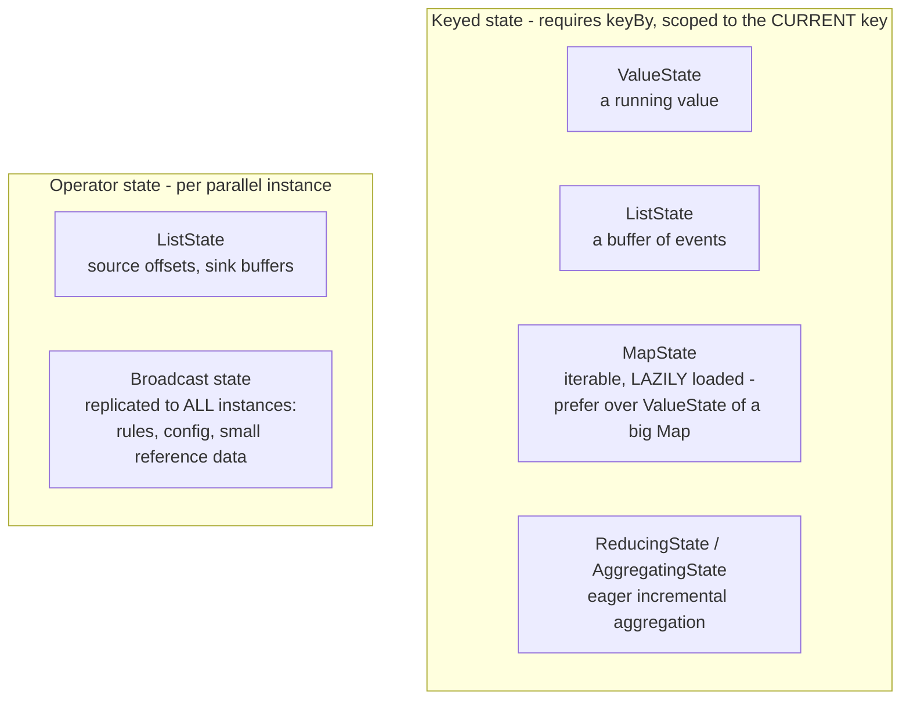

**Why `MapState` over `ValueState<Map<K,V>>`**: with RocksDB, a `ValueState` holding a map must deserialize *the entire map* on every access and reserialize it on every write. `MapState` stores each entry as its own key, so you read and write one entry. On a large per-key map this is the difference between a working job and a dead one — a great concrete answer.

### Key groups and `maxParallelism`

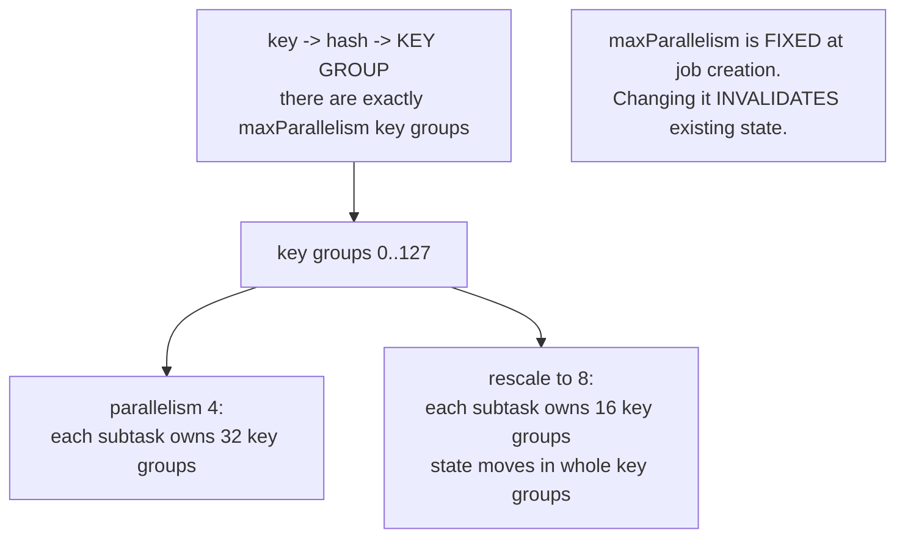

Key groups are the unit of state redistribution, which is what makes rescaling possible at all. Set `maxParallelism` deliberately and generously at job creation — you can never change it without discarding state.

**State TTL is mandatory hygiene** for any unbounded key space (user ids, session ids, order ids). Without it, state grows until the job dies. This is the most common cause of a Flink job that runs fine for three weeks and then falls over.

### State backends

| Backend | Where state lives | Access cost | State size limit |
|---|---|---|---|
| **HashMapStateBackend** | objects on the JVM heap | fastest (no serialization) | heap size; GC-sensitive |
| **EmbeddedRocksDBStateBackend** | on-disk LSM tree, serialized | serialize/deserialize per access | local disk; supports TB |
| **ForSt (Flink 2.0)** | **DFS primary, local disk as cache** | async, remote-aware | effectively unbounded |

### Disaggregated state and ForSt — the Flink 2.0 headline

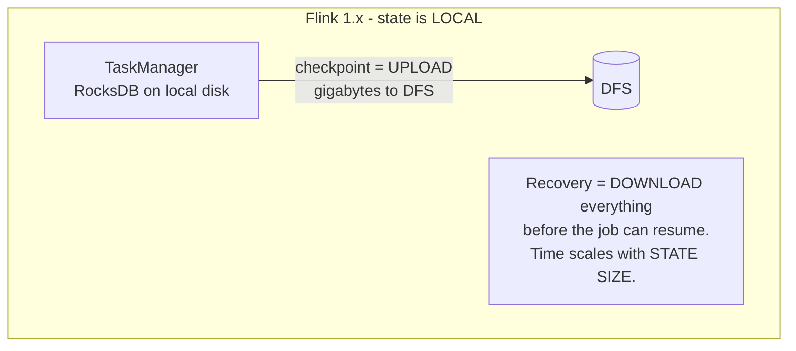
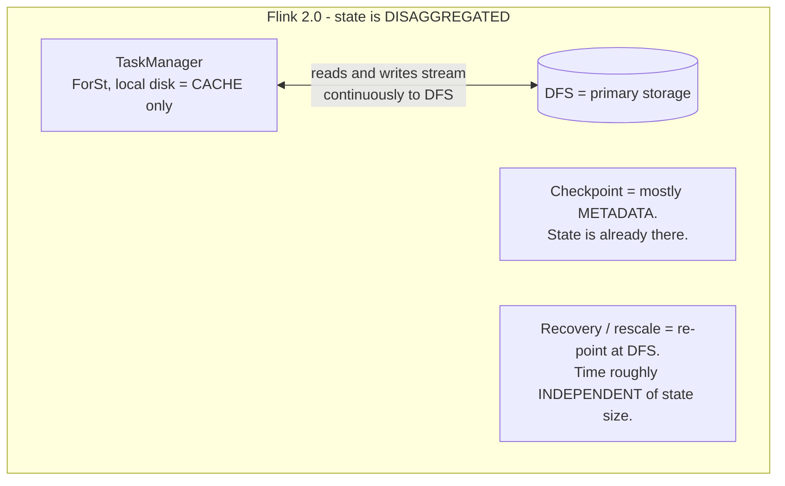

What it buys:
- **State size no longer bounded by local disk.**
- **Lightweight checkpoints** — largely a metadata operation instead of a multi-GB upload, so you can checkpoint more often, which lowers end-to-end latency for 2PC sinks.
- **Fast recovery and rescaling, roughly independent of state size** — no terabyte download before the job resumes.
- Requires the **async state access APIs** to hide remote I/O latency; a synchronous remote read would serialize the pipeline.

This is the best "what's new in Flink" answer, and it's the same architectural move — separating compute from storage — that reshaped data warehouses and that Kafka made with tiered storage. Being able to point out that pattern across three systems is exactly the kind of synthesis senior interviews look for.

---

## 4. Checkpoints and exactly-once

### Chandy–Lamport, adapted

```mermaid
sequenceDiagram
    participant JM as JobManager (checkpoint coordinator)
    participant SRC as Source
    participant OP as Stateful operator (2 inputs)
    participant SNK as Sink
    participant DFS as Durable store

    JM->>SRC: trigger checkpoint n
    SRC->>SRC: snapshot offsets
    SRC->>OP: BARRIER n injected into the stream
    Note over OP: input A's barrier arrived; input B's has not.<br/>ALIGNMENT: buffer input A until B's barrier arrives.
    OP->>OP: both barriers in -> snapshot state ASYNCHRONOUSLY
    OP->>DFS: write state
    OP->>SNK: forward barrier n
    SNK->>DFS: pre-commit (transaction open)
    SNK-->>JM: ack
    JM->>JM: all tasks acked -> checkpoint n COMPLETE
    JM->>SNK: notifyCheckpointComplete
    SNK->>SNK: COMMIT the transaction - data now visible downstream
```

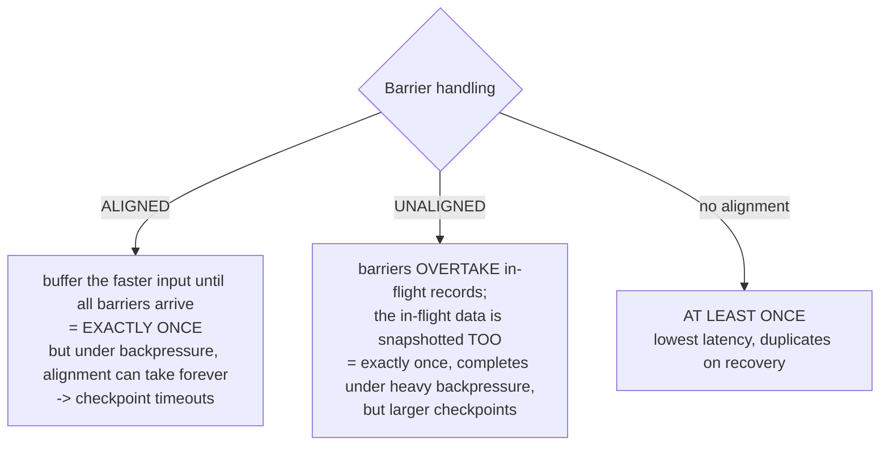

> **"My checkpoints time out under load" → enable unaligned checkpoints.** That's a crisp, correct, experienced-sounding answer, and you should follow it with "…and then fix the actual backpressure source, because unaligned checkpointing treats the symptom."

**Recovery**: the whole job restarts from the last completed checkpoint; sources rewind (Kafka offsets are part of the checkpoint) and state is restored. So "exactly-once" means **effect-once on state**, not "each record is read from Kafka once."

**End-to-end exactly-once** needs a **two-phase-commit sink**: pre-commit on checkpoint, commit on `notifyCheckpointComplete`. The Kafka sink implements this with Kafka transactions. The consequence people forget: **downstream visibility latency becomes your checkpoint interval**, which is why production jobs run 10–60 s checkpoints rather than 5-minute ones.

### Checkpoints vs savepoints

| | Checkpoint | Savepoint |
|---|---|---|
| Triggered by | Flink, periodically | you, explicitly |
| Purpose | automatic fault recovery | upgrades, migrations, forking, A/B |
| Format | backend-native, possibly incremental | canonical, portable across versions and backends |
| Lifecycle | deleted on cancel (unless retained) | persists until you delete it |

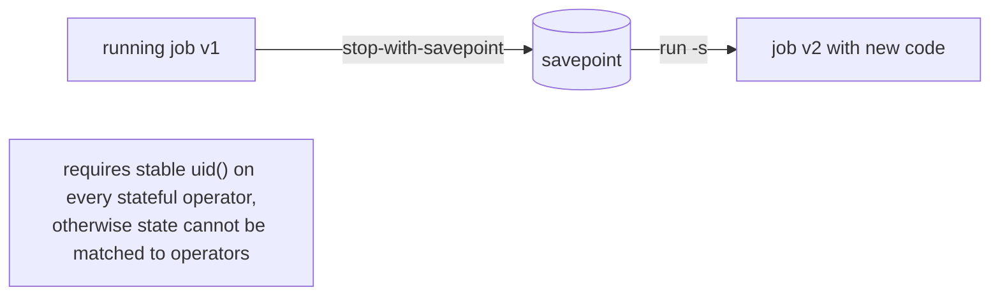

**Set `uid()` on every stateful operator.** Without it, Flink derives operator IDs from the job graph's structure, so adding an operator shifts the IDs and state can no longer be restored. **This is the #1 Flink operational mistake** — volunteer it unprompted.

---

## 5. Windows

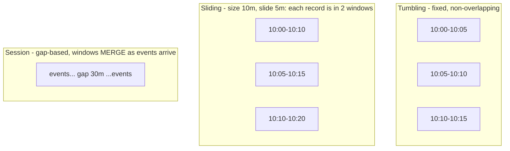

**A record lands in `size / slide` windows**, so a 1-hour window sliding every 1 minute puts every record in 60 windows — state multiplies 60×. That arithmetic is a favourite interview trap.

The anatomy of a window:

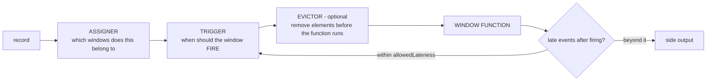

**Incremental vs buffering**: `reduce`/`aggregate` keep **one accumulator per window**; `process`/`apply` buffer **every record**. On a high-volume stream that's the difference between megabytes and terabytes of state. Use `aggregate(AggFn, ProcessWindowFunction)` when you need incremental aggregation *and* window metadata.

### ProcessFunction — the escape hatch

`KeyedProcessFunction` gives raw access to records, keyed state, **timers** (event-time and processing-time), and side outputs. Any window or pattern can be hand-built here. **When an interview asks "how would you implement X in Flink" and X isn't a standard window, the answer is almost always a `KeyedProcessFunction` with a registered timer.**

---

## 6. Flink SQL and the Table API

Flink SQL is not a bolt-on; it's the primary interface for most teams now.

### Dynamic tables and changelogs

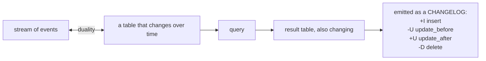

Whether a query is **append-only** or produces **retractions** determines which sinks you can use. A `GROUP BY` without a window emits retractions — a plain Kafka sink cannot express "un-emit that row," so you need `upsert-kafka` with a primary key. **This append-vs-retract distinction is the thing that most confuses people coming to Flink SQL from batch SQL**, and knowing it signals real experience.

### Join types

| Join | Semantics | State |
|---|---|---|
| **Regular join** | full stream-to-stream, any row can match any row | **unbounded — both sides retained forever.** Needs TTL or it dies |
| **Interval join** | `a.ts BETWEEN b.ts - 5 MIN AND b.ts` | bounded by the interval |
| **Temporal join** | join against the version of a dimension table **as of the event's time** | bounded by versioning |
| **Lookup join** | call an external store per record (JDBC/HBase/Redis) | none in Flink; cache + async recommended |

**Temporal joins are the important one for finance**: enrich a trade with the reference price *that was effective at trade time*, not the current one. That's how you avoid lookahead bias, and it's a much better answer than a naive join.

### Recent SQL/AI additions (2.1, 2.2)

- **`CREATE MODEL` + `ML_PREDICT`** — model inference as a table-valued function inside a streaming SQL query, so real-time scoring happens in the stream rather than via a separate serving hop.
- **`VECTOR_SEARCH`** — streaming vector similarity search / real-time context retrieval in SQL.
- **Process Table Functions (PTFs)** — UDFs with access to managed state, event time, timers, and changelogs; the most powerful UDF type Flink has had.
- **VARIANT** type for semi-structured data (the same idea as Spark's).
- **DeltaJoin / MultiJoin** — join strategies that avoid materializing full state on both sides, aimed squarely at the "my multi-way streaming join has terabytes of state" problem.
- **Materialized tables** — declare a table plus a freshness requirement; Flink chooses batch or streaming refresh.

---

## 7. Backpressure and performance

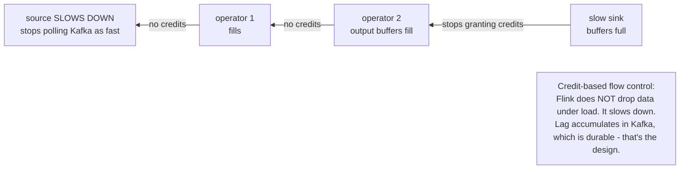

**Diagnosing**: the web UI's backpressure tab shows per-task busy/backpressured ratios. Find the **first** backpressured task going downstream — that's the bottleneck. Everything upstream of it is backpressured *as a consequence*, and "fixing" those does nothing.

| Cause | Fix |
|---|---|
| Synchronous external lookup | **Async I/O** (`AsyncDataStream.unorderedWait`) — hundreds of requests in flight instead of one |
| Slow sink | batch writes, increase sink parallelism, check the external system |
| Skew on `keyBy` | two-phase aggregation: pre-aggregate on a salted key, then combine |
| Expensive serialization | use POJOs/Avro with Flink's own serializers; **a silent fallback to Kryo is a large, invisible performance loss** — grep the logs for "must be processed as GenericType" |
| RocksDB on a slow disk | local SSD, tune block cache and write buffers, or move to disaggregated state |

Latency/throughput dials: `setBufferTimeout(0)` flushes network buffers immediately (lowest latency, worst throughput); the default 100 ms batches them. Checkpoint interval and `minPauseBetweenCheckpoints` trade recovery time against overhead.

---

## 8. Flink 2.x in one paragraph

Flink 2.0 (March 2025) was the first major release in eight years: **disaggregated state with the ForSt backend and async state APIs**; removal of long-deprecated APIs (the DataSet API is gone, the Scala API is gone, `SourceFunction`/`SinkFunction` replaced by the unified Source/Sink interfaces); a reworked configuration system; **adaptive batch execution**; materialized tables; and deep **Apache Paimon** integration for the *streaming lakehouse* — one table serving both streaming reads and batch analytics. 2.1 (July 2025) and 2.2 (Dec 2025) layered real-time AI on top: `ML_PREDICT`, `VECTOR_SEARCH`, PTFs, VARIANT, delta joins, balanced task scheduling and better PyFlink.

---

## 9. Quant / finance angle

- **Natural fit**: fraud and anomaly detection, real-time risk and exposure, order-flow analytics, market-data enrichment — anywhere per-event latency plus stateful pattern matching matter.
- **CEP library**: `Pattern.begin("a").next("b").within(...)` for sequence detection — spoofing/layering patterns, wash-trade candidates, N failed logins. Compiles to an NFA over keyed state.
- **Temporal joins** for as-of pricing, avoiding lookahead bias.
- **Event time from exchange timestamps**, with out-of-orderness sized to the venue's observed jitter, and late data to a **side output** for reconciliation rather than dropped.
- **Replay determinism**: the same job over the same Kafka history yields the same result under event time — the basis for backtest/production parity and for regulatory reproducibility.

---

## 10. Rapid-fire answers

**Why isn't my window firing?** The watermark isn't advancing — usually one idle or lagging input partition, since an operator's watermark is the minimum across its inputs. Check `withIdleness`, and confirm timestamps are actually assigned.

**Checkpoint vs savepoint?** Checkpoints: Flink-managed, periodic, backend-native, for automatic recovery. Savepoints: user-triggered, portable, for upgrades and migrations.

**Checkpoints time out under load — what do you do?** Enable unaligned checkpoints so barriers overtake in-flight data; raise the interval and min-pause; then fix the real backpressure source; consider incremental RocksDB checkpoints or disaggregated state.

**How does Flink do exactly-once?** Barrier-aligned distributed snapshots (Chandy–Lamport) for internal state, plus a two-phase-commit sink — pre-commit on checkpoint, commit on checkpoint-complete — to extend the guarantee outside.

**How do you bound state growth?** State TTL, watermarks that close windows, interval/temporal joins instead of regular ones, and key-space hygiene. Monitor state size as a first-class metric.

**How do you deploy a new version of a stateful job?** `stop-with-savepoint`, deploy, restore from savepoint. Requires stable `uid()`s and an unchanged `maxParallelism`.

**Why `MapState` instead of `ValueState<Map>`?** With RocksDB, a `ValueState` holding a map deserializes the entire map on every access; `MapState` stores each entry separately and loads lazily.

**Flink vs Kafka Streams?** Kafka Streams is a library inside your app, Kafka-only, deployed like any microservice, scaled by adding instances. Flink is a cluster with its own resource management, many connectors, richer time/state/window semantics, and much better very-large-state support. Kafka Streams for a Kafka-to-Kafka microservice; Flink for a platform.

**What does `keyBy` actually do?** Hashes the key into one of `maxParallelism` key groups, and routes the record (over the network) to the subtask owning that key group. It's a shuffle, and it's what makes keyed state possible.

---

## 11. Sources

- [Apache Flink 2.0.0 — a new era of real-time data processing](https://flink.apache.org/2025/03/24/apache-flink-2.0.0-a-new-era-of-real-time-data-processing/)
- [Disaggregated State Management in Apache Flink 2.0 (VLDB)](https://www.vldb.org/pvldb/vol18/p4846-mei.pdf)
- [Disaggregated state — Flink docs](https://nightlies.apache.org/flink/flink-docs-stable/docs/ops/state/disaggregated_state/)
- [Apache Flink 2.1.0 release announcement](https://flink.apache.org/2025/07/31/apache-flink-2.1.0-ushers-in-a-new-era-of-unified-real-time-data--ai-with-comprehensive-upgrades/)
- [Apache Flink 2.2.0 release announcement](https://flink.apache.org/2025/12/04/apache-flink-2.2.0-advancing-real-time-data--ai-and-empowering-stream-processing-for-the-ai-era/)
