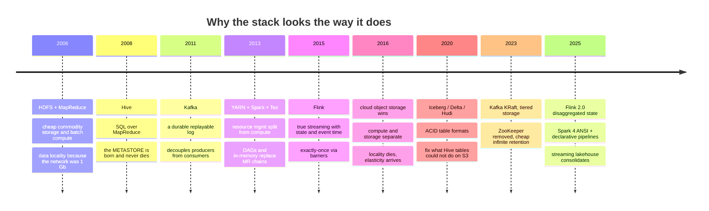
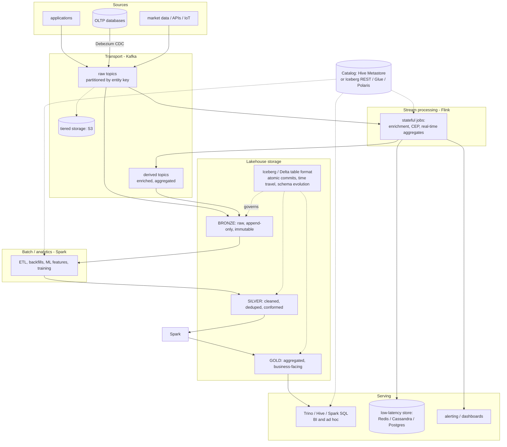
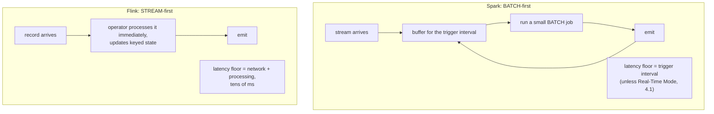
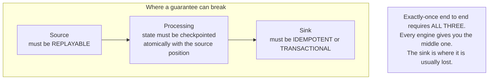
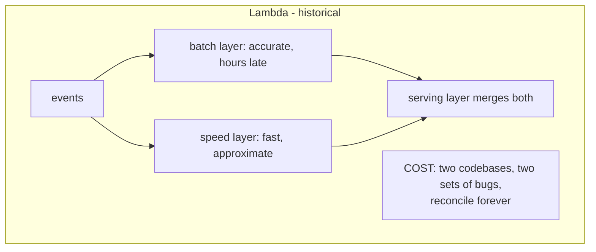
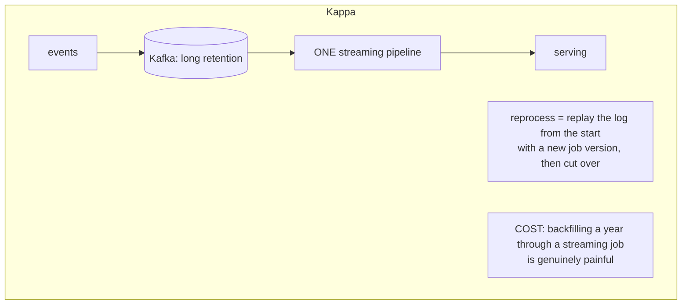
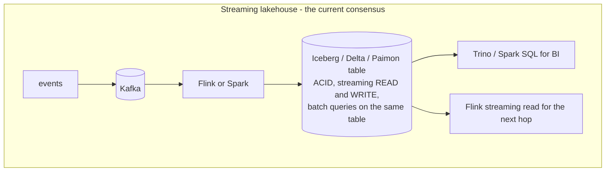
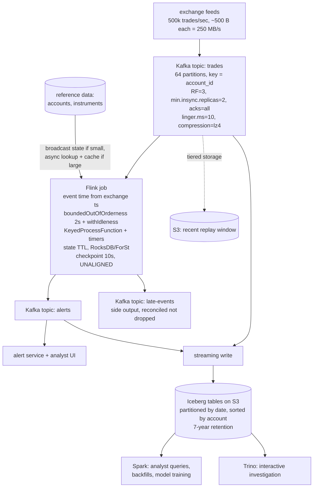

# Putting It Together — Architecture, Comparison, Interview Q&A

---

## 1. The whole stack, and how it evolved

**The two forces that explain almost every change**: (1) the network stopped being the bottleneck, so data locality stopped mattering and compute/storage separated; (2) object storage has no atomic rename, so every "table" abstraction built on directory renames had to be rebuilt around atomic metadata pointers.

### The reference architecture today

| Layer | Role | Who plays it |
|---|---|---|
| Transport | durable, replayable decoupling buffer | **Kafka** |
| Low-latency compute | stateful, event-at-a-time | **Flink** |
| Batch compute | large ETL, backfills, ML | **Spark** |
| Storage | cheap, durable bytes | S3/GCS (was **HDFS**) |
| Table format | ACID, schema, time travel | **Iceberg / Delta** (was Hive tables) |
| Catalog | table → files + schema | **Hive Metastore** / Iceberg REST |
| Resource mgmt | who gets which machine | **Kubernetes** (was **YARN**) |
| SQL serving | interactive queries | **Trino / Hive / Spark SQL** |

**They are not competitors.** If asked "Kafka vs Spark," the right first move is to say they occupy different layers, then answer the question you think they meant.

---

## 2. Spark vs Flink — the comparison that gets asked

| Dimension | Spark Structured Streaming | Flink |
|---|---|---|
| Core model | micro-batch over an unbounded table; batch-first | continuous dataflow; streaming-first, batch = bounded stream |
| Typical latency | 100 ms – seconds; **sub-second / single-digit ms with RTM (4.1)** | tens of ms natively |
| State | state store (HDFS / RocksDB), incremental checkpointing | first-class keyed state; **disaggregated state + ForSt (2.0)** |
| Checkpointing | per micro-batch: offset log + state | Chandy–Lamport barriers, async, aligned or unaligned |
| Event time | watermarks evaluated at micro-batch boundaries | watermarks as in-stream signals + per-key timers |
| Backpressure | adjusts batch size / rate limits | credit-based flow control propagating to the source |
| Windows | tumbling, sliding, session | + global windows, fully custom trigger/evictor, CEP |
| Batch | **excellent — the core use case** | good and improving; not why you pick Flink |
| SQL | mature, Catalyst, huge surface | mature, dynamic tables, temporal joins, changelog semantics |
| ML | MLlib + the whole Python ecosystem | `ML_PREDICT` / `VECTOR_SEARCH` for *inference*, not training |
| Ecosystem / hiring | much larger | smaller, growing fast |
| Sweet spot | large ETL, lakehouse, ML, "one engine for batch + streaming" | fraud detection, real-time risk, CEP, huge-state stream joins |

**How to answer "which would you choose?"** Start from requirements — latency SLA, state size, whether heavy batch is also needed, what the team already runs — then **commit to a recommendation**. "It depends" without a recommendation reads as evasion; a recommendation without stated assumptions reads as inexperience.

---

## 3. Delivery semantics — the unified view

| Guarantee | Kafka | Spark SS | Flink |
|---|---|---|---|
| At-most-once | `acks=0`, commit before processing | ignore checkpoints | disable checkpointing |
| At-least-once | `acks=all`, commit after processing | default with a replayable source | checkpointing + non-transactional sink |
| Exactly-once | idempotent producer + transactions (**inside Kafka only**) | replayable source + checkpoint + idempotent/transactional sink | barriers + 2PC sink |

**The sentence that wins this question**: *"Exactly-once in all three systems means exactly-once **effect on internal state**, not exactly-once delivery. Records are re-read on recovery. The guarantee only reaches the outside world if the sink is idempotent or transactional — so in practice I design idempotent sinks and treat transactions as an optimization, not a foundation."*

---

## 4. Reference patterns

**Medallion layout** — Bronze (raw, append-only, immutable) → Silver (cleaned, deduped, conformed) → Gold (aggregated, business-facing). Useful vocabulary; use it to give a design answer structure.

---

## 5. A worked system-design answer

> *"Design a real-time trade surveillance system: 500k trades/sec, detect suspicious patterns within 1 second, support 7-year historical investigation."*

### 5.1 Clarify first (out loud)
- Is the 1 s SLA p50 or p99? Assume **p99**.
- Is a missed alert or a false alert worse? Surveillance → **missing is worse**, so favour completeness and tolerate re-alerting.
- Retention: 7 years, regulatory, must be queryable.
- Is per-account ordering required? **Yes** — the patterns are sequence-based.

### 5.2 The design

### 5.3 The reasoning to say out loud

**Ingest.** 250 MB/s ÷ ~10 MB/s per partition ≈ 25 partitions minimum; take **64** for headroom and consumer parallelism. Key by `account_id` because the detection patterns are per-account sequences. **Acknowledge the skew**: high-volume accounts will create hot partitions — mitigate with a composite key for known hot accounts, and make the pattern logic order-tolerant for those.

**The SLA tension** (the point that makes this answer good): a 2 s watermark lag against a 1 s p99 SLA means **you cannot wait for windows to close**. So detection fires on arrival inside a `KeyedProcessFunction` with timers, emitting provisionally, and late events produce corrections via the side output — rather than a windowed aggregation that only emits after the watermark passes. Noticing that conflict, instead of drawing a window and moving on, is the difference between a good and a great answer.

**Flink, not Spark**, because of the latency SLA plus stateful sequence detection. State TTL is mandatory — accounts are unbounded over 7 years. Unaligned checkpoints because the load is bursty around market open.

**Serving and retention.** Kafka tiered storage gives a cheap recent replay window; Iceberg on S3 gives the 7-year archive with ACID commits and time travel — important because a regulator may ask "what did you know at time T," and snapshot rollback answers that directly.

**Reprocessing when a rule changes.** Replay from Kafka for recent data, or run the *same* Flink job in batch mode over Iceberg for historical — a bounded source, same code. Write to a new table version/branch and cut over, never in place.

### 5.4 Failure modes to name unprompted
Rebalance storms from slow processing; checkpoint timeouts under backpressure; unbounded state from a missing TTL; skew from a hot account; a hung Kafka transaction stalling `read_committed` readers; the small-files problem from streaming writes (schedule compaction); and watermark stall from an idle venue feed overnight.

> **That structure — clarify → ingest → process → serve → backfill → operate → failure modes — works for essentially any streaming design question.** Memorize the shape, not the example.

---

## 6. Cross-system patterns worth naming

These recur across every system here. Spotting them is what "systems thinking" looks like in an interview.

| Pattern | HDFS/Hadoop | Hive | Kafka | Spark | Flink |
|---|---|---|---|---|---|
| **Hot/cold tiering** | EC for cold, replication for hot | — | tiered storage to S3 | — | disaggregated state, local cache |
| **Separate compute from storage** | (it didn't — that's why it lost) | — | tiered storage | Spark Connect, S3 | ForSt / disaggregated state |
| **Handle skew by special-casing the hot key** | speculative execution (wrongly) | `hive.optimize.skewjoin` | custom partitioner | AQE skew join / salting | two-phase aggregation |
| **Avoid the shuffle by pre-partitioning** | — | bucketed SMB join | partition by key | broadcast join, bucketing | `keyBy` once, reuse |
| **Atomic commit without atomic rename** | — | ACID deltas + compaction | — | Delta/Iceberg commit | 2PC sink |
| **Small files hurt** | NameNode heap | too many partitions | too many partitions | one file per trigger | one file per checkpoint |
| **Bound your state** | — | compaction | retention / compaction | watermarks | TTL + watermarks |

---

## 7. Rapid-fire Q&A

### Hadoop / storage

**Why 128 MB blocks?** Amortize seek time against transfer time, and minimize NameNode metadata objects. A 128 MB block spends ~1 % of its time seeking.

**Why replica 2 on a different rack but replica 3 on the same rack as replica 2?** One cross-rack hop buys rack-failure tolerance; a second would consume scarce inter-rack bandwidth for little extra safety.

**The small files problem?** Two costs: NameNode heap (~150 B per file/block object, so millions of tiny files exhaust the master) and compute (one task per split means millions of tiny tasks where startup dominates). Fix with compaction, `CombineFileInputFormat`, larger streaming triggers, Iceberg/Delta `OPTIMIZE`.

**Erasure coding vs replication?** RS(6,3) costs 50 % overhead vs 200 % for 3× replication, tolerating 3 losses either way. But EC files are striped across nodes, so **locality and short-circuit reads are gone** and reconstruction is CPU- and network-expensive. Cold data only.

**HDFS vs S3?** S3 for elasticity and cost. Losing locality no longer matters much; the real problem is that **rename is a copy, not an atomic metadata op**, which breaks Hadoop's commit protocol — solved by table formats that commit via an atomic metadata pointer swap.

**Speculative execution — when does it hurt?** It fixes slow *machines*. It hurts when the straggler is caused by data skew (the duplicate is equally slow and you've doubled the cost) and it's dangerous for non-idempotent tasks with external side effects.

### Hive / tables

**What is the Metastore and why does it outlive Hive?** An RDBMS + Thrift service mapping `db.table` → schema, location, partitions, stats. It decoupled *what a table is* from *which engine reads it*, so Spark, Trino, Flink, Impala all share it.

**Partitioning vs bucketing?** Partitioning = directories on a low-cardinality column, enabling pruning (skip data entirely). Bucketing = hashing into a fixed number of files inside each partition, enabling shuffle-free joins and sampling. Partition by date, bucket by a high-cardinality join key. **Partitioning on high cardinality is the classic disaster** — millions of directories and metastore rows.

**Managed vs external?** `DROP TABLE` deletes the data for managed tables, metadata only for external. Hive 3+ defaults to managed *and* ACID, which surprises people migrating.

**How does Hive do UPDATE on an append-only filesystem?** It doesn't edit files. ACID v2 writes delta and delete-delta directories of row-ids; readers merge base + deltas against a valid-write-id list for snapshot isolation; compaction folds deltas into a new base. State lives in the Metastore, which is why only Hive can safely write those tables.

**Why Iceberg?** The file list is explicit metadata instead of a directory listing (fast and race-free on S3); commits are an atomic pointer swap (safe on S3 and under multi-engine concurrency); plus hidden partitioning, schema and partition evolution without rewrites, per-file stats, and time travel.

**Why is my Hive query suddenly slow?** Check column statistics first — with missing NDV the CBO guesses and picks a shuffle join where a map join would do.

### Kafka

**More consumers than partitions?** Extras idle — one partition per group member preserves ordering. Share groups (4.2+) relax this at the cost of ordering.

**`acks=all` — enough?** Not without `min.insync.replicas ≥ 2`; if ISR shrinks to the leader it degrades to `acks=1`.

**What's the high watermark for?** It's the highest offset on all ISR members; consumers can't read past it, so they never see a record that could disappear in a failover.

**What changed in 4.0?** ZooKeeper removed (KRaft only), KIP-848 rebalance protocol by default, share groups, old client protocols dropped.

**Why is Kafka fast?** Sequential I/O, page cache not heap, zero-copy `sendfile`, producer-side batching + compression.

### Spark

**Why faster than MapReduce?** In-memory pipelining between stages instead of replicated HDFS round trips, one DAG per job, long-lived executors, an optimizer, and optional rather than mandatory shuffle sort. Caveat: the 100× figure is for iterative workloads; single-pass ETL is 2–5×.

**Diagnosing a slow job?** Task duration distribution (max vs median) for skew; shuffle bytes for the cost centre; spill for memory pressure; `explain("formatted")` for the join strategy and pushdown.

**`repartition` vs `coalesce`?** Full shuffle and balanced vs cheap merge that reduces upstream parallelism.

**Biggest 4.0 upgrade hazard?** ANSI mode by default — nulls became errors.

**How is Spark fault tolerant?** Lineage — it recomputes lost partitions from their parents rather than replicating intermediates. Long lineages need `checkpoint()`.

### Flink

**Window not firing?** Watermark not advancing; it's the min across inputs, so one idle partition stalls everything. `withIdleness`.

**Checkpoint vs savepoint?** Automatic/native/recovery vs manual/portable/upgrades.

**Checkpoints timing out?** Unaligned checkpoints, then fix the real backpressure.

**Bounding state?** TTL, watermarks, interval/temporal joins instead of regular joins.

**Upgrading a stateful job?** `stop-with-savepoint` → deploy → restore. Stable `uid()`s, unchanged `maxParallelism`.

**What's new in 2.0?** Disaggregated state with ForSt: state in DFS with local cache, so size is unbounded, checkpoints are lightweight, and recovery time no longer scales with state size.

### Cross-cutting

**Kafka Streams vs Flink?** Library in your app, Kafka-only, deploy like a microservice — vs a cluster with richer time/state semantics, many connectors, and better huge-state support.

**Schema evolution?** Schema Registry with Avro/Protobuf, `BACKWARD` compatibility by default; add fields with defaults, never remove required fields; version topics only as a last resort.

**Reprocess a year of data after a bug?** Prefer replay — restart from an earlier offset with fresh state, writing to a new table version or topic, then cut over. If retention doesn't reach back far enough, run the same logic in batch over the lakehouse. Design for this by keeping the pipeline deterministic under event time.

**How do you choose between batch and streaming?** By the *decision latency* the business actually needs, not by what's fashionable. If nobody acts on the result until the next morning, a batch job is cheaper, simpler, easier to test, and easier to backfill. Streaming buys latency and costs operational complexity — pay for it when latency has value.

---

## 8. What signals seniority in these interviews

1. **Name the tradeoff before the answer** — latency vs completeness, durability vs throughput, cost vs recovery time, ordering vs parallelism.
2. **"Exactly-once means exactly-once effect, not exactly-once delivery"** — and then follow it all the way to the sink.
3. **Talk about failure modes and operations**, not just the happy path: rebalances, skew, backpressure, upgrades, state growth, compaction.
4. **Be actually current** — KRaft-only Kafka 4.x with share groups; Spark 4.x ANSI-by-default, Connect, VARIANT, declarative pipelines, Real-Time Mode; Flink 2.x disaggregated state and SQL/AI functions; Hive 4 on Iceberg. Describing the 2019 versions of these systems is an immediate tell.
5. **Notice the cross-system pattern** — tiering, compute/storage separation, hot-key special-casing, atomic metadata commits. It shows you understand principles rather than products.
6. **Give a recommendation** after stating your assumptions, instead of stopping at "it depends."
7. **Say what you'd measure.** Any answer that ends with "and I'd watch consumer lag per partition, checkpoint duration, and state size" lands better than one that ends with a design.
