# Apache Iceberg — the table format

> **Mental model.** A Hive table is *"whatever files happen to be in this directory."* An Iceberg table is **an immutable tree of metadata files whose root is swapped atomically.** Every capability — ACID, time travel, schema and partition evolution, fast planning on S3, safe multi-engine writes — falls out of that one change. Read [02-hive.md](02-hive.md) first if you haven't; Iceberg only makes sense as an answer to Hive's specific failures.

---

## 1. The problems it exists to solve

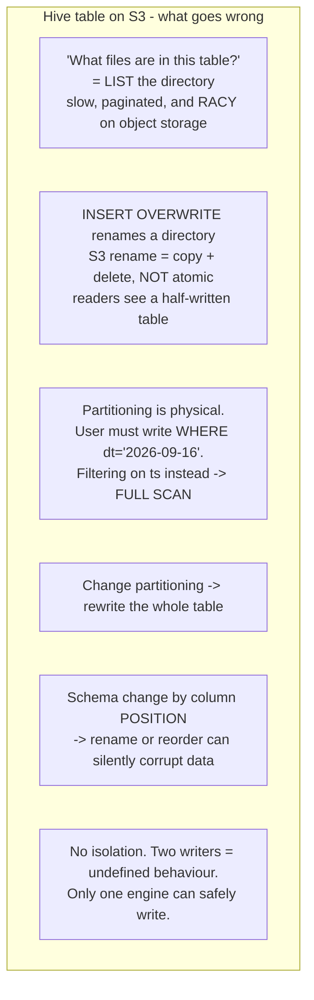

Every one of those is a direct consequence of "the table is a directory." Iceberg replaces the definition.

---

## 2. The metadata tree

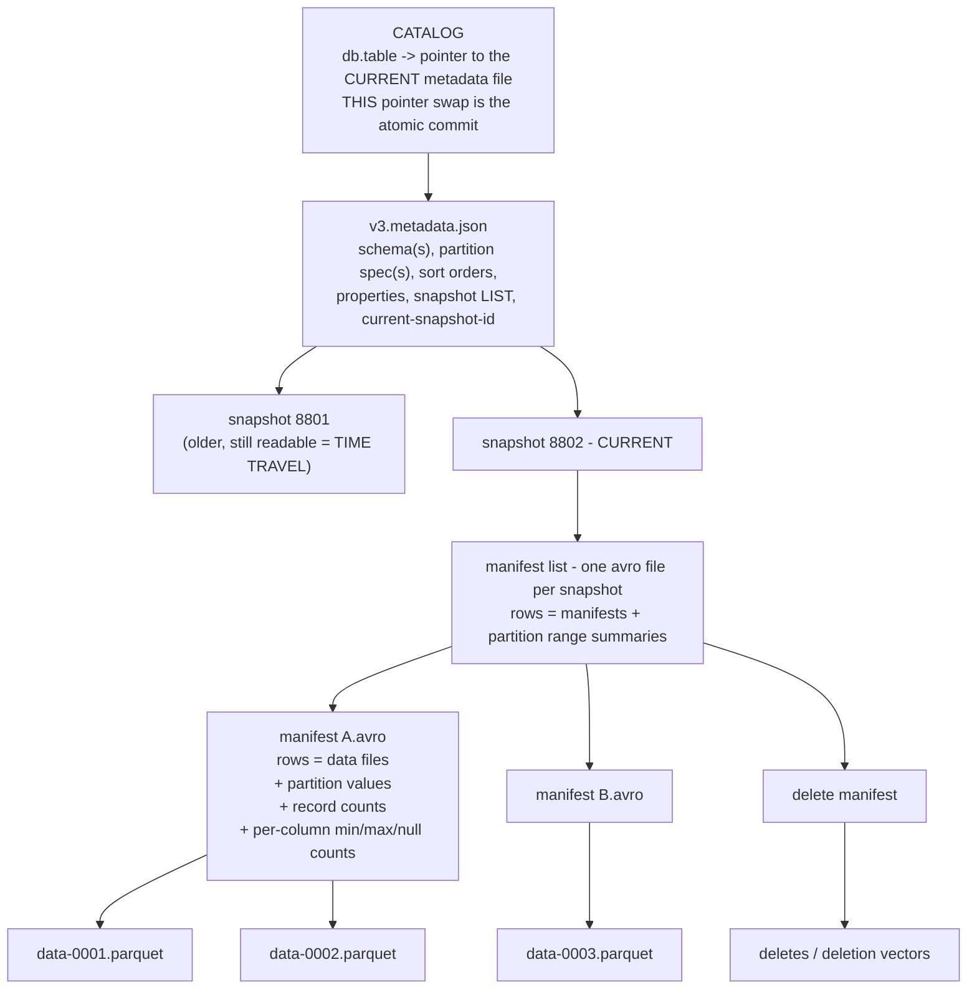

| Level | File | Holds | Why it exists |
|---|---|---|---|
| Catalog | (a pointer) | `db.table` → current metadata location | the **single atomic thing** in the whole design |
| Metadata | `*.metadata.json` | schemas, partition specs, snapshot history, properties | the table's identity over time |
| Manifest list | one Avro file per snapshot | which manifests, with partition min/max summaries | lets the planner skip whole manifests |
| Manifest | Avro | one row per data file + partition values + column stats | lets the planner skip whole files |
| Data | Parquet / ORC / Avro | the actual rows | |

**Query planning becomes a metadata read, not a directory listing.** Three levels of pruning happen before a single byte of data is touched:

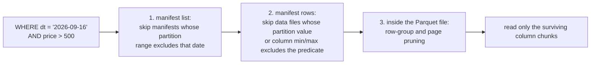

That's why Iceberg plans fast on object storage where Hive crawls: **O(read a few metadata files)** instead of **O(list millions of keys)**.

---

## 3. The commit protocol

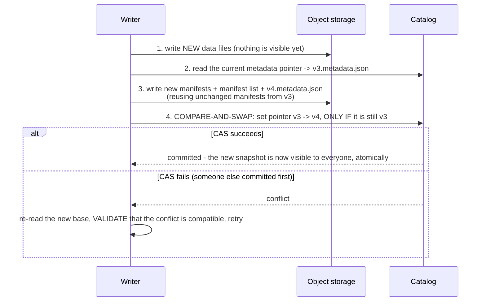

Three things to say about this:

1. **The commit is one atomic compare-and-swap on the catalog pointer.** Data files are written first and are invisible until the swap; a crashed writer leaves only orphaned files, never a corrupt table.
2. **Optimistic concurrency with validation.** Two concurrent appends to different partitions both succeed (one retries). An append and a conflicting overwrite on the same partition — one fails and is retried or rejected. `commit.retry.num-retries` governs this. Serializable and snapshot isolation levels are both available per operation.
3. **Everything is immutable and copy-on-write at the metadata level.** A new snapshot *reuses* the unchanged manifests from the previous one, so committing to a huge table doesn't rewrite all its metadata.

**This is why multiple engines can safely write the same table.** Spark, Flink, Trino and Hive all follow the same protocol against the same catalog. Hive ACID couldn't do that because the transaction state lived in Hive's own Metastore RDBMS.

---

## 4. Hidden partitioning and partition evolution

### Hidden partitioning

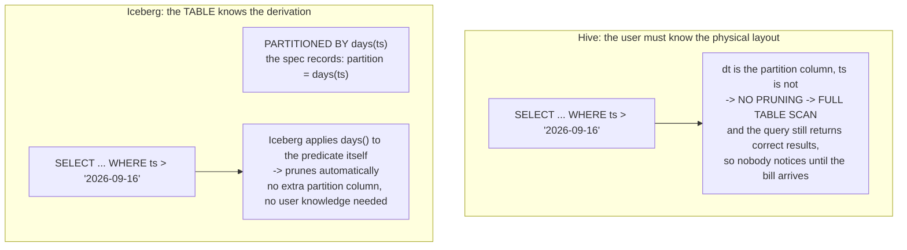

Partition transforms: `identity`, `year`, `month`, `day`, `hour`, `bucket(N, col)`, `truncate(W, col)`, and (v3) multi-argument transforms. **There is no separate `dt` column to keep in sync** — a whole class of Hive bugs disappears.

### Partition evolution

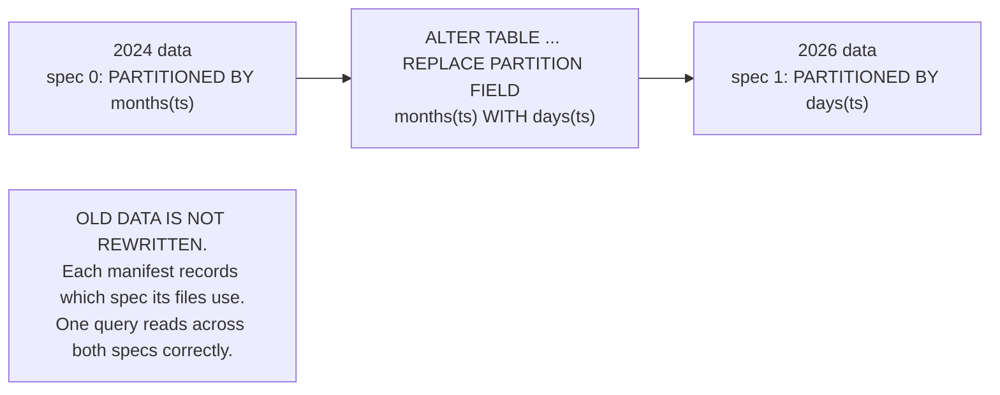

In Hive, changing the partitioning means rewriting the entire table — so in practice nobody does it, and tables stay mis-partitioned for years. Iceberg makes it a metadata operation.

### Schema evolution by field ID

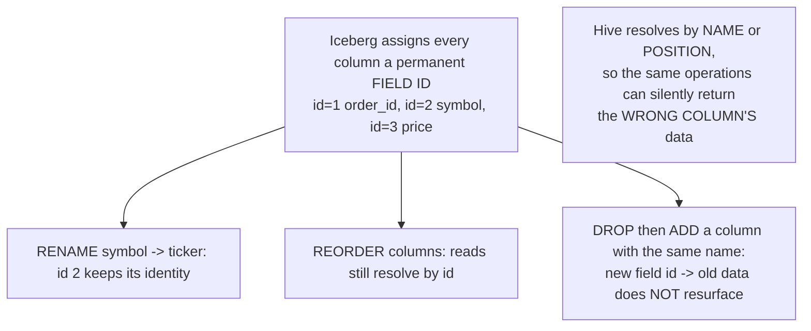

Safe, in-place, no rewrite: add, drop, rename, reorder, and widen types (`int → long`, `float → double`, decimal precision). **This is the single most under-appreciated Iceberg feature** — it's the one that prevents silent data corruption rather than just making things faster.

---

## 5. Row-level deletes: copy-on-write vs merge-on-read

An `UPDATE` or `DELETE` on immutable files has only two possible implementations.

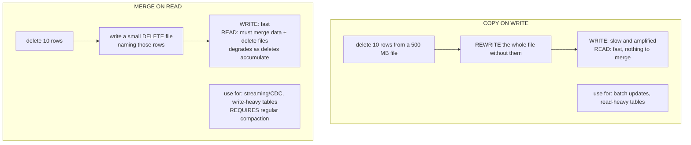

Set per operation: `write.update.mode`, `write.delete.mode`, `write.merge.mode` = `copy-on-write` | `merge-on-read`.

**Delete file types (v2)**

| Type | Names rows by | Cost |
|---|---|---|
| **Positional deletes** | `(file path, row position)` | cheap to apply, but the writer must know positions |
| **Equality deletes** | predicate on column values, e.g. `id = 42` | cheap to write (a streaming writer doesn't know positions), **expensive to read** — every matching file must be checked |

Flink CDC ingest produces equality deletes, which is exactly why **Iceberg tables fed by streaming pipelines degrade without compaction** — the classic incident.

### v3 deletion vectors

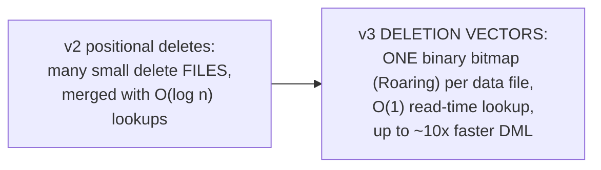

---

## 6. Iceberg v3 — what's new

Generally available across the major platforms during 2025–2026 (AWS Nov 2025, Databricks preview April 2026, Snowflake GA May 2026). Seven additions:

| Feature | What it does | Why it matters |
|---|---|---|
| **Deletion vectors** | Roaring-bitmap deletes, one per data file | up to 10× faster DML; replaces the small-delete-file mess |
| **Row lineage** | `_row_id` and `_last_updated_sequence_number` per row | **native CDC out of the table itself** — no Debezium, no external change log |
| **VARIANT type** | native semi-structured column, with shredding and filter pushdown | replaces "store JSON in a STRING"; same idea as Spark 4 and Flink 2.1 VARIANT |
| **Default column values** | a real `DEFAULT` on `ADD COLUMN` | add a non-null column without rewriting history |
| **Geometry / geography types** | first-class spatial | |
| **Nanosecond timestamps** | `timestamp_ns` | **relevant to your track** — microsecond precision is not enough for exchange timestamps |
| **Multi-arg partition transforms** | transforms over several columns | richer layouts |

**Compatibility direction**: v3 readers can read v2 tables; **v2 readers cannot read v3 tables.** Upgrading a table is one-way, so check every engine in your stack before flipping `format-version`.

Row lineage is the strategically interesting one: it makes the table itself the change stream, which erodes the boundary between "the lake" and "the CDC pipeline."

---

## 7. Snapshots, time travel, and branching

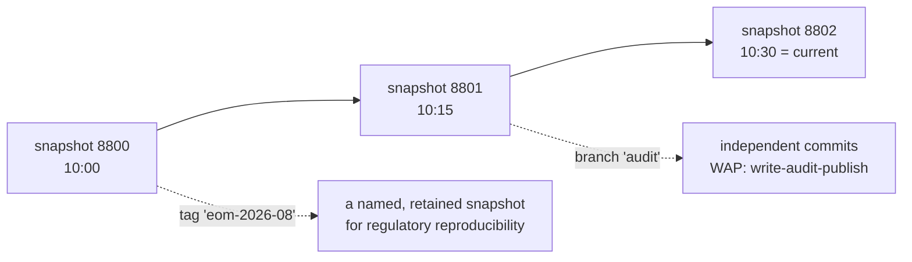

```sql
-- time travel
SELECT * FROM trades FOR SYSTEM_TIME AS OF '2026-09-16 09:30:00';
SELECT * FROM trades FOR SYSTEM_VERSION AS OF 8801;

-- incremental read: what changed between two snapshots
SELECT * FROM trades.changes ...   -- engine-specific syntax

-- undo a bad write
CALL catalog.system.rollback_to_snapshot('db.trades', 8801);
```

**Write–Audit–Publish (WAP)**: write to a branch, run data-quality checks against that branch, and only then fast-forward `main`. Bad data never becomes visible to readers. This is the pattern to name when asked about data quality in a lakehouse — it's the lake's equivalent of a staging transaction.

**For a quant/regulatory context**, tag the snapshot used for each end-of-month report. When someone asks in 2029 "what did the data look like when you computed this," the answer is one `AS OF` query rather than an archaeology project.

---

## 8. Catalogs

The catalog is the **only** stateful, coordinating component — it's what makes the atomic swap atomic.

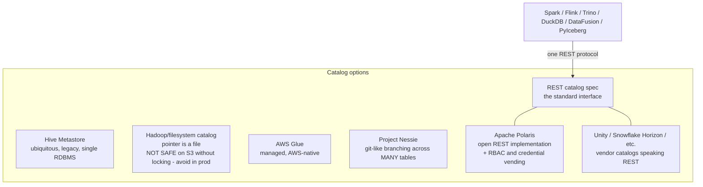

**The REST catalog spec is the important development.** It turns the catalog into a network protocol rather than a library, which means engines don't need per-catalog plugins, credentials are **vended** by the catalog (the engine never holds long-lived cloud keys), and access control can be enforced centrally instead of by every engine independently. Apache Polaris is the vendor-neutral implementation.

**Avoid the Hadoop/filesystem catalog in production** on object storage — its "commit" relies on file-system semantics S3 doesn't provide. Know this; it's a real interview question and a real outage.

---

## 9. Maintenance — where teams actually fail

> The quotable line: **the table format matters less than your table maintenance.** Operational discipline is the bottleneck, not the format.

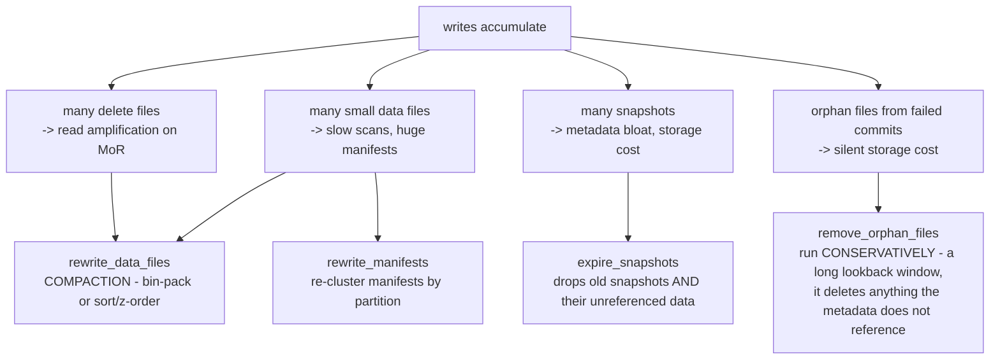

```sql
CALL catalog.system.rewrite_data_files(
  table => 'db.trades',
  strategy => 'sort', sort_order => 'symbol, ts',
  options => map('target-file-size-bytes','536870912'));

CALL catalog.system.expire_snapshots('db.trades', TIMESTAMP '2026-09-09 00:00:00', 100);
CALL catalog.system.rewrite_manifests('db.trades');
CALL catalog.system.remove_orphan_files(table => 'db.trades', older_than => TIMESTAMP '2026-09-09 00:00:00');
```

Practical rules:
- **Continuous streaming ingest → compact every 1–4 hours.** Daily batch loads → compact right after each load.
- **Compact from a single engine** on a multi-engine table, to avoid concurrent compactions fighting each other; coordinate through the catalog.
- **Always pair compaction with `expire_snapshots`** — otherwise the old small files are still referenced by old snapshots and you've *increased* storage, not reduced it. This surprises people constantly.
- `expire_snapshots` **destroys time travel** past the expiry point. Decide the retention window deliberately, and use tags to pin snapshots you must keep.
- **`remove_orphan_files` is the dangerous one.** With a short lookback it can delete files belonging to an in-flight write. Use a multi-day threshold.
- Polaris and other catalogs govern tables but **do not run maintenance** — compaction needs a distributed engine (Spark/Trino) or a managed service. Policy-driven maintenance tooling (e.g. Floe on Polaris) is emerging to fill that gap.

---

## 10. Iceberg vs Delta Lake vs Hudi vs Paimon

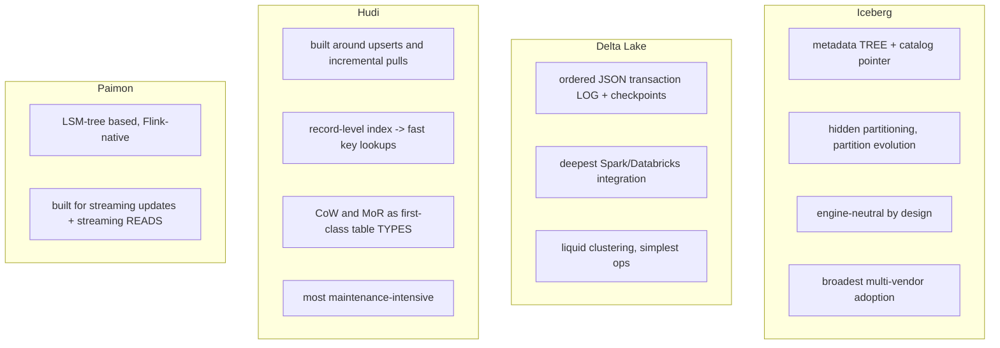

| | Iceberg | Delta | Hudi | Paimon |
|---|---|---|---|---|
| Metadata | manifest tree, atomic catalog swap | append-only transaction log | timeline + record index | LSM |
| Partition evolution | **yes** | no (liquid clustering instead) | limited | — |
| Hidden partitioning | **yes** | no | no | — |
| Upsert performance | good (v3 DVs) | good | **best** (record index) | very good |
| Streaming reads | good | good | good | **best** |
| Engine neutrality | **best** | Spark-centric, improving | good | Flink-centric |
| Ops burden | medium (compaction + expiry) | **lowest** | **highest** | medium |

**How to answer "which format?"** Iceberg has the momentum and the broadest multi-engine support, so it's the default for a new, engine-neutral platform. Delta if you're a Databricks shop — the integration and lower ops burden are real. Hudi if the workload is upsert-heavy CDC and you need record-level indexing. Paimon if you're Flink-first and want streaming reads off the table. Then add the honest caveat: **the formats are converging**, and your maintenance discipline will matter more than the choice.

---

## 11. Iceberg with Spark and Flink

```sql
-- Spark
CREATE TABLE catalog.db.trades (
  order_id BIGINT, symbol STRING, price DECIMAL(18,6), qty INT, ts TIMESTAMP_NS)
USING iceberg
PARTITIONED BY (days(ts), bucket(16, symbol))
TBLPROPERTIES (
  'format-version'='3',
  'write.delete.mode'='merge-on-read',
  'write.target-file-size-bytes'='536870912');

MERGE INTO catalog.db.trades t USING updates u ON t.order_id = u.order_id
WHEN MATCHED THEN UPDATE SET * WHEN NOT MATCHED THEN INSERT *;
```

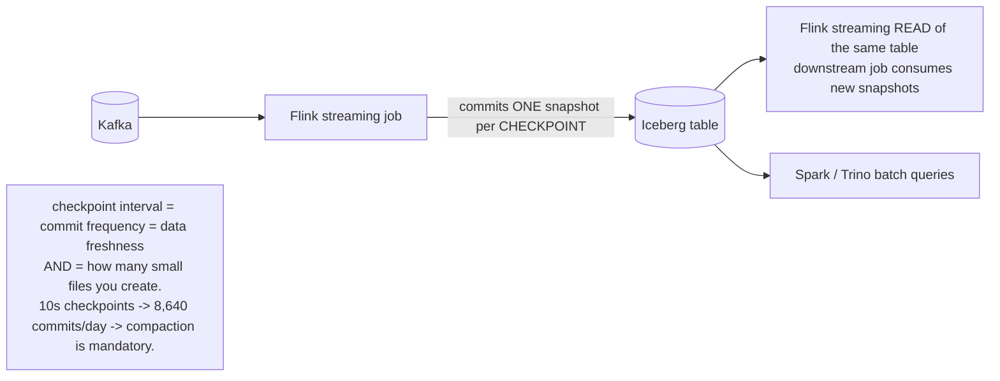

**That note is the key operational insight of streaming lakehouses**: your Flink checkpoint interval silently sets your file count. Short checkpoints buy freshness and cost you compaction. Say this and you sound like you've run one.

The `days(ts) + bucket(16, symbol)` layout above is a good default for market data: date partitions prune time-range queries, symbol buckets bound the file count and enable storage-partitioned joins on `symbol`.

---

## 12. Rapid-fire answers

**What is Iceberg, in one sentence?** An open table format that defines a table as a tree of metadata files — manifests listing data files with statistics — whose root pointer is swapped atomically by a catalog, giving ACID, time travel, and safe multi-engine access over object storage.

**Why is it faster than a Hive table on S3?** Planning reads a few metadata files instead of listing millions of object keys, and manifest-level partition/column statistics prune files before any data is read.

**How does it get ACID without a database?** Optimistic concurrency: write new data and metadata files (invisible), then compare-and-swap the catalog pointer. A losing writer re-reads the new base, validates its conflict, and retries.

**Hidden partitioning?** The table records that the partition is derived from a column (`days(ts)`), so the engine applies the transform to your predicate automatically. No extra partition column to keep in sync, no full scans from filtering on the "wrong" column.

**Copy-on-write vs merge-on-read?** CoW rewrites whole files on update — slow writes, fast reads; use for batch and read-heavy tables. MoR writes small delete files — fast writes, progressively slower reads; use for streaming/CDC, and *compact*.

**Why do Iceberg tables get slow over time?** Small files from frequent commits, accumulated delete files (especially equality deletes from Flink CDC), and bloated manifests. Fix with `rewrite_data_files`, `rewrite_manifests`, and — crucially — `expire_snapshots`, without which compaction doesn't actually free anything.

**What's in v3?** Deletion vectors (~10× faster DML), row lineage for native CDC, VARIANT, default values, geo types, nanosecond timestamps, multi-argument partition transforms. v3 readers read v2; v2 readers cannot read v3.

**Which catalog, and why not the filesystem one?** REST catalogs (Polaris, Glue, Nessie, vendor catalogs) — they standardize the protocol, vend short-lived credentials, and centralize access control. The Hadoop/filesystem catalog depends on file-system semantics object storage doesn't guarantee and is unsafe in production on S3.

**How does a Flink job write to Iceberg exactly-once?** The Iceberg sink is a two-phase-commit sink: files are written during the checkpoint interval and the Iceberg commit happens on checkpoint completion, so one checkpoint produces one snapshot. Recovery replays from the checkpoint and re-commits idempotently.

**Iceberg vs Delta?** Both solve the same problem. Iceberg has hidden partitioning, partition evolution and stronger engine neutrality; Delta has tighter Spark/Databricks integration and lower operational overhead. They are converging; pick by ecosystem.

---

## 13. Sources

- [Apache Iceberg spec](https://iceberg.apache.org/spec/)
- [What's new in Apache Iceberg v3 (Google Open Source Blog)](https://opensource.googleblog.com/2025/08/whats-new-in-iceberg-v3.html)
- [Apache Iceberg v3: moving the ecosystem towards unification (Databricks)](https://www.databricks.com/blog/apache-icebergtm-v3-moving-ecosystem-towards-unification)
- [AWS support for Iceberg v3 deletion vectors and row lineage](https://aws.amazon.com/about-aws/whats-new/2025/11/aws-apache-iceberg-v3-deletion-vectors-row-lineage)
- [Iceberg compaction best practices](https://itnext.io/apache-iceberg-compaction-best-practices-25b81d66bcb6)
- [Running Iceberg maintenance in production](https://iomete.com/resources/blog/iceberg-maintenance-production-guide)
- [Floe and Apache Polaris — policy-driven table maintenance](https://polaris.apache.org/blog/2026/02/04/floe-and-apache-polaris-policy-driven-table-maintenance-for-apache-iceberg/)
- [Lakehouse table formats in 2026](https://amdatalakehouse.substack.com/p/lakehouse-table-formats-in-2026-iceberg)
