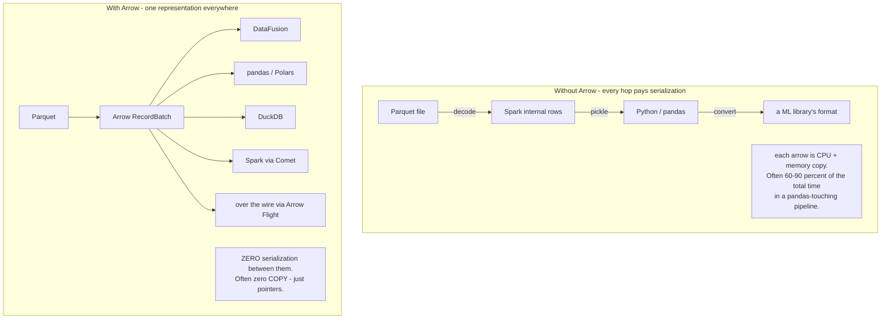
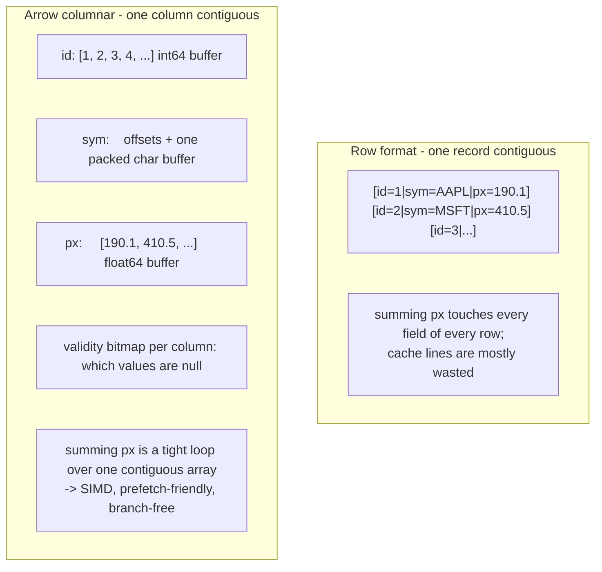
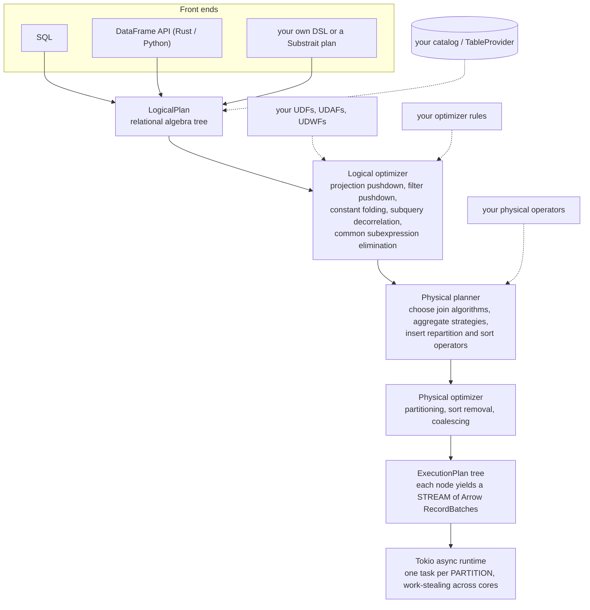
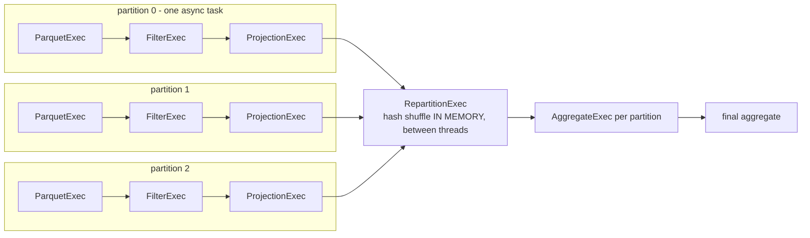
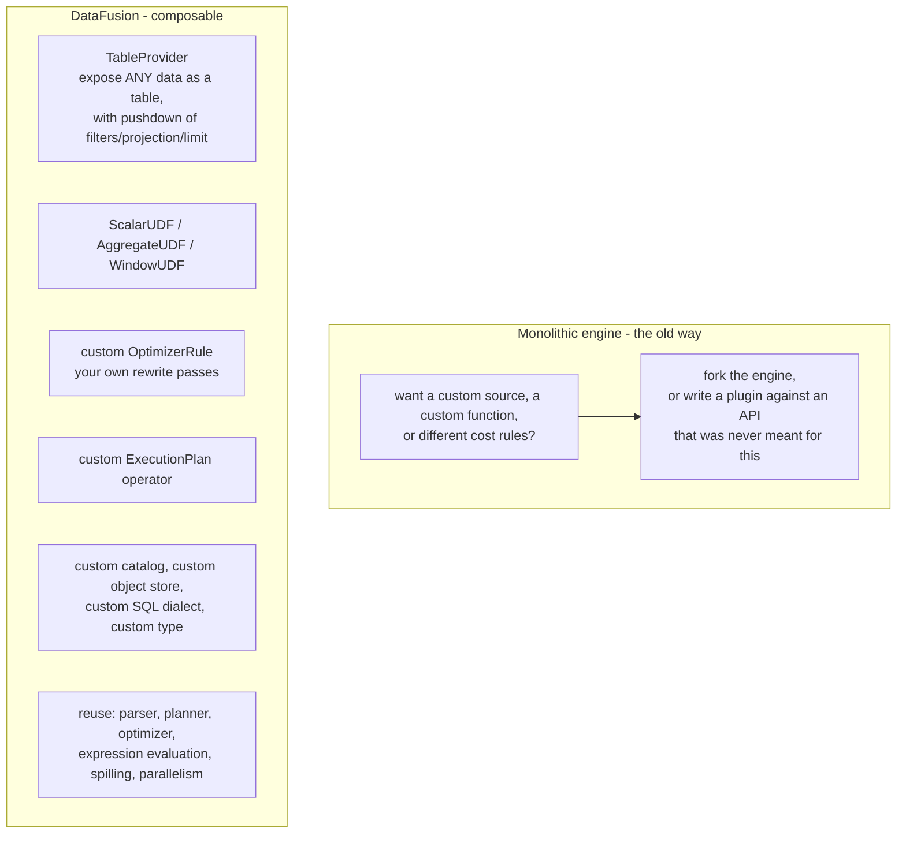
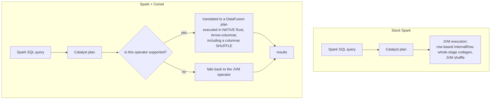
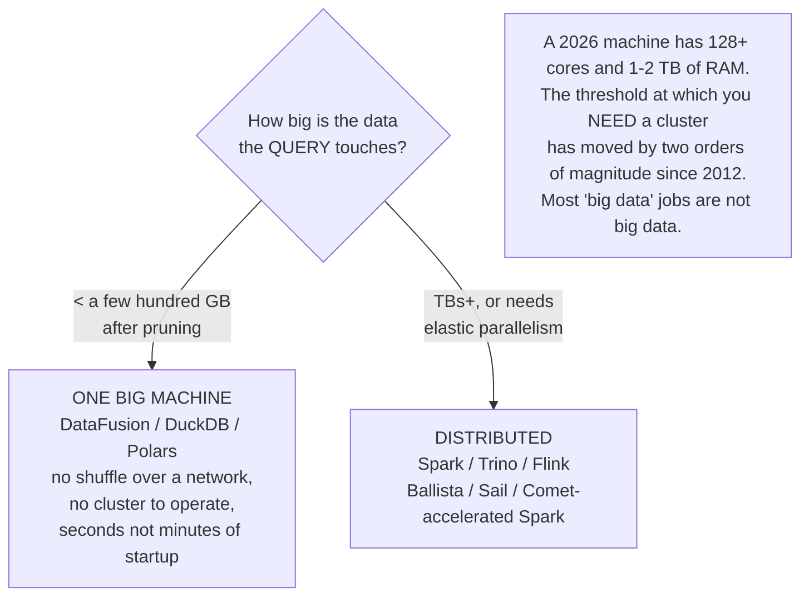
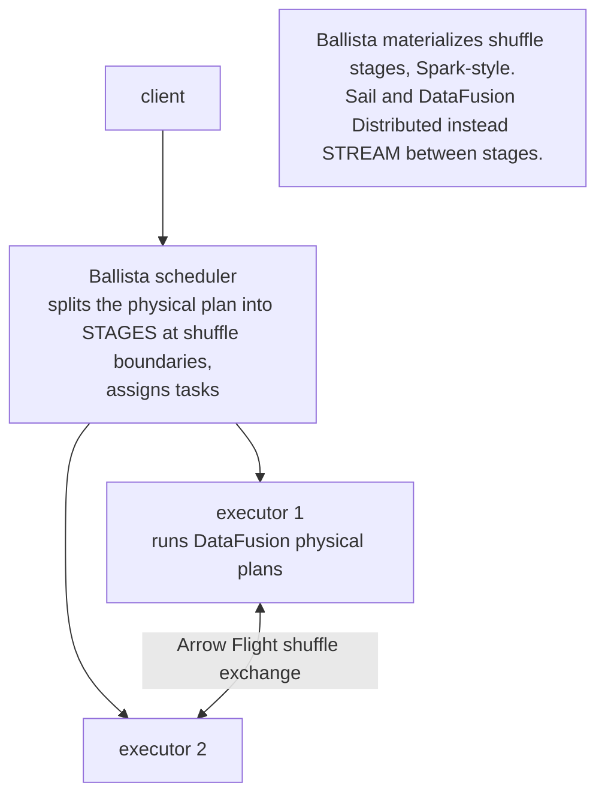
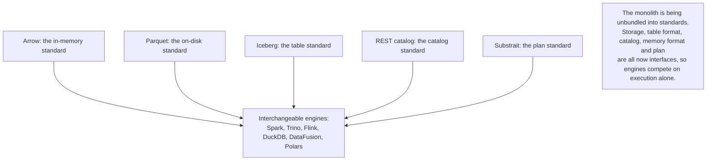

# Apache Arrow & DataFusion — the composable engine layer

> **Mental model.** The last decade's engines each built their own storage format, their own in-memory representation, their own optimizer and their own execution runtime, from scratch, in a monolith. **Arrow standardizes the in-memory representation; DataFusion makes the rest of the engine a library you assemble.** DataFusion is not "a faster Spark" — it's a *toolkit for building query engines*, and understanding that distinction is the whole interview answer.

---

## 1. Apache Arrow — the substrate

### Why a standard in-memory format matters



### The physical layout



Key properties to be able to state:
- **Column = contiguous buffers** (values + a validity bitmap + offsets for variable-length types), with a documented, versioned layout.
- **No serialization between processes or languages** — the on-wire form *is* the in-memory form. "Zero-copy" is literal: a process can map another's buffer.
- **SIMD-friendly**: a vectorized `sum` over a `float64` buffer compiles to a handful of instructions per 4–8 values.
- **RecordBatch** = a set of equal-length column arrays; the unit of work everywhere in this ecosystem.

**Arrow vs Parquet — the confusion to pre-empt**: Parquet is an **on-disk** format optimized for *storage* (heavy encoding, compression, row groups). Arrow is an **in-memory** format optimized for *compute* (no compression, fixed-width access, directly addressable). They're designed as a pair: read Parquet → decode to Arrow → compute.

### The Arrow family

| Project | What it is |
|---|---|
| **Arrow IPC / Feather** | serialize Arrow buffers to a file or stream, near-zero cost |
| **Arrow Flight** | gRPC protocol for moving Arrow data — replaces ODBC/JDBC row-by-row transfer for bulk movement |
| **Arrow Flight SQL** | a SQL database protocol over Flight |
| **ADBC** | a client API (like JDBC) that returns **Arrow batches** instead of rows |
| **DataFusion** | a query engine built on Arrow |

---

## 2. DataFusion — what it is

**A fast, embeddable, extensible query engine written in Rust, using Arrow as its memory model.** Out of the box it gives you a SQL parser, a full logical and physical planner, a columnar/vectorized/multi-threaded/streaming execution engine, a DataFrame API, and readers for Parquet, CSV, JSON and Avro. Then it exposes **10+ major extension APIs** so you can replace any part.



### Execution: streaming, partitioned, pull-based



- Every `ExecutionPlan` node exposes `execute(partition) -> SendableRecordBatchStream`. Operators **pull** batches from their children and yield batches upward, so a query streams rather than materializing whole intermediate tables.
- **Parallelism = partitions**, scheduled as Tokio async tasks over a thread pool. A "shuffle" is `RepartitionExec` moving batches between threads in the same process — no disk, no network, nothing like Spark's shuffle.
- Memory is governed by a **MemoryPool**; operators that exceed their budget **spill to disk** (sorts, hash joins, grouped aggregates). So DataFusion handles larger-than-memory data on a single node — a common misconception is that it can't.

---

## 3. What makes it different: it's a *toolkit*

This is the point that matters in an interview.



> **"Start from a working engine and customize the pieces specific to your domain"** is the pitch. Building a query engine used to be a multi-year project; DataFusion makes it a matter of implementing a `TableProvider` and a few UDFs.

### Who actually uses it

| System | How it uses DataFusion |
|---|---|
| **InfluxDB 3.0 (IOx)** | its entire SQL query engine over Arrow/Parquet time-series storage |
| **DataFusion Comet** | a **Rust accelerator for Apache Spark** — see below |
| **DataFusion Ballista** | distributed scheduler on top of DataFusion |
| **Sail**, **DataFusion Distributed** | distributed engines that *stream* between stages |
| **GreptimeDB**, **Cube.dev**, **ROAPI**, **Spice AI** | embedded query layer |
| **Cloudflare Log Explorer** | SQL over logs in R2 |
| **Palantir Lightweight Pipelines** | powered by DataFusion |

That list is the real answer to "is this a toy?" — it's infrastructure under commercial databases, not a hobby project.

---

## 4. DataFusion Comet — the one most relevant to a Spark shop



- Comet keeps queries **Arrow-native end to end** — operators, expressions, shuffle and broadcast all stay columnar, avoiding the per-row overhead of Spark's row-based engine.
- Reported **~2× on TPC-DS at 1 TB, ~50 % cost saving**, with no query rewrites: you add a plugin jar and set a few configs.
- Unsupported operators fall back to the JVM transparently, so adoption is incremental.

**Why this is a great interview talking point**: it's a concrete example of the industry's direction — *keep the mature front end (Catalyst, the API, the ecosystem) and replace the execution engine with a native, vectorized one.* The same pattern appears in Databricks Photon (C++), Gluten + Velox, and Presto's native workers. "Vectorized native execution under an existing SQL front end" is the defining engine trend of the 2020s.

---

## 5. Where it fits: single-node vs distributed



**This is the argument to be able to make.** Hadoop's design assumed a 2006 machine and a 1 Gb network. Today a single node can do what a 50-node 2012 cluster did, and single-node engines (DataFusion, DuckDB, Polars) exploit that. **Ask "how much data does the query actually touch after partition and column pruning?"** — the answer is usually far smaller than the table, and often fits on one machine. Distributed execution buys elastic scale and fault tolerance, and costs you a shuffle, a scheduler, and an ops burden.

### DataFusion vs DuckDB vs Polars vs Spark

| | DataFusion | DuckDB | Polars | Spark |
|---|---|---|---|---|
| Written in | Rust | C++ | Rust | Scala/JVM |
| Primary identity | **an engine toolkit you embed and extend** | **an embedded analytical database** | **a DataFrame library** | a distributed compute platform |
| Interface | SQL + DataFrame, Rust/Python | SQL first | DataFrame first, some SQL | SQL + DataFrame, many languages |
| Extensibility | **its main selling point** — 10+ extension APIs | extensions, less deep | UDFs | broad but heavyweight |
| Storage | none — bring your own via `TableProvider` | its own format + external files | none | none |
| Scale | single node (Ballista/Sail for distributed) | single node | single node | **distributed** |
| Use when | you are **building a system** | you are **querying data** interactively | you are **transforming data** in code | data genuinely needs a cluster |

**The crisp distinction**: *DuckDB is a database you use; DataFusion is an engine you build with.* If someone asks "why would I choose DataFusion over DuckDB for analytics?", the honest answer is usually "for plain analytics, DuckDB — choose DataFusion when you need to embed a query engine in your own product, customize the planner, or stay in Rust."

### Ballista and distributed DataFusion



Ballista is deliberately Spark-shaped (stages, shuffle files, a scheduler) while reusing DataFusion for per-node execution. It's the least mature part of the ecosystem — say so if asked, rather than overselling it.

---

## 6. Using it — the shape of the code

```python
# Python
from datafusion import SessionContext
ctx = SessionContext()
ctx.register_parquet("trades", "s3://bucket/trades/")
df = ctx.sql("""
    SELECT symbol, date_trunc('minute', ts) AS minute,
           sum(price * qty) / sum(qty) AS vwap
    FROM trades WHERE ts >= '2026-09-16' GROUP BY 1, 2
""")
df.show()
arrow_table = df.to_arrow_table()   # zero-copy handoff to pandas/polars/ML
```

```rust
// Rust — the embedding case
let ctx = SessionContext::new();
ctx.register_table("trades", Arc::new(MyCustomTableProvider::new()))?;   // any data source
ctx.register_udf(create_udf("vol_adjust", /* ... */));                   // your domain function
let df = ctx.sql("SELECT vol_adjust(price, sigma) FROM trades").await?;
let batches: Vec<RecordBatch> = df.collect().await?;
```

The `TableProvider` is the interesting part: implement `scan()` plus `supports_filters_pushdown()` and **any** system — a REST API, a custom binary format, a proprietary tick store — becomes SQL-queryable with pushdown, parallelism, and spilling handled for you.

---

## 7. How this connects to everything else in this track



**This is the synthesis to offer in a senior interview.** Hadoop bundled storage + scheduling + compute. The cloud unbundled storage. Iceberg unbundled the table. REST catalogs unbundled the catalog. Arrow unbundled the memory format. DataFusion unbundles the engine itself. Every layer becoming a standard is why a 2026 platform mixes Flink for streaming, Spark for ETL, Trino for BI and DuckDB/DataFusion for local work — **over the same tables, with no data movement between them.** That's the composable data stack, and being able to name that arc puts you well ahead of a feature-list answer.

---

## 8. Rapid-fire answers

**Arrow vs Parquet?** Parquet is an on-disk storage format — heavily encoded and compressed, optimized for space and scan pruning. Arrow is an in-memory compute format — uncompressed, fixed-width, directly addressable, SIMD-friendly. They're a designed pair: read Parquet, decode to Arrow, compute on Arrow.

**What does "zero-copy" actually mean here?** Arrow's on-wire representation is identical to its in-memory representation, so moving data between processes, languages or systems requires no serialization or parsing — often just passing a pointer or mapping a buffer.

**What is DataFusion?** An embeddable, extensible SQL query engine in Rust, built on Arrow, with a full planner, optimizer, and a vectorized streaming multi-threaded execution engine — designed as a *toolkit for building query engines*, not as an end-user database.

**Is it distributed?** No, not by itself. It's a single-node engine with excellent multi-core parallelism and disk spilling. Ballista, Sail and DataFusion Distributed add distribution on top.

**DataFusion vs DuckDB?** DuckDB is a database you use; DataFusion is an engine you build with. For interactive analytics, DuckDB. For embedding a customizable engine in your own system, or staying in Rust, DataFusion.

**What is Comet and why does it matter?** A Spark plugin that executes supported operators natively in Rust via DataFusion, Arrow-columnar end to end including shuffle, with transparent fallback to the JVM. ~2× on TPC-DS 1 TB with no query changes. It exemplifies the broader trend of replacing JVM row-based execution with native vectorized execution under an existing SQL front end (cf. Photon, Gluten+Velox).

**Why is columnar + vectorized faster?** Contiguous same-type values mean fewer cache misses, no per-row virtual dispatch, branch-free evaluation via validity bitmaps, and loops the compiler can auto-vectorize to SIMD. You amortize interpretation cost over a whole batch instead of paying it per row.

**When would you not use a cluster at all?** When the data the query actually touches after partition and column pruning fits on one large machine — which today is hundreds of GB. You then skip the network shuffle, the scheduler, and the cluster ops entirely. Use a cluster for genuinely large scans, elastic concurrency, or when you need task-level fault tolerance on long jobs.

**How would you expose a proprietary tick store to SQL?** Implement a DataFusion `TableProvider`: a `scan()` that returns partitioned Arrow record-batch streams, plus filter/projection/limit pushdown so predicates reach the storage layer. You inherit the planner, optimizer, parallelism, spilling and SQL surface for free.

---

## 9. Sources

- [Apache DataFusion documentation](https://datafusion.apache.org/)
- [Apache DataFusion — introduction / user guide](https://datafusion.apache.org/user-guide/introduction.html)
- [Apache Arrow DataFusion: a fast, embeddable, modular analytic query engine (SIGMOD 2024)](https://dl.acm.org/doi/10.1145/3626246.3653368)
- [DataFusion Comet overview](https://datafusion.apache.org/comet/user-guide/overview.html)
- [apache/datafusion on GitHub](https://github.com/apache/datafusion)
- [DataFusion Ballista architecture](https://datafusion.apache.org/ballista/contributors-guide/architecture.html)
- [Apache DataFusion — what data engineers need to know in 2026](https://medium.com/@andymadson/apache-datafusion-what-data-engineers-need-to-know-in-2026-3ad96f7157f6)
