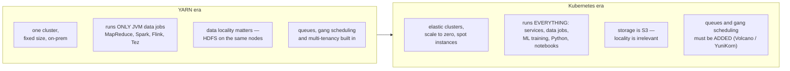
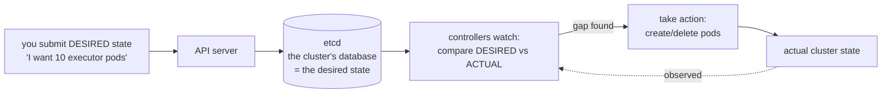
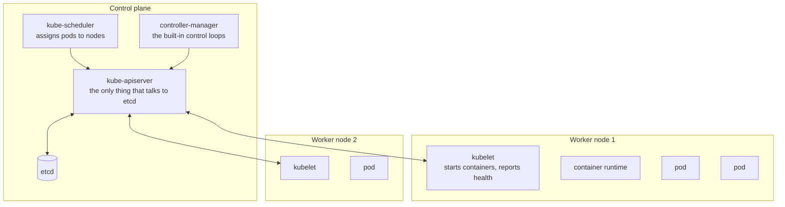
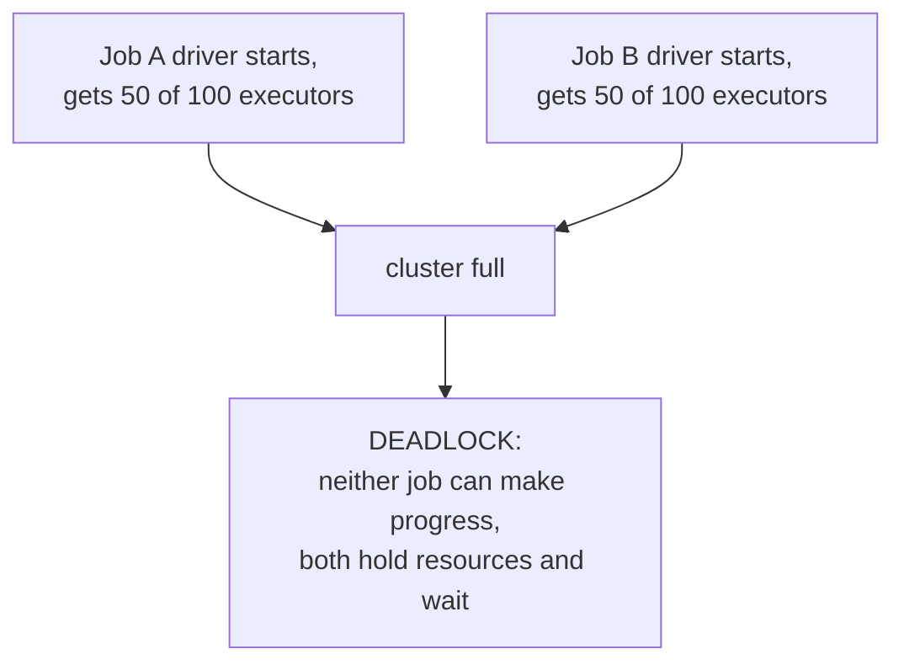
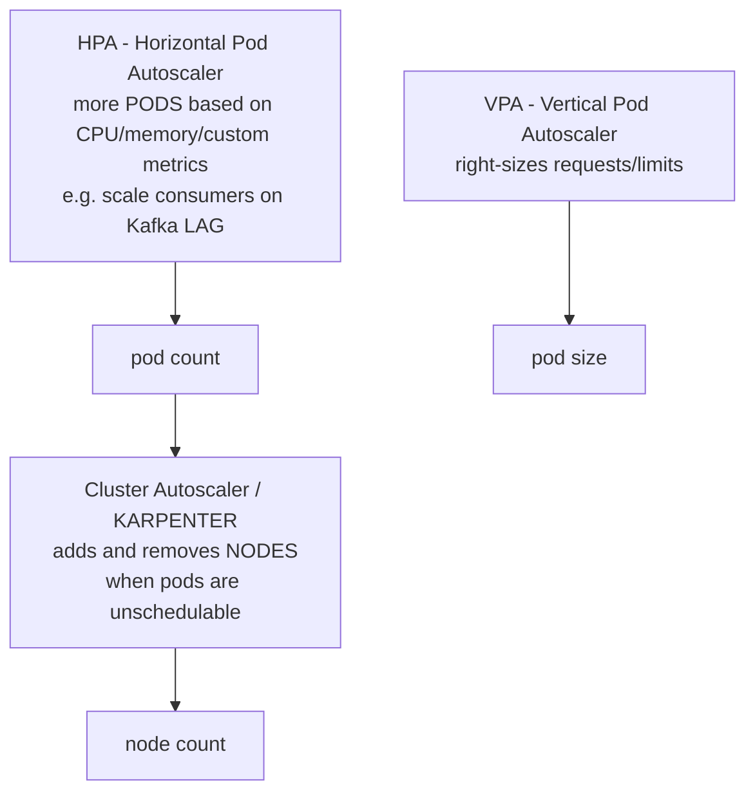
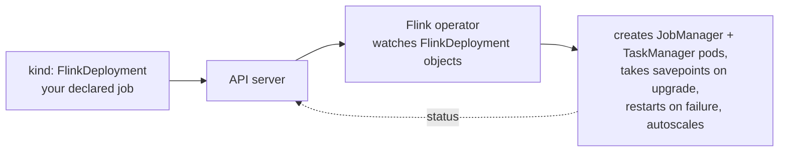
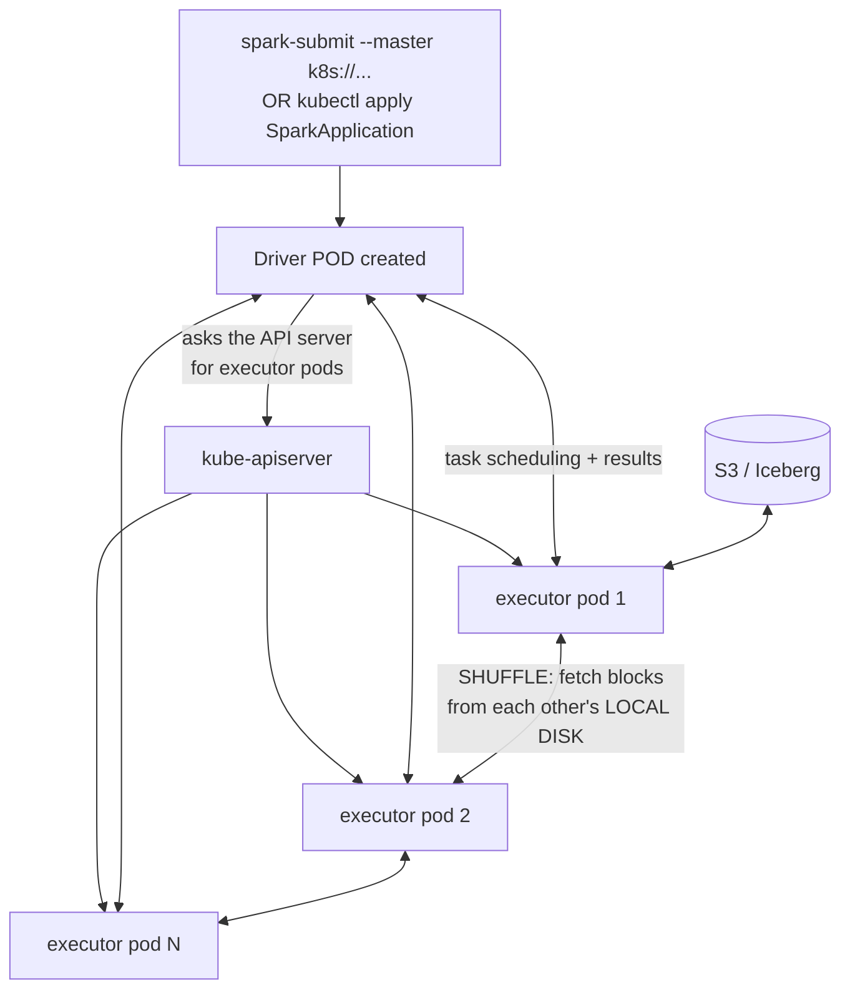
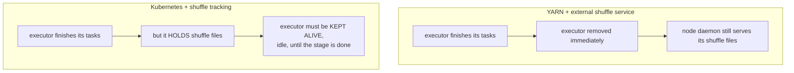
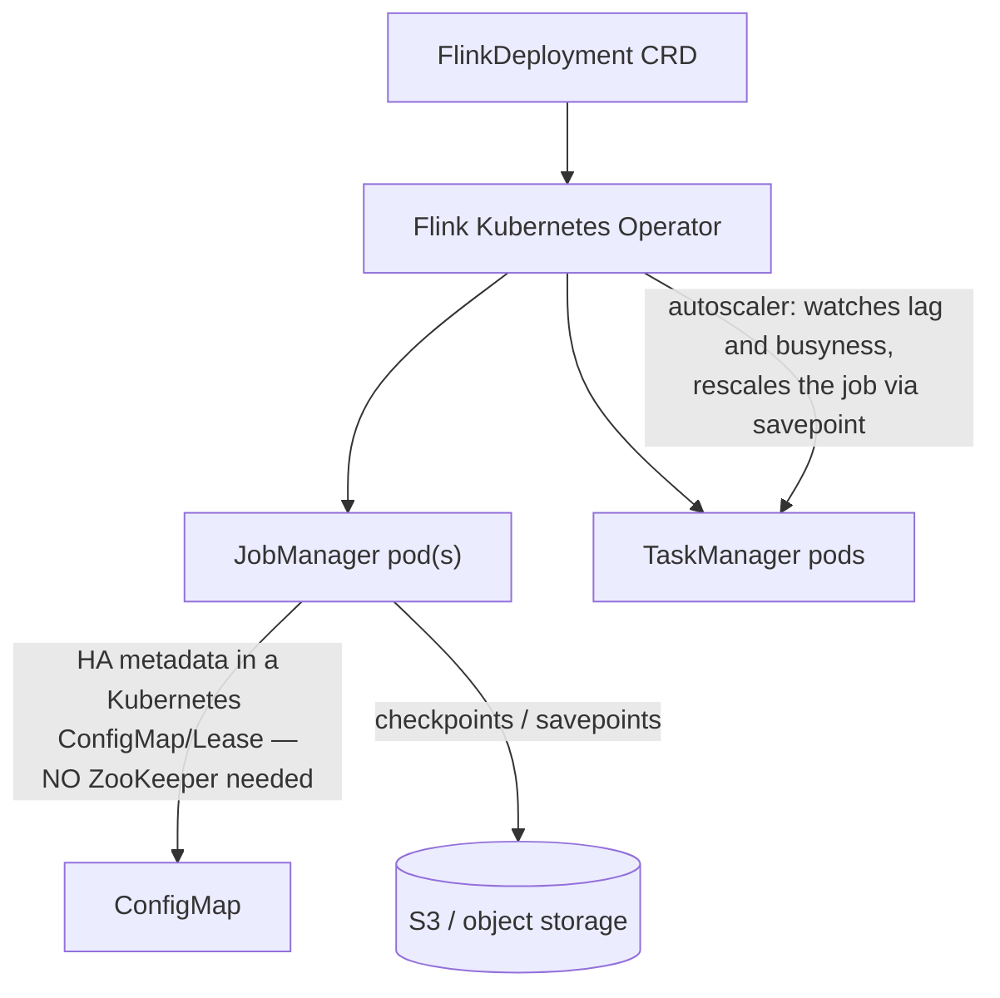
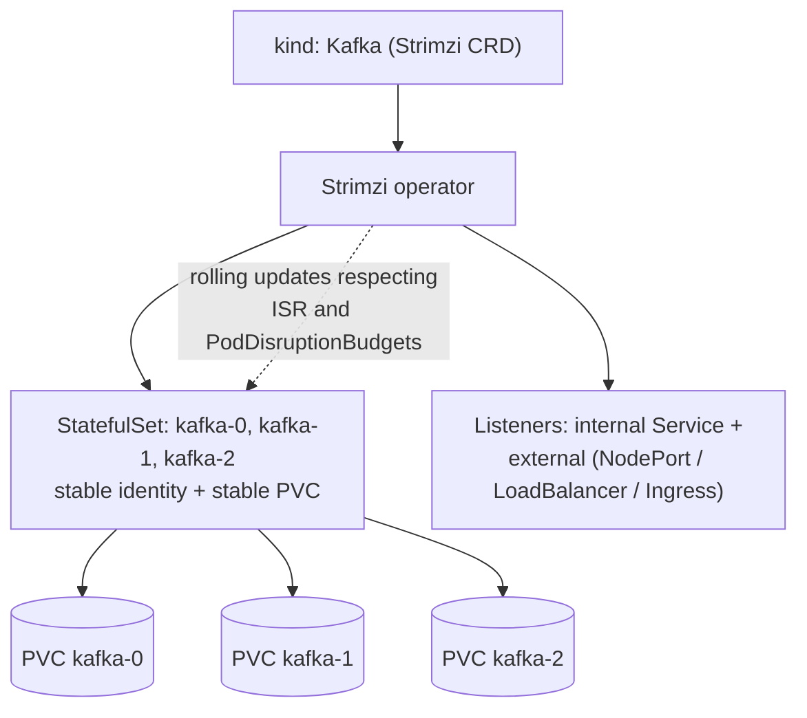

# Kubernetes for Data Engineering

> **Mental model.** YARN asks "which machine has a free slot *and* the data?" Kubernetes asks nothing — you **declare** the state you want, and a set of control loops works continuously to make reality match. Everything odd about running data workloads on Kubernetes follows from two facts: it was built for **stateless, long-lived services**, not **stateful, bursty batch jobs**; and it assumes **compute and storage are separate**, so data locality (see [01-hadoop.md](01-hadoop.md)) simply doesn't exist.

---

## 1. Why the industry moved off YARN



| Driver | Why it pushed people to Kubernetes |
|---|---|
| **Cloud object storage** | Once data lives in S3, the whole reason for co-locating compute with storage evaporates — and with it YARN's main advantage. |
| **Containers** | Every job carries its own Python/Java/library versions. YARN's shared-classpath model made dependency conflicts a constant tax. |
| **One platform** | Microservices, Airflow, Spark, Flink, ML training, model serving — all on one substrate, with one set of RBAC, monitoring and CI. |
| **Elasticity** | Spin up 500 nodes for an hour, then scale to zero. YARN clusters are sized for peak and idle the rest of the time. |
| **Spot / preemptible instances** | 60–90 % cheaper compute, if your jobs tolerate nodes vanishing. (This is what makes [10-celeborn.md](10-celeborn.md) necessary.) |

**Where things stand in 2026**: with Spark 4.x, the official Apache Spark Kubernetes Operator, mature Flink and Kafka operators, Karpenter/Volcano/YuniKorn, and Celeborn for shuffle, the feature gap with YARN has largely closed. YARN survives mainly in large on-prem Hadoop estates where migration cost exceeds benefit.

---

## 2. The core mental model: declarative reconciliation

This is the single idea that makes Kubernetes make sense.



You never say "start a container on node 7." You say "10 of these should exist," and a controller keeps making that true — after a node dies, after you edit the number, forever. **Everything in Kubernetes, including every operator you'll meet later in this chapter, is a variation of that loop.**

### Architecture



### The objects you actually need

| Object | What it is | Data-engineering use |
|---|---|---|
| **Pod** | one or more containers sharing a network namespace; the unit of scheduling | a Spark executor, a Kafka broker, a Flink TaskManager |
| **Deployment** | keeps N identical, interchangeable pods running | stateless services, Trino workers |
| **StatefulSet** | pods with **stable names and stable storage** (`kafka-0`, `kafka-1`) | **Kafka brokers, Flink JobManagers, Celeborn workers** |
| **DaemonSet** | one pod per node | log collectors, node exporters, a per-node shuffle service |
| **Job / CronJob** | run to completion / on a schedule | batch ETL, compaction jobs |
| **Service** | stable virtual IP + DNS name in front of pods | broker discovery, driver↔executor |
| **ConfigMap / Secret** | configuration / credentials | Spark configs, Kafka credentials |
| **PVC / StorageClass** | a request for a disk / the kind of disk to provision | Kafka log dirs, RocksDB state |
| **Namespace + ResourceQuota** | isolation boundary + caps | per-team limits |

**The one to remember for data**: `Deployment` is for cattle; **`StatefulSet` is for anything that owns data on disk** — its pods get stable identities (`kafka-0` always re-attaches to the same volume), which is exactly what a Kafka broker or a Celeborn worker needs.

---

## 3. Scheduling — and where batch jobs hurt

### Requests and limits

```yaml
resources:
  requests: { cpu: "4",  memory: "16Gi" }   # used for SCHEDULING — reserve this much
  limits:   { cpu: "8",  memory: "20Gi" }   # ENFORCED at runtime
```

Two rules that cause most production incidents:

- **Exceed the memory limit → the container is killed instantly (`OOMKilled`).** No warning, no swap. This is why the JVM heap plus off-heap plus overhead must fit *under* the limit — exactly the `spark.executor.memoryOverhead` problem from [04-spark.md](04-spark.md), now enforced by the kernel.
- **Exceed the CPU limit → you are throttled, not killed.** CPU limits on latency-sensitive workloads (a Kafka broker, a Flink task) cause mysterious stalls. Many teams set CPU *requests* but deliberately omit CPU *limits*.

**QoS classes**: `Guaranteed` (requests == limits) is evicted last; `Burstable` (requests < limits) next; `BestEffort` (nothing set) first. Set requests == limits for anything you don't want evicted.

### The gang-scheduling problem

Kubernetes schedules **one pod at a time**. A batch job needs **all of its pods at once**. Put two large Spark jobs on a cluster with room for one and you get:



YARN never had this problem — its ApplicationMaster negotiated for the whole application. The fix on Kubernetes is a **batch scheduler** that replaces or supplements `kube-scheduler`:

| Scheduler | Brings |
|---|---|
| **Apache YuniKorn** | **gang scheduling** (all pods or none), hierarchical queues, per-tenant quotas, better bin-packing — essentially YARN's Capacity Scheduler semantics on Kubernetes |
| **Volcano** | gang scheduling, job queues, fair-share, preemption; strong in the ML/HPC ecosystem |

If someone asks "what does Kubernetes still miss compared with YARN?", **gang scheduling and hierarchical queues** is the correct answer — and naming YuniKorn/Volcano as the remedy is the follow-up.

### Placement controls

| Mechanism | Use |
|---|---|
| **nodeSelector / affinity** | put Kafka on nodes with local NVMe; keep Spark off them |
| **taints / tolerations** | reserve GPU or spot nodes for workloads that explicitly opt in |
| **pod anti-affinity** | spread Kafka brokers or Celeborn workers across nodes and zones |
| **topologySpreadConstraints** | even distribution across zones |
| **PodDisruptionBudget (PDB)** | "never voluntarily evict more than 1 broker at a time" — **essential for Kafka**, or a node drain can take out a whole ISR |
| **PriorityClass + preemption** | production ETL evicts ad-hoc notebooks |

### Autoscaling



**Karpenter** is the modern choice on AWS: instead of scaling fixed node groups, it looks at the pending pods and provisions the cheapest instance types that fit — including spot — then consolidates and removes underused nodes. For bursty Spark workloads this is a large cost win, and it's also why **executors die mid-job far more often than they did on YARN**, which is the motivation for the next chapter.

---

## 4. The operator pattern — how data systems run on Kubernetes

A **CRD (CustomResourceDefinition)** teaches the API server a new object type. An **operator** is a controller that reconciles it — the same loop from §2, but encoding the operational knowledge of a specific system.



**The point**: `kubectl apply -f my-flink-job.yaml` and the operator handles savepoint-upgrade-restore (see [05-flink.md](05-flink.md)) without you writing a deployment script.

| System | Operator | Notes (as of 2026) |
|---|---|---|
| **Spark** | **Apache Spark Kubernetes Operator** (official, 1.x) and the **Kubeflow Spark Operator** | the official ASF subproject is the newer of the two; both expose a `SparkApplication` CRD |
| **Flink** | **Apache Flink Kubernetes Operator** (1.16 latest) | `FlinkDeployment` CRD, **built-in autoscaler**, blue/green deployments, savepoint-based upgrades |
| **Kafka** | **Strimzi** (1.x) | `Kafka`, `KafkaTopic`, `KafkaUser`, `KafkaConnect` CRDs; rolling upgrades; KRaft-native |
| **Airflow** | Helm chart + `KubernetesExecutor` | each task becomes a pod |
| **Celeborn** | Helm chart (StatefulSets, health probes since 0.7) | [10-celeborn.md](10-celeborn.md) |

---

## 5. Spark on Kubernetes



The driver *is* the scheduler — it creates and deletes executor pods directly through the API server. There is no ResourceManager.

### The dynamic allocation problem

On YARN, an **external shuffle service** runs as a per-node daemon and serves shuffle files *after* the executor that wrote them is gone. That's what makes executors safely removable.

**Kubernetes has no external shuffle service.** So Spark added **shuffle tracking**: the driver simply refuses to remove an executor that still holds shuffle data anyone might need (enabled by default in Spark 4.0).



The consequences are the whole reason chapter 10 exists:

| Consequence | Impact |
|---|---|
| Idle executors held for their shuffle files | you pay for compute doing nothing; scale-down is blocked |
| Executor or node lost (spot reclaim) | its shuffle files are gone → **recompute the entire upstream stage** |
| Every node needs big local disks | sized for peak shuffle, mostly wasted |
| Data skew | one straggler holds the whole stage open, so nothing scales down |

### Storage options for executors

| Option | Trade-off |
|---|---|
| `emptyDir` on the node's disk (default) | simple; limited by node disk; lost with the pod |
| `emptyDir` with `medium: Memory` | fast, but counts against the pod's memory limit → OOMKilled |
| **hostPath to local NVMe** | fastest real option; ties pods to specific node types |
| **PVC per executor** | survives pod restart, but provisioning latency and cost |
| **Remote shuffle service (Celeborn)** | removes the problem entirely — next chapter |

### Practical configuration notes

```
spark.kubernetes.container.image=...
spark.executor.memoryOverhead=...        # must fit under the pod memory LIMIT or OOMKilled
spark.kubernetes.executor.deleteOnTermination=false   # keep failed pods for debugging
spark.dynamicAllocation.enabled=true
spark.dynamicAllocation.shuffleTracking.enabled=true  # default in Spark 4.0
```

---

## 6. Flink on Kubernetes

Flink's Kubernetes support is the most native of the three, because a streaming job is a **long-lived service** — exactly what Kubernetes was built for.



Key points, each connecting to [05-flink.md](05-flink.md):
- **Native Kubernetes mode**: the JobManager requests TaskManager pods itself, so parallelism changes don't need an external resource manager.
- **HA without ZooKeeper**: leader election and metadata pointers live in Kubernetes ConfigMaps/Leases.
- **Upgrades**: the operator performs `stop-with-savepoint` → deploy new image → restore. This is the savepoint discipline from chapter 5, automated — and it still requires stable `uid()`s on stateful operators.
- **Autoscaler** (a headline feature of recent operator versions): observes per-vertex backpressure and lag and rescales the job automatically. With **disaggregated state / ForSt** (Flink 2.0), rescaling no longer requires moving terabytes of local state, which makes autoscaling genuinely practical.
- **State**: RocksDB on local NVMe via `emptyDir`/hostPath; checkpoints to S3.

---

## 7. Kafka on Kubernetes

The hardest of the three, because Kafka is **stateful, disk-bound, network-bound and latency-sensitive** — everything Kubernetes finds awkward.



What makes it work:
- **StatefulSet + PVC**: `kafka-1` always re-attaches to its own log directory. Never use a Deployment.
- **KRaft** ([03-kafka.md](03-kafka.md)) removes ZooKeeper, halving the stateful surface — a major reason Kafka-on-Kubernetes got easier.
- **Rack awareness** mapped to Kubernetes zones so replicas of a partition land in different availability zones.
- **PodDisruptionBudgets**: a node drain must never take down two brokers in the same ISR.
- **Rolling updates** that wait for under-replicated partitions to return to zero before touching the next broker — this is exactly the operational knowledge an operator encodes.

Caveats worth stating: storage performance depends heavily on the volume type (network-attached EBS-style volumes behave very differently from local NVMe); external client access needs careful listener configuration; and **tiered storage** makes Kafka-on-Kubernetes far more pleasant, because brokers keep small local disks and rebalancing moves far less data.

---

## 8. Kubernetes vs YARN — the comparison table

| Dimension | YARN | Kubernetes |
|---|---|---|
| Workload scope | JVM data jobs | **anything containerized** |
| Dependency isolation | shared classpath, fragile | **container image per job** |
| Data locality | **first-class** (HDFS block locations) | none — assumes object storage |
| Queues & hierarchical quotas | **built in** (Capacity/Fair) | needs YuniKorn or Volcano |
| Gang scheduling | **built in** | needs YuniKorn or Volcano |
| Elasticity | fixed cluster | **scale to zero, spot, Karpenter** |
| External shuffle service | **yes** — per-node daemon | **no** → shuffle tracking or **Celeborn** |
| Ecosystem momentum | maintenance mode | **where everything is going** |

---

## 9. Common failure modes

| Symptom | Cause | Fix |
|---|---|---|
| Executor pods `OOMKilled` | JVM heap + off-heap + Python workers exceed the pod memory **limit** | raise `memoryOverhead`, or the limit |
| Pods stuck `Pending` forever | no node fits the requests; or no gang scheduler and the cluster is deadlocked | check requests vs node size; add YuniKorn/Volcano |
| Job runs but is mysteriously slow | **CPU limits throttling** | remove CPU limits, keep requests |
| Stage recomputed repeatedly | spot node reclaimed, **shuffle files lost** | Celeborn, or don't use spot for shuffle-heavy stages |
| Dynamic allocation never scales down | shuffle tracking holding idle executors | Celeborn, then disable shuffle tracking |
| Kafka under-replicated after a node drain | no PodDisruptionBudget | add PDBs, use an operator |
| Flink job restarts on every deploy | no savepoint upgrade path, or unstable operator `uid()`s | use the operator's upgrade mode |
| Cluster-wide slowness, API server lag | tens of thousands of short-lived pods hammering etcd | fewer, longer-lived executors; batch scheduler |

---

## 10. Interview answers

**Why did data platforms move from YARN to Kubernetes?** Object storage removed the value of data locality; containers solved dependency isolation; and Kubernetes gives elasticity (spot, scale-to-zero) plus one platform for services, data and ML. The trade is that queues and gang scheduling have to be added back.

**What does Kubernetes still lack versus YARN for batch?** Gang scheduling and hierarchical queues natively — supplied by YuniKorn or Volcano — and a per-node external shuffle service, which is what Celeborn replaces.

**Deployment vs StatefulSet?** Deployment for interchangeable stateless pods; StatefulSet for pods with stable network identity and stable per-pod storage — Kafka brokers, Celeborn workers, anything owning a disk.

**What is an operator?** A controller plus a CRD that encodes operational knowledge, reconciling your declared intent (`FlinkDeployment`) with reality — handling upgrades, savepoints, rolling restarts and scaling.

**Why do Spark executors get OOMKilled on Kubernetes but not YARN?** The pod memory limit is enforced by the kernel with no grace: JVM heap plus off-heap plus Python workers must fit under it. YARN's enforcement was laxer and the failure mode less abrupt.

**Why can't Spark release idle executors on Kubernetes?** There's no external shuffle service, so an executor holding shuffle files must stay alive for readers. Shuffle tracking enforces that, which blocks scale-down — the problem Celeborn solves.

**How do you run Kafka safely on Kubernetes?** StatefulSets with per-broker PVCs, an operator (Strimzi), rack awareness mapped to zones, PodDisruptionBudgets, ISR-aware rolling updates, local NVMe or fast block storage, and ideally KRaft plus tiered storage to shrink the stateful footprint.

---

## Sources
- [Running Spark on Kubernetes (Spark 4.2 docs)](https://spark.apache.org/docs/latest/running-on-kubernetes.html)
- [Apache Spark Kubernetes Operator](https://apache.github.io/spark-kubernetes-operator/) · [Kubeflow Spark Operator](https://www.kubeflow.org/docs/components/spark-operator/overview/)
- [Apache Flink Kubernetes Operator 1.16.0 release](https://flink.apache.org/2026/09/15/apache-flink-kubernetes-operator-1.16.0-release-announcement/)
- [Strimzi — Apache Kafka on Kubernetes](https://strimzi.io/)
- [YuniKorn gang scheduling](https://yunikorn.apache.org/docs/user_guide/gang_scheduling/) · [Spark on Kubernetes gang scheduling with YuniKorn (Cloudera)](https://www.cloudera.com/blog/technical/spark-on-kubernetes-gang-scheduling-with-yunikorn.html)
- [SPARK-36057: support customized Kubernetes schedulers](https://issues.apache.org/jira/browse/SPARK-36057)
