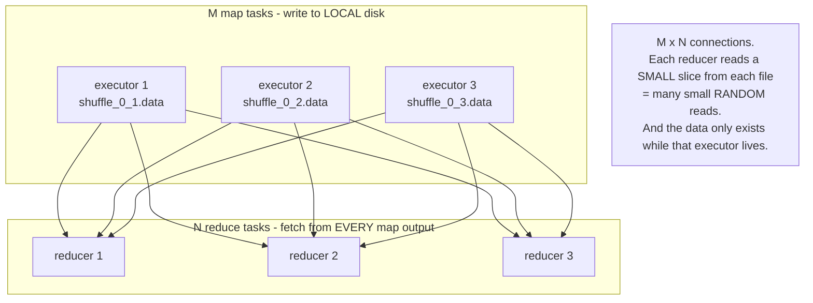
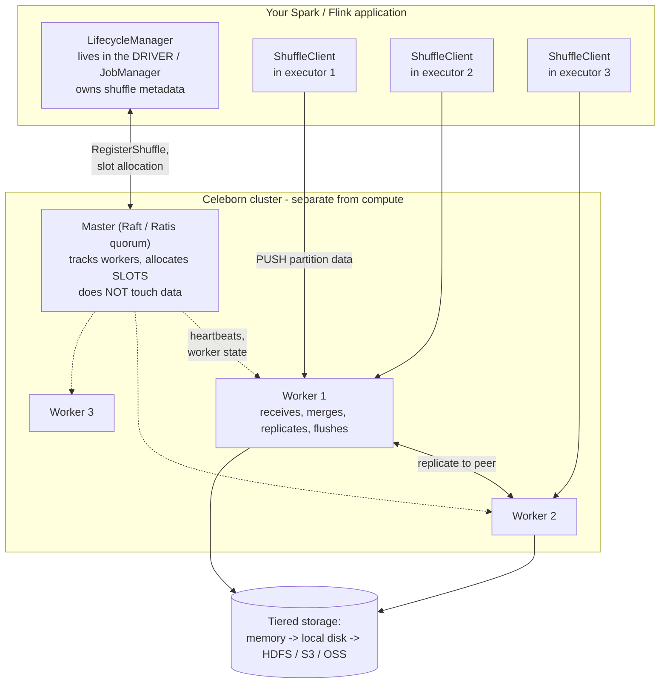
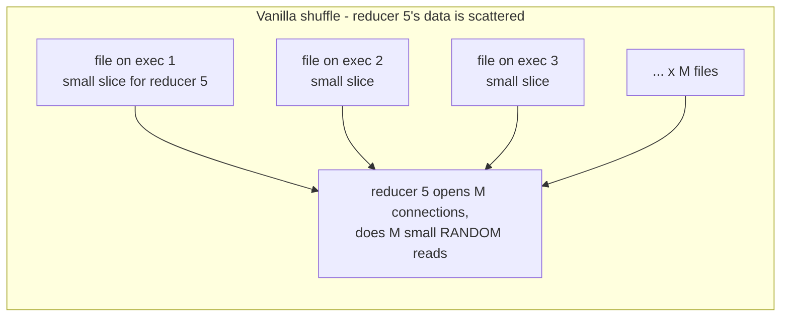
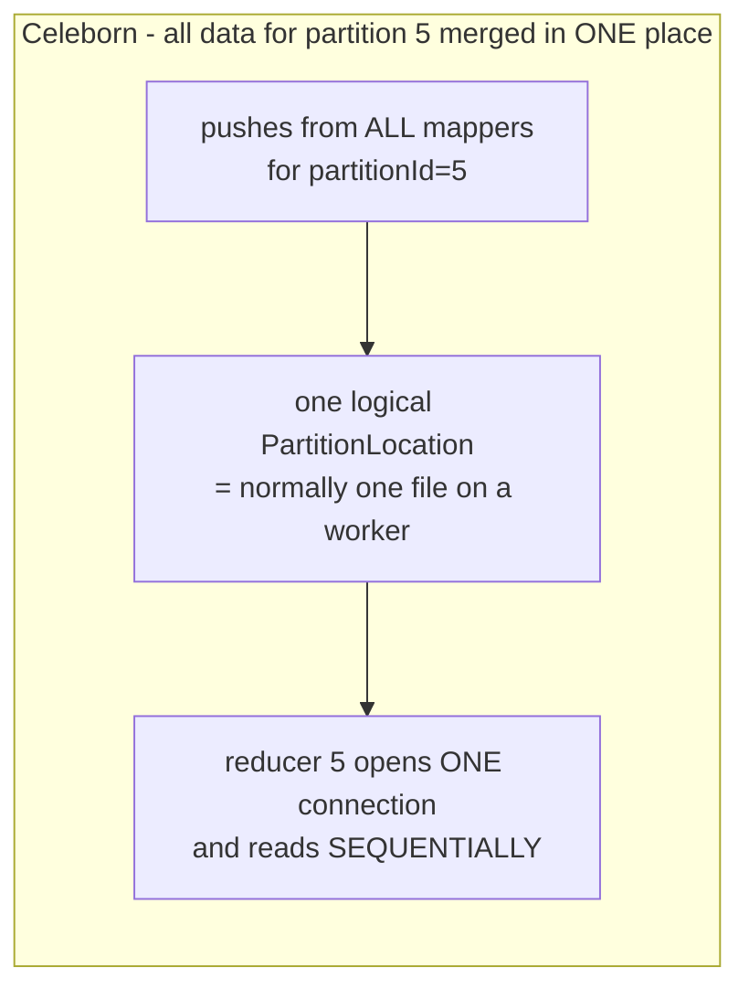
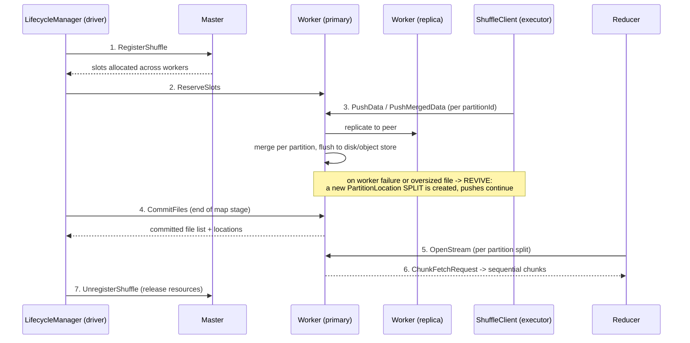
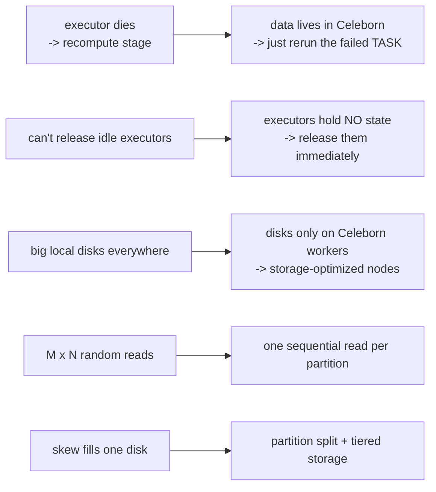
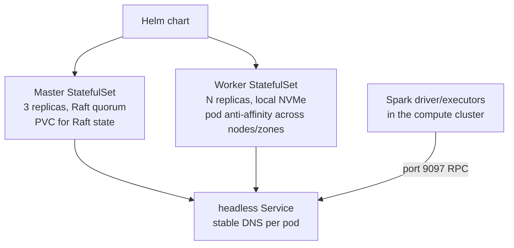

# Apache Celeborn — remote shuffle and spilled data

> **Mental model.** Shuffle is the one part of a distributed engine that assumes **local disks that outlive the task** ([01-hadoop.md](01-hadoop.md), [04-spark.md](04-spark.md)). Kubernetes and spot instances broke that assumption ([09-kubernetes.md](09-kubernetes.md)). Celeborn puts shuffle data in a **separate, replicated service** so that compute becomes genuinely stateless and disposable — and, as a bonus, turns the M×N random-read storm into sequential reads.

---

## 1. The problem, precisely

Recall how a shuffle works in Spark: each map task writes a partitioned file to **its executor's local disk**, and each reduce task fetches its slice from **every** map output.



Five distinct problems fall out of that design once you're on Kubernetes and the cloud:

| # | Problem | Consequence |
|---|---|---|
| 1 | **Shuffle data dies with the executor** | a spot reclaim or node failure forces **recomputation of the entire upstream stage** — catastrophic on multi-TB jobs |
| 2 | **Executors can't be released while holding shuffle files** | dynamic allocation stalls; you pay for idle executors (the shuffle-tracking problem, ch. 9 §5) |
| 3 | **Every node needs large local disks** | sized for peak shuffle, idle most of the time, and a few nodes do most of the shuffling |
| 4 | **M × N small random reads** | poor disk and network efficiency; at large M and N, connection storms and fetch failures |
| 5 | **Skew and spill** | a single hot partition can exhaust one executor's disk and fail the stage |

**Rule of thumb**: the bigger the job and the more elastic the cluster, the more these hurt. On a fixed YARN cluster with an external shuffle service, only #3–#5 bite. On Kubernetes with spot instances, #1 and #2 dominate.

---

## 2. What Celeborn is

> *"An elastic and high-performance service for shuffle and spilled data."*

An Apache top-level project (graduated from the incubator; 0.6.x/0.7.x are the current line), originally from Alibaba, now used by Alibaba Cloud EMR, AWS EMR, and many large Spark and Flink shops.

The core move: **executors push shuffle data over the network to a dedicated Celeborn cluster instead of writing it to local disk.**



| Component | Where it runs | Job |
|---|---|---|
| **Master** | dedicated pods/nodes, **Raft (Apache Ratis) quorum** for HA | tracks live workers, allocates **slots** for each shuffle, syncs shared state. **Never sees the data itself.** |
| **Worker** | dedicated pods/nodes with fast local disks | accepts pushed data, **merges it per partition**, replicates to a peer, flushes to storage, serves reads |
| **LifecycleManager** | inside the driver / JobManager (one per application) | registers shuffles, tracks partition locations and splits, triggers commits |
| **ShuffleClient** | inside each executor / TaskManager | the actual push and fetch |

---

## 3. The key idea: partition aggregation

This is what makes Celeborn *faster*, not merely *more elastic*.




Celeborn stores all data with the same `partitionId` in one **PartitionLocation**. The reducer therefore makes **one connection and one sequential scan** instead of M random reads. That converts the shuffle read from a random-I/O problem into a streaming one — which is why Celeborn often *speeds up* large shuffles rather than just making them survivable.

---

## 4. The shuffle lifecycle



Mechanisms worth naming individually:

| Mechanism | What it does | Why it matters |
|---|---|---|
| **Push-based** | mappers push; workers merge | removes the M×N fan-out at read time |
| **Slots** | Master allocates worker capacity per shuffle up front | load balancing across the Celeborn cluster |
| **Replication** (`push.replicate.enabled`) | each partition written to a **primary and a replica** worker | a Celeborn worker can die without losing shuffle data |
| **Revive / partition split** | when a file grows too large or a worker fails, a **new split** is opened and pushes continue | no stage failure; the LifecycleManager tracks splits so readers read them all |
| **CommitFiles** | flushes and seals files at the end of the map stage | readers get a consistent, complete view |
| **Graceful shutdown** | worker flushes and hands off before stopping | rolling upgrades of the Celeborn cluster don't kill running jobs |
| **Tiered storage** | memory → local disk → **HDFS / S3 / OSS**, with multipart parallel upload | capacity elasticity; cold shuffle data spills to object storage instead of failing |

---

## 5. What it buys you



The configuration that expresses this:

```properties
spark.shuffle.manager                            org.apache.spark.shuffle.celeborn.SparkShuffleManager
spark.celeborn.master.endpoints                  celeborn-master:9097
spark.celeborn.client.push.replicate.enabled     true

# THE important line: executors no longer hold shuffle data,
# so Spark may release them freely.
spark.dynamicAllocation.enabled                  true
spark.dynamicAllocation.shuffleTracking.enabled  false
```

**That last line is the punchline of both chapters.** Chapter 9 explained that shuffle tracking exists because Kubernetes has no external shuffle service, and that it blocks scale-down. Celeborn makes it unnecessary — compute becomes truly elastic, and **spot instances become safe for shuffle-heavy jobs**.

---

## 6. The costs — be honest about these

| Cost | Detail |
|---|---|
| **Another distributed system to operate** | Master quorum, workers, upgrades, monitoring, capacity planning |
| **Data crosses the network twice** | map → worker, worker → reducer, instead of a local write. Needs good network bandwidth |
| **Replication doubles write traffic** | `replicate.enabled=true` is the safe default but costs bandwidth and disk |
| **A new shared failure domain** | a Celeborn outage affects every job using it; size and isolate accordingly |
| **Worker nodes need fast disks** | local NVMe; network-attached volumes underperform badly |
| **Version and engine compatibility** | client jars must match the cluster; check your Spark/Flink versions |
| **Not free for small jobs** | a job whose shuffle fits comfortably on local disk gains little and pays the network hop |

---

## 7. Engine support

| Engine | Support |
|---|---|
| **Spark** | 3.x and 4.x — the primary use case; pluggable `ShuffleManager`, no code changes |
| **Flink** | 1.18–2.3, **batch jobs**: remote shuffle service (since Flink 1.16) and **hybrid shuffle** (since Flink 1.20) |
| **MapReduce** | supported via classpath configuration |
| **Gluten / Auron** | native-engine Spark accelerators, supported through the client API |

Note the Flink case is *batch* — streaming jobs shuffle continuously between running tasks and don't have the same materialization problem.

---

## 8. Running Celeborn on Kubernetes



Practical notes, tying back to chapter 9:
- **StatefulSets, not Deployments** — workers and masters have identity and disks.
- **Master** needs a durable volume for Raft state; **workers** want local NVMe (`hostPath`/local volumes) for the shuffle data itself.
- **Pod anti-affinity** so replicas of the same partition don't land on the same node.
- **Health probes**: 0.7 added `GET /healthz` on master and worker, wired into the Helm chart as startup/liveness/readiness probes; worker readiness only reports healthy once it has registered with the master, which gates rolling updates safely.
- A common topology is a **dedicated Celeborn cluster** (its own node pool, or even its own Kubernetes cluster reached via a load balancer) shared by many compute clusters.

---

## 9. Alternatives and how to choose

| Option | How it works | Best when |
|---|---|---|
| **Vanilla local shuffle** | executor local disk | fixed clusters, modest shuffle, no spot |
| **YARN external shuffle service** | per-node daemon serves files after the executor exits | you're still on YARN |
| **Spark push-based shuffle (Magnet, SPARK-30602)** | mappers also push blocks to be merged by the **external shuffle service** | YARN deployments wanting merged sequential reads without a new system |
| **Apache Celeborn** | dedicated push-based service; Master/Worker/Client; replication; tiered storage | **Kubernetes, spot instances, very large shuffles, multi-engine** |
| **Apache Uniffle** | similar remote shuffle service; Coordinator assigns Shuffle Servers by load | same problem space; evaluate both |
| **Cloud-managed RSS** | EMR/vendor-managed | you want someone else to run it |

**Decision guide**: if you're on YARN with stable nodes, you may not need any of this. If you're on Kubernetes, using spot instances, or regularly shuffling tens of TB, a remote shuffle service stops being an optimization and becomes infrastructure.

---

## 10. Interview answers

**What problem does Celeborn solve?** Shuffle data being tied to the executor's local disk. That coupling causes stage recomputation when executors die, blocks dynamic allocation scale-down, forces large local disks on every node, and produces M×N small random reads. Celeborn moves shuffle data to a replicated external service.

**Why does it matter specifically on Kubernetes?** Kubernetes has no external shuffle service, so Spark uses shuffle tracking, which keeps idle executors alive. Combined with spot instances — where nodes vanish routinely — local shuffle becomes both expensive and fragile. Celeborn lets you set `shuffleTracking.enabled=false` and release executors freely.

**How does it make reads faster, not just safer?** It merges all data for a given `partitionId` into one PartitionLocation, so a reducer opens one connection and reads sequentially instead of fetching M small slices from M executors.

**What is partition split / revive?** When a partition file grows too large or its worker fails, Celeborn opens a new split and pushes continue; the LifecycleManager records the splits so readers consume all of them. It avoids failing the stage.

**How is it fault-tolerant?** Master HA through a Raft (Ratis) quorum; per-job replication of partitions to a peer worker; graceful shutdown that flushes before stopping; and partition split to route around failed workers mid-stage.

**What are the downsides?** Another distributed system to run, two network hops for shuffle data, doubled write traffic with replication on, a shared failure domain across jobs, and little benefit for small jobs.

**Celeborn vs Spark's own push-based shuffle?** Magnet pushes blocks to be merged by the **YARN external shuffle service** — it improves read patterns but keeps shuffle tied to the compute cluster's nodes. Celeborn is a fully separate service, which is what decouples compute lifetime from shuffle data and works on Kubernetes.

---

## Sources
- [Apache Celeborn — architecture (official docs)](https://celeborn.apache.org/docs/latest/developers/overview/)
- [Apache Celeborn — deployment](https://celeborn.apache.org/docs/latest/deploy/) · [Deploy on Kubernetes](https://celeborn.apache.org/docs/latest/deploy_on_k8s/)
- [apache/celeborn on GitHub](https://github.com/apache/celeborn)
- [High-performance remote shuffle service on Amazon EMR with Apache Celeborn (AWS)](https://aws.amazon.com/blogs/big-data/high-performance-remote-shuffle-service-on-amazon-emr-with-apache-celeborn/)
- [Boost Spark performance with Celeborn (Alibaba Cloud EMR)](https://www.alibabacloud.com/help/en/emr/emr-on-ecs/user-guide/celeborn)
- [Apache Uniffle — remote shuffle service](https://uniffle.apache.org/blog/2023/07/21/Uniffle%20-%20New%20chapter%20for%20the%20shuffle%20in%20the%20cloud%20native%20era/)
