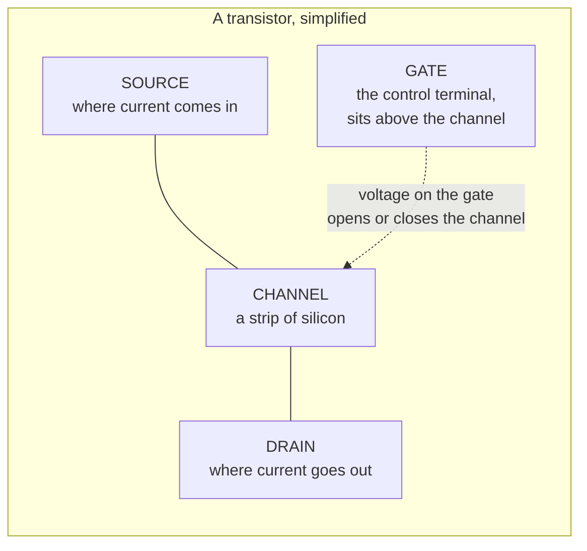
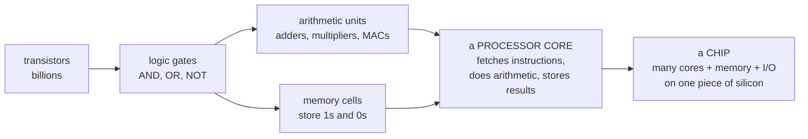
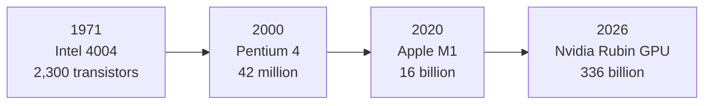
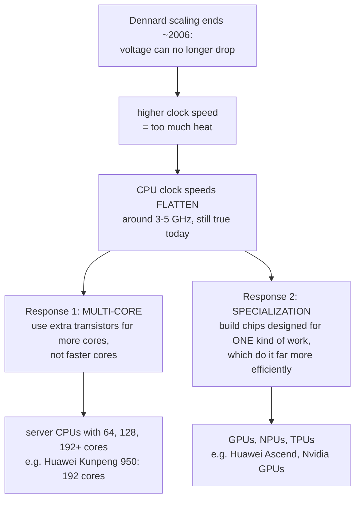
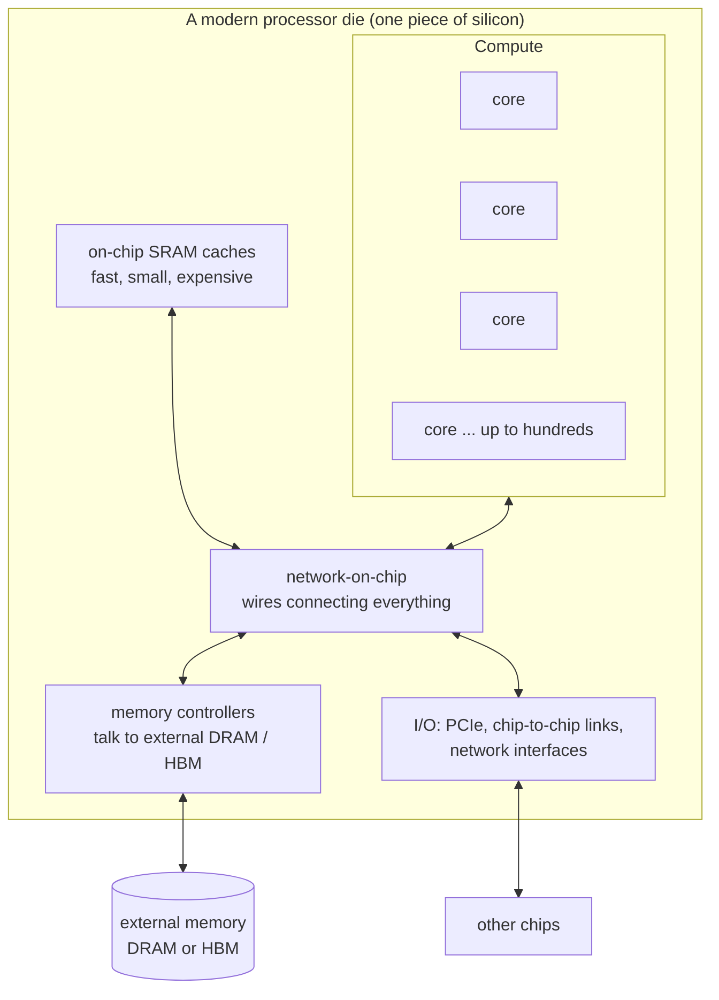

# 1. From a switch to a chip

> **Goal of this chapter.** Understand what a chip physically *is*, why it gets faster and more power-hungry, and why the industry stopped simply making CPUs faster and started building specialized chips like Huawei's Ascend. No background needed.

---

## 1.1 Everything is a switch

A computer does exactly one kind of thing, billions of times per second: **it turns tiny electrical switches on and off.**

- A switch that is **on** (current flows) represents **1**.
- A switch that is **off** (no current) represents **0**.

Everything else — numbers, text, images, an AI model — is built out of patterns of 1s and 0s. The number 13 is `1101` in binary. The letter "A" is `01000001`. A photograph is millions of numbers describing pixel colours.

So the question "how does a chip work?" becomes "how do you build billions of tiny switches, and how do you wire them together so they compute something useful?"

---

## 1.2 The transistor — a switch with no moving parts

The switch is the **transistor**. Specifically a **MOSFET** (metal-oxide-semiconductor field-effect transistor), which is what nearly every modern chip uses.



Think of it as a **water tap**:

| Water tap | Transistor |
|---|---|
| pipe in | source |
| pipe out | drain |
| the handle | gate |
| turning the handle | putting a voltage on the gate |
| water flows / stops | current flows (1) / stops (0) |

The crucial property: **a small voltage on the gate controls a current through the channel**, with no mechanical movement. So it can switch **billions of times per second**, and it can be made **extremely small** — modern transistors are a few tens of nanometres across. A human hair is about 80,000 nanometres wide.

### Why silicon?

Silicon is a **semiconductor**: normally it conducts electricity poorly, but add tiny amounts of other elements (called **doping**) and apply a voltage, and you can make it conduct well. That controllable in-between behaviour is exactly what a switch needs. Silicon is also cheap (it's refined from sand), and it grows a clean insulating oxide layer, which is what the gate sits on.

---

## 1.3 From switches to logic

Connect a few transistors together and you get **logic gates**: tiny circuits that take 1s and 0s in and produce a 1 or 0 out according to a rule.

| Gate | Rule | Example |
|---|---|---|
| **NOT** | flip it | 1 → 0 |
| **AND** | 1 only if *both* inputs are 1 | 1,1 → 1; 1,0 → 0 |
| **OR** | 1 if *either* input is 1 | 1,0 → 1 |
| **XOR** | 1 if the inputs *differ* | 1,0 → 1; 1,1 → 0 |

A NOT gate takes 2 transistors, and a NAND gate takes 4. That's the whole trick: **any computation can be built from these gates.**

### Gates make arithmetic

Adding two 1-bit numbers needs just an XOR (for the sum digit) and an AND (for the carry):

```
  1        sum   = 1 XOR 1 = 0
+ 1        carry = 1 AND 1 = 1
---
 10        (that's 2 in binary)
```

Chain 64 of these "adders" and you can add two 64-bit numbers. Build a **multiplier** out of many adders. Build a **multiply-accumulate (MAC)** unit — `a × b + c` — and you have the single operation that AI chips perform trillions of times per second. We will come back to MAC units constantly.



### Memory is also made of transistors

Gates compute; you also need to *remember*. A circuit of 6 transistors can hold one bit indefinitely as long as power is on — that's **SRAM**, the fast memory inside a chip. A single transistor plus a tiny capacitor holds one bit that slowly leaks and must be refreshed — that's **DRAM**, the cheaper, denser "main memory" in your computer. The difference between these two will matter enormously when we get to AI chips (chapter 5).

---

## 1.4 The clock — the chip's heartbeat

A chip does work in steps, and a **clock** signal tells every part of the chip when to take the next step. The clock ticks billions of times per second:

- **1 GHz** = 1 billion ticks per second.
- A 3 GHz CPU ticks 3 billion times per second — each tick is one third of a nanosecond.

In one third of a nanosecond, light travels about 10 cm. Electrical signals inside a chip travel slower than that. **This is a real physical limit**: the chip can't be too big, or a signal can't cross it within one tick. That's one reason chips are designed as many small cores rather than one giant one.

---

## 1.5 Power — the constraint that shapes everything

Every time a transistor switches, it charges or discharges a tiny amount of capacitance and burns a tiny amount of energy. Multiply by billions of transistors and billions of switches per second and you get real heat.

The formula to remember (you don't need to calculate with it, just understand its shape):

```
Dynamic power  ≈  α  ×  C  ×  V²  ×  f

α = how often transistors actually switch (activity)
C = capacitance being charged (bigger transistors & wires = more)
V = supply voltage             ← SQUARED — the most important term
f = clock frequency
```

The consequences:
- **Voltage is squared.** Cutting voltage by 30 % cuts power by about half. This is why chip designers obsess over voltage.
- **Frequency is linear**, but higher frequency usually *needs* higher voltage to work reliably — so in practice, pushing frequency up costs power roughly with the *cube* of the frequency. Going from 3 GHz to 4 GHz can cost more than twice the power.
- All that power becomes **heat**, and heat must be removed. A modern AI chip draws **700–1,400 watts** — more than a microwave oven — from a piece of silicon the size of a postage stamp. That's why AI data centres use **liquid cooling**.

**This is the single most important idea in modern chip design: performance is limited by power and heat, not by how many transistors you can build.**

---

## 1.6 Moore's law and Dennard scaling — and how they broke

### Moore's law (1965)

Gordon Moore observed that **the number of transistors on a chip doubles roughly every two years**. It held for about 50 years and is still roughly true for density, though it has slowed and become far more expensive.



### Dennard scaling (1974) — the free lunch

Robert Dennard showed that when you shrink a transistor, you can also lower its voltage, so **power per unit area stays constant**. Result: every new generation, you got more transistors, running faster, at the same power. Chips got faster automatically — the "free lunch."

### Around 2005–2007, Dennard scaling ended

Transistors got so small that lowering voltage further made them **leak current even when "off"** — the tap drips. Voltage stopped going down. So:



**This diagram explains why the two Huawei product lines you asked about exist:**
- **Kunpeng** is the "many cores" answer — a general-purpose CPU with up to 192 (and soon 256+) cores.
- **Ascend** is the "specialization" answer — a chip built almost entirely for the math that AI uses.

### Why specialization wins for AI

A general-purpose CPU spends most of its transistors and energy on *figuring out what to do next* — fetching instructions, predicting branches, reordering work, managing caches. Only a small fraction of the energy goes into actual arithmetic.

AI workloads are, overwhelmingly, **the same operation repeated trillions of times**: multiply two numbers, add to a running total (a MAC). A chip that knows that in advance can skip almost all of the "figuring out" machinery and fill itself with thousands of MAC units. For AI, that can be 10–100× more work per watt than a CPU. Chapter 4 explains exactly how.

---

## 1.7 What a modern chip actually contains



Keep this picture in mind. Every chapter adds detail to one box:
- **Chapter 2** — how the silicon is manufactured (and why that's Huawei's hardest problem).
- **Chapter 3** — what's inside a CPU core (→ Kunpeng).
- **Chapter 4** — what's inside an AI core (→ Ascend).
- **Chapter 5** — the memory box and packaging (→ Huawei's self-made HBM).
- **Chapter 6** — the I/O box and connecting thousands of chips (→ SuperPoD, UnifiedBus, optics).

---

## 1.8 Check your understanding

1. What does a transistor do, in one sentence?
   > It's a switch: a voltage on the gate controls whether current flows between source and drain, representing 1 or 0.
2. Why did CPU clock speeds stop rising around 2006?
   > Dennard scaling ended — voltage couldn't keep dropping without leakage, so higher frequency meant unmanageable power and heat.
3. What were the industry's two responses?
   > More cores per chip, and specialized chips built for one kind of workload.
4. Why is voltage the most important term in the power formula?
   > Power scales with voltage squared, so small voltage reductions give large power savings.
5. Which Huawei product line corresponds to each response?
   > Kunpeng = many general-purpose cores (CPU). Ascend = specialization for AI (NPU).

**Next: [02-how-chips-are-made.md](02-how-chips-are-made.md)**
