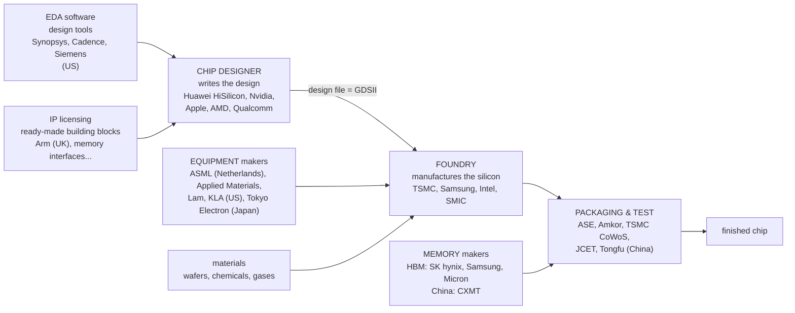
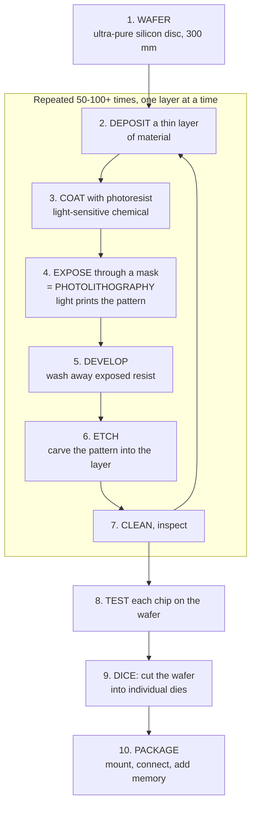
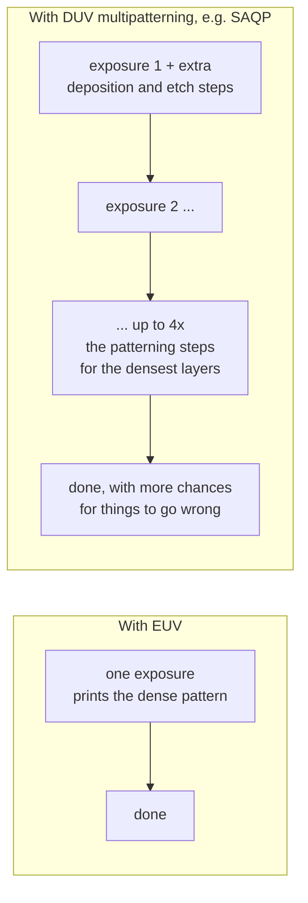
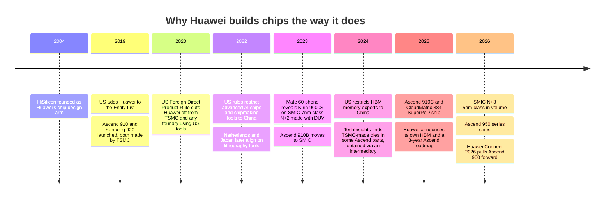

# 2. How chips are made — and why it's Huawei's hardest problem

> **Goal of this chapter.** Understand how a design becomes silicon, what "7nm" and "5nm" actually mean (hint: not what they say), why EUV machines matter so much, how yield works, and therefore why Huawei's chip strategy looks the way it does. This chapter is the key to understanding *every* design choice in chapters 6 and 7.

---

## 2.1 The industry's structure — who does what

Making a chip involves very different companies:



| Model | Designs? | Manufactures? | Examples |
|---|---|---|---|
| **Fabless** | yes | no — pays a foundry | Nvidia, AMD, Apple, Qualcomm, **Huawei HiSilicon** |
| **Foundry** | no | yes — for others | **TSMC**, **SMIC**, Samsung Foundry |
| **IDM** (integrated device manufacturer) | yes | yes — its own fabs | Intel, Samsung, Texas Instruments |

**Huawei's HiSilicon is fabless.** It designs excellent chips but depends on someone else to build them. Until 2020, that was TSMC in Taiwan, the world's most advanced foundry. That dependency is the root of the story.

---

## 2.2 How a chip is manufactured (simplified)

A chip is built on a **wafer**: a disc of ultra-pure silicon, 300 mm (12 inches) across, sliced from a single crystal. Hundreds of chips are made on one wafer at the same time, then cut apart.



The bottom layers are the transistors themselves. Above them, **10–20 layers of metal wiring** connect everything. A modern chip takes **around three months** to go through the fab and involves **over a thousand process steps**.

### Photolithography — the heart of it

**Photolithography is printing with light.** Light passes through a **mask** (a stencil of the circuit pattern), gets shrunk by a system of lenses or mirrors, and exposes a light-sensitive coating on the wafer.

The fundamental limit is physics: **you cannot print features much smaller than the wavelength of light you use.** Roughly:

```
smallest printable feature  ≈  k₁ × λ / NA

λ   = wavelength of light          ← the big lever
NA  = numerical aperture (how much light the lens gathers)
k₁  = process cleverness factor (practically ≥ ~0.25)
```

Two kinds of light matter today:

| | **DUV** (deep ultraviolet) | **EUV** (extreme ultraviolet) |
|---|---|---|
| Wavelength | **193 nm** | **13.5 nm** — about 14× shorter |
| Best single-exposure pitch | ~76–80 nm (with immersion) | ~30–36 nm |
| Machine maker | ASML, Nikon, Canon | **ASML only — a global monopoly** |
| Cost per machine | ~$50–100 M | **~$200 M+** (High-NA EUV: ~$380 M) |
| Available to China? | older models yes; advanced immersion tools restricted | **No — never shipped** |

EUV light is so hard to make that ASML's machine fires a laser at droplets of molten tin, 50,000 times per second, to create a plasma that emits 13.5 nm light. It's one of the most complex machines ever built, and **no one else in the world makes one.**

---

## 2.3 What "7nm" and "5nm" really mean

**Process node names are marketing labels.** Nothing on a "7nm" chip is 7 nanometres long. The names used to match the transistor gate length, but that link broke around 1997 and the numbers have continued to shrink by convention since.

What actually matters is **density** — how many transistors fit per square millimetre — and the performance and power of those transistors.

| Node (foundry name) | Approx. density (million transistors / mm²) | Lithography | Year |
|---|---|---|---|
| TSMC N7 | ~90 | DUV (N7) / EUV (N7+) | 2018 |
| **SMIC N+2** ("7nm-class") | ~90 (estimated, similar to TSMC N7) | **DUV only** | 2023 |
| TSMC N5 | ~130–170 | EUV | 2020 |
| **SMIC N+3** ("5nm-class") | **between TSMC N7 and N5** per teardowns | **DUV only** | 2025–26 |
| TSMC N3 | ~200+ | EUV | 2022–23 |
| TSMC N2 | higher still, new "gate-all-around" transistors | EUV | 2025–26 |

(Densities are approximate; they vary with the mix of logic and memory on the chip.)

**Remember**: you cannot compare node names across companies. Intel's "Intel 7" is roughly TSMC N7-class; SMIC's "N+3" is, according to TechInsights' teardown of the Kirin 9030 phone chip, **somewhere between 7nm-class and a true 5nm-class**, not a full generational leap.

---

## 2.4 Multipatterning — how to go smaller without EUV

If you can't get EUV, can you still print tiny features with DUV? **Yes, but painfully**: you split one dense pattern into two, three or four sparser patterns and print them in sequence, each one shifted slightly.



This is exactly how SMIC reaches 7nm-class and "5nm-class" without EUV. It works, but it costs:

| Cost | Why |
|---|---|
| **More steps** | 2–4 exposures + extra deposition/etch for each critical layer |
| **Lower throughput** | each wafer spends much longer in the lithography tools, so fewer wafers per month |
| **Lower yield** | every extra step is another chance to misalign or introduce a defect |
| **Higher cost per chip** | all of the above; estimates put it at a large premium over the TSMC equivalent |
| **Diminishing returns** | beyond ~5nm-class, DUV multipatterning becomes impractical |

Reports have put SMIC's advanced-node yields well below TSMC's (figures of 20–40 % have been reported for some 7nm products — treat these as estimates, since neither company publishes them). **Keep "lower yield, fewer wafers, higher cost" in mind — it directly explains Huawei's system designs.**

---

## 2.5 Yield — why big chips are expensive

Every wafer has random **defects** — a dust particle, a flaw in the crystal. If a defect lands on a chip, that chip usually fails. **The bigger the chip, the more likely it catches a defect.**

A standard simple model:

```
Yield  ≈  e^(−D × A)

D = defect density (defects per cm²) — how clean/mature the process is
A = die area (cm²)
```

Let's compute with realistic numbers. A large AI chip die is about **8 cm²** (800 mm²).

| Process maturity | D (defects/cm²) | Yield for an 8 cm² die | Yield for a 2 cm² die |
|---|---|---|---|
| Very mature (a leading foundry, late in a node's life) | 0.1 | e^(−0.8) ≈ **45 %** | e^(−0.2) ≈ **82 %** |
| Less mature / harder process | 0.3 | e^(−2.4) ≈ **9 %** | e^(−0.6) ≈ **55 %** |

Read the table carefully — it's one of the most important in this whole course:

1. **A worse process punishes big chips disproportionately.** Going from D = 0.1 to 0.3 cuts yield on the big die from 45 % to 9 % (five times worse), but on the small die only from 82 % to 55 %.
2. **Therefore, on a less mature process, you want smaller dies.** Split one big chip into several smaller **chiplets** and connect them in the package (chapter 5). Each small die yields much better.
3. There's also a hard ceiling: the **reticle limit**. A lithography machine can expose at most about **26 × 33 mm (~858 mm²)** in one shot. No single die can be bigger than that. The biggest AI chips are already at that limit, which is another reason everyone moved to multiple dies per package.

**Connect the dots for Huawei**: on SMIC's DUV-multipatterned process, defect density is higher and wafer capacity is limited. So Huawei is pushed toward (a) multiple smaller dies per package, (b) accepting lower performance *per chip*, and (c) **using more chips** and connecting them extremely well. That third point is the entire SuperPoD strategy (chapter 7).

---

## 2.6 The geopolitical timeline you need to know

This isn't politics for its own sake — it's the engineering constraint that shapes every Huawei chip.



The four chokepoints for any Chinese chip company:

| Chokepoint | Who controls it | Huawei's response |
|---|---|---|
| **EUV lithography** | ASML (Netherlands), under export controls | DUV multipatterning at SMIC; accept density/yield penalty |
| **Leading-edge foundry** | TSMC, Samsung | SMIC as domestic foundry |
| **HBM memory** | SK hynix, Samsung, Micron (restricted since late 2024) | **self-developed HBM** (HiBL 1.0, HiZQ 2.0) + domestic partners |
| **EDA design software** | Synopsys, Cadence, Siemens | domestic EDA tools, in-house tooling |

And a fifth, softer one: **software ecosystem** (Nvidia's CUDA). Huawei's answer is CANN and MindSpore — covered in chapter 7.

---

## 2.7 Check your understanding

1. What's the difference between a fabless company, a foundry and an IDM? Which is Huawei HiSilicon?
   > Fabless designs only; a foundry manufactures for others; an IDM does both. HiSilicon is fabless.
2. What does "7nm" actually measure?
   > Nothing physical any more — it's a marketing generation label. Compare density and transistor performance instead.
3. Why does EUV matter so much?
   > Its 13.5 nm light prints far finer features in one exposure than 193 nm DUV. ASML is the only maker and it is not sold to China.
4. How does SMIC make 7nm/5nm-class chips without EUV, and what does it cost?
   > DUV multipatterning — several exposures per layer. More steps, lower throughput, lower yield, higher cost, and a practical limit around 5nm-class.
5. Why do big chips suffer more on an immature process?
   > Yield ≈ e^(−D·A): higher defect density hits large-area dies exponentially harder. That pushes designers toward smaller dies (chiplets) and more chips.
6. What is the reticle limit?
   > The maximum area one lithography exposure can print, ~858 mm². No single die can exceed it.

**Next: [03-cpu-and-kunpeng.md](03-cpu-and-kunpeng.md)**

---

## Sources
- [SMIC N+3 confirmed: Kirin 9030 analysis (TechInsights)](https://www.techinsights.com/blog/smic-n3-confirmed-kirin-9030-analysis-reveals-how-close-smic-5nm)
- [Huawei's Kirin 9030 made on SMIC N+3 (Tom's Hardware)](https://www.tomshardware.com/tech-industry/semiconductors/huaweis-latest-mobile-is-chinas-most-advanced-process-node-to-date-despite-using-blacklisted-chipmaker-huawei-kirin-9030-mobile-soc-made-on-smic-n-3-process-but-cant-compete-with-5nm-nodes)
- [SMIC AI chip strategy 2026](https://enkiai.com/ai-market-intelligence/smic-ai-chip-strategy-2026-inside-chinas-5nm-power-play/)
- [Huawei / HiSilicon spotlight — Ascend, SMIC, export controls](https://semiconductorx.com/spotlight-huawei-hisilicon.html)
