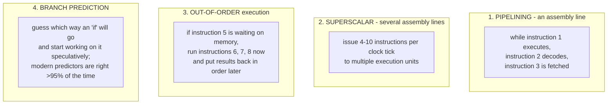
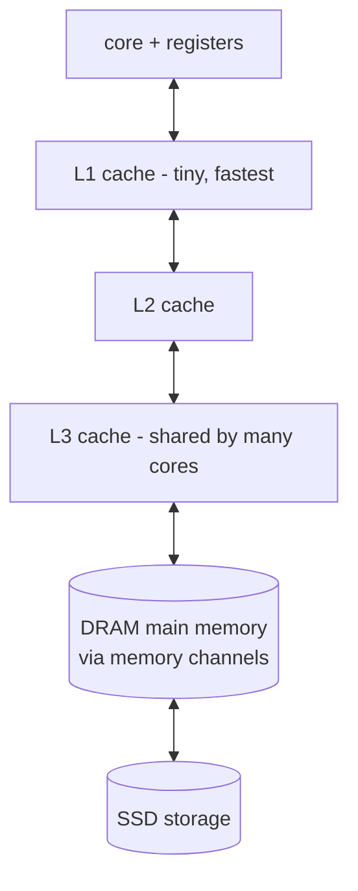
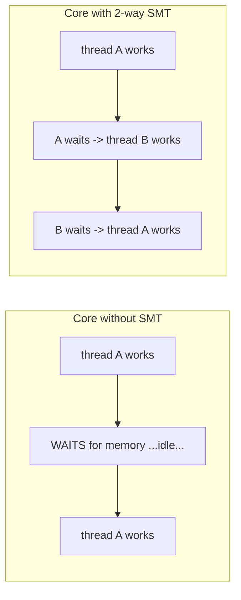
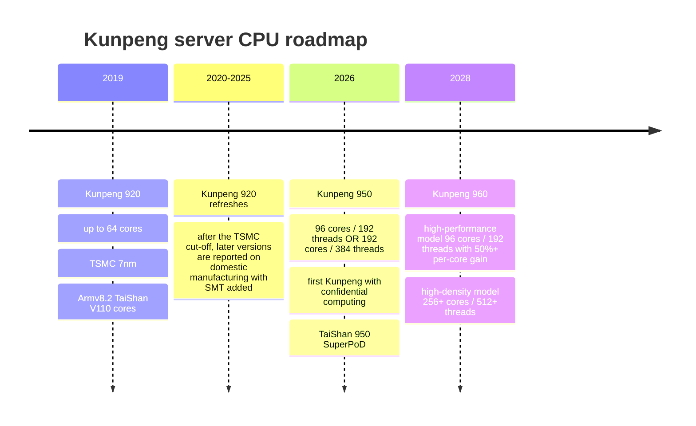

# 3. How a CPU works — and Huawei Kunpeng

> **Goal of this chapter.** Understand what's inside a CPU core, what "192 cores, 384 threads" means, why memory is slow and caches exist, what Arm vs x86 means, and then where Huawei's Kunpeng CPUs (920 → 950 → 960) fit — including why a CPU company matters in an AI story.

---

## 3.1 What a CPU does

A CPU (central processing unit) runs **programs**: lists of simple **instructions** like "load this number from memory", "add these two numbers", "if the result is zero, jump to instruction 47".

Every core repeats a cycle:

**Registers** are a handful of tiny, ultra-fast storage slots inside the core — the core's "hands". Everything the core works on must be in a register first.

---

## 3.2 The ISA — the language a CPU speaks

The **instruction set architecture (ISA)** is the vocabulary of instructions a CPU understands. Software compiled for one ISA won't run on another without translation.

| ISA | Owner / model | Where you see it | Style |
|---|---|---|---|
| **x86-64** | Intel & AMD only (cross-licensed) | PCs, most servers historically | complex instructions (CISC) |
| **Arm (AArch64)** | Arm Ltd (UK) **licenses** it | every phone, Apple Macs, AWS Graviton, Nvidia Grace, **Huawei Kunpeng** | simpler, regular instructions (RISC) |
| **RISC-V** | open standard, free to use | embedded chips, growing in China, emerging in servers | RISC, modular |

### Arm licensing — important for Huawei

Arm sells two kinds of licence:
- **Core licence**: use Arm's ready-made core designs (e.g. Neoverse). Fast to market, but you use Arm's design.
- **Architecture licence**: implement the Arm *instruction set* with **your own core design**. Much harder, full control.

Huawei holds an **architecture licence for Armv8**, so it designs its own cores (the "TaiShan" cores) that speak Armv8. This is why Kunpeng can exist under sanctions. The risk: newer Arm versions (Armv9) were reported to be off-limits to Huawei because they contain US-origin technology — which is one reason China is investing heavily in RISC-V as a long-term hedge.

---

## 3.3 Making one core fast

A modern core doesn't do one instruction at a time. Four big tricks:

All four exist for one reason: **keep the execution units busy instead of waiting.** They are also why a high-end CPU core is *large and power-hungry* — most of its area is prediction, reordering and bookkeeping logic, not arithmetic. Remember this when we reach AI chips, which throw most of this machinery away.

**Vector (SIMD) units**: cores also have units that apply one instruction to many numbers at once (Arm calls these NEON and SVE; x86 calls them AVX). "Add these 16 pairs of numbers in one instruction." This is a first, small step toward the massive parallelism of AI chips.

---

## 3.4 The memory wall and caches

Here is the most important performance fact in all of computing:

> **The core is fast. Memory is slow. Very slow.**

| Where data lives | Typical size | Time to get data | If one clock tick were 1 second… |
|---|---|---|---|
| Register | bytes | ~0.3 ns (1 cycle) | 1 second |
| **L1 cache** (SRAM, per core) | 64 KB | ~1 ns | 4 seconds |
| **L2 cache** (SRAM, per core) | 1–2 MB | ~4 ns | 14 seconds |
| **L3 cache** (SRAM, shared) | 32–512 MB | ~15–40 ns | 1–2 minutes |
| **Main memory** (DRAM) | 256 GB – several TB | ~80–120 ns | **5–6 minutes** |
| **SSD** | TBs | ~50–100 µs | **2–4 days** |

If the core had to go to DRAM for everything, it would spend almost all its time waiting. So chips keep copies of recently-used data in **caches** — small, fast SRAM memories close to the core. Because programs tend to reuse the same data (and nearby data), caches hit most of the time.

Two metrics describe memory, and you need both:
- **Latency** — how long one request takes (the table above).
- **Bandwidth** — how many bytes per second can flow. A server CPU with 8–12 DDR5 channels gets roughly **300–600 GB/s**. (AI chips need *10×* that — which is why they use HBM, chapter 5.)

**"The memory wall"** is the name for the fact that processors got faster much more quickly than memory did. It's the recurring villain of this whole course.

---

## 3.5 Many cores, threads, NUMA

### Cores

After Dennard scaling ended (chapter 1), extra transistors went into **more cores**. A modern server CPU has 64–192+ cores, each a complete processor.

### Threads — what "192 cores / 384 threads" means

**Simultaneous multithreading (SMT)** lets one physical core run **two instruction streams (threads)** at once. When thread A is stuck waiting for memory, the core's execution units run thread B instead. Intel calls this Hyper-Threading.

So **"192 cores, 384 threads" = 192 physical cores, each running 2 threads.** SMT typically adds maybe 15–30 % throughput — *not* 2× — because the two threads share the same execution units and caches. It helps most for workloads that wait on memory a lot, like databases and web services.

### Sockets and NUMA

A server often has **2 CPU sockets** (two CPU chips on one board). Each CPU has its own directly-attached memory. A core can reach the *other* CPU's memory, but more slowly. This is **NUMA** (non-uniform memory access). Big multi-chiplet CPUs have NUMA effects even *within* one package. Software that ignores NUMA can lose a lot of performance.

---

## 3.6 Why CPUs still matter in the AI era

It's tempting to think AI is all about GPUs/NPUs. But every AI server still needs CPUs, and their role is growing:

| Job | Why a CPU does it |
|---|---|
| **Host** for the accelerators | launches work on the NPUs, feeds them data, runs the OS and scheduler |
| **Data preprocessing** | decoding, tokenizing, shuffling training data |
| **Databases & analytics** | still overwhelmingly CPU work (and GaussDB, Spark — Huawei cites both) |
| **KV-cache and memory pooling** | holding large amounts of memory that accelerators can reach |
| **AI agents** | agents run tools, code and sandboxes — thousands of small, branchy CPU tasks |

That last row is new and is exactly why Huawei's 2026 keynote pitched the TaiShan 950 SuperPoD at "sandbox startup" speed: an **agent** calling tools spawns huge numbers of isolated little environments, which is CPU work, not NPU work.

---

## 3.7 Huawei Kunpeng

**Kunpeng** (鲲鹏, a mythical giant bird-fish) is Huawei's family of **Arm-based server CPUs**, designed by HiSilicon with Huawei's own TaiShan cores. Servers built on it are called **TaiShan** servers. Its main markets are Chinese government, finance, telecom, and cloud — where "domestic, controllable" technology is a requirement — plus Huawei Cloud itself.

### The generations

### Kunpeng 920 (2019)
- Up to **64 cores**, Armv8.2, Huawei's own **TaiShan V110** cores, ~2.6 GHz.
- **TSMC 7nm** — made just before the US cut Huawei off from TSMC.
- 8 DDR4 memory channels, PCIe 4.0, and integrated high-speed networking.
- At launch, competitive on multi-core throughput with the x86 server chips of its day, weaker on single-thread performance.

### Kunpeng 950 (2026)
Announced at Huawei Connect 2025 for Q1 2026:
- **Two configurations**: 96 cores / 192 threads, and **192 cores / 384 threads**. (Now you know what the threads mean: 2-way SMT.)
- **"Four-layer isolation"** security and **confidential computing** — the first Kunpeng with it. Confidential computing means data stays encrypted *while being processed*, in hardware-protected enclaves, so even the cloud operator can't read it. Important for government and finance customers.
- Powers the **TaiShan 950 SuperPoD**.

### TaiShan 950 SuperPoD — a *CPU* SuperPoD

"SuperPoD" isn't only for AI chips. Huawei applies the same idea — many chips joined by its **UnifiedBus** interconnect so they behave like one big machine with **shared memory** — to CPUs:

| | Announced Sept 2025 | Upgraded at Huawei Connect, Sept 2026 |
|---|---|---|
| Scale | up to 16 nodes, 32 processors | **up to 4,096 nodes** |
| Pooled memory | 48 TB | **up to 256 TB unified memory** |
| Huawei's claimed wins | GaussDB (Huawei's database) 2.9× faster; +20 % memory utilization in VMs; Spark 30 % faster | 100,000 sandboxes start 30× faster; 2× vector-search efficiency on 10 billion × 1,000-dim vectors |

The pitch is **memory pooling**: rather than each server being stuck with its own fixed memory, the pod's memory is shared, so a huge database or a vector index can use far more memory than any one server has. (Chapter 6 explains how UnifiedBus makes that possible.) Note these are Huawei's own benchmarks.

### Kunpeng 960 (2028)
Two variants, which illustrates a general trend in server CPUs — splitting into "fast cores" and "many cores" products:
- **High-performance**: 96 cores / 192 threads, **50 %+ higher per-core performance** — aimed at AI hosts and databases, where single-thread speed matters.
- **High-density**: **at least 256 cores / 512 threads** — aimed at cloud, where you want as many cores per rack as possible.

For comparison, AMD's and Intel's current server CPUs are also in the ~128–288-core range; the "many cores" race is industry-wide.

### Why Kunpeng matters strategically
Huawei is building a **complete, domestic compute stack** — CPU (Kunpeng), AI accelerator (Ascend), interconnect (UnifiedBus), OS (**openEuler**, which Huawei reports at over 20 million installations), database (GaussDB), and AI software (CANN, MindSpore). Kunpeng is the general-purpose half of that stack.

---

## 3.8 Check your understanding

1. What is an ISA, and why can't x86 software run directly on Kunpeng?
   > The instruction vocabulary a CPU understands. Kunpeng speaks Arm (AArch64), not x86, so software must be compiled for Arm.
2. What's the difference between an Arm core licence and an architecture licence?
   > A core licence lets you use Arm's designs; an architecture licence lets you design your own cores implementing the Arm ISA. Huawei has the latter for Armv8.
3. What does "192 cores / 384 threads" mean, and does SMT double performance?
   > 192 physical cores, each running 2 hardware threads via SMT. No — typically +15–30 %, because threads share the core's resources.
4. Why do caches exist?
   > DRAM is ~100× slower than the core; caches keep frequently-used data in fast on-chip SRAM.
5. Why are CPUs becoming *more* important for AI, not less?
   > Hosting accelerators, data preprocessing, databases, memory pooling, and especially AI agents, which run lots of CPU-bound tools and sandboxes.
6. What's the idea of a CPU SuperPoD?
   > Join many CPU servers with a high-speed interconnect so their memory can be pooled and shared, behaving like one larger machine.

**Next: [04-ai-chips-and-ascend-core.md](04-ai-chips-and-ascend-core.md)**

---

## Sources
- [Huawei Connect 2025 keynote — Kunpeng 950/960, TaiShan 950 SuperPoD](https://www.huawei.com/en/news/2025/9/hc-xu-keynote-speech)
- [Huawei Connect 2026 keynote — TaiShan 950 SuperPoD upgrade, ecosystem](https://www.huawei.com/en/news/2026/9/hc-wang-keynote)
- [Huawei next-gen Kunpeng: 950 up to 192 cores, 960 over 256 cores (Wccftech)](https://wccftech.com/huawei-next-gen-kungpeng-chips-950-series-up-to-192-cores-q4-2026-960-series-over-256-cores-q1-2028/)
- [Huawei plans 256-core CPU for 2028 (TechRadar)](https://www.techradar.com/pro/huawei-is-planning-a-256-core-cpu-monster-to-take-on-amds-epyc-and-intels-xeon-range-but-it-wont-land-till-2028-at-least-thats-the-official-line)
