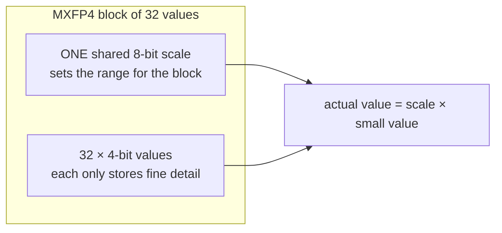
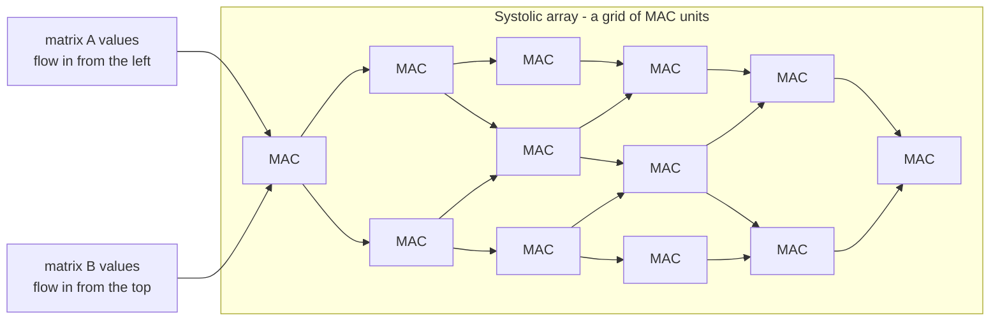
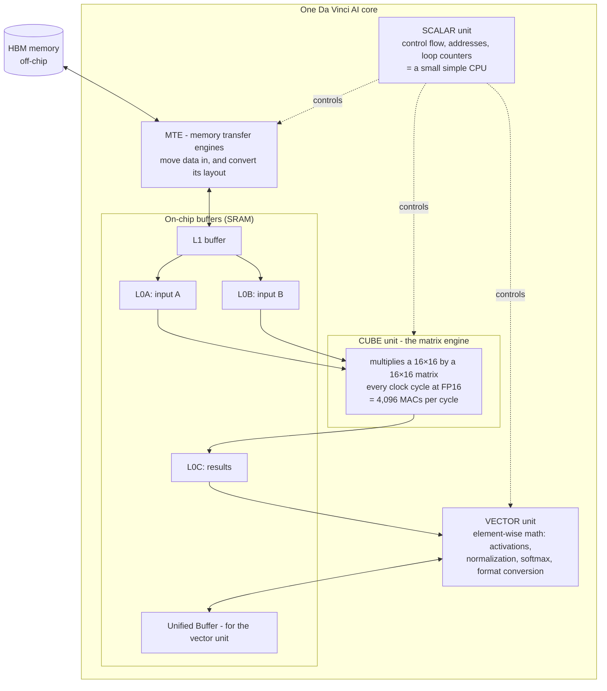
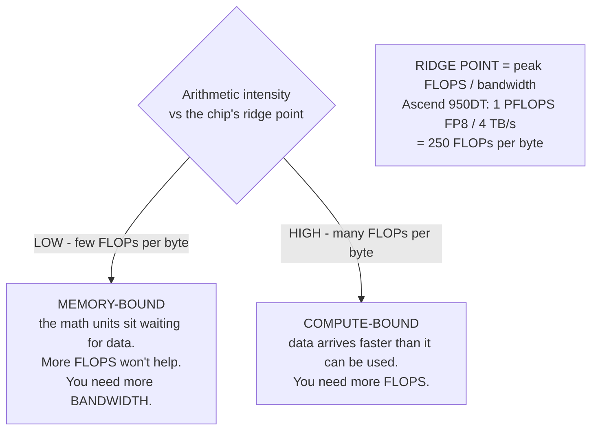
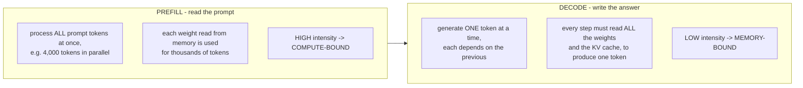
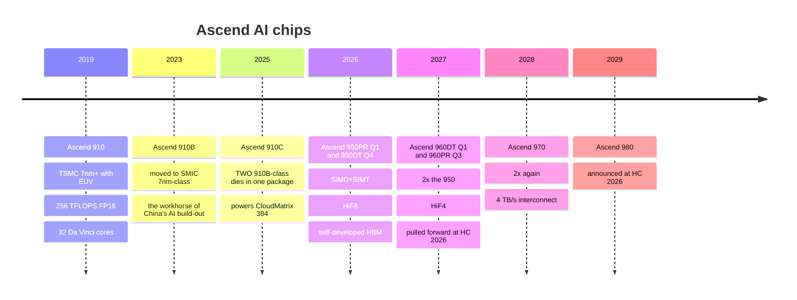

# 4. How AI chips work — and inside the Ascend core

> **Goal of this chapter.** Understand what math AI actually does, why number formats like FP8 and FP4 matter, how a GPU differs from an NPU, what's inside Huawei's Da Vinci AI core, and — the most useful idea in the chapter — why some AI work is limited by compute and some by memory. That last idea explains why Huawei split the Ascend 950 into two different chips.

---

## 4.1 What AI actually computes

A neural network is, mechanically, **a long sequence of matrix multiplications** with some simple functions in between.

A tiny example: a layer takes 3 inputs and produces 2 outputs using a **weight matrix** W (these weights are what "training" learns):

```
       W (2×3)          x (3)      y (2)
  [ 0.2  -0.5  0.1 ]   [ 1.0 ]   [ 0.2·1.0 + (−0.5)·2.0 + 0.1·3.0 ]   [ −0.5 ]
  [ 0.7   0.3  0.4 ] × [ 2.0 ] = [ 0.7·1.0 +   0.3·2.0 + 0.4·3.0 ] = [  2.5 ]
                       [ 3.0 ]
```

Every output number is a chain of **multiply-accumulate (MAC)** operations: multiply, add to a running total, repeat. A large language model (LLM) is the same thing at enormous scale:

- A 70-billion-parameter model has **70 billion weights**.
- Generating **one token** (roughly one word-piece) costs about **2 × 70 billion = 140 billion arithmetic operations** (one multiply + one add per weight).
- Training runs on trillions of tokens. The total math is measured in the 10²⁴–10²⁶ range.

### FLOPS — the unit of AI compute

**FLOP** = one floating-point operation (a multiply or an add). **FLOPS** = FLOPs per second.

| Prefix | Value | Example |
|---|---|---|
| TFLOPS (tera) | 10¹² | a laptop GPU: tens of TFLOPS |
| **PFLOPS** (peta) | 10¹⁵ | **one Ascend 950 chip: 1 PFLOPS at FP8** |
| **EFLOPS** (exa) | 10¹⁸ | **one Atlas 950 SuperPoD: 8 EFLOPS at FP8** |
| **ZFLOPS** (zetta) | 10²¹ | **Atlas 960 SuperCluster: 2 ZFLOPS at FP8 (planned)** |

**Always ask "FLOPS at what precision?"** — the next section explains why the same chip has a different FLOPS number for every format.

---

## 4.2 Number formats — the hidden lever

Computers store real numbers as **floating point**: a sign, an **exponent** (how big — the range), and a **mantissa** (the precise digits).

```
FP32   [s][ exponent 8 ][        mantissa 23         ]   32 bits  - classic "full precision"
BF16   [s][ exponent 8 ][ m 7 ]                          16 bits  - same RANGE as FP32, less precision
FP16   [s][ exp 5 ][  m 10  ]                            16 bits  - more precision, less range
FP8    [s][exp 4][m 3]  (E4M3)   or  [s][exp 5][m2] (E5M2)   8 bits
FP4    [s][e 2][m1]  (E2M1)                               4 bits  - only 16 possible values!
```

Why go smaller? Halving the bits gives you, roughly:

| Benefit | Why |
|---|---|
| **~2× the compute** | a multiplier for 8-bit numbers is far smaller than for 16-bit, so twice as many fit in the same area and power |
| **½ the memory** | a 70 B-parameter model is 140 GB in BF16, 70 GB in FP8, 35 GB in FP4 |
| **½ the memory traffic** | and as you'll see in §4.6, memory traffic is often the real bottleneck |

That's why every chip spec lists **FP4 FLOPS ≈ 2 × FP8 FLOPS ≈ 4 × BF16 FLOPS**. Look at Ascend 950: **1 PFLOPS FP8, 2 PFLOPS FP4.** Same chip, same hardware; the FP4 number is just the same silicon working on smaller numbers.

The cost is **accuracy**. FP4 can represent only 16 distinct values. Using it without destroying the model requires tricks:

### Block scaling — the MX formats

Instead of each tiny number carrying its own range, a **block** of numbers (e.g. 32) shares one **scale factor**:



This is the industry's **OCP Microscaling (MX)** standard — MXFP8, MXFP4. Nvidia has its own variant (NVFP4). Values that cluster together (common in neural networks) get good precision cheaply.

### HiF8 and HiF4 — Huawei's own formats

Huawei designed its own formats: **HiFloat8 (HiF8)** and, for the Ascend 960, **HiF4**. HiF8 uses **tapered precision**: instead of a fixed split between exponent and mantissa bits, it spends **more precision on values near 1** (where most neural-network numbers live) and **fewer bits on very large or very small values** — aiming to get both good precision and wide range out of 8 bits. Huawei's claim is that this lets more of training run in 8-bit without the accuracy loss of standard FP8.

**Why this matters strategically**: if your chip has less raw compute than a competitor's (because of manufacturing limits — chapter 2), a better number format is a way to get more *useful* work out of each FLOP. Owning the format also ties models trained on it to Ascend hardware.

The Ascend 950 series supports **FP8, MXFP8, HiF8 and MXFP4**.

---

## 4.3 GPU vs NPU — two ways to do lots of math

Both are **massively parallel** — they do thousands of operations at once, unlike a CPU core's handful. They differ in *how*.

### GPU: thousands of small threads (SIMT)

A GPU (graphics processing unit — originally for games) runs **thousands of lightweight threads**. Threads are grouped (Nvidia calls a group of 32 a **warp**) and each group executes the same instruction on different data: **SIMT — single instruction, multiple threads**.

- **Flexible**: each thread can branch, pick different addresses, handle irregular data. Almost any parallel algorithm can run on it.
- Modern GPUs *also* contain **tensor cores**: dedicated matrix-multiply units, which provide the bulk of AI FLOPS.

### NPU: a big matrix engine (systolic / cube)

An **NPU** (neural processing unit) — Huawei's term for Ascend; Google calls its version a TPU — is built around a **large fixed-function matrix-multiply engine**. The classic design is a **systolic array**:



Data **pulses through the grid** like blood through a heart (hence "systolic"): each MAC unit multiplies the two values passing through it, adds to its running total, and passes the values on to its neighbours. **Each number fetched from memory is reused many times** as it moves across the grid — so very little energy goes to memory access, and nearly all of it goes to arithmetic.

| | GPU (SIMT + tensor cores) | NPU (systolic / cube) |
|---|---|---|
| Efficiency on dense matrix math | very high | **very high, often better per watt** |
| Flexibility for irregular work | **high** | lower — the matrix engine only does one thing |
| Software | CUDA: mature, huge ecosystem | vendor-specific; harder to program |
| Examples | Nvidia, AMD | **Huawei Ascend**, Google TPU, AWS Trainium |

The trade-off is **efficiency vs flexibility.** Keep it in mind: the Ascend 950's biggest architectural change is to **add GPU-style SIMT** to Huawei's NPU design (§4.5).

---

## 4.4 Inside the Da Vinci core

All Ascend chips are built from **Da Vinci AI cores**, an architecture HiSilicon presented publicly at the Hot Chips conference in 2019. One chip contains many of them (the original Ascend 910 had 32).



Three compute units, each for a different kind of work:

| Unit | Does | Share of work in AI |
|---|---|---|
| **Cube** | matrix × matrix — the MACs | the vast majority of FLOPs |
| **Vector** | per-element math: activation functions, normalization, softmax, adding biases, converting number formats | small in FLOPs, but **can become the bottleneck** if it's too weak |
| **Scalar** | control: loops, addresses, branching | tiny, but orchestrates everything |

Why "cube"? The Cube does a **16 × 16 × 16** matrix multiply per cycle — a 3-D block of multiplications, hence a cube. Because data moves **in large tiles** through dedicated buffers (L1 → L0A/L0B → Cube → L0C), it gets the systolic benefit: fetch once, reuse many times.

---

## 4.5 What changed in the Ascend 950 architecture

Huawei's own description of the Ascend 950 series lists several architectural changes. Each makes sense with what you now know:

| Change | What it means | Why Huawei did it |
|---|---|---|
| **SIMD + SIMT architecture** | alongside the matrix and vector (SIMD) units, add **GPU-style SIMT** thread-level parallelism | modern models do lots of **irregular** work — Mixture-of-Experts routing, sparse attention, gather/scatter — that a pure cube+vector design handles poorly. SIMT is flexible where the cube is rigid. This is the NPU moving toward the GPU. |
| **Much stronger vector compute** | bigger vector units | in LLMs, softmax/normalization/format conversion grew in importance; a weak vector unit leaves the Cube waiting |
| **Memory access granularity 512 B → 128 B** | fetch memory in smaller chunks | when you only need a few bytes, fetching 512 wastes bandwidth. Smaller chunks — like a GPU — help irregular access patterns |
| **FP8, MXFP8, HiF8, MXFP4 support** | low-precision formats | ~2× throughput and ½ memory per halving of precision (§4.2) |

The big picture: **Da Vinci started as a pure, efficient matrix machine; each generation adds GPU-like flexibility**, because the AI workloads of 2026 (MoE, long context, agents) are less uniform than the dense networks of 2019. Nvidia's GPUs went the opposite direction — from flexible to adding fixed-function tensor cores. The two designs are converging.

---

## 4.6 The roofline — compute-bound vs memory-bound

This is the most useful single idea for understanding AI hardware. Every chip has two speeds:
- **Compute**: how many FLOPs per second it can do.
- **Memory bandwidth**: how many bytes per second it can read from memory.

For any piece of work, compute its **arithmetic intensity**:

```
arithmetic intensity  =  FLOPs performed  /  bytes read from memory
```

Then:



The Ascend 950DT needs to do **250 FLOPs for every byte** it reads just to keep its math units busy. Below that, it's waiting on memory.

### Applying it to LLMs: prefill vs decode

When an LLM answers a question, there are two phases with *opposite* characters:



A worked example. A 70 B model in FP8 is 70 GB of weights. During decode, generating one token requires reading all 70 GB:

```
time per token  ≥  70 GB  /  4 TB/s  =  17.5 ms   →  at most ~57 tokens/second
FLOPs per token ≈  140 billion  →  140 GFLOP / 17.5 ms = 8 TFLOPS used
                                   out of 1,000 TFLOPS available  →  under 1% utilization
```

**The chip is 99 % idle during decode**, waiting on memory. That's why serving systems **batch** many users together (each weight read is then reused across the batch), and why **memory bandwidth, not FLOPS, is often the number that matters most for inference.** (Real decode also reads the **KV cache** — stored attention state for every previous token — which grows with context length and makes it even more memory-bound.)

### This is why Ascend 950 comes in two versions

Now Huawei's product split reads naturally:

| | **Ascend 950PR** | **Ascend 950DT** |
|---|---|---|
| Name | **P**refill & **R**ecommendation | **D**ecode & **T**raining |
| Workload character | compute-bound (prefill; recommendation models) | memory-bandwidth-bound (decode) + training |
| Compute | 1 PFLOPS FP8 / 2 PFLOPS MXFP4 | 1 PFLOPS FP8 / 2 PFLOPS MXFP4 — **same** |
| Memory | **HiBL 1.0** — Huawei's **low-cost, high-capacity** HBM | **HiZQ 2.0** — **144 GB, 4 TB/s** high-bandwidth HBM |
| Interconnect | 2 TB/s | 2 TB/s |
| Available | Q1 2026 | Q4 2026 |

**Same compute die, different memory.** Prefill doesn't need extreme bandwidth, so it gets cheaper memory; decode is starved for bandwidth, so it gets the expensive, fast memory. HBM is the most expensive and supply-constrained part of an AI chip (chapter 5), so matching memory to workload saves real money. This mirrors an industry-wide trend called **disaggregated prefill/decode serving** — running the two phases on different hardware pools — and Nvidia's Rubin CPX is the same idea from the other side.

---

## 4.7 The Ascend lineage



| Chip | Year | Made at | Key numbers (reported / announced) |
|---|---|---|---|
| **Ascend 910** | 2019 | TSMC 7nm+ (EUV) | 256 TFLOPS FP16, 310 W |
| **Ascend 910B** | 2023 | SMIC 7nm-class (DUV) | roughly 300 TFLOPS-class FP16 (variants differ); HBM2e |
| **Ascend 910C** | 2025 | SMIC (plus some earlier TSMC dies) | two dies; ~750–800 TFLOPS BF16 reported; 53 B transistors reported |
| **Ascend 950PR / 950DT** | 2026 | undisclosed (widely assumed SMIC) | 1 PF FP8, 2 PF FP4; 950DT: 144 GB / 4 TB/s HiZQ 2.0; 2 TB/s interconnect |
| **Ascend 960** | 2027 | undisclosed | 2 PF FP8, 4 PF FP4; 2× the 950's bandwidth, capacity (up to 288 GB) and interconnect ports; HiF4 |
| **Ascend 970** | 2028 | undisclosed | 4 PF FP8, 8 PF FP4; 4 TB/s interconnect; ≥1.5× the 960's memory bandwidth |
| **Ascend 980** | 2029 | undisclosed | "compute continues to double" |

**Notice the pattern since 2025: roughly one new chip per year, doubling compute each time.** That's Huawei matching Nvidia's annual cadence. At Huawei Connect 2026, it said the **960DT arrives Q1 2027 — three quarters ahead of the original plan** — and the 960PR in Q3 2027.

Also notice the **910C used two dies**. That's chapter 2's yield argument in action: two smaller dies yield better than one giant one on an immature process.

---

## 4.8 How to compare AI chips honestly

Spec sheets are designed to impress. Before comparing any two chips, normalize:

| Trap | What to check |
|---|---|
| **Precision** | Is it FP4, FP8, or BF16? FP4 numbers are 2× FP8 and 4× BF16 for the same chip. |
| **Sparse vs dense** | Some vendors quote "sparse" FLOPS (assumes half the weights are zero), which doubles the number. Compare dense to dense. |
| **Per die vs per package** | A package can contain 2 dies. Nvidia's naming has changed on exactly this point (chapter 6). |
| **Training vs inference numbers** | Nvidia quotes Rubin at 50 PF NVFP4 for inference but 35 PF for training. |
| **Peak vs delivered** | Real workloads reach 30–60 % of peak (**MFU**, chapter 6). Interconnect and software decide how much you get. |
| **Per chip vs per watt vs per dollar** | A slower chip can win on cost if it's cheap and power is cheap. |

Applying that to Huawei vs Nvidia: TNW's analysis of the announcements puts the **Ascend 960DT at roughly half the FP8 and a third of the FP4 compute of Nvidia's B300** — and Nvidia's 2026 Rubin generation is further ahead still. **Per chip, Huawei is behind — and says so implicitly by competing at the system level instead.** Chapter 6 explains how; chapter 7 puts it together.

---

## 4.9 Check your understanding

1. Why does an AI chip list a different FLOPS number for each precision?
   > Smaller numbers need smaller multipliers, so roughly 2× as many operations fit per halving of bits. Same silicon, different format.
2. What problem do MX block-scaled formats solve?
   > Very low-bit numbers have tiny range; sharing one scale factor per block of ~32 values restores range cheaply.
3. What's the key difference between a GPU and an NPU?
   > GPUs run thousands of flexible threads (SIMT); NPUs use a large fixed-function matrix engine. NPUs are more efficient on dense math, GPUs more flexible.
4. Name the three compute units in a Da Vinci core.
   > Cube (matrix multiply), Vector (element-wise math), Scalar (control).
5. Why did Ascend 950 add SIMT?
   > Modern models (MoE routing, sparse attention) include irregular work that a rigid matrix engine handles poorly.
6. Why is LLM decode memory-bound?
   > Each generated token requires reading all the weights and the KV cache, but does little math per byte read.
7. Why do the 950PR and 950DT use different memory?
   > Prefill is compute-bound, so cheaper high-capacity memory is enough; decode is bandwidth-bound, so it needs expensive high-bandwidth HBM.

**Next: [05-memory-and-packaging.md](05-memory-and-packaging.md)**

---

## Sources
- [Huawei Connect 2025 keynote — Ascend 950/960/970 specifications](https://www.huawei.com/en/news/2025/9/hc-xu-keynote-speech)
- [Huawei Connect 2026 keynote — Ascend 960 schedule, Ascend 980](https://www.huawei.com/en/news/2026/9/hc-wang-keynote)
- [Huawei Connect 2026: Ascend 960 early, a million-NPU plan (TNW)](https://thenextweb.com/news/huawei-connect-2026-ascend-960-superpod-unifiedbus)
- [Huawei Ascend 950 NPU architecture deep dive](https://www.besthub.dev/articles/huawei-ascend-950-npu-architecture-deep-dive-full-whitepaper-inside-27bd3dfc13d6)
- [Ascend 910 (Glenn Lockwood)](https://www.glennklockwood.com/garden/processors/ascend-910)
- [Huawei's Ascend 910C and CloudMatrix (XPU.pub)](https://xpu.pub/2025/04/22/huawei-ascend/)
- [Inside the Nvidia Vera Rubin platform (Nvidia)](https://developer.nvidia.com/blog/inside-the-nvidia-rubin-platform-six-new-chips-one-ai-supercomputer/)
