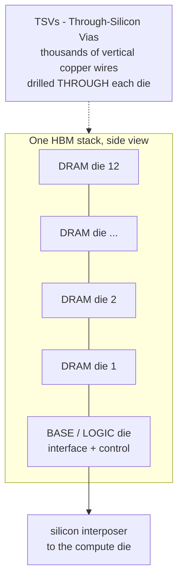
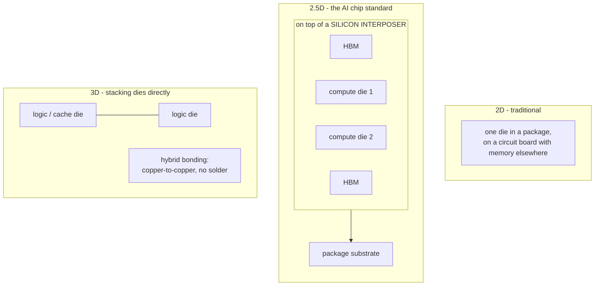
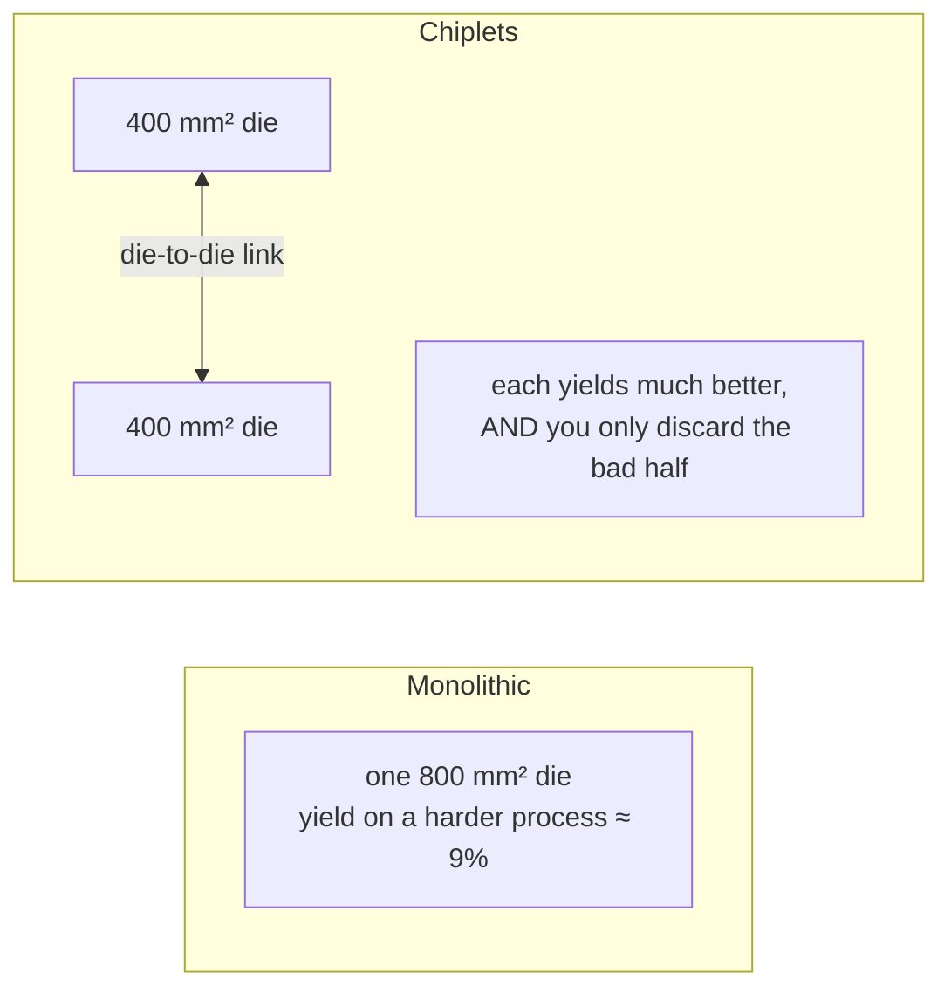
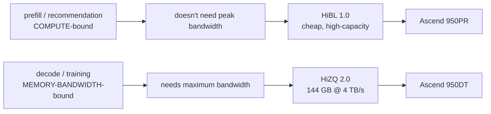
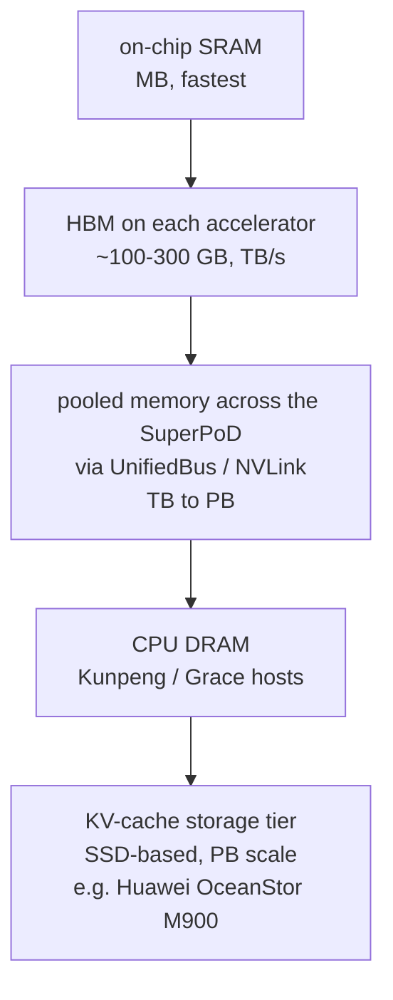

# 5. Memory and packaging — HBM, chiplets, and Huawei's own HBM

> **Goal of this chapter.** Chapter 4 showed that AI chips are often starved for memory bandwidth. This chapter explains the memory that feeds them (HBM), how chips and memory are physically assembled (packaging and chiplets), and why Huawei developing its own HBM is one of the most important parts of its 2026 roadmap.

---

## 5.1 The memory options

| Memory | Where | Bandwidth (one device/stack) | Capacity | Cost per GB | Used for |
|---|---|---|---|---|---|
| **SRAM** | on the chip itself | extremely high | tens–hundreds of MB total | very high | caches, on-chip buffers (L0/L1 in Da Vinci) |
| **DDR5** | separate DIMM sticks on the motherboard | ~50–70 GB/s per channel | up to TBs | low | CPU main memory (Kunpeng) |
| **LPDDR5X** | soldered near the chip | moderate | 100s of GB | low–medium | phones, laptops, Nvidia Grace CPU |
| **GDDR7** | chips around a GPU on the board | ~1.5–2 TB/s per GPU total | 16–32 GB | medium | gaming GPUs, some inference cards |
| **HBM** | **stacked right beside the compute die, inside the package** | **~1–2+ TB/s per stack** | 24–48 GB per stack | **very high** | **every flagship AI training chip** |

The trade-off is fundamental: **fast memory is small and expensive; big memory is slow and cheap.** AI chips need memory that is *both* fast and fairly big, which is exactly what HBM is — at a price.

---

## 5.2 HBM — High Bandwidth Memory

### The idea: go wide, go vertical

Memory bandwidth = (number of wires) × (speed per wire). DDR and GDDR make each wire very fast. HBM does the opposite: it uses **an enormous number of wires running at moderate speed**.

```
DDR5 channel:   64 data wires     × very fast
GDDR7 chip:     32 data wires     × extremely fast
HBM3E stack:  1,024 data wires    × moderate speed
HBM4 stack:   2,048 data wires    × moderate speed      ← 2× wider
```

You can't route 1,024 wires across a normal circuit board. So HBM is placed **millimetres from the compute die** and connected through a **silicon interposer** (§5.3), where wires can be packed microscopically close.

To get capacity in a tiny footprint, HBM **stacks DRAM dies vertically**:



- **8, 12 or 16 DRAM dies** stacked, each thinned to tens of micrometres.
- Connected vertically by **TSVs (through-silicon vias)** — holes etched through the silicon and filled with copper.
- A **base die** at the bottom handles the interface. In HBM4, the base die is increasingly made on a logic process and can be customized per customer.

### HBM generations

| Generation | Interface width | Bandwidth per stack (approx.) | Typical capacity per stack |
|---|---|---|---|
| HBM2e | 1,024 bits | ~0.4–0.46 TB/s | 16 GB |
| HBM3 | 1,024 bits | ~0.8 TB/s | 16–24 GB |
| HBM3E | 1,024 bits | ~1.2 TB/s | 24–36 GB |
| **HBM4** | **2,048 bits** | **~2 TB/s+** | 36–48 GB+ |

A flagship chip carries **4–8 stacks**. Nvidia's Rubin: 288 GB of HBM4 at **22 TB/s**. Huawei's Ascend 950DT: **144 GB at 4 TB/s**. Huawei's Ascend 910C used HBM2e-class memory. That bandwidth gap is — per chapter 4's roofline — a bigger deal for inference than the FLOPS gap.

### Why HBM is so expensive and scarce

1. **Stacking multiplies yield risk.** If one of 12 stacked dies is bad, the whole stack may be lost.
2. **TSVs** take die area and extra process steps.
3. **Advanced packaging** is needed to attach it — itself a bottleneck (§5.3).
4. **Only three companies make it at scale**: SK hynix (the leader), Samsung, and Micron.
5. It uses roughly **3× the wafer area per bit** of normal DRAM, so HBM demand squeezes the whole DRAM market.

HBM can be a large fraction of an AI accelerator's total cost.

---

## 5.3 Packaging — how chips and memory become one product

"Packaging" used to mean a plastic case with pins. For AI chips it's now one of the most advanced — and constrained — steps in the whole supply chain.



| Style | What it is | Example |
|---|---|---|
| **2D** | one die per package | classic CPUs |
| **2.5D** | several dies side-by-side on a **silicon interposer** — a passive slab of silicon carrying ultra-dense wiring between them | **TSMC CoWoS** (used by Nvidia, and by Huawei's TSMC-era chips); every chip with HBM |
| **3D** | dies stacked directly on each other | HBM itself; AMD's 3D V-Cache; TSMC SoIC |

**TSMC's CoWoS capacity** has been one of the main limits on how many AI chips the world can produce — often more of a bottleneck than the compute dies themselves. China is building domestic advanced-packaging capacity for the same reason.

### Chiplets — many small dies instead of one big one

Recall chapter 2's yield table: a large die on an immature process yields terribly. **Chiplets** solve that by splitting the design into several smaller dies connected inside the package:



Benefits: better yield, can exceed the reticle limit, can mix processes (e.g. cutting-edge process for compute, cheaper process for I/O). Costs: the **die-to-die link** uses power and adds latency, and software may see two chips rather than one. **UCIe** is the emerging industry standard for chiplet links.

The **Ascend 910C** is exactly this: **two 910B-class dies** in one package, doubling compute and memory without needing one enormous, low-yield die.

---

## 5.4 Huawei's self-developed HBM

### Why Huawei had to build its own

In December 2024, US export controls restricted sales of advanced HBM to China. SK hynix, Samsung and Micron — the only three large-scale HBM makers — could no longer supply Huawei with current-generation parts. Reports indicated Huawei had built up inventories beforehand, but a stockpile doesn't last through an annual chip cadence.

**Without HBM, there is no competitive AI training chip.** So at Huawei Connect 2025, Huawei announced two HBM types of its own:

| | **HiBL 1.0** | **HiZQ 2.0** |
|---|---|---|
| Optimized for | **capacity and low cost** | **bandwidth** |
| Positioning | a cheaper alternative to HBM3E / HBM4E | high-performance HBM |
| Specs announced | low-cost, high-capacity (detailed bandwidth not emphasized) | **144 GB per chip, 4 TB/s** |
| Paired with | **Ascend 950PR** (prefill & recommendation) | **Ascend 950DT** (decode & training) |

Now chapter 4 and chapter 5 connect:



**Engineering read-through**: Huawei's HBM bandwidth (4 TB/s on its best part) trails Nvidia's Rubin (22 TB/s) by a wide margin. Huawei compensates in two ways: (1) not spending scarce high-bandwidth HBM where it isn't needed (the PR/DT split), and (2) scaling out to thousands of chips so that the **total pooled memory** of a SuperPoD is enormous — the Atlas 950 SuperPoD advertises **1,152 TB** across 8,192 chips. Chapter 6 covers how that pooling works.

**Supply is still tight**: at Huawei Connect 2026, reporting noted Huawei had **raised the price of the Ascend 950DT by 60 %, citing tight component supply** — HBM and advanced packaging being the obvious candidates.

---

## 5.5 Beyond HBM — the memory hierarchy of an AI system

Because HBM is expensive and limited, modern AI systems build a **multi-tier memory hierarchy**, the same idea as CPU caches (chapter 3) at data-centre scale:



**The KV cache** is the main reason this is needed. When an LLM holds a long conversation, it stores intermediate attention state (the KV cache) for every token so far, and that can exceed the model's own size. Moving old KV cache to cheaper tiers — pooled memory, CPU DRAM, even SSDs — and fetching it back when needed is now a core part of AI system design. Huawei announced the **OceanStor M900** at Huawei Connect 2026 for **petabyte-scale KV cache**, claiming a 16× extension of SSD lifespan, and its SuperCluster connects "KV cache clusters" as first-class peers alongside NPUs and CPUs.

---

## 5.6 Check your understanding

1. How does HBM achieve high bandwidth differently from DDR or GDDR?
   > Very wide interfaces (1,024–2,048 bits) at moderate speed, placed right beside the compute die on an interposer.
2. What are TSVs?
   > Vertical copper connections drilled through stacked silicon dies, linking the layers of an HBM stack.
3. Why is HBM expensive and supply-limited?
   > Stacking multiplies yield risk, TSVs add steps, it needs advanced packaging, uses ~3× the wafer area per bit, and only three companies make it at scale.
4. What is 2.5D packaging?
   > Placing several dies (compute and HBM) side-by-side on a silicon interposer that carries dense wiring between them.
5. Why did Huawei develop HiBL 1.0 and HiZQ 2.0?
   > US controls cut off supply of advanced HBM; without HBM there's no competitive AI chip. It made two types to match memory to workload and cost.
6. Why build a memory hierarchy beyond HBM?
   > HBM is expensive and limited, while KV caches for long contexts can exceed model size; lower tiers hold cold data cheaply.

**Next: [06-interconnect-and-superpods.md](06-interconnect-and-superpods.md)**

---

## Sources
- [Huawei Connect 2025 keynote — HiBL 1.0, HiZQ 2.0](https://www.huawei.com/en/news/2025/9/hc-xu-keynote-speech)
- [Huawei Connect 2026 keynote — OceanStor M900](https://www.huawei.com/en/news/2026/9/hc-wang-keynote)
- [Huawei Connect 2026 coverage — 950DT price rise, supply (TNW)](https://thenextweb.com/news/huawei-connect-2026-ascend-960-superpod-unifiedbus)
- [Huawei Ascend 910C / CloudMatrix analysis (XPU.pub)](https://xpu.pub/2025/04/22/huawei-ascend/)
- [Inside the Nvidia Vera Rubin platform (Nvidia)](https://developer.nvidia.com/blog/inside-the-nvidia-rubin-platform-six-new-chips-one-ai-supercomputer/)
