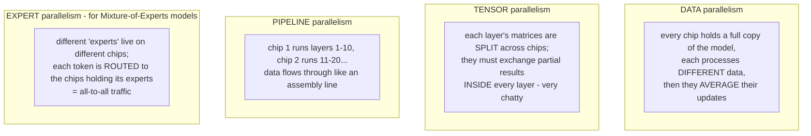
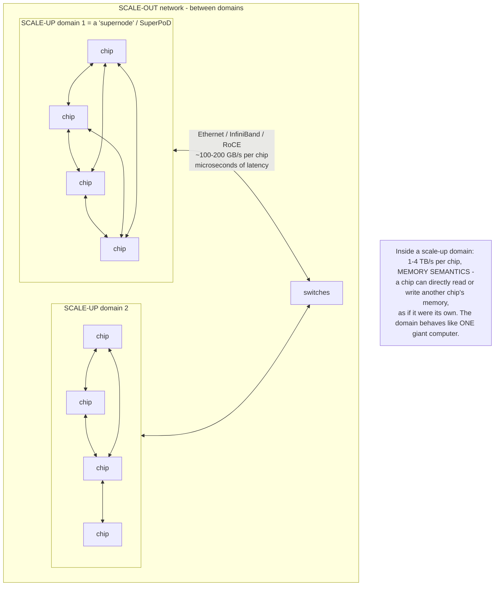
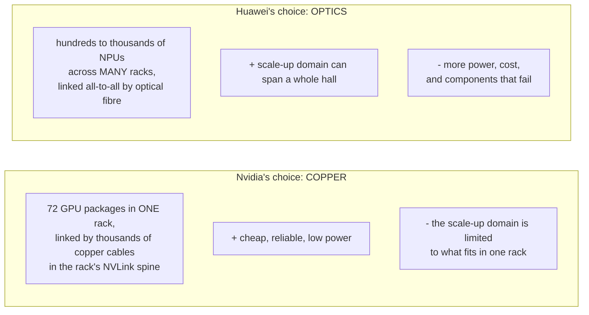
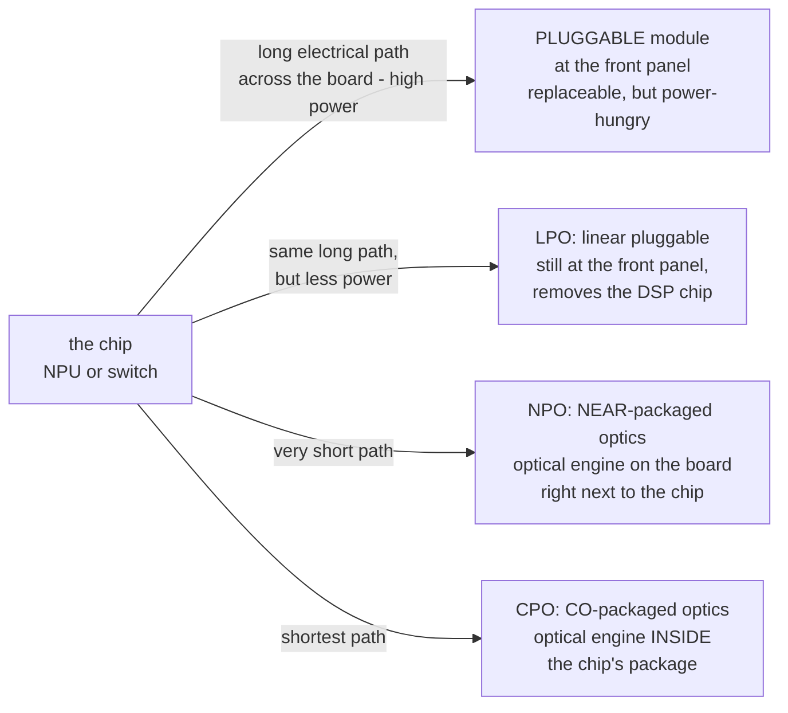
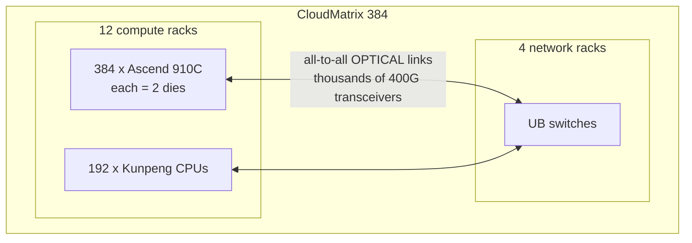
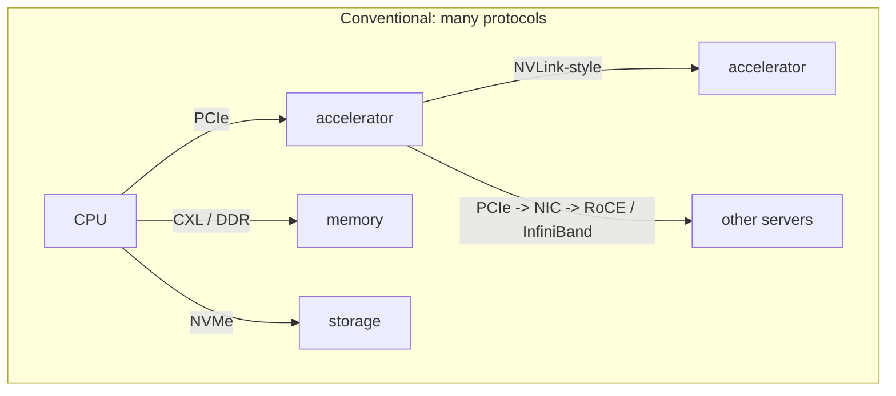
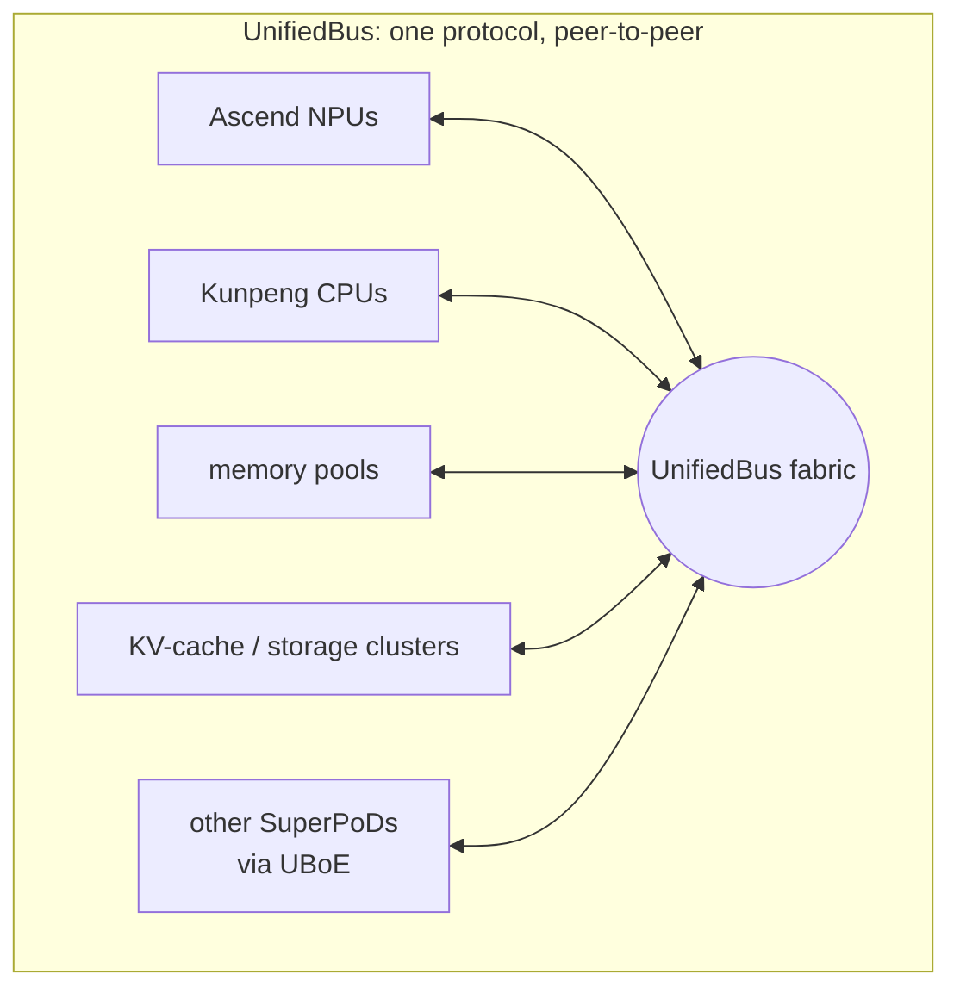
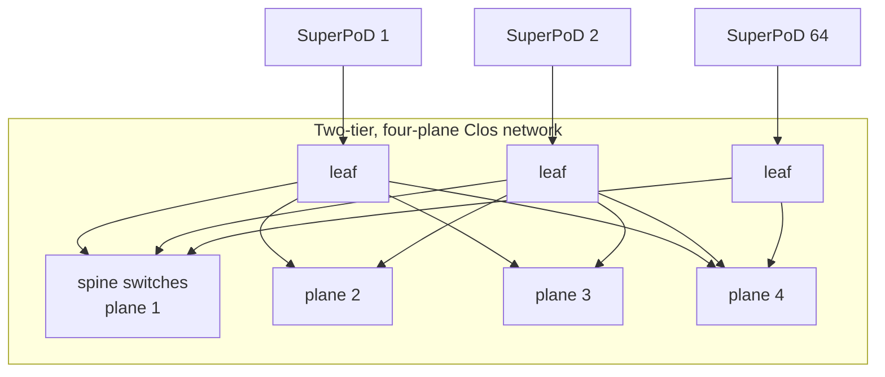

# 6. Connecting thousands of chips — interconnect, optics, and SuperPoDs

> **Goal of this chapter.** One AI chip can't train or serve a frontier model. This chapter explains how chips cooperate, why the links between them are now as important as the chips, the difference between "scale-up" and "scale-out", why optics matter, and then exactly what Huawei's SuperPoD, UnifiedBus and near-packaged optics are. This is the heart of Huawei's strategy.

---

## 6.1 Why one chip is never enough

Two numbers make it obvious:

| | Size |
|---|---|
| A frontier model with **10 trillion parameters**, stored in FP8 | **~10 TB** just for the weights (plus much more for training state) |
| Memory on one Ascend 950DT | **144 GB** |

The model doesn't fit on one chip — not even close. And training requires ~10²⁵+ FLOPs; at 1 PFLOPS that's **hundreds of years** on one chip. So you split the work across **thousands to hundreds of thousands** of chips. Huawei's 2026 keynote puts it bluntly: **100,000-NPU clusters are now the baseline.**

### Four ways to split the work

Each creates **communication** between chips:

| Pattern | Traffic | How demanding |
|---|---|---|
| Data parallel | **all-reduce** — everyone averages gradients | large volume, but can overlap with compute |
| Tensor parallel | exchanges inside every layer | **very latency- and bandwidth-sensitive** — needs the fastest links |
| Pipeline parallel | passes activations to the next stage | moderate |
| **Expert parallel (MoE)** | **all-to-all** — every chip sends to every other chip | **the hardest pattern** for a network; now dominant because most frontier models are MoE (DeepSeek, Qwen, etc.) |

### The cost of communication — MFU

**MFU (Model FLOPs Utilization)** = the fraction of a chip's peak FLOPS actually doing useful model math. Real large-scale training typically lands around 30–50 %. The rest is lost to waiting — much of it on communication. Huawei's 2026 keynote claims **inter-chip communication accounts for over 40 % of training time** in large clusters, and that its 4,096-NPU SuperPoDs raise MFU by **2.75×** (its claim).

**This is the key insight of the chapter**: *past a certain scale, the interconnect decides how much of your compute you actually get.* A cluster of slower chips with a superb network can outperform faster chips with a poor one.

---

## 6.2 Scale-up vs scale-out

There are two fundamentally different kinds of network in an AI system:

| | **Scale-up** | **Scale-out** |
|---|---|---|
| Purpose | make many chips act like **one big computer** | connect those big computers together |
| Bandwidth per chip | **~1–4 TB/s** | ~0.1–0.2 TB/s (one or two 800 Gb/s ports) |
| Latency | sub-microsecond to ~2 µs | several µs+ |
| Semantics | **memory semantics** — load/store into another chip's memory | **message semantics** — send packets (RDMA) |
| Nvidia's version | **NVLink** + NVLink switches | InfiniBand or Spectrum-X Ethernet |
| Huawei's version | **UnifiedBus (UB)** | UB-over-Ethernet (UBoE) and RoCE |
| Carries | tensor-parallel and expert (all-to-all) traffic | data-parallel traffic |

**The size of the scale-up domain is the key battleground in AI hardware today.** A bigger domain means the chatty tensor- and expert-parallel traffic stays on the fast network, and a larger model fits in one "computer". That's precisely what a **SuperPoD** (Huawei) or **NVL72 rack** (Nvidia) is: a very large scale-up domain.

### Link speeds for reference

| Link | Bandwidth per chip (approx., total both directions) |
|---|---|
| PCIe 5.0 ×16 | ~128 GB/s |
| 800 Gb/s Ethernet port | ~100 GB/s per direction |
| Nvidia NVLink 5 (Blackwell) | 1.8 TB/s |
| **Huawei Ascend 950 (UB)** | **2 TB/s** |
| Nvidia NVLink 6 (Rubin) | 3.6 TB/s |
| **Huawei Ascend 970 (UB), 2028** | **4 TB/s** |

---

## 6.3 Copper vs optics — the physical constraint

Signals travel between chips over **SerDes** (serializer/deserializer) lanes, now running at ~200 Gb/s per lane. At those speeds:

- **Copper cable** works only over **~1–2 metres** before the signal degrades. It's cheap, reliable, and uses little power.
- **Optical fibre** carries signals **hundreds of metres or more**, but the electrical signal must be converted to light and back, which costs power, money, and adds components that can fail.

**This is the fork in the road between the two companies.** Nvidia has the best chips, so it can build a strong scale-up domain within a rack using cheap copper. Huawei's chips are individually weaker, so it needs *many more of them* in one domain — which means spanning many racks — which means optics.

### Four ways to do optics

The closer the light conversion sits to the chip, the less power is wasted pushing electrical signals across the board:

| Approach | Power | Serviceability | Status |
|---|---|---|---|
| **Pluggable transceivers** | highest | **best** — pull it out and swap | the standard today |
| **LPO** (linear pluggable) | lower | good | emerging |
| **NPO** (near-packaged) | **low** | **moderate** — engine is on the board, near but separate from the chip | **Huawei's choice for Atlas 960E** |
| **CPO** (co-packaged) | **lowest** | **worst** — a failed optical part may mean replacing the whole chip package | Nvidia and Broadcom shipping CPO *switches* |

NPO is a deliberate middle path: most of CPO's power savings, without welding the optics into the NPU package itself.

---

## 6.4 Huawei's SuperPoD generations

### Atlas 900 A3 SuperPoD / CloudMatrix 384 (2025)

Huawei's first large SuperPoD, and the one that made headlines:

- **384 Ascend 910C** chips + 192 Kunpeng CPUs across **16 racks**, one scale-up domain over **UnifiedBus 1.0**.
- **Up to 300 PFLOPS** (BF16) per Huawei.
- Huawei reported **more than 300 units** deployed to over 20 customers by September 2025.

The widely-cited SemiAnalysis comparison against Nvidia's GB200 NVL72 (approximate figures) shows the strategy in one table:

| | Huawei CloudMatrix 384 | Nvidia GB200 NVL72 | Ratio |
|---|---|---|---|
| BF16 compute | ~300 PFLOPS | ~180 PFLOPS | **Huawei ~1.7× more** |
| HBM capacity | ~49 TB | ~14 TB | **Huawei ~3.6× more** |
| HBM bandwidth | ~1,230 TB/s | ~580 TB/s | **Huawei ~2.1× more** |
| Chips | 384 packages | 72 packages | 5.3× more chips |
| **System power** | **~560 kW** | **~145 kW** | **Huawei ~3.9× more power** |
| **Compute per watt** | — | — | **Huawei ~2.3× worse** |

**Read this table carefully — it summarizes Huawei's entire approach:** *win the system-level numbers by using many more chips, and pay for it in power and space.* That trade is acceptable in China, where electricity for data centres is comparatively cheap and abundant, and where the alternative (buying Nvidia's best) isn't available.

### Atlas 950 SuperPoD (Q4 2026)

| Spec | Value |
|---|---|
| NPUs | up to **8,192 Ascend 950DT** |
| Compute | **8 EFLOPS FP8**, 16 EFLOPS FP4 |
| Memory | **1,152 TB** |
| Interconnect bandwidth | **16 PB/s** |
| Physical | **160 cabinets** (128 compute + 32 communications), **~1,000 m²** |
| Huawei's throughput claims | 4.91 M tokens/s training; 19.6 M tokens/s inference (FP4) |

### Atlas 960 SuperPoD (Q4 2027)

| Spec | Value |
|---|---|
| NPUs | up to **15,488 Ascend 960** |
| Compute | **30 EFLOPS FP8**, 60 EFLOPS FP4 |
| Memory | **4,460 TB** |
| Interconnect bandwidth | **34 PB/s** |
| Physical | **220 cabinets** (176 compute + 44 communications), **~2,200 m²** |

### Atlas 960E SuperPoD — announced at Huawei Connect 2026

The newest, and the first built on **near-packaged optics**:

| Spec | Value |
|---|---|
| NPUs | up to **4,096** |
| Compute | **8 EFLOPS FP8** |
| Memory | up to **1 PB** of HBM |
| Optics | **5,500 Hi-ONE NPO engines**, **7.2 Tb/s each**, with a **built-in light source** |
| What it replaces | **48,000 × 800G pluggable optical modules** that a conventional design would need |
| Power saving | **over 550 kW** (Huawei's claim) |
| Availability | **99.8 %** (Huawei's claim) |

Notice: the 960E reaches the **same 8 EFLOPS** as the 8,192-chip Atlas 950 SuperPoD with **half the chips** (4,096 Ascend 960s at 2× the per-chip compute), and cuts the optics power that was CloudMatrix 384's weak point. **Removing 48,000 pluggable transceivers** also removes 48,000 things that can fail — at this scale, optical module failures are one of the leading causes of training interruptions.

**A built-in light source** matters because lasers are the least reliable part of optics; integrating and managing them inside the engine is a claimed reliability and serviceability win.

### How Huawei compares itself — and how to read it

Huawei compared the Atlas 950 SuperPoD with Nvidia's planned Vera Rubin **NVL144** and claimed **56.8× more NPUs, 6.7× more compute, 15× more memory and 62× more interconnect bandwidth.**

Apply chapter 4's "compare honestly" rules:
- It compares an **8,192-chip, 160-cabinet, 1,000 m²** system against **one Nvidia rack**. Of course the bigger system has bigger totals.
- **"NVL144" counts dies**, not packages (144 dies = 72 two-die packages). Nvidia has used both styles for Rubin, which confuses comparisons.
- Per chip, per watt and per square metre, Nvidia is well ahead.

The *real* claim hiding in the marketing is about **scale-up domain size**: Huawei is saying "our single coherent 'computer' is far larger than yours." That is a genuine architectural difference — and a meaningful one for very large MoE models — but it is not a chip-for-chip win.

---

## 6.5 UnifiedBus (UB) — the glue

**UnifiedBus** is Huawei's interconnect protocol, and arguably the most important technology in its whole AI stack.

### The problem it solves

A conventional AI data centre speaks many protocols: PCIe between CPU and accelerator, NVLink-style links between accelerators, CXL for memory, Ethernet/RoCE or InfiniBand between servers, NVMe for storage, and more. **Every boundary needs a conversion**, which adds latency, power, and complexity.

### What UB provides (per Huawei)

| Property | Claim |
|---|---|
| **One protocol** | consolidates **more than ten protocols** into one, removing conversion overhead |
| **Memory semantics** | any device can read/write another device's memory directly — the basis for **pooled memory** across NPUs and CPUs (e.g. the TaiShan 950 SuperPoD's 256 TB unified memory) |
| **Peer-to-peer** | NPUs, CPUs, memory and storage are *equals* on the fabric, not a CPU with devices hanging off it |
| **Bandwidth** | from "hundreds of GB/s to TB/s" per device |
| **Latency** | **~2 µs** (2.1 µs), down from ~7 µs |
| **Optical reliability** | fault detection in **~100 ns**; optical links "100× more reliable" through link-level redundancy and fast failover |
| **Reach** | **over 200 m** — enough to span a large data hall as one scale-up domain |
| **Scale-out** | **UBoE** (UB over Ethernet) and RoCE connect SuperPoDs into SuperClusters |

**Generations**: UB 1.0 in the Atlas 900 A3 / CloudMatrix 384; the next generation underpins the Atlas 950/960. Huawei said at Huawei Connect 2025 that it would publish the UnifiedBus specifications openly, aiming to grow an ecosystem around it — analogous to how Nvidia licenses NVLink Fusion.

**Topology**: Huawei researchers have published a design called **UB-Mesh** — a hierarchical, multi-dimensional "full-mesh" topology that directly connects nearby chips to each other and uses switches only at higher levels. Direct connections suit AI traffic, which is heavily local, and reduce the number of expensive switches and optical modules.

---

## 6.6 SuperClusters — connecting SuperPoDs

A **Clos network** (also called a fat tree) connects many nodes through layers of switches so that any node can reach any other with the same number of hops and plenty of spare paths. **Planes** are independent parallel copies of the network — if one fails, the others carry the traffic. **Multi-rail** designs give each chip its own connection into several separate networks.

| System | Scale | Compute | When |
|---|---|---|---|
| **Atlas 950 SuperCluster** | 64 SuperPoDs, **>520,000 Ascend 950DT**, >10,000 cabinets | **524 EFLOPS FP8** | Q4 2026 |
| **Two-tier, four-plane Clos** (HC 2026) | up to **512,000 NPUs** | — | — |
| **Multi-rail topology** (HC 2026) | up to **1,000,000 NPUs** | — | described in coverage as theoretical rather than proven |
| **Atlas 960 SuperCluster** | **>1,000,000 NPUs** | **2 ZFLOPS FP8**, 4 ZFLOPS FP4 | Q4 2027 |

The 2026 "**agentic SuperCluster**" framing: UB connects Ascend SuperPoDs, Kunpeng SuperPoDs and KV-cache clusters as peers, targeting training and inference of **10-trillion-parameter** models — Huawei projects frontier models will exceed 100 trillion parameters by 2030.

### Reliability at this scale

With hundreds of thousands of chips, **something is always failing.** If a training job had to restart every time one link or chip failed, it would never finish. That's why Huawei emphasizes fast optical fault detection, redundant planes, and 99.8 % availability — and why removing tens of thousands of pluggable modules (Atlas 960E) matters as much for reliability as for power.

---

## 6.7 Check your understanding

1. Why do AI models need thousands of chips?
   > The weights alone exceed one chip's memory by orders of magnitude, and training compute would take centuries on one chip.
2. Which kind of parallelism generates all-to-all traffic, and why does it matter now?
   > Expert parallelism in Mixture-of-Experts models; most frontier models are MoE, and all-to-all is the hardest pattern for a network.
3. What's the difference between scale-up and scale-out?
   > Scale-up joins chips into one big computer with TB/s links and memory semantics; scale-out connects those computers with slower packet networks.
4. Why does Nvidia use copper inside NVL72 but Huawei uses optics?
   > Copper only reaches ~1–2 m, enough for one rack. Huawei's weaker chips need many more of them per domain, spanning many racks, which requires optics.
5. What's the difference between NPO and CPO?
   > Both put optical engines close to the chip; CPO puts them inside the chip package, NPO puts them on the board next to it — slightly less efficient but much easier to service.
6. Summarize the CloudMatrix 384 vs NVL72 trade-off.
   > Huawei gets more total compute, memory and bandwidth by using ~5× more chips, at ~4× the power and ~2.3× worse compute per watt.
7. What does UnifiedBus do?
   > Replaces many protocols with one peer-to-peer, memory-semantic fabric linking NPUs, CPUs, memory and storage — enabling large scale-up domains and pooled memory.
8. Why is Huawei's "62× more interconnect bandwidth than NVL144" claim misleading?
   > It compares an 8,192-chip, 160-cabinet system to a single rack. The real point is the size of the scale-up domain, not per-chip performance.

**Next: [07-huawei-big-picture.md](07-huawei-big-picture.md)**

---

## Sources
- [Huawei Connect 2025 keynote — SuperPoDs, SuperClusters, UnifiedBus](https://www.huawei.com/en/news/2025/9/hc-xu-keynote-speech)
- [Huawei Connect 2026 keynote — Atlas 960E, Hi-ONE NPO, SuperCluster topologies](https://www.huawei.com/en/news/2026/9/hc-wang-keynote)
- [Huawei Connect 2026: Ascend 960 early, a million-NPU plan (TNW)](https://thenextweb.com/news/huawei-connect-2026-ascend-960-superpod-unifiedbus)
- [Huawei Atlas 960E scales to a SuperCluster of a million NPUs (Techzine)](https://www.techzine.eu/blogs/infrastructure/144385/huawei-atlas-960e-scales-up-to-a-supercluster-of-a-million-npus/)
- [SemiAnalysis of Huawei CloudMatrix and the 910C (FiberMall summary)](https://www.fibermall.com/blog/semianalysis-of-huawei-cloudmatrix-910c.htm)
- [Nvidia Vera Rubin NVL144 (TechPowerUp)](https://www.techpowerup.com/342049/nvidia-vera-rubin-nvl144-servers-set-for-2026-volume-production)
