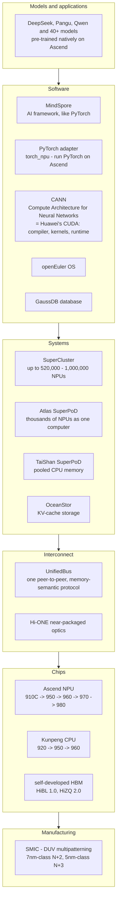
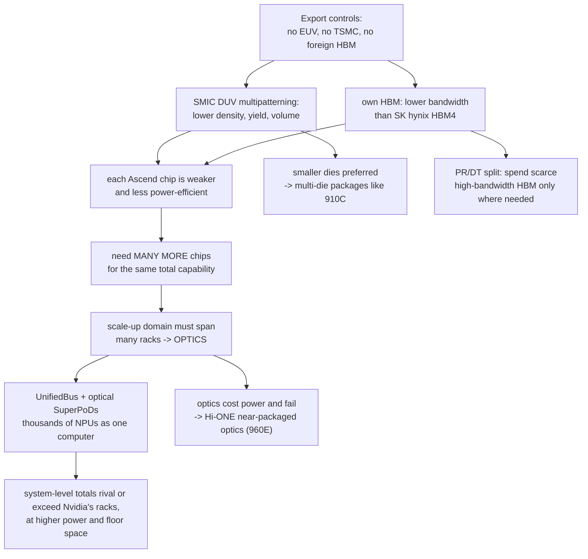
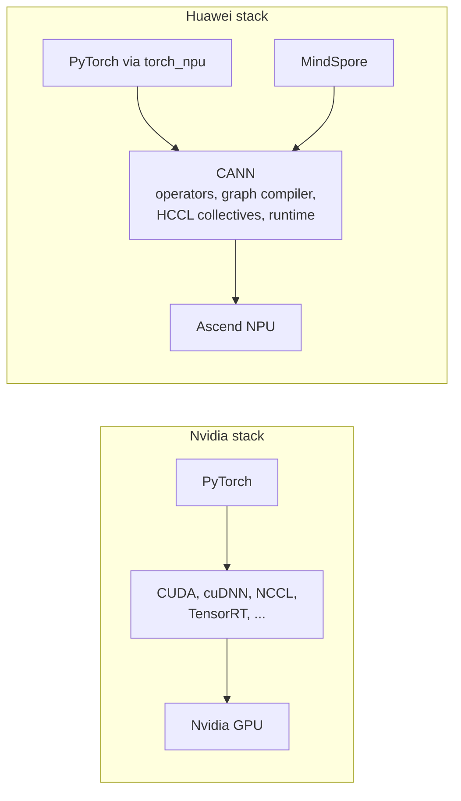

# 7. Huawei's AI computing stack — the whole picture

> **Goal of this chapter.** Put chapters 1–6 together into one coherent picture: what Huawei has built, *why* it's shaped that way, the software side, and an honest assessment of its strengths and weaknesses against Nvidia. If you only re-read one chapter before a conversation about this topic, make it this one.

---

## 7.1 The full stack on one page

No other company besides Nvidia spans this much of the stack — and Huawei goes further down (its own CPU, its own HBM, its own OS and database) because it can't buy those parts freely.

---

## 7.2 The strategy in one paragraph

**Huawei cannot win chip-for-chip, so it competes at the system level.** US export controls deny it EUV lithography, TSMC's manufacturing and the world's HBM supply (chapter 2). Its chips are therefore made on SMIC's DUV-multipatterned processes, with lower density, lower yield and limited volume, and they carry less memory bandwidth (chapter 5). Each Ascend chip is individually slower and less power-efficient than Nvidia's best (chapter 4). Huawei compensates by **using many more chips** and investing heavily in the thing that decides how well many chips work together — **the interconnect** (chapter 6): UnifiedBus, all-optical scale-up across many racks, and now near-packaged optics to cut the power and failure cost of all that optics. It accepts **higher total power and much larger floor space**, which China's comparatively cheap electricity and domestic demand make viable. And it **matches memory to workload** (950PR vs 950DT) to stretch its scarce high-bandwidth HBM.

### The logic chain

---

## 7.3 The roadmap in one table

| Year | Ascend (AI) | Kunpeng (CPU) | Systems |
|---|---|---|---|
| 2019 | 910 (TSMC 7nm+) | 920 (TSMC 7nm, 64 cores) | — |
| 2023 | 910B (SMIC) | 920 refreshes | Atlas 900 clusters |
| 2025 | 910C (2 dies) | — | **Atlas 900 A3 / CloudMatrix 384**, UB 1.0 |
| 2026 | **950PR** (Q1), **950DT** (Q4) | **950** (96c or 192c) | **Atlas 950 SuperPoD** (8,192 NPUs), **Atlas 950 SuperCluster** (520k+), **TaiShan 950 SuperPoD** |
| 2027 | **960DT** (Q1, pulled in 3 quarters), **960PR** (Q3) | — | **Atlas 960 SuperPoD** (15,488), **Atlas 960E** (4,096, NPO), **Atlas 960 SuperCluster** (1M+) |
| 2028 | **970** | **960** (96c high-perf / 256c+ high-density) | — |
| 2029 | **980** | — | — |

Note what Huawei did at Huawei Connect 2026: it **pulled the Ascend 960DT forward by three quarters**. In an industry where roadmaps usually slip, publicly moving one *earlier* is a deliberate signal of manufacturing confidence — worth watching whether it holds.

---

## 7.4 Software — the part that decides adoption

Hardware is only useful if software runs well on it. **Nvidia's deepest advantage isn't its chips — it's CUDA**: nearly two decades of libraries, tools, tuned kernels and developer familiarity. Almost all AI research code is written assuming Nvidia GPUs.

| Layer | Nvidia | Huawei |
|---|---|---|
| Low-level programming & kernels | CUDA | **CANN** (with its Ascend C kernel language) |
| Collective communication | NCCL | **HCCL** |
| Framework | PyTorch (dominant), JAX | **MindSpore**, plus PyTorch via the **torch_npu** adapter |
| OS | Linux | Linux / **openEuler** |

The practical challenge is **porting**: code tuned for CUDA must be adapted, custom kernels rewritten, and performance re-tuned — and a new architecture like the 950's SIMD+SIMT means kernels must be tuned again. Huawei's responses: supporting PyTorch directly rather than forcing MindSpore, and **opening up CANN** to outside developers (announced in 2025).

Huawei's 2026 numbers on the software ecosystem:
- **61 %** of CANN developers are now external to Huawei; over **5,200** monthly active developers.
- Over **90** major third-party open-source projects supported.
- **Over 40 models** pre-trained natively on Ascend.
- Kunpeng: **4.16 million** developers, **7,200+** partners; openEuler **20 million+** installations.

5,200 monthly active CANN developers is still tiny next to CUDA's millions. Software maturity is the gap that closes slowest.

### Real-world signal

At Huawei Connect 2026, reporting noted **DeepSeek plans to deploy at least 160,000 Ascend 950DT chips**, and that Huawei **raised the 950DT's price by 60 %** citing tight component supply. Demand is real; supply is the constraint.

---

## 7.5 Honest assessment

### Where Huawei is strong
- **System-level scale**: the largest single scale-up domains announced anywhere (thousands of NPUs vs Nvidia's 72–144 per rack).
- **Interconnect and optics**: Huawei is one of the world's largest telecom-equipment makers; optical networking is home turf. UnifiedBus, all-optical SuperPoDs and mass-production NPO play directly to that strength.
- **Vertical integration**: CPU, NPU, HBM, interconnect, storage, OS, database, frameworks.
- **A protected, large home market** with strong policy support for domestic technology.
- **Cadence**: an annual, publicly-committed roadmap with doubling compute per generation.

### Where Huawei is weak
- **Per-chip performance**: the Ascend 960DT is estimated at roughly half the FP8 and a third of the FP4 compute of Nvidia's B300 — and Nvidia's Rubin (50 PF FP4 inference per package, 288 GB HBM4 at 22 TB/s) is further ahead.
- **Power efficiency**: CloudMatrix 384 used ~4× the power of NVL72 for ~1.7× the compute. More chips means more power, cooling and floor space (the Atlas 960 SuperPoD occupies ~2,200 m²).
- **Memory bandwidth**: 4 TB/s per chip vs 22 TB/s — decisive for inference decode (chapter 4).
- **Manufacturing**: no EUV; SMIC's yields and volume limit how many chips can be made at all. That may matter more than per-chip performance.
- **Software ecosystem**: CANN is improving fast but is far from CUDA's depth.
- **Unverified claims**: most system-level numbers (tokens/s, MFU gains, availability, power savings) are Huawei's own. The 1M-NPU topology is described in coverage as theoretical.

### Side by side

| | Huawei approach | Nvidia approach |
|---|---|---|
| Chip | good, not leading; SMIC DUV | leading-edge; TSMC 3nm-class EUV |
| Memory | self-developed HBM, ~4 TB/s | HBM4 from SK hynix etc., ~22 TB/s |
| Scale-up domain | **thousands of NPUs, all-optical, many racks** | 72 packages (144 dies) in one rack, copper |
| Interconnect | UnifiedBus, NPO optics | NVLink 6, CPO switches |
| Power per unit of compute | higher | lower |
| Software | CANN, MindSpore, torch_npu | CUDA — the industry standard |
| Market | China (restricted from exporting widely) | global (restricted from selling top parts to China) |

**The one-sentence summary**: *Nvidia builds the best chips and connects them well; Huawei builds good-enough chips and connects enormous numbers of them exceptionally well, trading power and space for scale.*

---

## 7.6 What to watch next

1. **Does the 960 arrive on its pulled-forward schedule (Q1 2027)?** Hitting it would signal SMIC's N+3-class capacity and yields are better than outsiders assume.
2. **HBM**: can Huawei's HBM close the bandwidth gap (HiZQ successors), and is supply sufficient for 520,000-chip clusters?
3. **Delivered efficiency**: independent measurements of MFU and tokens-per-watt on Atlas 950 SuperPoDs, rather than vendor claims.
4. **NPO in practice**: does the Atlas 960E actually deliver the claimed power and reliability benefits at scale?
5. **Software**: the number of models trained natively on Ascend, and whether mainstream frameworks treat Ascend as a first-class backend.
6. **UnifiedBus as a standard**: whether other Chinese chipmakers adopt it, turning it into an ecosystem rather than a Huawei-only protocol.

---

## 7.7 Check your understanding — explain it in your own words

Try answering these aloud without looking back. If you can, you understand the topic.

1. Why does Huawei build SuperPoDs of thousands of NPUs instead of focusing on making each chip faster?
2. Why does that force it to use optics, and why did it move to near-packaged optics?
3. What problem does UnifiedBus solve, and what does "memory semantics" enable?
4. Why are there two Ascend 950 variants with different memory?
5. What is Huawei's biggest single disadvantage, and which is hardest to fix: chips, memory, manufacturing, or software?
6. Why is comparing an Atlas 950 SuperPoD with an Nvidia NVL144 rack misleading, and what's the fair comparison?

---

**Next: [09-competitors-compared.md](09-competitors-compared.md)** — Huawei next to Nvidia, Google, AWS and AMD.

---

## Sources
- [Huawei Connect 2026 keynote (Huawei)](https://www.huawei.com/en/news/2026/9/hc-wang-keynote)
- [Huawei Connect 2025 keynote (Huawei)](https://www.huawei.com/en/news/2025/9/hc-xu-keynote-speech)
- [Huawei Connect 2026: Ascend 960 early, a million-NPU plan (TNW)](https://thenextweb.com/news/huawei-connect-2026-ascend-960-superpod-unifiedbus)
- [Huawei unveils Ascend 960 roadmap and 11-chip portfolio (TechWire Asia)](https://techwireasia.com/2026/09/huawei-ascend-960-ai-infrastructure-11-chip-portfolio/)
- [Huawei unveils Ascend 960 SuperPoD computing cluster (Huawei Central)](https://www.huaweicentral.com/huawei-unveils-ascend-960-superpod-computing-cluster-targeting-nvidia/)
- [Analysis: Huawei's datacenter chip roadmap (TechInsights)](https://library.techinsights.com/analysis-view/ARI-2604-803)
- [Inside the Nvidia Vera Rubin platform (Nvidia)](https://developer.nvidia.com/blog/inside-the-nvidia-rubin-platform-six-new-chips-one-ai-supercomputer/)
