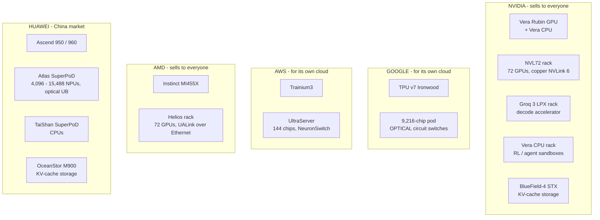
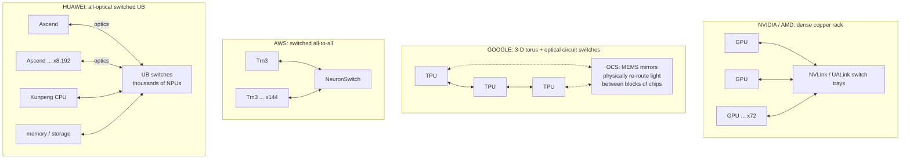

# 9. Huawei vs the competition — Nvidia, Google, AWS, AMD

> **Goal of this chapter.** Put Huawei's SuperPoD next to what the other major AI-infrastructure builders ship in the same window (late 2026 to 2027), at both the chip level and the system level. You'll see that the SuperPoD's headline idea — a huge optically-connected scale-up domain — **is not new**, and where Huawei is genuinely ahead or behind. Chapter 10 then goes deeper into LLM inference and RL post-training specifically.

---

## 9.1 Who builds what

Two business models matter:
- **Merchant vendors** (Nvidia, AMD, Huawei) sell hardware to many customers, so their software must work for everyone.
- **Hyperscaler in-house chips** (Google TPU, AWS Trainium) are built for one company's cloud and its biggest customers (Google's own models; Anthropic on both TPU and Trainium). Their software can be narrower and tightly co-designed.

---

## 9.2 Chip-for-chip

All figures are **vendor-published peak numbers**. Read them with chapter 4 §4.8 in mind: precision, dense vs sparse, and peak vs delivered all matter.

| | **Nvidia Rubin** | **Google Ironwood** (TPU v7) | **AWS Trainium3** | **AMD MI455X** | **Huawei Ascend 950DT** | **Huawei Ascend 960** |
|---|---|---|---|---|---|---|
| Ships | H2 2026 | GA late 2025 | GA Dec 2025 | H2 2026 | Q4 2026 | 960DT Q1 2027 |
| Process | TSMC 3nm-class | TSMC (undisclosed) | TSMC 3nm | TSMC | undisclosed (assumed SMIC) | undisclosed |
| FP8 (dense) | — (Nvidia leads with FP4) | **4.6 PF** | **2.5 PF** | ~19 PF (derived from rack figure) | **1 PF** | **2 PF** |
| FP4 | **50 PF inference / 35 PF training** | — | — | ~42 PF (derived from rack figure) | **2 PF** | **4 PF** |
| HBM capacity | **288 GB** HBM4 | 192 GB HBM3E | 144 GB HBM3E | **~430 GB** HBM4 | 144 GB (HiZQ 2.0) | up to 288 GB |
| HBM bandwidth | **~22 TB/s** | 7.3 TB/s | 4.9 TB/s | **~23 TB/s** | **4 TB/s** | ~2× the 950 |
| Scale-up link per chip | **3.6 TB/s** (NVLink 6) | 1.2 TB/s (ICI) | doubled vs Trn2 | (260 TB/s per 72-GPU rack) | **2 TB/s** (UB) | 2× ports vs 950 |

(The AMD per-GPU figures are divided out from AMD's published Helios rack totals, so treat them as approximate.)

**What the table says:**

1. **Compute gap**: an Ascend 950DT has roughly **1/25 of Rubin's FP4 inference figure** and about **1/4.6 of Ironwood's FP8**. Even allowing for format and dense/sparse differences, Huawei is behind on compute per chip by a large factor. TNW's analysis puts the 2027 Ascend 960DT at roughly half the FP8 and a third of the FP4 of Nvidia's *previous-generation* B300.
2. **Memory bandwidth gap — the one that matters most for inference**: Rubin and MI455X carry about **5.5× the bandwidth** of the 950DT. Per chapter 4 §4.6, decode speed is roughly bandwidth ÷ bytes per token, so this gap translates almost directly into slower token generation per chip.
3. **Trainium3 is the closest peer in spirit**: modest per-chip numbers (2.5 PF FP8, 4.9 TB/s), made up for with price and system scale. The difference is that it's on TSMC 3nm, so it gets there with better power efficiency.
4. **Huawei matches the others on one thing: scale-up link bandwidth** (2 TB/s, similar to NVLink 5 and above Ironwood's ICI). That's where Huawei has chosen to spend.

---

## 9.3 System-for-system

| System | Chips in one scale-up domain | Compute | HBM total | Interconnect | Physical | Ships |
|---|---|---|---|---|---|---|
| **Nvidia Vera Rubin NVL72** | **72** GPUs (144 dies) | **3.6 EF FP4** inference | ~20 TB | copper NVLink 6, **260 TB/s** | **1 rack** | H2 2026 |
| **AMD Helios** | **72** | 3 EF FP4, 1.4 EF FP8 | **31 TB** | UALink over Ethernet, 260 TB/s | 1 rack | H2 2026 |
| **AWS Trn3 UltraServer** | **144** | 362 PF FP8 | 20.7 TB | NeuronSwitch all-to-all | multi-rack | GA Dec 2025 |
| **Google Ironwood pod** | **9,216** | **42.5 EF FP8** | **1.77 PB** | ICI + **optical circuit switches** | many racks | GA late 2025 |
| **Huawei Atlas 950 SuperPoD** | **8,192** | 8 EF FP8, 16 EF FP4 | 1.15 PB | UnifiedBus, optical | 160 cabinets, ~1,000 m² | Q4 2026 |
| **Huawei Atlas 960E SuperPoD** | 4,096 | 8 EF FP8 | ~1 PB | UB + **near-packaged optics** | — | 2027 |
| **Huawei Atlas 960 SuperPoD** | **15,488** | 30 EF FP8, 60 EF FP4 | 4.46 PB | UnifiedBus, optical | 220 cabinets, ~2,200 m² | Q4 2027 |

### The first surprise: Google already did this

Huawei's marketing compares its SuperPoD with Nvidia's single rack and wins on scale. **Compare it with Google's pod instead:**

| | Google Ironwood pod | Huawei Atlas 950 SuperPoD |
|---|---|---|
| Chips | 9,216 | 8,192 |
| FP8 compute | **42.5 EF** | 8 EF |
| Directly addressable HBM | **1.77 PB** | 1.15 PB |
| Optical scale-up | yes — **optical circuit switches** | yes — UB over optics |
| Available | **late 2025** | Q4 2026 |

With a similar number of chips, the Ironwood pod has **~5× the FP8 compute and ~1.5× the memory — a year earlier.** And Google has run optically-switched pods of thousands of chips since **TPU v4 (4,096 chips per pod, in production from around 2021)**.

So the answer to "does the SuperPoD lack something others already have?" starts here: **the SuperPoD's big idea — a scale-up domain of thousands of chips spanning many racks over optics — was pioneered by Google years ago.** What Huawei adds is:
- doing it as a **merchant product** (Google's pods are only rentable inside Google Cloud);
- a **fully-connected, switched** fabric (UB) rather than Google's reconfigurable 3-D torus (§9.4);
- **one protocol spanning NPUs, CPUs, memory and storage** (UnifiedBus);
- **near-packaged optics** in mass production (Atlas 960E).

### The second surprise: Nvidia chose *not* to build a big pod

Nvidia's scale-up domain (72 GPUs) is **deliberately small**. Its reasoning: copper inside a rack is cheaper, lower-power and more reliable than optics, and each Rubin GPU is so strong that 72 of them already form a very large computer. Nvidia's roadmap does grow the domain in a denser "Kyber" rack generation (Rubin Ultra, 2027), but it's still growing within a rack before reaching for optics.

---

## 9.4 Four philosophies of scale-up

| Approach | Strength | Weakness |
|---|---|---|
| **Copper rack** (Nvidia, AMD) | cheapest, lowest power, most reliable per link; mature | domain limited to one rack |
| **Torus + OCS** (Google) | enormous domains; OCS can reconfigure topology and route around failed blocks; very power-efficient — the switches just steer light and don't convert it | a torus suits some traffic patterns better than others; all-to-all (MoE) traffic must take several hops |
| **Switched all-to-all** (AWS) | every chip one hop from every other; good for MoE | switch cost and power scale with size |
| **All-optical switched UB** (Huawei) | huge domain *and* switched all-to-all; CPUs/memory/storage as peers | the most optics, so the most power, cost and failure points — which NPO tries to fix |

**Huawei's real architectural distinction** is the combination: a Google-sized domain that's **fully switched** (good for MoE all-to-all) *and* treats CPUs and memory as peers. That's legitimately different — it just isn't "the first big pod."

---

## 9.5 Scorecard

| Dimension | Leader | Where Huawei stands |
|---|---|---|
| Per-chip compute | **Nvidia** (Rubin), then AMD | far behind (process limits) |
| Per-chip memory bandwidth | **AMD, Nvidia** (~22–23 TB/s) | far behind (4 TB/s) |
| Scale-up domain size | **Google** (9,216) ≈ **Huawei** (8,192 → 15,488) | **joint leader** — and ahead of Nvidia and AMD |
| Fully-switched scale-up at scale | **Huawei** | leader |
| Optics in scale-up | **Google** (OCS since ~2021), Huawei (NPO) | strong, especially NPO |
| Compute per watt | Google, Nvidia | behind (e.g. CloudMatrix 384 ~2.3× worse than NVL72 by SemiAnalysis's estimate) |
| Compute per m² | Nvidia, AMD | far behind (1,000–2,200 m² SuperPoDs) |
| Software ecosystem | **Nvidia** (CUDA) by a wide margin | behind, improving |
| Inference-specialized hardware | **Nvidia** (LPX decode racks) | a PR/DT split, but no dedicated decode silicon (ch. 10) |
| Supply availability (in China) | Huawei | the domestic default, but supply-constrained (950DT price +60 %) |
| Global availability | Nvidia, AMD; hyperscalers in their own clouds | largely China-only |
| Independent benchmarks | Nvidia, Google, AMD submit to MLPerf regularly | few independent results; mostly Huawei's own papers and claims |

---

## 9.6 Check your understanding

1. Which competitor already built scale-up domains of thousands of chips connected optically, and since when?
   > Google — optical-circuit-switched TPU pods since TPU v4 (4,096 chips, around 2021); Ironwood reaches 9,216.
2. Why does Nvidia keep its scale-up domain at one rack?
   > Copper within a rack is cheaper, lower-power and more reliable than optics, and its per-chip strength makes 72 GPUs powerful enough.
3. What's genuinely distinctive about Huawei's SuperPoD, if not size?
   > A fully-switched optical fabric at Google-like scale, with CPUs, memory and storage as peers on one protocol, sold as a merchant product, with mass-production near-packaged optics.
4. Which per-chip gap matters most for LLM inference, and how big is it?
   > Memory bandwidth — about 5.5× (4 TB/s vs ~22 TB/s), which translates almost directly into decode speed per chip.
5. Why compare the Atlas 950 SuperPoD with a Google Ironwood pod rather than an NVL72 rack?
   > Similar chip counts and the same design idea (many-rack optical scale-up); comparing with a single rack mostly measures system size.

**Next: [10-llm-inference-and-rl.md](10-llm-inference-and-rl.md)** — what inference and RL post-training actually need, and where Huawei's gaps show up.

---

## Sources
- [GTC 2026: Rubin GPUs, Groq LPUs, Vera CPUs (StorageReview)](https://www.storagereview.com/news/nvidia-gtc-2026-rubin-gpus-groq-lpus-vera-cpus-and-what-nvidia-is-building-for-trillion-parameter-inference)
- [Inside the Nvidia Vera Rubin platform (Nvidia)](https://developer.nvidia.com/blog/inside-the-nvidia-rubin-platform-six-new-chips-one-ai-supercomputer/)
- [Ironwood — Hot Chips 2025 (Google)](https://hc2025.hotchips.org/assets/program/conference/day2/61_Google_Ironwood-Final.pdf)
- [TPU7x (Ironwood) documentation (Google Cloud)](https://docs.cloud.google.com/tpu/docs/tpu7x)
- [Google unveils Ironwood with 9,216-chip superpod (TrendForce)](https://www.trendforce.com/news/2025/11/07/news-google-unveils-7th-gen-tpu-ironwood-with-9216-chip-superpod-taking-aim-at-nvidia/)
- [AWS brings Trainium3 to market with EC2 UltraServers (HPCwire)](https://www.hpcwire.com/2025/12/02/aws-brings-the-trainium3-chip-to-market-with-new-ec2-ultraservers/)
- [AMD Helios rack-scale solution (AMD)](https://www.amd.com/en/products/rackscale-solutions/helios.html)
- [Huawei Connect 2025 keynote](https://www.huawei.com/en/news/2025/9/hc-xu-keynote-speech) · [Huawei Connect 2026 keynote](https://www.huawei.com/en/news/2026/9/hc-wang-keynote)
- [Huawei Connect 2026: Ascend 960 early (TNW)](https://thenextweb.com/news/huawei-connect-2026-ascend-960-superpod-unifiedbus)
