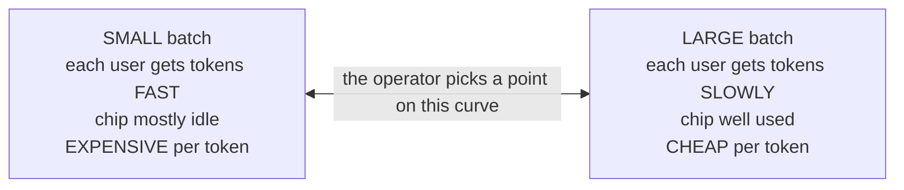
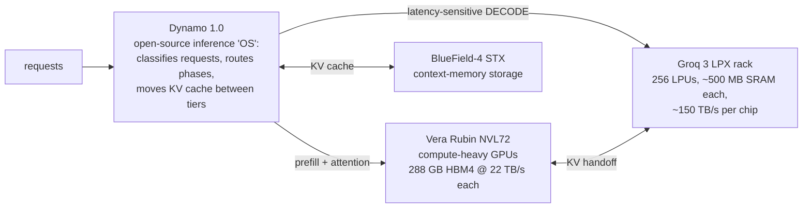
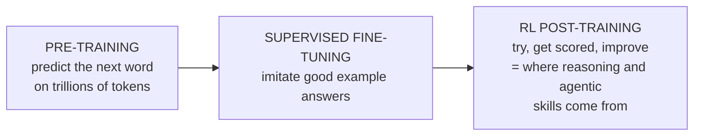
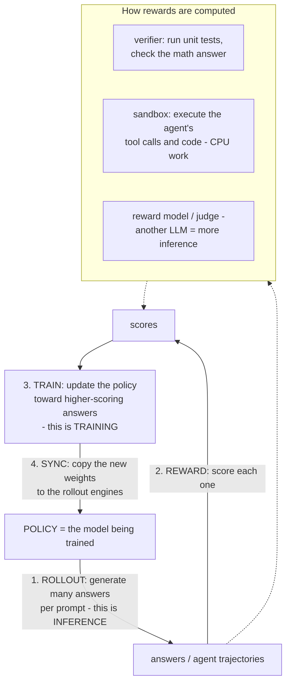
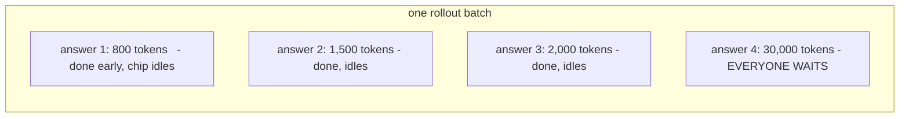
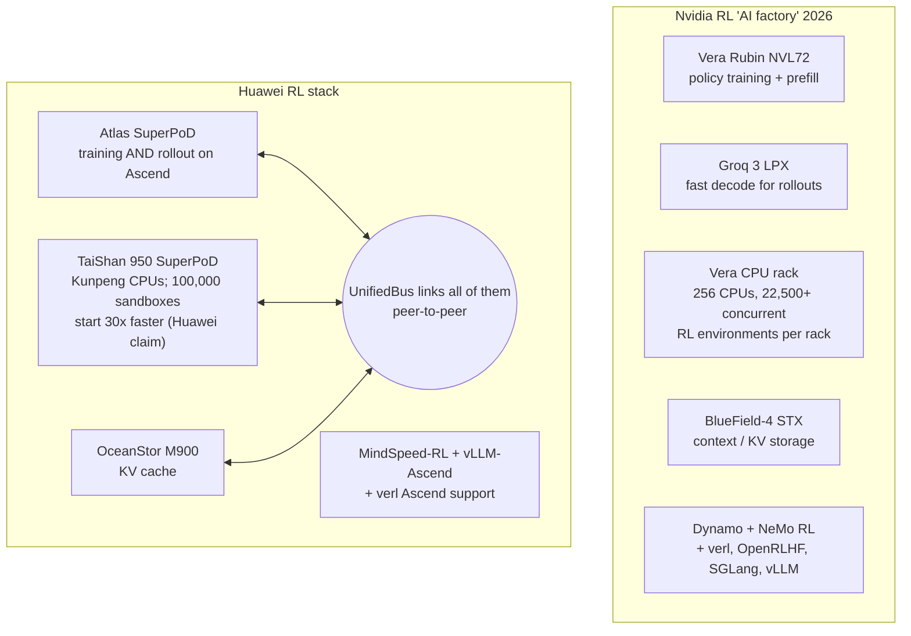

# 10. LLM inference and RL post-training — what they need, and where Huawei falls short

> **Goal of this chapter.** Explain from scratch how serving an LLM and doing reinforcement-learning (RL) post-training actually work, derive what hardware each one needs, then map Nvidia's and Huawei's offerings onto those needs. The result is a concrete list of what the SuperPoD has, what it lacks, and how much each gap matters.
>
> Builds on chapter 4 §4.6 (prefill vs decode, memory-bound) and chapter 6 (scale-up, all-to-all). Re-read those if needed.

---

## Part A — LLM inference

### 10.1 The two numbers users feel

When you use a chatbot, two delays matter:

| Metric | Phase | Bound by | Typical target |
|---|---|---|---|
| **TTFT** (time to first token) | prefill | **compute** | under 1–2 s |
| **TPOT** (time per output token) | decode | **memory bandwidth + communication latency** | 10–50 ms → 20–100 tokens/s per user |
| **Throughput** (tokens/s per chip) | both | how many users you batch together | as high as possible — this sets **cost per token** |

### 10.2 The central trade-off: throughput vs interactivity

Batching many users together makes each weight read serve more tokens (chapter 4 §4.6), which raises throughput and cuts cost. But a bigger batch makes each step slower, so each individual user waits longer.

Every inference system is judged on this curve: **how many tokens per second per chip can you serve *while* keeping each user above some speed?** Huawei's own CloudMatrix-384 serving paper (DeepSeek-R1, INT8) reports exactly this:

| Constraint | Throughput per NPU | Speed per user |
|---|---|---|
| TPOT < 50 ms | **1,943 tokens/s** | ≥ 20 tokens/s |
| TPOT < 15 ms (strict) | **538 tokens/s** | ≈ 67 tokens/s |

Tighten the per-user speed requirement by ~3× and throughput falls by ~3.6×. That's the trade-off in real numbers.

### 10.3 Why reasoning models and agents make it harder

- **Reasoning models** "think" before answering, generating thousands to tens of thousands of hidden tokens. Decode — the memory-bound phase — becomes almost all of the work.
- **Agents** run loops: think → call a tool → read the result → think again. Each turn waits on the previous one, so **per-user speed (TPOT) directly sets how long a task takes.** An agent that needs 50 steps of 2,000 tokens each takes ~25 minutes at 67 tokens/s, versus ~2 minutes at 1,000 tokens/s.
- **Long contexts** make the **KV cache** huge (chapter 5 §5.5), and multi-turn agents re-use the same context over and over, so storing and re-fetching KV cache becomes a first-class problem.

So the industry's inference priority has shifted from "cheapest tokens" toward **"fast tokens per user at acceptable cost."**

### 10.4 What inference hardware needs

| Need | Why | Hardware feature |
|---|---|---|
| **High memory bandwidth** | decode reads all active weights + KV cache for every token | HBM bandwidth — or SRAM |
| **Low-latency scale-up** | a Mixture-of-Experts (MoE) model does two all-to-all exchanges **in every layer** during decode; ~60 layers × 2 × several µs each adds up to milliseconds per token | small, fast, switched scale-up domain |
| **Large scale-up domain** | huge MoE models need expert parallelism across hundreds of chips | many chips in one domain |
| **Big, tiered memory** | KV cache for long contexts and many users | HBM + pooled memory + KV storage tier |
| **Separate prefill and decode pools** | opposite bottlenecks (compute vs bandwidth) | disaggregated serving, possibly different chips |
| **Low-precision formats** | fewer bytes per weight = faster decode | FP8 / FP4 support with good accuracy |
| **Mature serving software** | batching, routing, KV management, speculative decoding, kernels for every new attention variant | Dynamo / vLLM / SGLang / TensorRT-LLM-class stack |

### 10.5 Nvidia's 2026 inference answer: specialize every phase

At GTC 2026, Nvidia stopped treating inference as one workload and built a **different box for each phase**, tied together by one piece of software:

**The Groq 3 LPX is the key piece.** It came from Nvidia's licensing deal with Groq (reported at about $20 billion). Instead of HBM, each LPU keeps weights in **on-chip SRAM** (~500 MB per chip, 128 GB across a 256-chip rack) at **~150 TB/s per chip** — roughly **7× Rubin's HBM bandwidth and ~37× the Ascend 950DT's**. A model's weights are spread across many LPUs' SRAM, so every decode step reads at SRAM speed. The result is very high **per-user** token speed — exactly what reasoning models and agents need (§10.3).

### 10.6 Huawei's inference answer

Huawei has a real, published inference stack. It's worth being precise about what it has:

| Capability | Huawei | Nvidia equivalent |
|---|---|---|
| Prefill/decode disaggregation (software) | **CloudMatrix-Infer**: peer-to-peer serving that scales prefill, decode and caching independently | Dynamo |
| Prefill/decode split (hardware) | **Ascend 950PR vs 950DT** — same compute die, different HBM | Rubin NVL72 + Groq LPX (fundamentally different chips) |
| Huge expert parallelism in one fast domain | **EP320** on CloudMatrix 384 over UB | NVL72 domain is 72 GPUs; beyond that, traffic crosses the slower scale-out network |
| KV-cache management | **UCM (Unified Cache Manager)**, open source, integrates with vLLM; claims 3–10× latency cuts in multi-turn and long-context | Dynamo KV routing + NIXL + LMCache |
| KV-cache storage tier | **OceanStor M900** (PB-scale) | BlueField-4 STX |
| PyTorch-ecosystem serving | vLLM-Ascend | vLLM, SGLang, TensorRT-LLM (CUDA-first) |
| Dedicated low-latency decode silicon | **none** | **Groq 3 LPX** |

**Where Huawei is genuinely strong: MoE expert parallelism.** A trillion-parameter MoE model spreads its experts across hundreds of chips, and every decode step does an all-to-all among them. Huawei can keep **320+ chips in one low-latency UB domain**, whereas on NVL72 an expert-parallel group larger than 72 GPUs has to cross the slower scale-out network. For very large MoE models, that's a real architectural advantage — one reason DeepSeek-style models run credibly on Ascend.

### 10.7 Inference gaps

| # | Gap | Severity | Fixed by Huawei's roadmap? |
|---|---|---|---|
| 1 | **No dedicated low-latency decode hardware.** Nothing like an SRAM-based LPX. Per-user speed is capped by 4 TB/s HBM. Huawei's own paper shows ~67 tokens/s per user under a 15 ms TPOT budget, at a large throughput cost. | **High** for reasoning and agentic inference | No announced decode-specialized part. The 960/970 raise bandwidth, but it's HBM, not SRAM. |
| 2 | **~5.5× lower HBM bandwidth per chip** than Rubin/MI455X — directly sets decode speed and cost per token | **High** | Partly: the 960 doubles bandwidth, the 970 adds ≥1.5× more — but Nvidia also moves on. |
| 3 | **Low-precision maturity.** Nvidia runs NVFP4 in production inference; Huawei adds MXFP4 on the 950 (2026) and HiF4 on the 960 (2027). | Medium | Yes, over 2026–27. |
| 4 | **Software maturity and day-0 model support.** New attention variants, speculative-decoding methods and serving features usually appear on CUDA first. | Medium–high | Improving (CANN opening, vLLM-Ascend), but slowest to close. |
| 5 | **Tokens per watt.** More chips and more optics per token. No independent numbers exist for the Atlas 950. | Medium (power is cheap in China) | NPO (960E) targets exactly this. |
| 6 | **Independent benchmarks.** Very little third-party data; most figures are Huawei's own. | Medium, for anyone evaluating it | — |

---

## Part B — RL post-training

### 10.8 What RL post-training is

A model is built in stages:

Since 2024–25, **RL post-training** has become a major share of total compute for frontier models, because it's how models learn to reason, write working code and use tools. Popular algorithms include **PPO** and **GRPO** (the one DeepSeek-R1 used).

### 10.9 The RL loop

**RL mixes three very different workloads in one tight loop**:

| Stage | Workload type | Hardware bottleneck |
|---|---|---|
| **Rollout** | LLM **inference**, decode-heavy, very long outputs | memory bandwidth, per-user decode speed |
| **Reward / environment** | **CPU** sandboxes, code execution, tool calls; or judge-model inference | CPU cores, fast sandbox startup, memory |
| **Training** | normal **training** | compute, training interconnect |
| **Weight sync** | move hundreds of GB – TBs of new weights every step | scale-up / network bandwidth |

### 10.10 Why RL is hard on hardware

**1. Rollout usually dominates the time.** Generating long reasoning traces is decode, which is memory-bound (chapter 4). In reasoning-focused RL, rollout is commonly the majority of each step's wall-clock time.

**2. The long tail.** A batch of rollouts produces answers of very different lengths, and a synchronous step can't finish until the **longest** one does:

The whole cluster runs at the speed of the slowest single sequence, which is limited by **per-sequence decode speed** — the same metric as §10.3. Fast single-stream decode (SRAM-based chips, high HBM bandwidth) directly cuts RL step time. The other fix is **asynchronous RL** — start training on finished rollouts while stragglers continue — which trades some "on-policy-ness" for speed.

**3. Environments are CPU work.** Agentic and coding RL needs **thousands of isolated sandboxes** running code and tools in parallel. That's why both vendors now sell a CPU product aimed at RL.

**4. Weight sync is big and frequent.** After every update, new weights must reach every rollout engine. Two designs:
- **Co-located**: the same chips switch between training and inference modes (e.g. verl's HybridEngine). No cross-cluster copy, but the weights must be **resharded** between the training layout and the inference layout, and memory must hold both.
- **Disaggregated**: separate training and rollout clusters, with a fast broadcast between them.

Either way, a big, fast scale-up domain helps.

**5. Training–inference numerical mismatch.** The rollout engine (e.g. vLLM with its own fast kernels) and the training engine (e.g. Megatron) compute *slightly different* probabilities for the same tokens, because of different kernels, precisions and reduction orders. RL treats those probabilities as ground truth, so the mismatch quietly makes training **off-policy** and can destabilize it. Mitigations: importance-sampling corrections, matching precisions between the two engines, deterministic kernels. This affects every platform, but it's harder when:
- the rollout and training stacks are **less mature or less aligned**, and
- **custom number formats** (e.g. HiF8 in one engine, BF16 in the other) widen the numeric gap.

### 10.11 RL products side by side

| RL need | Nvidia | Huawei | Assessment |
|---|---|---|---|
| Training the policy | Rubin NVL72 | Atlas SuperPoD (950DT) | Nvidia far ahead per chip; Huawei relies on scale |
| **Fast rollout decode** | **Groq 3 LPX** + 22 TB/s HBM | 950DT/960 HBM only (4 TB/s → ~8 TB/s) | **Huawei's biggest RL gap** — the long tail (§10.10) makes this doubly costly |
| **RL environments (CPU)** | Vera CPU rack, 22,500+ environments per rack | TaiShan 950 SuperPoD, 4,096 nodes, fast sandbox start | **Rough parity in concept.** Both vendors saw the same need. |
| KV / context storage | BlueField-4 STX | OceanStor M900 + UCM | Parity in concept |
| **One fabric linking CPU, NPU, storage** | separate products connected over networking | **UnifiedBus peer-to-peer across all of them** | **Potential Huawei advantage**: lower-latency policy ↔ environment ↔ KV traffic — if the claims hold up |
| Weight sync / resharding | NVLink within 72; network beyond | large UB domain | Huawei's large domain helps co-located designs |
| RL frameworks | NeMo RL, verl, OpenRLHF, SkyRL, slime — CUDA-first | **MindSpeed-RL** (official, Megatron-based; reports 1.42–3.97× over baselines and 81 % scaling linearity on 192 NPUs vs 40 % for verl), verl with Ascend support | New RL algorithms and tricks usually land on CUDA first |
| Low-precision RL | FP8/NVFP4 training maturing on Blackwell/Rubin | FP8/HiF8/MXFP4 on 950 | Huawei's custom formats add mismatch risk (§10.10) |

---

## 10.12 Direct answer: what does the SuperPoD lack?

Putting both halves together, here's what Huawei's SuperPoD **doesn't have that competitors already ship or have announced**, ranked by how much it matters for modern LLM inference and RL:

1. **Dedicated fast-decode silicon.** Nvidia now pairs its GPUs with SRAM-based Groq LPUs specifically for decode. Huawei's 950PR/950DT split changes the *memory type*, not the *memory tier*. It has nothing SRAM-class. For reasoning models, agents and RL rollouts — all dominated by per-user decode speed and long tails — this is the most consequential gap.
2. **Per-chip memory bandwidth.** ~4 TB/s vs ~22 TB/s. Scale can make up for it on *throughput* (add more chips) but **not on per-user latency** — you can't make one sequence decode faster by adding chips beyond what parallelism allows.
3. **Being first to a thousand-chip optical pod.** Google has run optically-switched pods of thousands of chips since around 2021, and Ironwood's 9,216-chip pod has ~5× the FP8 compute of an Atlas 950 SuperPoD. The SuperPoD's scale is impressive but not unprecedented.
4. **Production FP4.** Nvidia is already on NVFP4 in production; Huawei's FP4 path arrives over 2026–27 (MXFP4, then HiF4).
5. **Software depth and day-0 support**, for both serving (Dynamo/SGLang/TensorRT-LLM) and RL (the CUDA-first RL framework ecosystem).
6. **Efficiency and independent validation.** Tokens per watt and per m², and third-party benchmarks.

And what it **has that others don't** (or not at this scale):

1. **The largest fully-switched scale-up domain as a merchant product** — very good for giant MoE expert parallelism (EP320 already demonstrated).
2. **One protocol connecting NPUs, CPUs, KV storage and memory pools peer-to-peer** — a cleaner story for RL and agentic systems than several separately-networked racks, *if* the latency claims hold.
3. **Near-packaged optics in mass production** (Atlas 960E) for scale-up.
4. **Availability in China**, where Nvidia's leading parts can't be bought.

**One-line verdict**: *For high-throughput, cost-sensitive inference of large MoE models in China, the SuperPoD is credible and in some respects architecturally ahead. For latency-critical inference — reasoning, agents, and the rollout phase of RL — Nvidia's 2026 stack (22 TB/s HBM, Groq LPX decode, Vera CPU racks, Dynamo) has a structural lead that Huawei's roadmap doesn't yet address directly.*

---

## 10.13 Check your understanding

1. Why does per-user decode speed matter more for agents than for a simple chatbot?
   > Agents run many sequential think→act turns; each waits on the previous, so total task time scales with tokens ÷ per-user speed.
2. What do TTFT and TPOT measure, and which phase bounds each?
   > Time to first token (prefill, compute-bound) and time per output token (decode, bandwidth- and latency-bound).
3. Why can Huawei make up for weak chips on throughput but not on per-user latency?
   > Throughput scales by adding chips and batching; one sequence's decode speed is limited by bandwidth per step and communication latency, which more chips don't fix.
4. What are the four stages of the RL loop, and which one usually dominates?
   > Rollout, reward/environment, training, weight sync. Rollout (decode-heavy inference) usually dominates.
5. What is the long-tail problem in RL rollouts?
   > A synchronous step waits for the longest generation; the cluster idles on stragglers, so per-sequence decode speed sets step time.
6. What is training–inference mismatch, and why could custom formats worsen it?
   > Rollout and training engines compute slightly different token probabilities, making RL silently off-policy. Different number formats between the engines widen that difference.
7. Where is Huawei's architecture genuinely advantaged for MoE inference?
   > It can hold expert-parallel groups of hundreds of chips (EP320) in one low-latency UB domain, where Nvidia's fast domain stops at 72 GPUs.

---

## Sources
- [Serving LLMs on Huawei CloudMatrix384 (arXiv 2506.12708)](https://arxiv.org/abs/2506.12708)
- [Huawei Cloud Model-as-a-Service on CloudMatrix384 (arXiv 2508.02520)](https://arxiv.org/pdf/2508.02520)
- [MindSpeed RL: distributed dataflow for RL training on Ascend (arXiv 2507.19017)](https://arxiv.org/pdf/2507.19017)
- [AsyncFlow: asynchronous streaming RL (arXiv 2507.01663)](https://arxiv.org/pdf/2507.01663)
- [Huawei UCM — Unified Cache Manager (GitHub)](https://github.com/ModelEngine-Group/unified-cache-management) · [UCM launch coverage (Gizmochina)](https://www.gizmochina.com/2025/08/12/huawei-unveils-ucm-memory-management-tool-boosts-ai-inference-speed/)
- [GTC 2026: Rubin, Groq LPUs, Vera CPUs (StorageReview)](https://www.storagereview.com/news/nvidia-gtc-2026-rubin-gpus-groq-lpus-vera-cpus-and-what-nvidia-is-building-for-trillion-parameter-inference)
- [GTC 2026 — the inference kingdom expands (SemiAnalysis)](https://newsletter.semianalysis.com/p/nvidia-the-inference-kingdom-expands)
- [Nvidia Groq 3 LPX, its first non-GPU rack (WinBuzzer)](https://winbuzzer.com/2026/03/17/nvidia-groq-3-lpx-non-gpu-inference-rack-gtc-2026-xcxwbn/)
- [Huawei Connect 2026 keynote — TaiShan 950 SuperPoD, OceanStor M900](https://www.huawei.com/en/news/2026/9/hc-wang-keynote)
