# Chips and AI Hardware — from zero to Huawei's SuperPoDs

A from-scratch course: no prior hardware knowledge assumed. Each chapter builds exactly the concepts the next one needs, so that by chapter 7, statements like *"the Ascend 950DT pairs HiZQ 2.0 HBM with a SIMD+SIMT core, and 4,096 of them form an Atlas 960E SuperPoD over UnifiedBus with near-packaged optics"* make complete sense.

Current as of **Huawei Connect 2026 (17 September 2026)**.

Diagrams are Mermaid — open any file and press `⇧⌘V` in VS Code to see them rendered.

## Chapters

| # | Chapter | You'll learn | Huawei link |
|---|---|---|---|
| 1 | [From a switch to a chip](01-transistors-to-chips.md) | transistors, logic, clocks, power, why CPUs stopped getting faster | why Kunpeng (many cores) and Ascend (specialization) both exist |
| 2 | [How chips are made](02-how-chips-are-made.md) | foundries, lithography, DUV vs EUV, what "7nm" means, yield | **why Huawei's chips are made the way they are** — SMIC, no EUV |
| 3 | [CPUs and Kunpeng](03-cpu-and-kunpeng.md) | ISA, Arm vs x86, cores, caches, threads, NUMA | **Kunpeng 920 → 950 → 960**, TaiShan SuperPoD |
| 4 | [AI chips and the Ascend core](04-ai-chips-and-ascend-core.md) | FLOPS, FP8/FP4, GPU vs NPU, roofline, prefill vs decode | **Da Vinci core, Ascend 910 → 980, 950PR vs 950DT** |
| 5 | [Memory and packaging](05-memory-and-packaging.md) | HBM, TSVs, interposers, chiplets | **Huawei's own HBM (HiBL, HiZQ)**, 910C's two dies |
| 6 | [Interconnect and SuperPoDs](06-interconnect-and-superpods.md) | parallelism, scale-up vs scale-out, copper vs optics | **SuperPoD, UnifiedBus, NPO optics, SuperCluster** |
| 7 | [Huawei — the big picture](07-huawei-big-picture.md) | strategy, software, honest comparison with Nvidia | everything together |
| 9 | [Huawei vs the competition](09-competitors-compared.md) | Nvidia Rubin, Google Ironwood, AWS Trainium3, AMD Helios — chip and system level | **Google built thousand-chip optical pods first**; where Huawei leads and trails |
| 10 | [LLM inference and RL post-training](10-llm-inference-and-rl.md) | TTFT/TPOT, throughput vs interactivity, the RL loop, rollout long tails, weight sync | **what the SuperPoD lacks** for reasoning, agents and RL |
| — | [Glossary](08-glossary.md) | every term, one line each | |

## How to study it

```mermaid
flowchart LR
    C1["1. Switch to chip<br/>~30 min"] --> C2["2. Manufacturing<br/>~40 min"]
    C2 --> C3["3. CPU + Kunpeng<br/>~40 min"]
    C3 --> C4["4. AI chips + Ascend<br/>~60 min - the densest"]
    C4 --> C5["5. Memory<br/>~30 min"]
    C5 --> C6["6. SuperPoDs<br/>~60 min - the core topic"]
    C6 --> C7["7. Big picture<br/>~30 min"]
    C7 --> C9["9. Competitors<br/>~40 min"]
    C9 --> C10["10. Inference + RL<br/>~60 min"]
```

- **Read in order.** Chapter 6 won't make sense without chapters 4 and 5.
- Each chapter ends with **"check your understanding"** questions with answers. Cover the answers and try first.
- Chapter 7 ends with six open questions. If you can answer them aloud without notes, you understand the topic.
- If you're short on time: read **2, 4, 6, 7** — those carry the Huawei story. Add **9 and 10** for the competitive picture and the inference/RL gap analysis.

## The five ideas that explain everything

1. **Performance is limited by power and heat**, not transistor count — which is why the industry moved to many cores and specialized chips (ch. 1).
2. **Without EUV, advanced chips are made with DUV multipatterning**: more steps, lower yield, lower volume. Bigger dies suffer most (ch. 2).
3. **AI is mostly matrix multiplication, and often limited by memory bandwidth rather than compute** — especially LLM decode (ch. 4).
4. **Past a certain scale, the interconnect decides how much of your compute you actually get** (ch. 6).
5. **Huawei's strategy follows from 2 + 4**: weaker individual chips, so use far more of them, connected by a superb (optical) interconnect — trading power and floor space for scale (ch. 7).

## A note on sources

Most Huawei figures are **Huawei's own announcements** (Huawei Connect 2025 and 2026 keynotes). Independent verification of system-level claims — tokens/s, MFU gains, power savings, availability — is limited. The chapters mark vendor claims as such, and chapter 4 §4.8 explains how to compare spec sheets fairly. Each chapter lists its sources at the end.
